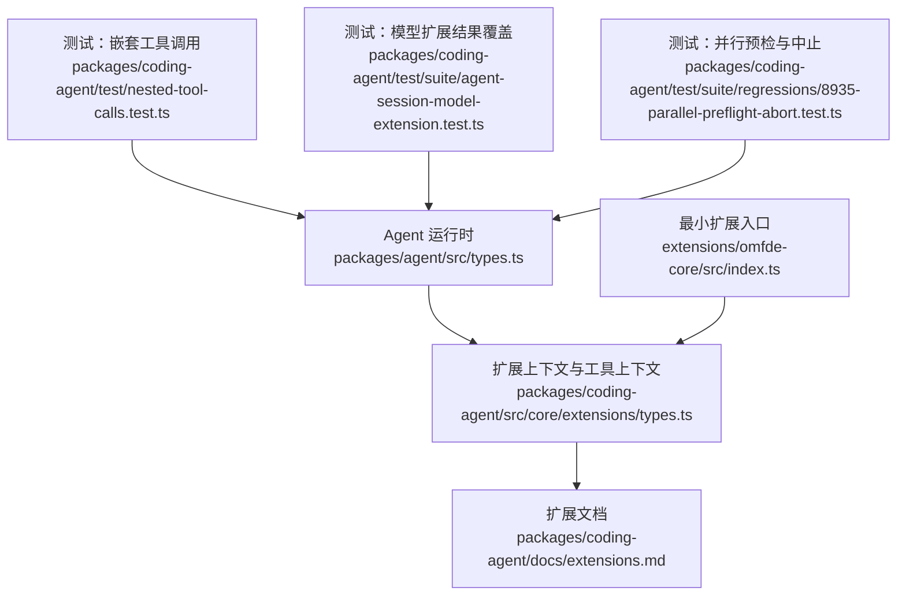
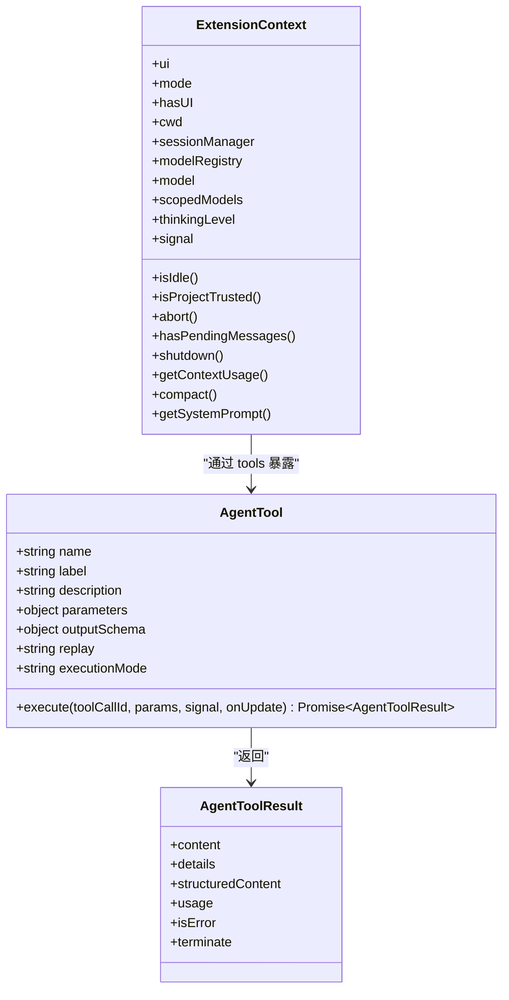
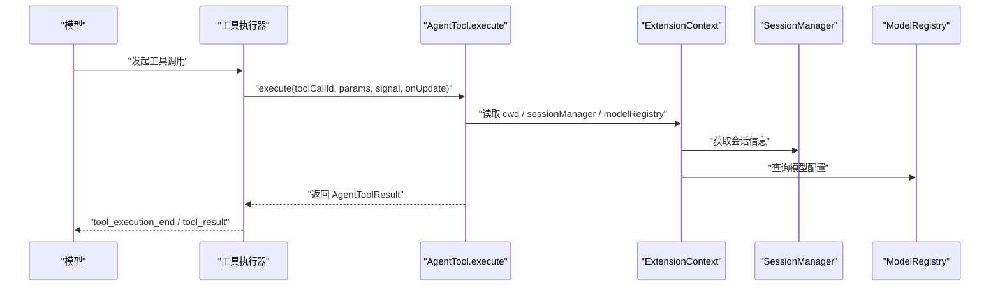
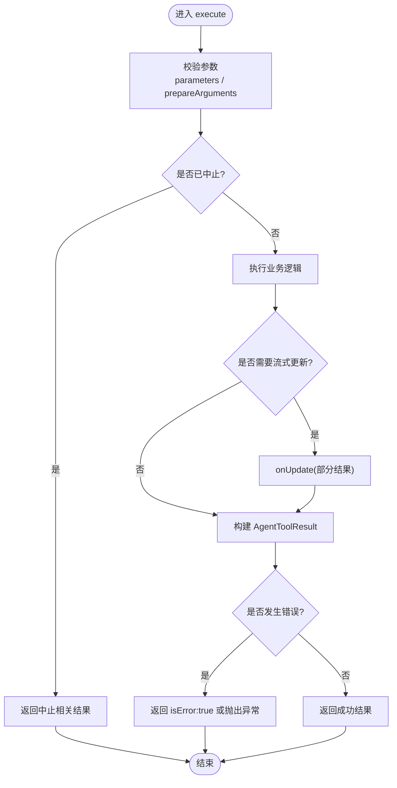
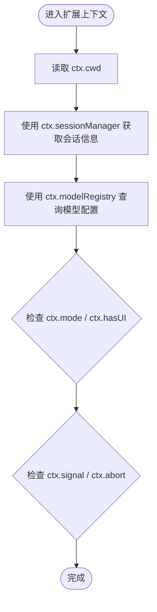
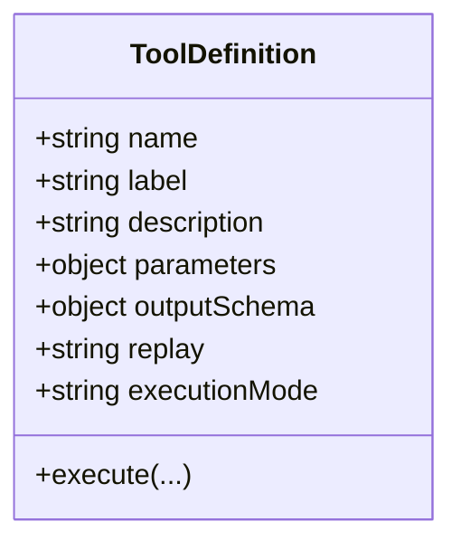
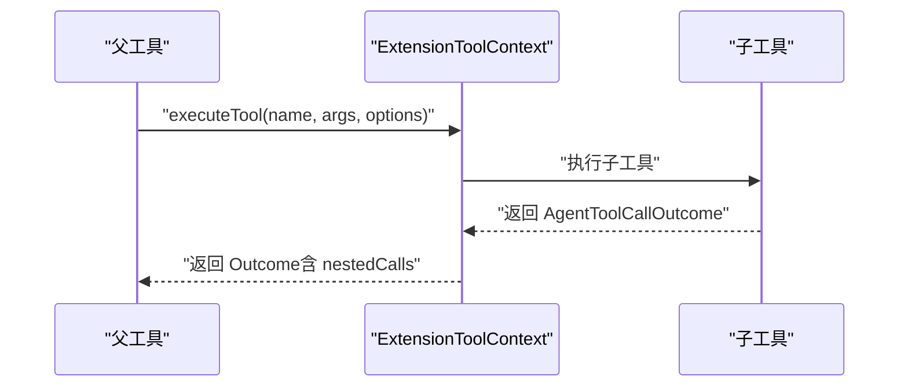
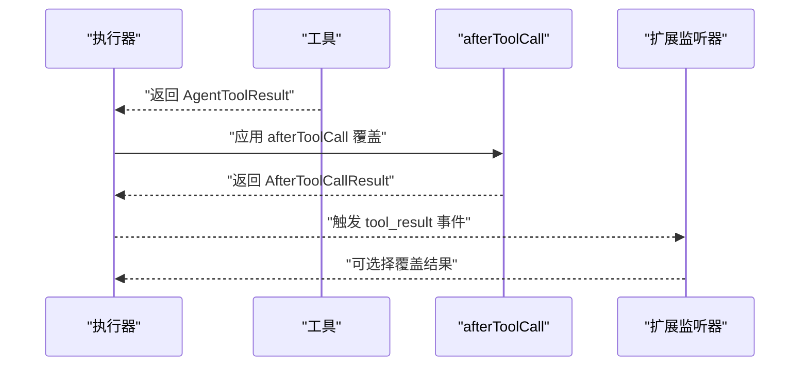
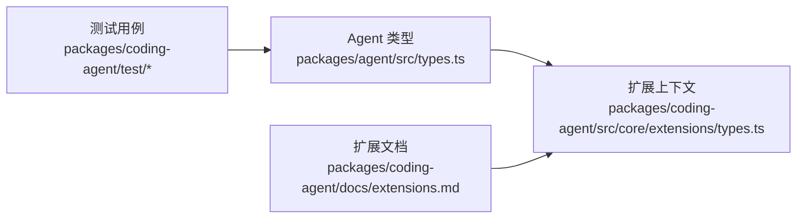

# 基础工具实现模式

**本文引用的文件**
- [packages/agent/src/types.ts](https://github.com/FDE-GROUP/oh-my-fde/blob/main/packages/agent/src/types.ts)
- [packages/coding-agent/src/core/extensions/types.ts](https://github.com/FDE-GROUP/oh-my-fde/blob/main/packages/coding-agent/src/core/extensions/types.ts)
- [packages/coding-agent/docs/extensions.md](https://github.com/FDE-GROUP/oh-my-fde/blob/main/packages/coding-agent/docs/extensions.md)
- [packages/coding-agent/test/nested-tool-calls.test.ts](https://github.com/FDE-GROUP/oh-my-fde/blob/main/packages/coding-agent/test/nested-tool-calls.test.ts)
- [packages/coding-agent/test/suite/agent-session-model-extension.test.ts](https://github.com/FDE-GROUP/oh-my-fde/blob/main/packages/coding-agent/test/suite/agent-session-model-extension.test.ts)
- [packages/coding-agent/test/suite/regressions/8935-parallel-preflight-abort.test.ts](https://github.com/FDE-GROUP/oh-my-fde/blob/main/packages/coding-agent/test/suite/regressions/8935-parallel-preflight-abort.test.ts)
- [extensions/omfde-core/src/index.ts](https://github.com/FDE-GROUP/oh-my-fde/blob/main/extensions/omfde-core/src/index.ts)

## 目录
1. [简介](#简介)
2. [项目结构](#项目结构)
3. [核心组件](#核心组件)
4. [架构总览](#架构总览)
5. [详细组件分析](#详细组件分析)
6. [依赖关系分析](#依赖关系分析)
7. [性能考虑](#性能考虑)
8. [故障排查指南](#故障排查指南)
9. [结论](#结论)

## 简介
本指南面向扩展与工具的开发者，系统说明在 Pi 生态中实现“基础工具”的标准模式。重点包括：
- execute 函数的标准实现模式：参数校验、异步处理、错误处理、结果返回格式、流式更新。
- ExtensionContext 的基本用法：cwd、sessionManager、modelRegistry 等核心属性。
- 工具定义的标准结构：name、label、description、parameters、outputSchema 等字段。
- 只读工具与文件操作工具的完整实现示例与最佳实践。
- 性能优化建议：大文件流式处理、内存管理与资源清理。

## 项目结构
仓库中与工具与上下文相关的核心代码集中在以下位置：
- Agent 运行时类型与工具契约：packages/agent/src/types.ts
- 扩展上下文与工具执行上下文：packages/coding-agent/src/core/extensions/types.ts
- 扩展文档与上下文使用示例：packages/coding-agent/docs/extensions.md
- 测试用例展示工具调用、嵌套调用、中止与结果覆盖：packages/coding-agent/test/*
- 最小扩展入口示例：extensions/omfde-core/src/index.ts

图表来源
- [packages/agent/src/types.ts:474-511](https://github.com/FDE-GROUP/oh-my-fde/blob/main/packages/agent/src/types.ts#L474-L511)
- [packages/coding-agent/src/core/extensions/types.ts:345-415](https://github.com/FDE-GROUP/oh-my-fde/blob/main/packages/coding-agent/src/core/extensions/types.ts#L345-L415)
- [packages/coding-agent/docs/extensions.md:1179-1220](https://github.com/FDE-GROUP/oh-my-fde/blob/main/packages/coding-agent/docs/extensions.md#L1179-L1220)
- [packages/coding-agent/test/nested-tool-calls.test.ts:24-50](https://github.com/FDE-GROUP/oh-my-fde/blob/main/packages/coding-agent/test/nested-tool-calls.test.ts#L24-L50)
- [packages/coding-agent/test/suite/agent-session-model-extension.test.ts:315-359](https://github.com/FDE-GROUP/oh-my-fde/blob/main/packages/coding-agent/test/suite/agent-session-model-extension.test.ts#L315-L359)
- [packages/coding-agent/test/suite/regressions/8935-parallel-preflight-abort.test.ts:55-72](https://github.com/FDE-GROUP/oh-my-fde/blob/main/packages/coding-agent/test/suite/regressions/8935-parallel-preflight-abort.test.ts#L55-L72)
- [extensions/omfde-core/src/index.ts:1-20](https://github.com/FDE-GROUP/oh-my-fde/blob/main/extensions/omfde-core/src/index.ts#L1-L20)

章节来源
- [packages/agent/src/types.ts:474-511](https://github.com/FDE-GROUP/oh-my-fde/blob/main/packages/agent/src/types.ts#L474-L511)
- [packages/coding-agent/src/core/extensions/types.ts:345-415](https://github.com/FDE-GROUP/oh-my-fde/blob/main/packages/coding-agent/src/core/extensions/types.ts#L345-L415)
- [packages/coding-agent/docs/extensions.md:1179-1220](https://github.com/FDE-GROUP/oh-my-fde/blob/main/packages/coding-agent/docs/extensions.md#L1179-L1220)
- [extensions/omfde-core/src/index.ts:1-20](https://github.com/FDE-GROUP/oh-my-fde/blob/main/extensions/omfde-core/src/index.ts#L1-L20)

## 核心组件
本节聚焦三类关键对象：AgentTool（工具定义）、AgentToolResult（工具结果）、ExtensionContext（扩展上下文）。

- AgentTool：描述工具的名称、标签、描述、参数 Schema、输出 Schema、执行函数、回放策略、执行模式等。
- AgentToolResult：描述工具最终或部分结果，包含内容、详情、结构化内容、用量、错误标志、终止提示等。
- ExtensionContext：扩展运行时的上下文，提供 UI、模式、工作目录、会话管理器、模型注册表、当前模型、受限模型列表、思考级别、空闲状态、项目信任、中止信号、消息队列、关闭、上下文用量、压缩、系统提示等方法。

图表来源
- [packages/agent/src/types.ts:474-511](https://github.com/FDE-GROUP/oh-my-fde/blob/main/packages/agent/src/types.ts#L474-L511)
- [packages/agent/src/types.ts:423-446](https://github.com/FDE-GROUP/oh-my-fde/blob/main/packages/agent/src/types.ts#L423-L446)
- [packages/coding-agent/src/core/extensions/types.ts:345-385](https://github.com/FDE-GROUP/oh-my-fde/blob/main/packages/coding-agent/src/core/extensions/types.ts#L345-L385)

章节来源
- [packages/agent/src/types.ts:423-446](https://github.com/FDE-GROUP/oh-my-fde/blob/main/packages/agent/src/types.ts#L423-L446)
- [packages/agent/src/types.ts:474-511](https://github.com/FDE-GROUP/oh-my-fde/blob/main/packages/agent/src/types.ts#L474-L511)
- [packages/coding-agent/src/core/extensions/types.ts:345-385](https://github.com/FDE-GROUP/oh-my-fde/blob/main/packages/coding-agent/src/core/extensions/types.ts#L345-L385)

## 架构总览
下图展示了从模型侧发起工具调用到工具执行、结果回传、以及扩展上下文参与的整体流程。

图表来源
- [packages/agent/src/types.ts:474-511](https://github.com/FDE-GROUP/oh-my-fde/blob/main/packages/agent/src/types.ts#L474-L511)
- [packages/coding-agent/src/core/extensions/types.ts:345-415](https://github.com/FDE-GROUP/oh-my-fde/blob/main/packages/coding-agent/src/core/extensions/types.ts#L345-L415)
- [packages/coding-agent/docs/extensions.md:1179-1220](https://github.com/FDE-GROUP/oh-my-fde/blob/main/packages/coding-agent/docs/extensions.md#L1179-L1220)

## 详细组件分析

### execute 函数的标准实现模式
标准模式要点：
- 参数验证：优先依赖 parameters JSON Schema 的自动校验；如需兼容旧参数，可使用 prepareArguments 做前置转换。
- 异步处理：execute 必须返回 Promise；支持 AbortSignal 以响应取消；必要时使用 onUpdate 推送部分结果。
- 错误处理：失败时抛出异常或返回 isError: true 的结果；不要仅在 content 中描述错误。
- 结果返回：返回 AgentToolResult，包含 content、details、可选 structuredContent、可选 usage、可选 terminate。
- 流式更新：对耗时任务，周期性调用 onUpdate 推送部分结果，提升交互体验。

图表来源
- [packages/agent/src/types.ts:474-511](https://github.com/FDE-GROUP/oh-my-fde/blob/main/packages/agent/src/types.ts#L474-L511)
- [packages/agent/src/types.ts:423-446](https://github.com/FDE-GROUP/oh-my-fde/blob/main/packages/agent/src/types.ts#L423-L446)
- [packages/coding-agent/test/nested-tool-calls.test.ts:24-50](https://github.com/FDE-GROUP/oh-my-fde/blob/main/packages/coding-agent/test/nested-tool-calls.test.ts#L24-L50)

章节来源
- [packages/agent/src/types.ts:474-511](https://github.com/FDE-GROUP/oh-my-fde/blob/main/packages/agent/src/types.ts#L474-L511)
- [packages/agent/src/types.ts:423-446](https://github.com/FDE-GROUP/oh-my-fde/blob/main/packages/agent/src/types.ts#L423-L446)
- [packages/coding-agent/test/nested-tool-calls.test.ts:24-50](https://github.com/FDE-GROUP/oh-my-fde/blob/main/packages/coding-agent/test/nested-tool-calls.test.ts#L24-L50)

### ExtensionContext 基本使用方法
- cwd：当前工作目录，用于解析相对路径。
- sessionManager：会话管理器，提供会话条目、分支、叶子节点、会话文件等信息。
- modelRegistry：模型注册表，用于查询 provider、认证、模型能力等。
- mode / hasUI：运行模式与 UI 可用性判断。
- isIdle / hasPendingMessages：会话空闲与待处理消息状态。
- signal / abort：中止信号与控制。
- isProjectTrusted：项目本地信任状态。
- getContextUsage / compact / getSystemPrompt：上下文用量、压缩、系统提示。

图表来源
- [packages/coding-agent/src/core/extensions/types.ts:345-385](https://github.com/FDE-GROUP/oh-my-fde/blob/main/packages/coding-agent/src/core/extensions/types.ts#L345-L385)
- [packages/coding-agent/docs/extensions.md:1179-1220](https://github.com/FDE-GROUP/oh-my-fde/blob/main/packages/coding-agent/docs/extensions.md#L1179-L1220)

章节来源
- [packages/coding-agent/src/core/extensions/types.ts:345-385](https://github.com/FDE-GROUP/oh-my-fde/blob/main/packages/coding-agent/src/core/extensions/types.ts#L345-L385)
- [packages/coding-agent/docs/extensions.md:1179-1220](https://github.com/FDE-GROUP/oh-my-fde/blob/main/packages/coding-agent/docs/extensions.md#L1179-L1220)

### 工具定义的标准结构
标准字段说明：
- name：工具唯一名称。
- label：人类可读标签，用于 UI。
- description：工具描述，帮助模型理解用途。
- parameters：JSON Schema，描述输入参数；可配合 TypeBox 或 pi-schema 构建以获得类型安全。
- outputSchema：结构化输出 Schema，供程序化调用方使用。
- execute：执行函数，遵循标准模式。
- replay：恢复策略（never | safe）。
- executionMode：执行模式（sequential | parallel），控制并发行为。

图表来源
- [packages/agent/src/types.ts:474-511](https://github.com/FDE-GROUP/oh-my-fde/blob/main/packages/agent/src/types.ts#L474-L511)

章节来源
- [packages/agent/src/types.ts:474-511](https://github.com/FDE-GROUP/oh-my-fde/blob/main/packages/agent/src/types.ts#L474-L511)

### 只读工具实现示例（最佳实践）
只读工具应：
- 明确声明 parameters 为空对象或必要只读参数。
- 不修改文件系统或外部状态。
- 返回结构化 content 与 details，便于 UI 渲染与日志记录。
- 若需要结构化数据，声明 outputSchema 并始终设置 structuredContent。

参考路径：
- [packages/coding-agent/test/nested-tool-calls.test.ts:53-65](https://github.com/FDE-GROUP/oh-my-fde/blob/main/packages/coding-agent/test/nested-tool-calls.test.ts#L53-L65)

章节来源
- [packages/coding-agent/test/nested-tool-calls.test.ts:53-65](https://github.com/FDE-GROUP/oh-my-fde/blob/main/packages/coding-agent/test/nested-tool-calls.test.ts#L53-L65)

### 文件操作工具实现示例（最佳实践）
文件操作工具应：
- 基于 ctx.cwd 解析目标路径，避免硬编码绝对路径。
- 使用 ctx.sessionManager 获取会话相关信息，如会话目录、会话 ID 等。
- 使用 ctx.modelRegistry 查询模型配置，以便根据模型能力调整输出。
- 对大文件进行流式读取，避免一次性加载到内存。
- 正确处理错误与中止信号，确保资源释放。

参考路径：
- [packages/coding-agent/docs/extensions.md:1179-1220](https://github.com/FDE-GROUP/oh-my-fde/blob/main/packages/coding-agent/docs/extensions.md#L1179-L1220)

章节来源
- [packages/coding-agent/docs/extensions.md:1179-1220](https://github.com/FDE-GROUP/oh-my-fde/blob/main/packages/coding-agent/docs/extensions.md#L1179-L1220)

### 嵌套工具调用与事件
- 工具可通过 ctx.executeTool 调用其他工具，获得相同校验、钩子与权限检查。
- 嵌套调用的事件携带 parentToolCallId，不会出现在对话转录中，但会记录在调用方的结构化结果中。
- 嵌套调用不会拒绝失败：未知工具、校验错误、被阻止或抛出的错误都会以 isError: true 返回。

图表来源
- [packages/coding-agent/src/core/extensions/types.ts:387-415](https://github.com/FDE-GROUP/oh-my-fde/blob/main/packages/coding-agent/src/core/extensions/types.ts#L387-L415)

章节来源
- [packages/coding-agent/src/core/extensions/types.ts:387-415](https://github.com/FDE-GROUP/oh-my-fde/blob/main/packages/coding-agent/src/core/extensions/types.ts#L387-L415)

### 结果覆盖与扩展钩子
- afterToolCall 钩子可以替换 content、details、isError、usage、terminate、structuredContent。
- 未提供的字段保留原值，不进行深度合并。
- 扩展可以通过 tool_result 事件监听并修改结果。

图表来源
- [packages/agent/src/types.ts:76-104](https://github.com/FDE-GROUP/oh-my-fde/blob/main/packages/agent/src/types.ts#L76-L104)
- [packages/coding-agent/test/suite/agent-session-model-extension.test.ts:315-359](https://github.com/FDE-GROUP/oh-my-fde/blob/main/packages/coding-agent/test/suite/agent-session-model-extension.test.ts#L315-L359)

章节来源
- [packages/agent/src/types.ts:76-104](https://github.com/FDE-GROUP/oh-my-fde/blob/main/packages/agent/src/types.ts#L76-L104)
- [packages/coding-agent/test/suite/agent-session-model-extension.test.ts:315-359](https://github.com/FDE-GROUP/oh-my-fde/blob/main/packages/coding-agent/test/suite/agent-session-model-extension.test.ts#L315-L359)

### 最小扩展入口示例
- 扩展通过 registerCommand 注册命令，并在 handler 中使用 ctx.ui.notify 进行用户交互。
- 该示例展示了扩展加载探针的最小形态。

参考路径：
- [extensions/omfde-core/src/index.ts:1-20](https://github.com/FDE-GROUP/oh-my-fde/blob/main/extensions/omfde-core/src/index.ts#L1-L20)

章节来源
- [extensions/omfde-core/src/index.ts:1-20](https://github.com/FDE-GROUP/oh-my-fde/blob/main/extensions/omfde-core/src/index.ts#L1-L20)

## 依赖关系分析
- AgentTool 与 AgentToolResult 由 Agent 运行时定义，作为工具契约的核心。
- ExtensionContext 由扩展框架提供，封装了 UI、会话、模型等运行时能力。
- 测试用例展示了工具执行、嵌套调用、结果覆盖与中止行为，验证了上述契约的实现一致性。

图表来源
- [packages/agent/src/types.ts:474-511](https://github.com/FDE-GROUP/oh-my-fde/blob/main/packages/agent/src/types.ts#L474-L511)
- [packages/coding-agent/src/core/extensions/types.ts:345-415](https://github.com/FDE-GROUP/oh-my-fde/blob/main/packages/coding-agent/src/core/extensions/types.ts#L345-L415)
- [packages/coding-agent/test/nested-tool-calls.test.ts:24-50](https://github.com/FDE-GROUP/oh-my-fde/blob/main/packages/coding-agent/test/nested-tool-calls.test.ts#L24-L50)
- [packages/coding-agent/docs/extensions.md:1179-1220](https://github.com/FDE-GROUP/oh-my-fde/blob/main/packages/coding-agent/docs/extensions.md#L1179-L1220)

章节来源
- [packages/agent/src/types.ts:474-511](https://github.com/FDE-GROUP/oh-my-fde/blob/main/packages/agent/src/types.ts#L474-L511)
- [packages/coding-agent/src/core/extensions/types.ts:345-415](https://github.com/FDE-GROUP/oh-my-fde/blob/main/packages/coding-agent/src/core/extensions/types.ts#L345-L415)
- [packages/coding-agent/test/nested-tool-calls.test.ts:24-50](https://github.com/FDE-GROUP/oh-my-fde/blob/main/packages/coding-agent/test/nested-tool-calls.test.ts#L24-L50)
- [packages/coding-agent/docs/extensions.md:1179-1220](https://github.com/FDE-GROUP/oh-my-fde/blob/main/packages/coding-agent/docs/extensions.md#L1179-L1220)

## 性能考虑
- 流式处理大文件：使用流式读取与 onUpdate 逐步推送部分结果，避免一次性加载大文件导致内存峰值。
- 内存管理：及时释放临时对象与缓冲区；避免在循环中创建大量闭包或缓存大对象。
- 资源清理：在 finally 块中关闭文件句柄、网络连接、进程等资源；尊重 AbortSignal 以快速退出。
- 执行模式选择：对 I/O 密集型工具使用 parallel 提高吞吐；对共享状态或顺序敏感的工具使用 sequential 保证一致性。
- 结构化输出：声明 outputSchema 并使用 structuredContent，减少不必要的文本序列化开销。

[本节为通用指导，不直接分析具体文件]

## 故障排查指南
常见问题与定位方法：
- 工具未找到：检查工具名称与注册方式；确认 activeTools 是否包含该工具。
- 参数校验失败：检查 parameters Schema 是否与传入参数匹配；必要时使用 prepareArguments 做兼容转换。
- 结果被覆盖：检查 afterToolCall 钩子与扩展监听器是否覆盖了 content、details、isError、usage。
- 中止未生效：确保在长时间操作中检查 AbortSignal 并及时返回。
- 并行预检与中止：在并行模式下，兄弟工具调用可能并发执行，注意竞态条件与中止传播。

参考路径：
- [packages/coding-agent/test/suite/regressions/8935-parallel-preflight-abort.test.ts:55-72](https://github.com/FDE-GROUP/oh-my-fde/blob/main/packages/coding-agent/test/suite/regressions/8935-parallel-preflight-abort.test.ts#L55-L72)
- [packages/coding-agent/test/suite/agent-session-model-extension.test.ts:315-359](https://github.com/FDE-GROUP/oh-my-fde/blob/main/packages/coding-agent/test/suite/agent-session-model-extension.test.ts#L315-L359)

章节来源
- [packages/coding-agent/test/suite/regressions/8935-parallel-preflight-abort.test.ts:55-72](https://github.com/FDE-GROUP/oh-my-fde/blob/main/packages/coding-agent/test/suite/regressions/8935-parallel-preflight-abort.test.ts#L55-L72)
- [packages/coding-agent/test/suite/agent-session-model-extension.test.ts:315-359](https://github.com/FDE-GROUP/oh-my-fde/blob/main/packages/coding-agent/test/suite/agent-session-model-extension.test.ts#L315-L359)

## 结论
实现基础工具时，请严格遵循 AgentTool 与 AgentToolResult 的契约，合理使用 ExtensionContext 提供的运行时能力，并通过 parameters 与 outputSchema 建立清晰的输入输出边界。对于耗时与 I/O 密集的操作，采用流式更新与合理的执行模式，确保用户体验与系统稳定性。借助测试用例与文档中的最佳实践，可以避免常见陷阱并提升工具的可维护性与可扩展性。