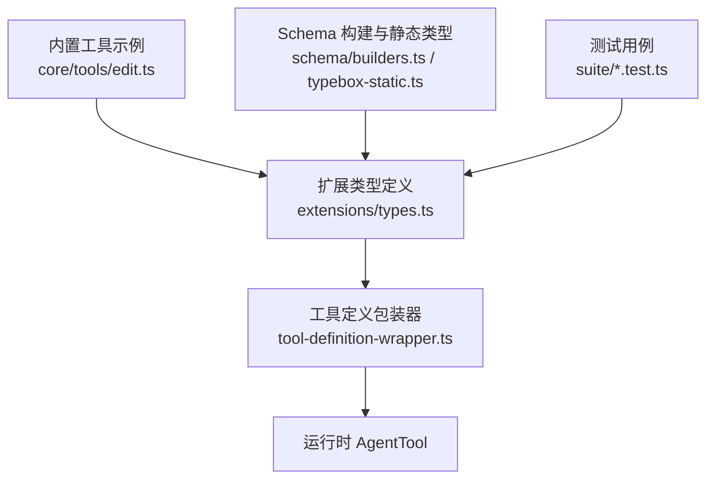
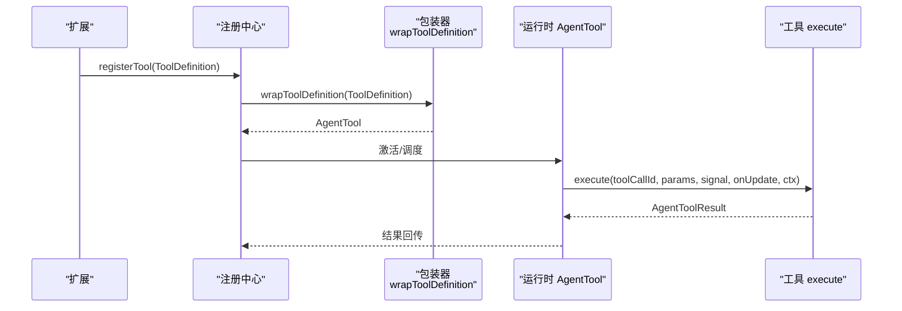
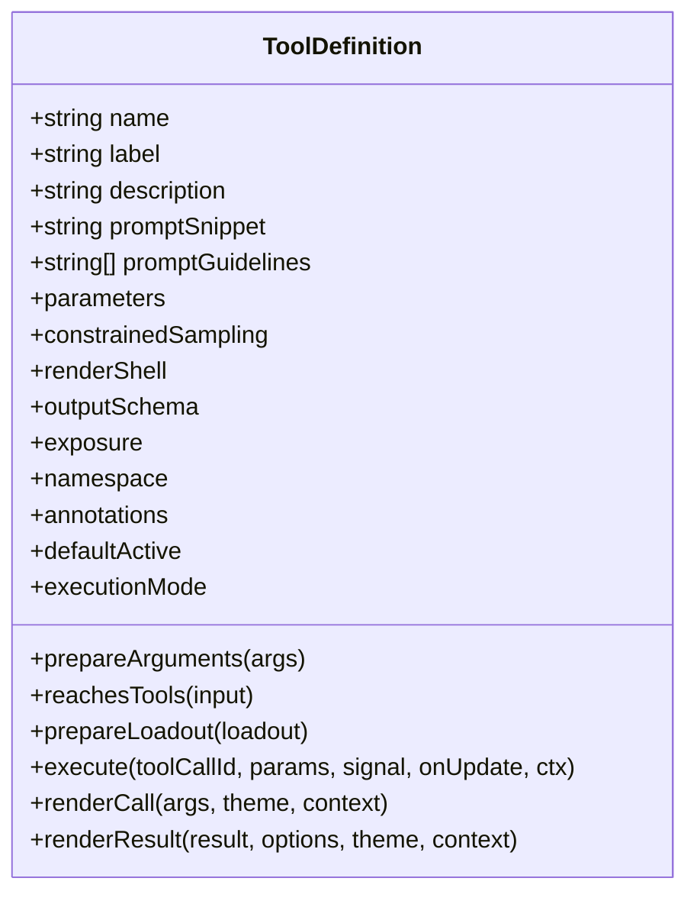
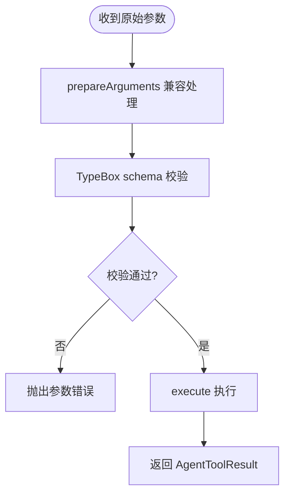
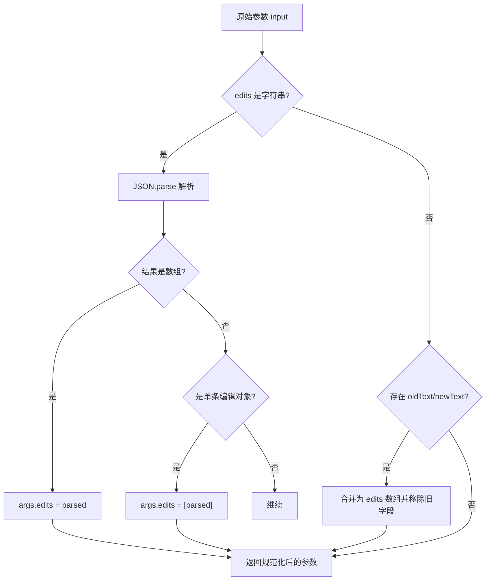
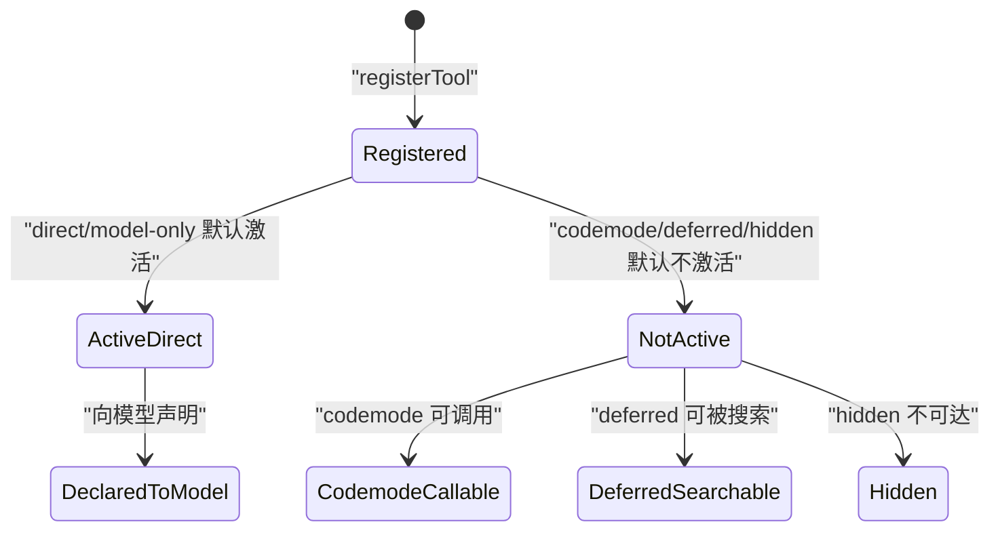
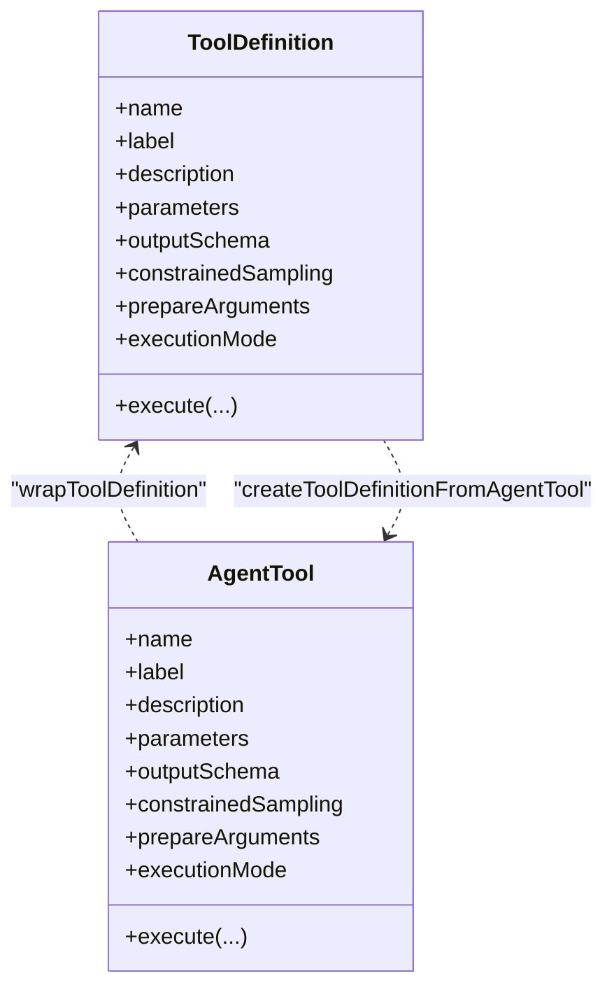
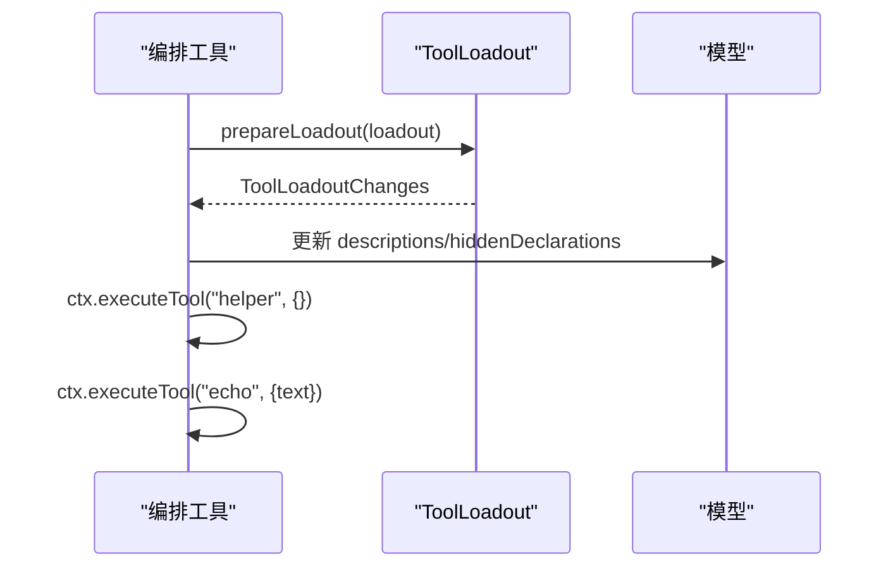
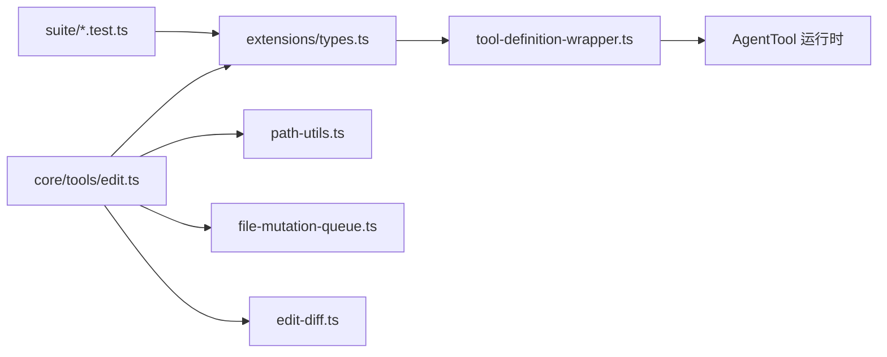

# 工具接口设计

**本文引用的文件**   
- [packages/coding-agent/src/core/extensions/types.ts](https://github.com/FDE-GROUP/oh-my-fde/blob/main/packages/coding-agent/src/core/extensions/types.ts)
- [packages/coding-agent/src/core/tools/tool-definition-wrapper.ts](https://github.com/FDE-GROUP/oh-my-fde/blob/main/packages/coding-agent/src/core/tools/tool-definition-wrapper.ts)
- [packages/coding-agent/src/core/tools/edit.ts](https://github.com/FDE-GROUP/oh-my-fde/blob/main/packages/coding-agent/src/core/tools/edit.ts)
- [docs/explains/12-tools.md](https://github.com/FDE-GROUP/oh-my-fde/blob/main/docs/explains/12-tools.md)
- [packages/schema/src/builders.ts](https://github.com/FDE-GROUP/oh-my-fde/blob/main/packages/schema/src/builders.ts)
- [packages/schema/src/typebox-static.ts](https://github.com/FDE-GROUP/oh-my-fde/blob/main/packages/schema/src/typebox-static.ts)
- [packages/coding-agent/test/suite/agent-session-tool-orchestration.test.ts](https://github.com/FDE-GROUP/oh-my-fde/blob/main/packages/coding-agent/test/suite/agent-session-tool-orchestration.test.ts)
- [packages/coding-agent/test/suite/agent-session-mcp.test.ts](https://github.com/FDE-GROUP/oh-my-fde/blob/main/packages/coding-agent/test/suite/agent-session-mcp.test.ts)

## 目录
1. [引言](#引言)
2. [项目结构](#项目结构)
3. [核心组件](#核心组件)
4. [架构总览](#架构总览)
5. [详细组件分析](#详细组件分析)
6. [依赖关系分析](#依赖关系分析)
7. [性能与行为特性](#性能与行为特性)
8. [故障排查指南](#故障排查指南)
9. [结论](#结论)
10. [附录：命名、描述与参数最佳实践](#附录命名描述与参数最佳实践)

## 引言
本文面向扩展开发者与工具作者，系统化说明工具接口的设计与使用方式。重点包括：
- ToolDefinition 接口的属性语义与用法
- 参数验证机制与 TypeBox schema 的使用
- prepareArguments 兼容性处理
- 工具暴露模式 ToolExposure 的类型与适用场景
- 工具命名规范、描述编写与参数设计原则
- 完整接口定义示例与常见错误处理方式

## 项目结构
本仓库中工具接口相关代码主要分布在以下位置：
- 扩展类型与工具定义：packages/coding-agent/src/core/extensions/types.ts
- 工具定义包装器（ToolDefinition 与 AgentTool 互转）：packages/coding-agent/src/core/tools/tool-definition-wrapper.ts
- 内置工具实现示例（如 edit）：packages/coding-agent/src/core/tools/edit.ts
- 工具文档与设计说明：docs/explains/12-tools.md
- Schema 构建与静态类型映射：packages/schema/src/builders.ts、packages/schema/src/typebox-static.ts
- 测试用例（暴露模式、编排等）：packages/coding-agent/test/suite/*.test.ts

**图表来源**
- [packages/coding-agent/src/core/extensions/types.ts:520-719](https://github.com/FDE-GROUP/oh-my-fde/blob/main/packages/coding-agent/src/core/extensions/types.ts#L520-L719)
- [packages/coding-agent/src/core/tools/tool-definition-wrapper.ts:1-78](https://github.com/FDE-GROUP/oh-my-fde/blob/main/packages/coding-agent/src/core/tools/tool-definition-wrapper.ts#L1-L78)
- [packages/coding-agent/src/core/tools/edit.ts:1-200](https://github.com/FDE-GROUP/oh-my-fde/blob/main/packages/coding-agent/src/core/tools/edit.ts#L1-L200)
- [packages/schema/src/builders.ts:1-25](https://github.com/FDE-GROUP/oh-my-fde/blob/main/packages/schema/src/builders.ts#L1-L25)
- [packages/schema/src/typebox-static.ts:1-26](https://github.com/FDE-GROUP/oh-my-fde/blob/main/packages/schema/src/typebox-static.ts#L1-L26)

**章节来源**
- [packages/coding-agent/src/core/extensions/types.ts:520-719](https://github.com/FDE-GROUP/oh-my-fde/blob/main/packages/coding-agent/src/core/extensions/types.ts#L520-L719)
- [packages/coding-agent/src/core/tools/tool-definition-wrapper.ts:1-78](https://github.com/FDE-GROUP/oh-my-fde/blob/main/packages/coding-agent/src/core/tools/tool-definition-wrapper.ts#L1-L78)
- [docs/explains/12-tools.md:1-30](https://github.com/FDE-GROUP/oh-my-fde/blob/main/docs/explains/12-tools.md#L1-L30)

## 核心组件
- ToolDefinition：扩展侧的工具定义接口，声明工具元数据、参数 schema、执行逻辑与渲染钩子。
- ToolExposure：控制模型如何发现与调用工具的暴露模式。
- ToolLoadout / ToolLoadoutChanges：在工具激活时动态调整模型可见的描述与隐藏声明。
- wrapToolDefinition / createToolDefinitionFromAgentTool：ToolDefinition 与运行时 AgentTool 的转换桥接。
- TypeBox schema 与 Static：以 TypeBox 构建 JSON Schema，并推导参数的 TypeScript 类型。

**章节来源**
- [packages/coding-agent/src/core/extensions/types.ts:520-719](https://github.com/FDE-GROUP/oh-my-fde/blob/main/packages/coding-agent/src/core/extensions/types.ts#L520-L719)
- [packages/coding-agent/src/core/tools/tool-definition-wrapper.ts:1-78](https://github.com/FDE-GROUP/oh-my-fde/blob/main/packages/coding-agent/src/core/tools/tool-definition-wrapper.ts#L1-L78)
- [packages/schema/src/builders.ts:1-25](https://github.com/FDE-GROUP/oh-my-fde/blob/main/packages/schema/src/builders.ts#L1-L25)
- [packages/schema/src/typebox-static.ts:1-26](https://github.com/FDE-GROUP/oh-my-fde/blob/main/packages/schema/src/typebox-static.ts#L1-L26)

## 架构总览
下图展示从扩展注册到工具执行的端到端流程，以及 ToolDefinition 与 AgentTool 的关系。

**图表来源**
- [packages/coding-agent/src/core/tools/tool-definition-wrapper.ts:26-49](https://github.com/FDE-GROUP/oh-my-fde/blob/main/packages/coding-agent/src/core/tools/tool-definition-wrapper.ts#L26-L49)
- [packages/coding-agent/src/core/extensions/types.ts:669-676](https://github.com/FDE-GROUP/oh-my-fde/blob/main/packages/coding-agent/src/core/extensions/types.ts#L669-L676)

## 详细组件分析

### ToolDefinition 接口详解
ToolDefinition 是扩展侧定义工具的核心契约，关键字段如下：
- name：工具名称，用于 LLM 工具调用标识。
- label：人类可读标签，用于 UI 展示。
- description：对模型的描述，决定模型是否选择该工具以及如何正确使用。
- promptSnippet：可选，系统提示“可用工具”区的一行摘要；未提供时自定义工具不会出现在该区域。
- promptGuidelines：可选，当工具激活时追加到系统提示“指南”区的要点列表。
- parameters：TypeBox schema，描述输入参数结构与类型。
- constrainedSampling：可选，为 provider 侧受限采样配置；false 显式禁用。
- renderShell：控制 UI 渲染外壳，“default”由框架着色，“self”由工具自绘。
- prepareArguments：可选，兼容层，将原始参数转换为符合 TParams 的对象，再进入 schema 校验。
- outputSchema：可选，结构化输出 structuredContent 的 JSON Schema；若声明则应始终返回 structuredContent。
- exposure：工具暴露模式，默认 "direct"。
- namespace：工具分组，例如 MCP 服务器组。
- reachesTools：可选，声明该工具可能触达的其他工具集合或策略。
- annotations：可选，工具行为提示（只读、破坏性、幂等、开放域）。
- defaultActive：注册时是否自动激活；direct/model-only 默认激活，其他不激活。
- prepareLoadout：可选，在工具激活时动态修改模型可见的描述与隐藏声明。
- executionMode：可选，逐工具执行模式覆盖（sequential/parallel）。
- execute：执行函数，接收 toolCallId、params、signal、onUpdate、ctx，返回 AgentToolResult。
- renderCall/renderResult：可选，自定义调用与结果的渲染组件。

**图表来源**
- [packages/coding-agent/src/core/extensions/types.ts:599-688](https://github.com/FDE-GROUP/oh-my-fde/blob/main/packages/coding-agent/src/core/extensions/types.ts#L599-L688)

**章节来源**
- [packages/coding-agent/src/core/extensions/types.ts:599-688](https://github.com/FDE-GROUP/oh-my-fde/blob/main/packages/coding-agent/src/core/extensions/types.ts#L599-L688)

### 参数验证机制与 TypeBox schema
- parameters 字段采用 TypeBox schema，既用于运行期校验，也用于推导 TypeScript 类型。
- Static\<TParams> 通过 builders.ts 与 typebox-static.ts 将 TypeBox 的 "~kind"/"~unsafe" 标记映射为 TS 类型，保证 execute(params) 的参数类型安全。
- 对于非 TypeBox 的普通 JSON Schema，Static 会退化为 unknown，因此推荐统一使用 TypeBox 构建参数 schema。

**图表来源**
- [packages/coding-agent/src/core/extensions/types.ts:617-618](https://github.com/FDE-GROUP/oh-my-fde/blob/main/packages/coding-agent/src/core/extensions/types.ts#L617-L618)
- [packages/schema/src/builders.ts:1-25](https://github.com/FDE-GROUP/oh-my-fde/blob/main/packages/schema/src/builders.ts#L1-L25)
- [packages/schema/src/typebox-static.ts:1-26](https://github.com/FDE-GROUP/oh-my-fde/blob/main/packages/schema/src/typebox-static.ts#L1-L26)

**章节来源**
- [packages/schema/src/builders.ts:1-25](https://github.com/FDE-GROUP/oh-my-fde/blob/main/packages/schema/src/builders.ts#L1-L25)
- [packages/schema/src/typebox-static.ts:1-26](https://github.com/FDE-GROUP/oh-my-fde/blob/main/packages/schema/src/typebox-static.ts#L1-L26)

### prepareArguments 兼容性处理
prepareArguments 用于在 schema 校验前对原始参数进行规范化，典型用途包括：
- 将字符串化 JSON 解析为数组或对象
- 将单条编辑对象包装为 edits 数组
- 兼容旧版参数结构（如顶层 oldText/newText）

edit 工具的实现展示了完整的兼容处理流程：
- 检测 edits 是否为字符串并尝试 JSON.parse
- 将单条编辑对象转为数组
- 兼容 legacy 字段 oldText/newText，合并为 edits

**图表来源**
- [packages/coding-agent/src/core/tools/edit.ts:100-131](https://github.com/FDE-GROUP/oh-my-fde/blob/main/packages/coding-agent/src/core/tools/edit.ts#L100-L131)

**章节来源**
- [packages/coding-agent/src/core/tools/edit.ts:100-131](https://github.com/FDE-GROUP/oh-my-fde/blob/main/packages/coding-agent/src/core/tools/edit.ts#L100-L131)

### 工具暴露模式 ToolExposure
ToolExposure 控制模型如何发现与调用工具，类型包括：
- direct：注册即激活，向模型声明并可被直接调用。
- model-only：向模型声明但不可被其他工具调用；适合编排型或交互型工具。
- codemode：仅在注册后可被 codemode 脚本调用；除非显式激活否则不对模型声明。
- deferred：类似 codemode，但不列入 codemode 工具描述；可被工具搜索发现。
- hidden：仅注册且不可达；激活无效果。

direct 与 model-only 在注册时默认激活；其他暴露模式默认不激活。活动工具集即为向模型声明的工具集合。

**图表来源**
- [packages/coding-agent/src/core/extensions/types.ts:520-536](https://github.com/FDE-GROUP/oh-my-fde/blob/main/packages/coding-agent/src/core/extensions/types.ts#L520-L536)

**章节来源**
- [packages/coding-agent/src/core/extensions/types.ts:520-536](https://github.com/FDE-GROUP/oh-my-fde/blob/main/packages/coding-agent/src/core/extensions/types.ts#L520-L536)
- [packages/coding-agent/test/suite/agent-session-mcp.test.ts:462-560](https://github.com/FDE-GROUP/oh-my-fde/blob/main/packages/coding-agent/test/suite/agent-session-mcp.test.ts#L462-L560)

### 工具包装与运行时适配
- wrapToolDefinition：将 ToolDefinition 转换为 AgentTool，保留 name、label、description、parameters、outputSchema、constrainedSampling、prepareArguments、executionMode，并将 execute 适配为运行时签名。
- createToolDefinitionFromAgentTool：反向构造最小 ToolDefinition，保持内部注册表“定义优先”的一致性。

**图表来源**
- [packages/coding-agent/src/core/tools/tool-definition-wrapper.ts:26-49](https://github.com/FDE-GROUP/oh-my-fde/blob/main/packages/coding-agent/src/core/tools/tool-definition-wrapper.ts#L26-L49)
- [packages/coding-agent/src/core/tools/tool-definition-wrapper.ts:65-77](https://github.com/FDE-GROUP/oh-my-fde/blob/main/packages/coding-agent/src/core/tools/tool-definition-wrapper.ts#L65-L77)

**章节来源**
- [packages/coding-agent/src/core/tools/tool-definition-wrapper.ts:1-78](https://github.com/FDE-GROUP/oh-my-fde/blob/main/packages/coding-agent/src/core/tools/tool-definition-wrapper.ts#L1-L78)

### 工具编排与 prepareLoadout
- prepareLoadout 允许在工具激活时动态调整模型可见的描述与隐藏声明，常用于编排工具列出可调用的工具名。
- 测试用例展示了 model-only 编排工具如何通过 prepareLoadout 动态生成 descriptions 与 hiddenDeclarations，并通过 ctx.executeTool 调用其他工具。

**图表来源**
- [packages/coding-agent/test/suite/agent-session-tool-orchestration.test.ts:30-52](https://github.com/FDE-GROUP/oh-my-fde/blob/main/packages/coding-agent/test/suite/agent-session-tool-orchestration.test.ts#L30-L52)

**章节来源**
- [packages/coding-agent/test/suite/agent-session-tool-orchestration.test.ts:10-53](https://github.com/FDE-GROUP/oh-my-fde/blob/main/packages/coding-agent/test/suite/agent-session-tool-orchestration.test.ts#L10-L53)

## 依赖关系分析
- ToolDefinition 依赖 TypeBox schema 进行参数类型与校验。
- wrapToolDefinition 依赖 ExtensionToolContext 以注入上下文。
- 内置工具（如 edit）依赖路径解析、文件操作队列、diff 生成等模块。
- 测试用例验证暴露模式、MCP 工具暴露与 codemode 集成。

**图表来源**
- [packages/coding-agent/src/core/extensions/types.ts:520-719](https://github.com/FDE-GROUP/oh-my-fde/blob/main/packages/coding-agent/src/core/extensions/types.ts#L520-L719)
- [packages/coding-agent/src/core/tools/tool-definition-wrapper.ts:1-78](https://github.com/FDE-GROUP/oh-my-fde/blob/main/packages/coding-agent/src/core/tools/tool-definition-wrapper.ts#L1-L78)
- [packages/coding-agent/src/core/tools/edit.ts:1-200](https://github.com/FDE-GROUP/oh-my-fde/blob/main/packages/coding-agent/src/core/tools/edit.ts#L1-L200)

**章节来源**
- [packages/coding-agent/src/core/extensions/types.ts:520-719](https://github.com/FDE-GROUP/oh-my-fde/blob/main/packages/coding-agent/src/core/extensions/types.ts#L520-L719)
- [packages/coding-agent/src/core/tools/tool-definition-wrapper.ts:1-78](https://github.com/FDE-GROUP/oh-my-fde/blob/main/packages/coding-agent/src/core/tools/tool-definition-wrapper.ts#L1-L78)
- [packages/coding-agent/src/core/tools/edit.ts:1-200](https://github.com/FDE-GROUP/oh-my-fde/blob/main/packages/coding-agent/src/core/tools/edit.ts#L1-L200)

## 性能与行为特性
- 文件写入串行化：同一文件的写操作串行，不同文件并行，避免并发冲突。
- 输出截断：按行数与字节数双重限制，并提供下一步建议（如 offset=N）。
- abort 处理：在每个 await 后检查信号，确保进程树清理与队列释放顺序正确。
- 流式输出：OutputAccumulator 维护尾部文本与临时文件，节流推送 onUpdate。

**章节来源**
- [docs/explains/12-tools.md:56-89](https://github.com/FDE-GROUP/oh-my-fde/blob/main/docs/explains/12-tools.md#L56-L89)
- [docs/explains/12-tools.md:165-212](https://github.com/FDE-GROUP/oh-my-fde/blob/main/docs/explains/12-tools.md#L165-L212)
- [docs/explains/12-tools.md:264-278](https://github.com/FDE-GROUP/oh-my-fde/blob/main/docs/explains/12-tools.md#L264-L278)

## 故障排查指南
常见问题与处理建议：
- 参数校验失败：检查 parameters 是否与传入值匹配；必要时在 prepareArguments 中做兼容转换。
- 工具未被模型发现：确认 exposure 是否为 direct 或 model-only；codemode/deferred/hidden 需要额外激活或搜索。
- 工具描述不清晰：完善 description 与 promptGuidelines，必要时使用 promptSnippet 提供一行摘要。
- 结构化输出缺失：若声明 outputSchema，请始终返回 structuredContent，以便 codemode 程序化调用。
- 执行异常：在 execute 中捕获并返回 isError=true 的结果，附带 details 与可执行下一步建议。

**章节来源**
- [packages/coding-agent/src/core/extensions/types.ts:617-624](https://github.com/FDE-GROUP/oh-my-fde/blob/main/packages/coding-agent/src/core/extensions/types.ts#L617-L624)
- [packages/coding-agent/src/core/tools/edit.ts:133-138](https://github.com/FDE-GROUP/oh-my-fde/blob/main/packages/coding-agent/src/core/tools/edit.ts#L133-L138)

## 结论
ToolDefinition 提供了统一的工具定义契约，结合 TypeBox schema 与 prepareArguments 实现了强类型与兼容性兼顾的参数处理。ToolExposure 的五种模式覆盖了从直接调用到延迟发现的多种场景。通过 prepareLoadout 与 annotations，扩展可以精细控制模型可见性与权限提示。建议在定义工具时遵循命名规范、清晰的描述与稳健的参数设计，并在 execute 中妥善处理错误与结构化输出。

## 附录：命名、描述与参数最佳实践
- 命名规范
  - name 使用小写字母与下划线，避免与内置工具冲突。
  - 对 MCP 工具建议使用 mcp__server__tool 风格的前缀。
- 描述编写
  - description 应明确工具职责、输入输出与注意事项。
  - 使用 promptSnippet 提供一行摘要，便于系统提示“可用工具”区展示。
  - 使用 promptGuidelines 补充关键使用要点与安全提示。
- 参数设计
  - 使用 TypeBox 构建 parameters，确保类型安全与校验一致。
  - 对易变模型输出，使用 prepareArguments 做兼容转换。
  - 对结构化输出，声明 outputSchema 并始终返回 structuredContent。
- 暴露模式选择
  - 直接对外：direct
  - 编排/交互：model-only
  - 仅 codemode 调用：codemode
  - 延迟发现：deferred
  - 内部隐藏：hidden

**章节来源**
- [packages/coding-agent/src/core/extensions/types.ts:599-688](https://github.com/FDE-GROUP/oh-my-fde/blob/main/packages/coding-agent/src/core/extensions/types.ts#L599-L688)
- [packages/coding-agent/test/suite/agent-session-mcp.test.ts:462-560](https://github.com/FDE-GROUP/oh-my-fde/blob/main/packages/coding-agent/test/suite/agent-session-mcp.test.ts#L462-L560)
- [docs/explains/12-tools.md:1-30](https://github.com/FDE-GROUP/oh-my-fde/blob/main/docs/explains/12-tools.md#L1-L30)