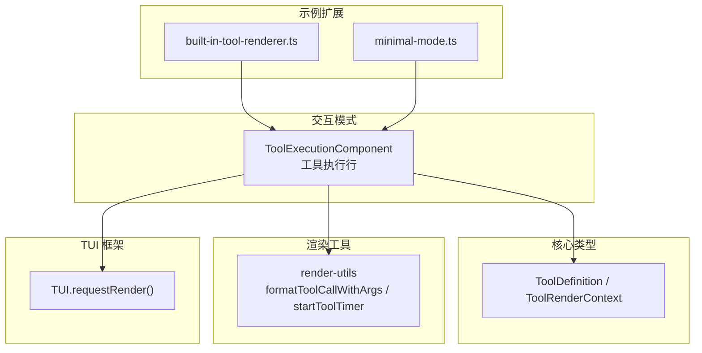
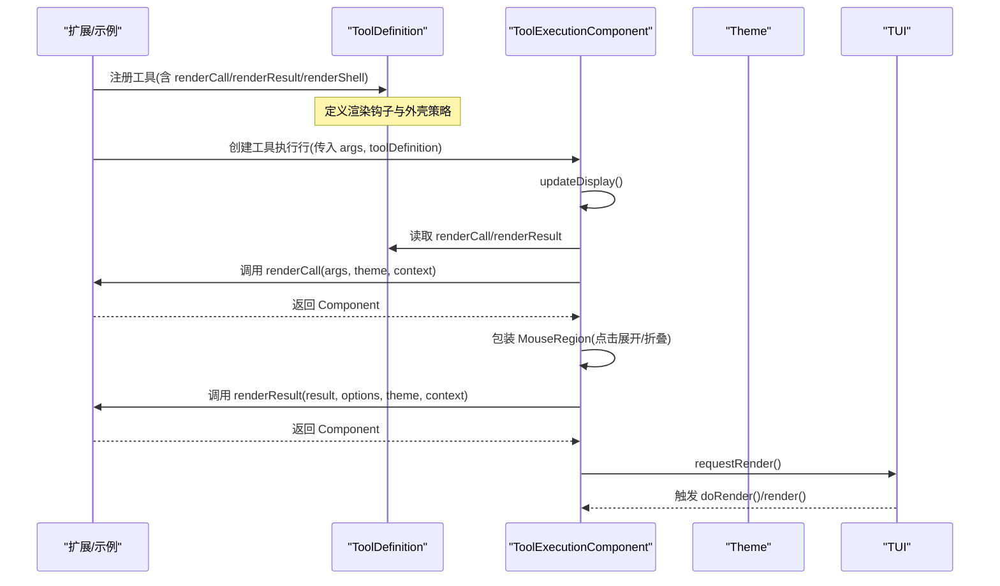
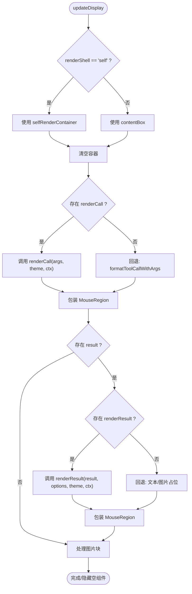
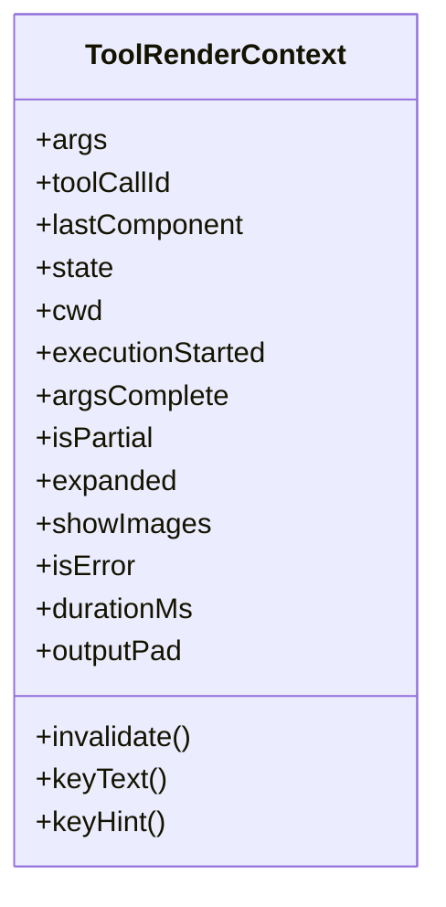
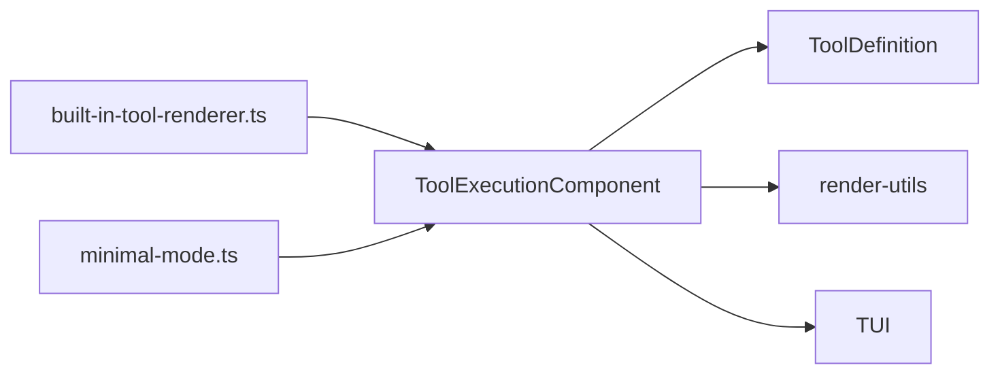

# 工具渲染定制

**本文引用的文件**   
- [tool-execution.ts](https://github.com/FDE-GROUP/oh-my-fde/blob/main/packages/coding-agent/src/modes/interactive/components/tool-execution.ts)
- [types.ts](https://github.com/FDE-GROUP/oh-my-fde/blob/main/packages/coding-agent/src/core/extensions/types.ts)
- [render-utils.ts](https://github.com/FDE-GROUP/oh-my-fde/blob/main/packages/coding-agent/src/core/tools/render-utils.ts)
- [built-in-tool-renderer.ts](https://github.com/FDE-GROUP/oh-my-fde/blob/main/packages/coding-agent/examples/extensions/built-in-tool-renderer.ts)
- [minimal-mode.ts](https://github.com/FDE-GROUP/oh-my-fde/blob/main/packages/coding-agent/examples/extensions/minimal-mode.ts)
- [tui.ts](https://github.com/FDE-GROUP/oh-my-fde/blob/main/packages/tui/src/tui.ts)

## 目录
1. [简介](#简介)
2. [项目结构](#项目结构)
3. [核心组件](#核心组件)
4. [架构总览](#架构总览)
5. [详细组件分析](#详细组件分析)
6. [依赖关系分析](#依赖关系分析)
7. [性能考虑](#性能考虑)
8. [故障排查指南](#故障排查指南)
9. [结论](#结论)
10. [附录](#附录)

## 简介
本指南面向需要为工具调用与结果提供自定义 UI 的开发者。内容涵盖：
- 实现 renderCall 与 renderResult 方法，构建可交互、主题化、响应式的 TUI 组件
- 使用 ToolRenderContext 的 args、state、invalidate 等关键属性
- 选择默认 shell 或自定义 shell（renderShell）
- 实现交互式工具（进度条、实时输出、用户确认对话框等）
- 渲染性能优化（组件缓存、增量更新、内存管理）

## 项目结构
围绕“工具渲染”的关键代码分布在以下位置：
- 工具执行行渲染容器：packages/coding-agent/src/modes/interactive/components/tool-execution.ts
- 扩展类型定义（含 ToolRenderContext、ToolDefinition 等）：packages/coding-agent/src/core/extensions/types.ts
- 渲染辅助函数（格式化参数、计时器、路径链接等）：packages/coding-agent/src/core/tools/render-utils.ts
- 示例扩展（内置工具渲染覆盖、极简模式）：packages/coding-agent/examples/extensions/built-in-tool-renderer.ts、packages/coding-agent/examples/extensions/minimal-mode.ts
- TUI 渲染调度（requestRender/renderNow）：packages/tui/src/tui.ts

**图表来源** 
- [tool-execution.ts:31-144](https://github.com/FDE-GROUP/oh-my-fde/blob/main/packages/coding-agent/src/modes/interactive/components/tool-execution.ts#L31-L144)
- [types.ts:478-692](https://github.com/FDE-GROUP/oh-my-fde/blob/main/packages/coding-agent/src/core/extensions/types.ts#L478-L692)
- [render-utils.ts:85-164](https://github.com/FDE-GROUP/oh-my-fde/blob/main/packages/coding-agent/src/core/tools/render-utils.ts#L85-L164)
- [tui.ts:1025-1065](https://github.com/FDE-GROUP/oh-my-fde/blob/main/packages/tui/src/tui.ts#L1025-L1065)

**章节来源**
- [tool-execution.ts:1-420](https://github.com/FDE-GROUP/oh-my-fde/blob/main/packages/coding-agent/src/modes/interactive/components/tool-execution.ts#L1-L420)
- [types.ts:478-692](https://github.com/FDE-GROUP/oh-my-fde/blob/main/packages/coding-agent/src/core/extensions/types.ts#L478-L692)
- [render-utils.ts:1-181](https://github.com/FDE-GROUP/oh-my-fde/blob/main/packages/coding-agent/src/core/tools/render-utils.ts#L1-L181)
- [built-in-tool-renderer.ts:1-226](https://github.com/FDE-GROUP/oh-my-fde/blob/main/packages/coding-agent/examples/extensions/built-in-tool-renderer.ts#L1-L226)
- [minimal-mode.ts:1-354](https://github.com/FDE-GROUP/oh-my-fde/blob/main/packages/coding-agent/examples/extensions/minimal-mode.ts#L1-L354)
- [tui.ts:1025-1065](https://github.com/FDE-GROUP/oh-my-fde/blob/main/packages/tui/src/tui.ts#L1025-L1065)

## 核心组件
- ToolExecutionComponent：负责单行工具调用的渲染编排，包括：
  - 根据 renderShell 选择默认外壳或自绘外壳
  - 调用 renderCall/renderResult 生成子组件
  - 处理部分结果、错误状态、图片展示、展开/折叠
  - 通过 invalidate + requestRender 触发增量重绘
- ToolDefinition：声明工具行为与渲染钩子（renderCall/renderResult/renderShell）
- ToolRenderContext：传递给渲染器的上下文，包含 args、state、invalidate、expanded、isPartial、durationMs 等
- render-utils：提供通用格式化能力（参数头、时长、路径链接等）

**章节来源**
- [tool-execution.ts:31-144](https://github.com/FDE-GROUP/oh-my-fde/blob/main/packages/coding-agent/src/modes/interactive/components/tool-execution.ts#L31-L144)
- [types.ts:478-692](https://github.com/FDE-GROUP/oh-my-fde/blob/main/packages/coding-agent/src/core/extensions/types.ts#L478-L692)
- [render-utils.ts:85-164](https://github.com/FDE-GROUP/oh-my-fde/blob/main/packages/coding-agent/src/core/tools/render-utils.ts#L85-L164)

## 架构总览
下图展示了从工具注册到渲染更新的完整流程，以及自定义渲染如何接入系统。

**图表来源** 
- [tool-execution.ts:280-343](https://github.com/FDE-GROUP/oh-my-fde/blob/main/packages/coding-agent/src/modes/interactive/components/tool-execution.ts#L280-L343)
- [types.ts:678-692](https://github.com/FDE-GROUP/oh-my-fde/blob/main/packages/coding-agent/src/core/extensions/types.ts#L678-L692)
- [tui.ts:1033-1058](https://github.com/FDE-GROUP/oh-my-fde/blob/main/packages/tui/src/tui.ts#L1033-L1058)

## 详细组件分析

### ToolExecutionComponent 渲染管线
- 外壳选择：当 renderShell 为 "self" 时，使用 selfRenderContainer；否则使用 contentBox（默认外壳）
- 参数区渲染：优先调用 renderCall，失败则回退到 formatToolCallWithArgs
- 结果区渲染：优先调用 renderResult，失败则回退到文本输出或图片占位
- 交互：MouseRegion 包裹结果区域，点击切换 expanded
- 图片：按 mimeType 与能力检测决定是否内联显示，非 PNG 会触发转码并再次请求渲染

**图表来源** 
- [tool-execution.ts:280-401](https://github.com/FDE-GROUP/oh-my-fde/blob/main/packages/coding-agent/src/modes/interactive/components/tool-execution.ts#L280-L401)

**章节来源**
- [tool-execution.ts:87-120](https://github.com/FDE-GROUP/oh-my-fde/blob/main/packages/coding-agent/src/modes/interactive/components/tool-execution.ts#L87-L120)
- [tool-execution.ts:280-401](https://github.com/FDE-GROUP/oh-my-fde/blob/main/packages/coding-agent/src/modes/interactive/components/tool-execution.ts#L280-L401)

### ToolRenderContext 属性与用法
- args：当前工具调用参数，跨 call/result 渲染共享
- toolCallId：稳定标识同一工具执行
- invalidate：仅使当前工具行失效并重绘
- lastComponent：上一次返回的组件实例，可用于复用
- state：渲染器状态对象，适合保存定时器、进度等
- cwd：工作目录，用于路径解析与超链接
- executionStarted/argsComplete/isPartial/expanded/showImages/isError/durationMs/outputPad：描述执行阶段与 UI 状态
- keyText/keyHint：键绑定提示，避免直接导入导致多份拷贝不一致

**图表来源** 
- [types.ts:487-519](https://github.com/FDE-GROUP/oh-my-fde/blob/main/packages/coding-agent/src/core/extensions/types.ts#L487-L519)

**章节来源**
- [types.ts:487-519](https://github.com/FDE-GROUP/oh-my-fde/blob/main/packages/coding-agent/src/core/extensions/types.ts#L487-L519)
- [tool-execution.ts:122-144](https://github.com/FDE-GROUP/oh-my-fde/blob/main/packages/coding-agent/src/modes/interactive/components/tool-execution.ts#L122-L144)

### renderCall 与 renderResult 实现要点
- renderCall：
  - 输入：args、theme、context
  - 输出：Component（如 Text、Box、自定义组件）
  - 建议：简洁展示命令/路径/关键参数；可使用 formatToolCallWithArgs 快速生成标题+参数预览
- renderResult：
  - 输入：result、options（expanded、isPartial）、theme、context
  - 输出：Component
  - 建议：区分 isPartial（进行中）与最终结果；利用 expanded 控制详情展示；结合 durationMs 或 startToolTimer/toolTimerText 显示耗时

参考示例：
- 内置工具渲染覆盖：[built-in-tool-renderer.ts:45-89](https://github.com/FDE-GROUP/oh-my-fde/blob/main/packages/coding-agent/examples/extensions/built-in-tool-renderer.ts#L45-L89)、[built-in-tool-renderer.ts:97-141](https://github.com/FDE-GROUP/oh-my-fde/blob/main/packages/coding-agent/examples/extensions/built-in-tool-renderer.ts#L97-L141)、[built-in-tool-renderer.ts:149-198](https://github.com/FDE-GROUP/oh-my-fde/blob/main/packages/coding-agent/examples/extensions/built-in-tool-renderer.ts#L149-L198)、[built-in-tool-renderer.ts:206-223](https://github.com/FDE-GROUP/oh-my-fde/blob/main/packages/coding-agent/examples/extensions/built-in-tool-renderer.ts#L206-L223)
- 极简模式：[minimal-mode.ts:65-92](https://github.com/FDE-GROUP/oh-my-fde/blob/main/packages/coding-agent/examples/extensions/minimal-mode.ts#L65-L92)、[minimal-mode.ts:101-132](https://github.com/FDE-GROUP/oh-my-fde/blob/main/packages/coding-agent/examples/extensions/minimal-mode.ts#L101-L132)、[minimal-mode.ts:141-165](https://github.com/FDE-GROUP/oh-my-fde/blob/main/packages/coding-agent/examples/extensions/minimal-mode.ts#L141-L165)、[minimal-mode.ts:175-202](https://github.com/FDE-GROUP/oh-my-fde/blob/main/packages/coding-agent/examples/extensions/minimal-mode.ts#L175-L202)

**章节来源**
- [built-in-tool-renderer.ts:45-223](https://github.com/FDE-GROUP/oh-my-fde/blob/main/packages/coding-agent/examples/extensions/built-in-tool-renderer.ts#L45-L223)
- [minimal-mode.ts:65-202](https://github.com/FDE-GROUP/oh-my-fde/blob/main/packages/coding-agent/examples/extensions/minimal-mode.ts#L65-L202)
- [render-utils.ts:85-164](https://github.com/FDE-GROUP/oh-my-fde/blob/main/packages/coding-agent/src/core/tools/render-utils.ts#L85-L164)

### renderShell 选项：何时使用默认壳，何时自定义
- renderShell: "default"（默认）：由 ToolExecutionComponent 提供统一边框、背景色、内边距与交互（展开/折叠）。适合大多数工具。
- renderShell: "self"：工具自行绘制外层壳，完全掌控布局与样式。适用于需要复杂布局、自定义边框、嵌套交互的工具（例如 edit 工具）。

在 ToolExecutionComponent 中：
- 构造时根据 renderShell 决定挂载 contentBox 还是 selfRenderContainer
- 渲染时若为 "self"，将图片与内容分别渲染并按需合并输出

**章节来源**
- [tool-execution.ts:87-120](https://github.com/FDE-GROUP/oh-my-fde/blob/main/packages/coding-agent/src/modes/interactive/components/tool-execution.ts#L87-L120)
- [tool-execution.ts:236-278](https://github.com/FDE-GROUP/oh-my-fde/blob/main/packages/coding-agent/src/modes/interactive/components/tool-execution.ts#L236-L278)
- [types.ts:614-615](https://github.com/FDE-GROUP/oh-my-fde/blob/main/packages/coding-agent/src/core/extensions/types.ts#L614-L615)

### 交互式工具实现
- 进度条/实时输出：
  - 在 renderCall 中使用 startToolTimer(context) 启动计时器
  - 在 renderResult 中使用 toolTimerText(context, isPartial) 显示“已用时间/耗时”
  - 对频繁更新的 UI，使用 context.invalidate() 触发局部重绘，避免全量刷新
- 用户确认对话框：
  - 通过 ExtensionUIContext.confirm/select/input 等 API 获取用户输入
  - 在 renderCall/renderResult 中根据用户选择动态调整组件树
- 键盘与鼠标交互：
  - 使用 MouseRegion 包裹组件以捕获点击事件（如展开/折叠）
  - 使用 keyText/keyHint 显示键绑定提示，提升可用性

**章节来源**
- [render-utils.ts:125-164](https://github.com/FDE-GROUP/oh-my-fde/blob/main/packages/coding-agent/src/core/tools/render-utils.ts#L125-L164)
- [types.ts:164-248](https://github.com/FDE-GROUP/oh-my-fde/blob/main/packages/coding-agent/src/core/extensions/types.ts#L164-L248)
- [tool-execution.ts:166-172](https://github.com/FDE-GROUP/oh-my-fde/blob/main/packages/coding-agent/src/modes/interactive/components/tool-execution.ts#L166-L172)

## 依赖关系分析
- ToolExecutionComponent 依赖：
  - ToolDefinition（renderCall/renderResult/renderShell）
  - Theme（颜色与样式）
  - TUI（requestRender 调度）
  - render-utils（格式化参数、计时器、路径链接）
- 示例扩展依赖：
  - 内置工具定义工厂（createReadToolDefinition 等）
  - TUI 基础组件（Text、Box、Image 等）

**图表来源** 
- [tool-execution.ts:1-22](https://github.com/FDE-GROUP/oh-my-fde/blob/main/packages/coding-agent/src/modes/interactive/components/tool-execution.ts#L1-L22)
- [types.ts:599-692](https://github.com/FDE-GROUP/oh-my-fde/blob/main/packages/coding-agent/src/core/extensions/types.ts#L599-L692)
- [render-utils.ts:1-181](https://github.com/FDE-GROUP/oh-my-fde/blob/main/packages/coding-agent/src/core/tools/render-utils.ts#L1-L181)
- [built-in-tool-renderer.ts:28-35](https://github.com/FDE-GROUP/oh-my-fde/blob/main/packages/coding-agent/examples/extensions/built-in-tool-renderer.ts#L28-L35)
- [minimal-mode.ts:19-31](https://github.com/FDE-GROUP/oh-my-fde/blob/main/packages/coding-agent/examples/extensions/minimal-mode.ts#L19-L31)

**章节来源**
- [tool-execution.ts:1-22](https://github.com/FDE-GROUP/oh-my-fde/blob/main/packages/coding-agent/src/modes/interactive/components/tool-execution.ts#L1-L22)
- [types.ts:599-692](https://github.com/FDE-GROUP/oh-my-fde/blob/main/packages/coding-agent/src/core/extensions/types.ts#L599-L692)
- [render-utils.ts:1-181](https://github.com/FDE-GROUP/oh-my-fde/blob/main/packages/coding-agent/src/core/tools/render-utils.ts#L1-L181)
- [built-in-tool-renderer.ts:28-35](https://github.com/FDE-GROUP/oh-my-fde/blob/main/packages/coding-agent/examples/extensions/built-in-tool-renderer.ts#L28-L35)
- [minimal-mode.ts:19-31](https://github.com/FDE-GROUP/oh-my-fde/blob/main/packages/coding-agent/examples/extensions/minimal-mode.ts#L19-L31)

## 性能考虑
- 组件缓存与复用
  - 使用 context.lastComponent 判断是否可复用上次返回的组件，减少重建开销
  - 图片数据复用：ToolExecutionComponent 内部维护 imageComponents 与 imageSources，相同 data/mimeType/widthCells 时复用 Image 实例
- 增量更新
  - 仅在必要时调用 context.invalidate()，配合 TUI.requestRender() 进行节流调度
  - 对于高频更新（如进度），使用 setInterval 驱动 invalidate，并在结束时清理定时器
- 渲染节流
  - TUI 层通过 requestRender 与 renderNow 控制渲染时机，避免每帧重复渲染
- 内存管理
  - 及时清除定时器（startToolTimer/toolTimerText 内部已处理）
  - 非 PNG 图片转码完成后主动 invalidate 触发一次渲染，避免残留中间态

**章节来源**
- [tool-execution.ts:351-396](https://github.com/FDE-GROUP/oh-my-fde/blob/main/packages/coding-agent/src/modes/interactive/components/tool-execution.ts#L351-L396)
- [render-utils.ts:125-164](https://github.com/FDE-GROUP/oh-my-fde/blob/main/packages/coding-agent/src/core/tools/render-utils.ts#L125-L164)
- [tui.ts:1025-1065](https://github.com/FDE-GROUP/oh-my-fde/blob/main/packages/tui/src/tui.ts#L1025-L1065)

## 故障排查指南
- 渲染异常回退
  - 若 renderCall/renderResult 抛出异常，系统将自动回退到默认文本/图片占位，保证界面可用
- 无内容时隐藏行
  - 当自定义渲染未产生任何内容且无可显示图片时，组件会被隐藏，避免空白行
- 图片不显示
  - 检查终端能力（getCapabilities().images）与 showImages 开关
  - 非 PNG 格式会触发转码，确保回调中再次请求渲染
- 交互无效
  - 确认使用了 MouseRegion 包裹结果区域，并正确处理 click 事件以切换 expanded

**章节来源**
- [tool-execution.ts:302-342](https://github.com/FDE-GROUP/oh-my-fde/blob/main/packages/coding-agent/src/modes/interactive/components/tool-execution.ts#L302-L342)
- [tool-execution.ts:398-401](https://github.com/FDE-GROUP/oh-my-fde/blob/main/packages/coding-agent/src/modes/interactive/components/tool-execution.ts#L398-L401)
- [tool-execution.ts:363-396](https://github.com/FDE-GROUP/oh-my-fde/blob/main/packages/coding-agent/src/modes/interactive/components/tool-execution.ts#L363-L396)
- [tool-execution.ts:166-172](https://github.com/FDE-GROUP/oh-my-fde/blob/main/packages/coding-agent/src/modes/interactive/components/tool-execution.ts#L166-L172)

## 结论
通过 ToolExecutionComponent 提供的渲染管线与 ToolRenderContext 暴露的状态，你可以：
- 精准控制工具调用与结果的展示形式
- 灵活选择默认外壳或完全自定义外壳
- 实现丰富的交互体验（进度、实时输出、确认对话框）
- 在保证性能的前提下，进行组件缓存、增量更新与内存管理

建议在简单场景优先使用默认 shell，在需要复杂布局或深度交互时使用 renderShell: "self"，并结合 render-utils 提供的工具函数提升一致性。

## 附录
- 常用 API 与类型定位
  - ToolRenderContext：[types.ts:487-519](https://github.com/FDE-GROUP/oh-my-fde/blob/main/packages/coding-agent/src/core/extensions/types.ts#L487-L519)
  - ToolDefinition.renderCall/renderResult/renderShell：[types.ts:678-692](https://github.com/FDE-GROUP/oh-my-fde/blob/main/packages/coding-agent/src/core/extensions/types.ts#L678-L692)
  - formatToolCallWithArgs/startToolTimer/toolTimerText：[render-utils.ts:85-164](https://github.com/FDE-GROUP/oh-my-fde/blob/main/packages/coding-agent/src/core/tools/render-utils.ts#L85-L164)
  - ToolExecutionComponent.updateDisplay/render：[tool-execution.ts:280-401](https://github.com/FDE-GROUP/oh-my-fde/blob/main/packages/coding-agent/src/modes/interactive/components/tool-execution.ts#L280-L401)
  - TUI.requestRender/renderNow：[tui.ts:1025-1065](https://github.com/FDE-GROUP/oh-my-fde/blob/main/packages/tui/src/tui.ts#L1025-L1065)