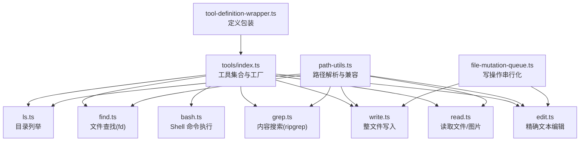
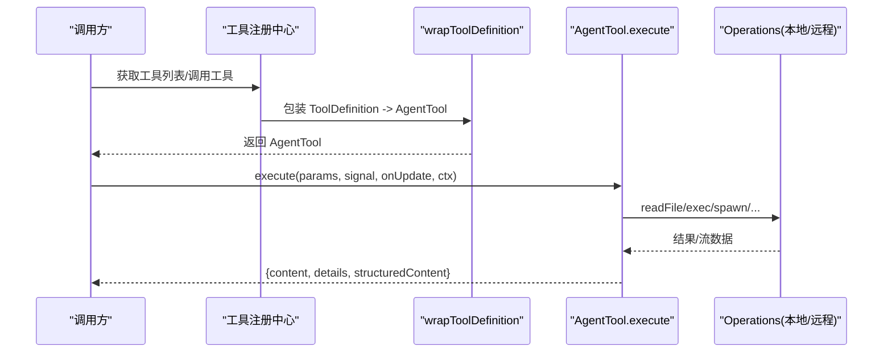
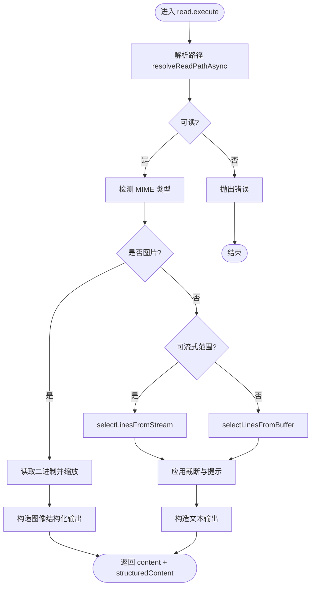
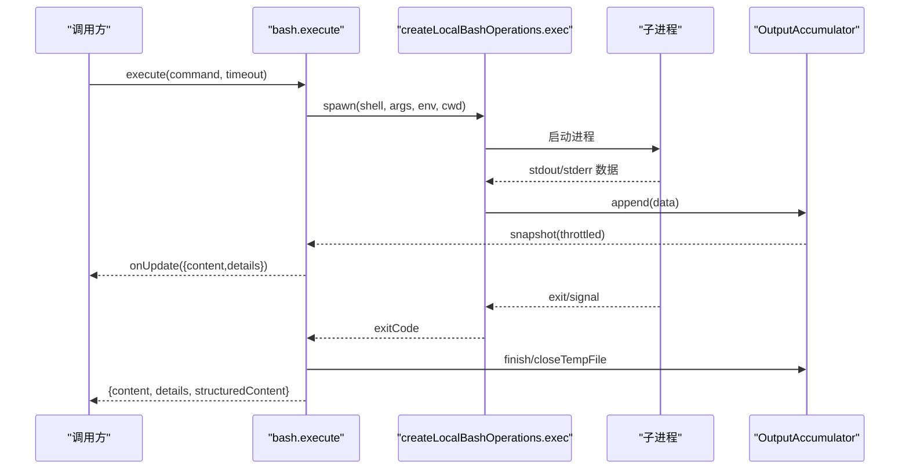
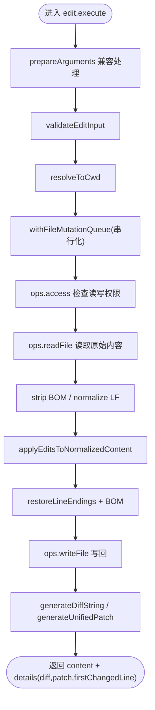
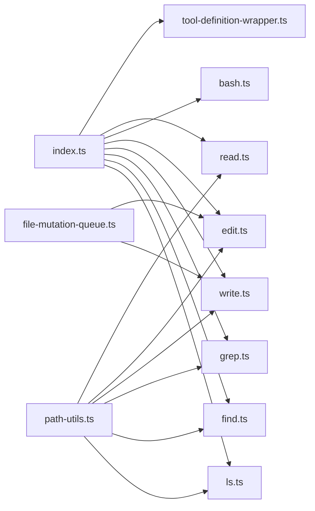

# 工具系统

**本文引用的文件**   
- [packages/coding-agent/src/core/tools/index.ts](https://github.com/FDE-GROUP/oh-my-fde/blob/main/packages/coding-agent/src/core/tools/index.ts)
- [packages/coding-agent/src/core/tools/read.ts](https://github.com/FDE-GROUP/oh-my-fde/blob/main/packages/coding-agent/src/core/tools/read.ts)
- [packages/coding-agent/src/core/tools/bash.ts](https://github.com/FDE-GROUP/oh-my-fde/blob/main/packages/coding-agent/src/core/tools/bash.ts)
- [packages/coding-agent/src/core/tools/edit.ts](https://github.com/FDE-GROUP/oh-my-fde/blob/main/packages/coding-agent/src/core/tools/edit.ts)
- [packages/coding-agent/src/core/tools/write.ts](https://github.com/FDE-GROUP/oh-my-fde/blob/main/packages/coding-agent/src/core/tools/write.ts)
- [packages/coding-agent/src/core/tools/grep.ts](https://github.com/FDE-GROUP/oh-my-fde/blob/main/packages/coding-agent/src/core/tools/grep.ts)
- [packages/coding-agent/src/core/tools/find.ts](https://github.com/FDE-GROUP/oh-my-fde/blob/main/packages/coding-agent/src/core/tools/find.ts)
- [packages/coding-agent/src/core/tools/ls.ts](https://github.com/FDE-GROUP/oh-my-fde/blob/main/packages/coding-agent/src/core/tools/ls.ts)
- [packages/coding-agent/src/core/tools/path-utils.ts](https://github.com/FDE-GROUP/oh-my-fde/blob/main/packages/coding-agent/src/core/tools/path-utils.ts)
- [packages/coding-agent/src/core/tools/file-mutation-queue.ts](https://github.com/FDE-GROUP/oh-my-fde/blob/main/packages/coding-agent/src/core/tools/file-mutation-queue.ts)
- [packages/coding-agent/src/core/tools/tool-definition-wrapper.ts](https://github.com/FDE-GROUP/oh-my-fde/blob/main/packages/coding-agent/src/core/tools/tool-definition-wrapper.ts)
- [docs/explains/12-tools.md](https://github.com/FDE-GROUP/oh-my-fde/blob/main/docs/explains/12-tools.md)

## 目录
1. [简介](#简介)
2. [项目结构](#项目结构)
3. [核心组件](#核心组件)
4. [架构总览](#架构总览)
5. [详细组件分析](#详细组件分析)
6. [依赖关系分析](#依赖关系分析)
7. [性能与限制](#性能与限制)
8. [自定义工具开发指南](#自定义工具开发指南)
9. [安全、权限与沙箱](#安全权限与沙箱)
10. [故障排查](#故障排查)
11. [结论](#结论)

## 简介
本文件系统性地梳理并文档化“工具系统”的设计与实现。该系统为模型提供一组可执行能力，包括文件读取、写入、编辑、Shell 命令执行、内容搜索、路径查找和目录列举等。所有内置工具采用统一的“工厂函数 + Operations 接口”模式，便于替换为远程实现（例如 SSH）。同时，系统提供了工具注册、参数校验、输出截断、结构化输出、渲染器扩展以及调用生命周期管理。

## 项目结构
工具系统的核心位于 `packages/coding-agent/src/core/tools` 目录，按功能拆分为多个文件：
- 统一入口与工具集合构建：`index.ts`
- 文件读：`read.ts`
- Shell 执行：`bash.ts`
- 精确文本编辑：`edit.ts`
- 整文件写入：`write.ts`
- 内容搜索：`grep.ts`
- 文件查找：`find.ts`
- 目录列举：`ls.ts`
- 路径解析与兼容性：`path-utils.ts`
- 文件写操作串行化：`file-mutation-queue.ts`
- 工具定义包装与适配：`tool-definition-wrapper.ts`

图示来源
- [packages/coding-agent/src/core/tools/index.ts:1-225](https://github.com/FDE-GROUP/oh-my-fde/blob/main/packages/coding-agent/src/core/tools/index.ts#L1-L225)
- [packages/coding-agent/src/core/tools/read.ts:1-363](https://github.com/FDE-GROUP/oh-my-fde/blob/main/packages/coding-agent/src/core/tools/read.ts#L1-L363)
- [packages/coding-agent/src/core/tools/bash.ts:1-477](https://github.com/FDE-GROUP/oh-my-fde/blob/main/packages/coding-agent/src/core/tools/bash.ts#L1-L477)
- [packages/coding-agent/src/core/tools/edit.ts:1-218](https://github.com/FDE-GROUP/oh-my-fde/blob/main/packages/coding-agent/src/core/tools/edit.ts#L1-L218)
- [packages/coding-agent/src/core/tools/write.ts:1-97](https://github.com/FDE-GROUP/oh-my-fde/blob/main/packages/coding-agent/src/core/tools/write.ts#L1-L97)
- [packages/coding-agent/src/core/tools/grep.ts:1-322](https://github.com/FDE-GROUP/oh-my-fde/blob/main/packages/coding-agent/src/core/tools/grep.ts#L1-L322)
- [packages/coding-agent/src/core/tools/find.ts:1-332](https://github.com/FDE-GROUP/oh-my-fde/blob/main/packages/coding-agent/src/core/tools/find.ts#L1-L332)
- [packages/coding-agent/src/core/tools/ls.ts:1-176](https://github.com/FDE-GROUP/oh-my-fde/blob/main/packages/coding-agent/src/core/tools/ls.ts#L1-L176)
- [packages/coding-agent/src/core/tools/path-utils.ts:1-119](https://github.com/FDE-GROUP/oh-my-fde/blob/main/packages/coding-agent/src/core/tools/path-utils.ts#L1-L119)
- [packages/coding-agent/src/core/tools/file-mutation-queue.ts:1-62](https://github.com/FDE-GROUP/oh-my-fde/blob/main/packages/coding-agent/src/core/tools/file-mutation-queue.ts#L1-L62)
- [packages/coding-agent/src/core/tools/tool-definition-wrapper.ts:1-78](https://github.com/FDE-GROUP/oh-my-fde/blob/main/packages/coding-agent/src/core/tools/tool-definition-wrapper.ts#L1-L78)

章节来源
- [packages/coding-agent/src/core/tools/index.ts:1-225](https://github.com/FDE-GROUP/oh-my-fde/blob/main/packages/coding-agent/src/core/tools/index.ts#L1-L225)

## 核心组件
- 工具定义与运行时对象
  - ToolDefinition：面向扩展的声明式描述，包含 name、description、parameters、promptSnippet、promptGuidelines、renderers 等。
  - AgentTool：面向运行时的可执行对象，包含 execute、executionMode、outputSchema 等。
  - wrapToolDefinition：将 ToolDefinition 包装为 AgentTool，供核心调度。
- 内置工具族
  - read：读取文本或图片，支持流式行选择、图片缩放、非视觉模型提示。
  - bash/powershell：执行 Shell 命令，支持超时、进程树清理、环境变量注入、输出节流与临时文件保存。
  - edit：基于精确匹配的文本替换，支持模糊匹配、BOM/换行保留、diff/unified patch 输出。
  - write：整文件覆盖，自动创建父目录，同一文件写操作串行。
  - grep：调用 ripgrep，JSON 事件流处理，上下文行、匹配上限、字节上限控制。
  - find：调用 fd，glob 匹配，git-aware 行为，结果相对路径规范化。
  - ls：目录列举，大小写不敏感排序，条目上限与字节上限。
- 公共能力
  - 路径解析：expandPath、resolveToCwd、resolveReadPath/Async，含 macOS 文件名兼容。
  - 输出截断：truncateHead/truncateTail/truncateLine，统一 maxLines/maxBytes 策略。
  - 写操作串行化：withFileMutationQueue，按 realpath 键序列化同文件写。
  - 渲染器：每个工具提供 renderers，用于 TUI 展示。

章节来源
- [packages/coding-agent/src/core/tools/tool-definition-wrapper.ts:1-78](https://github.com/FDE-GROUP/oh-my-fde/blob/main/packages/coding-agent/src/core/tools/tool-definition-wrapper.ts#L1-L78)
- [packages/coding-agent/src/core/tools/read.ts:1-363](https://github.com/FDE-GROUP/oh-my-fde/blob/main/packages/coding-agent/src/core/tools/read.ts#L1-L363)
- [packages/coding-agent/src/core/tools/bash.ts:1-477](https://github.com/FDE-GROUP/oh-my-fde/blob/main/packages/coding-agent/src/core/tools/bash.ts#L1-L477)
- [packages/coding-agent/src/core/tools/edit.ts:1-218](https://github.com/FDE-GROUP/oh-my-fde/blob/main/packages/coding-agent/src/core/tools/edit.ts#L1-L218)
- [packages/coding-agent/src/core/tools/write.ts:1-97](https://github.com/FDE-GROUP/oh-my-fde/blob/main/packages/coding-agent/src/core/tools/write.ts#L1-L97)
- [packages/coding-agent/src/core/tools/grep.ts:1-322](https://github.com/FDE-GROUP/oh-my-fde/blob/main/packages/coding-agent/src/core/tools/grep.ts#L1-L322)
- [packages/coding-agent/src/core/tools/find.ts:1-332](https://github.com/FDE-GROUP/oh-my-fde/blob/main/packages/coding-agent/src/core/tools/find.ts#L1-L332)
- [packages/coding-agent/src/core/tools/ls.ts:1-176](https://github.com/FDE-GROUP/oh-my-fde/blob/main/packages/coding-agent/src/core/tools/ls.ts#L1-L176)
- [packages/coding-agent/src/core/tools/path-utils.ts:1-119](https://github.com/FDE-GROUP/oh-my-fde/blob/main/packages/coding-agent/src/core/tools/path-utils.ts#L1-L119)
- [packages/coding-agent/src/core/tools/file-mutation-queue.ts:1-62](https://github.com/FDE-GROUP/oh-my-fde/blob/main/packages/coding-agent/src/core/tools/file-mutation-queue.ts#L1-L62)

## 架构总览
工具系统通过“定义 + 包装 + 执行”的分层组织，将声明式的工具描述与运行时执行解耦。核心流程如下：
- 使用 createXxxToolDefinition 生成 ToolDefinition；
- 使用 wrapToolDefinition 转换为 AgentTool；
- 由上层会话/扩展管理器注册并调度；
- 执行时传入 AbortSignal、onUpdate、ExtensionContext，完成 IO、外部命令、输出截断与结构化返回。

图示来源
- [packages/coding-agent/src/core/tools/tool-definition-wrapper.ts:27-49](https://github.com/FDE-GROUP/oh-my-fde/blob/main/packages/coding-agent/src/core/tools/tool-definition-wrapper.ts#L27-L49)
- [packages/coding-agent/src/core/tools/read.ts:228-362](https://github.com/FDE-GROUP/oh-my-fde/blob/main/packages/coding-agent/src/core/tools/read.ts#L228-L362)
- [packages/coding-agent/src/core/tools/bash.ts:271-476](https://github.com/FDE-GROUP/oh-my-fde/blob/main/packages/coding-agent/src/core/tools/bash.ts#L271-L476)

## 详细组件分析

### 文件读取工具 read
- 输入参数
  - path：文件或图片路径（相对/绝对）
  - offset：起始行号（1-indexed）
  - limit：最大行数
- 行为要点
  - 检测 MIME 类型，图片走 processImage 并按模型限制缩放；非视觉模型附加说明。
  - 文本优先流式读取，仅保留需显示的行到内存；不可流式时回退整文件读取。
  - 用户指定 limit 先于系统截断生效；截断时给出下一步建议（offset=N）。
  - 第一行超长时提示使用 bash sed 命令截取。
  - 结构化输出 structuredContent 支持 codemode image()。
- 关键实现位置
  - 参数与输出 Schema：[read.ts:14-38](https://github.com/FDE-GROUP/oh-my-fde/blob/main/packages/coding-agent/src/core/tools/read.ts#L14-L38)
  - 流式行选择与截断：[read.ts:141-226](https://github.com/FDE-GROUP/oh-my-fde/blob/main/packages/coding-agent/src/core/tools/read.ts#L141-L226)
  - 执行逻辑与图片处理：[read.ts:244-357](https://github.com/FDE-GROUP/oh-my-fde/blob/main/packages/coding-agent/src/core/tools/read.ts#L244-L357)

图示来源
- [packages/coding-agent/src/core/tools/read.ts:244-357](https://github.com/FDE-GROUP/oh-my-fde/blob/main/packages/coding-agent/src/core/tools/read.ts#L244-L357)

章节来源
- [packages/coding-agent/src/core/tools/read.ts:1-363](https://github.com/FDE-GROUP/oh-my-fde/blob/main/packages/coding-agent/src/core/tools/read.ts#L1-L363)

### Shell 执行工具 bash/powershell
- 输入参数
  - command：要执行的命令
  - timeout：可选超时秒数
- 行为要点
  - shell 配置来自 settings（shellPath、commandPrefix），Unix 上 detached 以支持进程树清理。
  - 暴露 PI_* 环境变量（可关闭），spawnHook 可在执行前改写 command/cwd/env。
  - 输出边接收边维护 OutputAccumulator，超过限制时写入临时文件，节流推送 onUpdate。
  - 超时区分“命令本身超时”和“shell 已退出但后台进程仍在写输出”。
  - 结构化输出 structuredContent 包含 output、truncated、full_output_path、exit_code、wall_time_seconds。
- 关键实现位置
  - 本地 Shell 后端 exec：[bash.ts:110-193](https://github.com/FDE-GROUP/oh-my-fde/blob/main/packages/coding-agent/src/core/tools/bash.ts#L110-L193)
  - 执行封装与输出节流：[bash.ts:271-448](https://github.com/FDE-GROUP/oh-my-fde/blob/main/packages/coding-agent/src/core/tools/bash.ts#L271-L448)

图示来源
- [packages/coding-agent/src/core/tools/bash.ts:110-193](https://github.com/FDE-GROUP/oh-my-fde/blob/main/packages/coding-agent/src/core/tools/bash.ts#L110-L193)
- [packages/coding-agent/src/core/tools/bash.ts:271-448](https://github.com/FDE-GROUP/oh-my-fde/blob/main/packages/coding-agent/src/core/tools/bash.ts#L271-L448)

章节来源
- [packages/coding-agent/src/core/tools/bash.ts:1-477](https://github.com/FDE-GROUP/oh-my-fde/blob/main/packages/coding-agent/src/core/tools/bash.ts#L1-L477)

### 精确编辑工具 edit
- 输入参数
  - path：目标文件路径
  - edits[]：{ oldText, newText } 数组
- 行为要点
  - 参数兼容：支持 JSON 字符串 edits、单条 edit、顶层 oldText/newText。
  - 匹配规则：先精确匹配，失败后模糊匹配（NFKC、去尾空白、智能引号转 ASCII、Unicode 破折号标准化、特殊空格标准化）。
  - 多条 edit 按位置排序并检测重叠；从后往前应用以保持偏移稳定。
  - 保留原始字节：只重写变更行，其余行原样复制。
  - 换行与 BOM：检测并恢复原始换行；剥离 BOM 再匹配，写回时加回。
  - 输出 diff 与 unified patch，并提供 firstChangedLine 供编辑器跳转。
- 关键实现位置
  - 参数预处理与校验：[edit.ts:100-138](https://github.com/FDE-GROUP/oh-my-fde/blob/main/packages/coding-agent/src/core/tools/edit.ts#L100-L138)
  - 执行流程与队列保护：[edit.ts:140-217](https://github.com/FDE-GROUP/oh-my-fde/blob/main/packages/coding-agent/src/core/tools/edit.ts#L140-L217)

图示来源
- [packages/coding-agent/src/core/tools/edit.ts:100-217](https://github.com/FDE-GROUP/oh-my-fde/blob/main/packages/coding-agent/src/core/tools/edit.ts#L100-L217)
- [packages/coding-agent/src/core/tools/file-mutation-queue.ts:28-61](https://github.com/FDE-GROUP/oh-my-fde/blob/main/packages/coding-agent/src/core/tools/file-mutation-queue.ts#L28-L61)

章节来源
- [packages/coding-agent/src/core/tools/edit.ts:1-218](https://github.com/FDE-GROUP/oh-my-fde/blob/main/packages/coding-agent/src/core/tools/edit.ts#L1-L218)

### 整文件写入工具 write
- 输入参数
  - path：目标文件路径
  - content：要写入的内容
- 行为要点
  - 自动创建父目录；整文件覆盖；同一文件写操作串行。
  - 不返回 diff（全量覆盖语义）。
- 关键实现位置
  - 执行逻辑与队列保护：[write.ts:43-96](https://github.com/FDE-GROUP/oh-my-fde/blob/main/packages/coding-agent/src/core/tools/write.ts#L43-L96)

章节来源
- [packages/coding-agent/src/core/tools/write.ts:1-97](https://github.com/FDE-GROUP/oh-my-fde/blob/main/packages/coding-agent/src/core/tools/write.ts#L1-L97)

### 内容搜索工具 grep
- 输入参数
  - pattern：搜索模式（正则或字面量）
  - path：搜索目录或文件（默认当前目录）
  - glob：过滤文件
  - ignoreCase/literal/context/limit：大小写、字面量、上下文行、匹配上限
- 行为要点
  - 调用 ripgrep，禁用用户配置（--no-config），解析 JSON 事件。
  - 路径相对于搜索目录（单文件用 basename）。
  - 每行截断到固定长度；匹配上限默认 100；字节上限 50KB。
  - 命中上限后再出现一个 match，才能确认“确实还有更多”。
  - abort 时杀掉 rg 进程。
- 关键实现位置
  - 执行与事件处理：[grep.ts:73-321](https://github.com/FDE-GROUP/oh-my-fde/blob/main/packages/coding-agent/src/core/tools/grep.ts#L73-L321)

章节来源
- [packages/coding-agent/src/core/tools/grep.ts:1-322](https://github.com/FDE-GROUP/oh-my-fde/blob/main/packages/coding-agent/src/core/tools/grep.ts#L1-L322)

### 文件查找工具 find
- 输入参数
  - pattern：glob 模式
  - path：搜索目录（默认当前目录）
  - limit：结果数量上限（默认 1000）
- 行为要点
  - 默认调用 fd；不在 git 仓库内时加 --no-require-git；在仓库内使用 fd 的 git-aware 行为。
  - 含 / 的 pattern 加 --full-path，并补 **/ 前缀；Windows 上分隔符转换。
  - 结果相对搜索根目录，分隔符统一为 /。
  - 支持自定义 operations.glob 完全绕过 fd。
- 关键实现位置
  - 执行与 fd 参数组装：[find.ts:69-331](https://github.com/FDE-GROUP/oh-my-fde/blob/main/packages/coding-agent/src/core/tools/find.ts#L69-L331)

章节来源
- [packages/coding-agent/src/core/tools/find.ts:1-332](https://github.com/FDE-GROUP/oh-my-fde/blob/main/packages/coding-agent/src/core/tools/find.ts#L1-L332)

### 目录列举工具 ls
- 输入参数
  - path：目录路径（默认当前目录）
  - limit：条目数量上限（默认 500）
- 行为要点
  - 大小写不敏感字母序排序；目录加 / 后缀；包含 dotfiles。
  - 无法 stat 的条目跳过；只有字节截断，没有单独的行限制（条目数已封顶）。
- 关键实现位置
  - 执行与输出格式化：[ls.ts:53-175](https://github.com/FDE-GROUP/oh-my-fde/blob/main/packages/coding-agent/src/core/tools/ls.ts#L53-L175)

章节来源
- [packages/coding-agent/src/core/tools/ls.ts:1-176](https://github.com/FDE-GROUP/oh-my-fde/blob/main/packages/coding-agent/src/core/tools/ls.ts#L1-L176)

## 依赖关系分析
- 工具集合与工厂
  - index.ts 提供 createTool/createToolDefinition、createCodingTools/createReadOnlyTools/createAllTools 等工厂方法，集中导出所有内置工具。
- 工具定义包装
  - tool-definition-wrapper.ts 提供 wrapToolDefinition/wrapToolDefinitions/createToolDefinitionFromAgentTool，桥接 ToolDefinition 与 AgentTool。
- 路径与 IO
  - path-utils.ts 提供 expandPath/resolveToCwd/resolveReadPath*，被 read/edit/write/grep/find/ls 复用。
  - file-mutation-queue.ts 被 edit/write 复用，保证同文件写串行。
- 外部工具
  - grep 依赖 ripgrep（rg），find 依赖 fd；两者均通过 ensureTool 获取路径。
- 渲染器
  - 各工具提供 renderers，用于 TUI 展示（如 bash/edit/find/grep/ls/read/write）。

图示来源
- [packages/coding-agent/src/core/tools/index.ts:1-225](https://github.com/FDE-GROUP/oh-my-fde/blob/main/packages/coding-agent/src/core/tools/index.ts#L1-L225)
- [packages/coding-agent/src/core/tools/tool-definition-wrapper.ts:1-78](https://github.com/FDE-GROUP/oh-my-fde/blob/main/packages/coding-agent/src/core/tools/tool-definition-wrapper.ts#L1-L78)
- [packages/coding-agent/src/core/tools/path-utils.ts:1-119](https://github.com/FDE-GROUP/oh-my-fde/blob/main/packages/coding-agent/src/core/tools/path-utils.ts#L1-L119)
- [packages/coding-agent/src/core/tools/file-mutation-queue.ts:1-62](https://github.com/FDE-GROUP/oh-my-fde/blob/main/packages/coding-agent/src/core/tools/file-mutation-queue.ts#L1-L62)

章节来源
- [packages/coding-agent/src/core/tools/index.ts:1-225](https://github.com/FDE-GROUP/oh-my-fde/blob/main/packages/coding-agent/src/core/tools/index.ts#L1-L225)

## 性能与限制
- 输出截断
  - 两个独立限制：maxLines=2000、maxBytes=50KB，先到先得。
  - truncateHead 用于 read/ls/grep/find；truncateTail 用于 bash；truncateLine 用于 grep 单行（500 字符）。
  - 截断会告诉模型下一步怎么做（offset=N、limit=2N、sed -n ...），而非简单返回“被截断”。
- 流式与内存控制
  - read 优先流式读取，仅保留需显示的行；bash 使用 OutputAccumulator 滚动保留最后 2*maxBytes，超限时落盘临时文件。
- 并发与串行
  - 不同文件的写操作并行；同一文件的写操作串行（withFileMutationQueue）。
- 外部命令
  - bash 支持超时与进程树清理；grep/find 在达到匹配/结果上限后尽早终止子进程。

章节来源
- [docs/explains/12-tools.md:68-90](https://github.com/FDE-GROUP/oh-my-fde/blob/main/docs/explains/12-tools.md#L68-L90)
- [packages/coding-agent/src/core/tools/read.ts:141-226](https://github.com/FDE-GROUP/oh-my-fde/blob/main/packages/coding-agent/src/core/tools/read.ts#L141-L226)
- [packages/coding-agent/src/core/tools/bash.ts:271-448](https://github.com/FDE-GROUP/oh-my-fde/blob/main/packages/coding-agent/src/core/tools/bash.ts#L271-L448)
- [packages/coding-agent/src/core/tools/file-mutation-queue.ts:28-61](https://github.com/FDE-GROUP/oh-my-fde/blob/main/packages/coding-agent/src/core/tools/file-mutation-queue.ts#L28-L61)

## 自定义工具开发指南
- 工具接口定义
  - 定义 ToolDefinition：name、label、description、parameters（TypeBox schema）、outputSchema、constrainedSampling、execute、prepareArguments、renderers 等。
  - 如需与 AgentTool 一致的类型约束，可使用 TypeBoxAgentTool 类型。
- 实现示例
  - 参考内置工具的 createXxxToolDefinition 工厂函数，封装业务逻辑与 IO 操作。
  - 若需要远程 IO，实现对应的 Operations 接口（如 ReadOperations/BashOperations/EditOperations/WriteOperations/GrepOperations/FindOperations/LsOperations）。
- 注册机制
  - 使用 wrapToolDefinition 将 ToolDefinition 转为 AgentTool，交由上层会话/扩展管理器注册。
  - 动态注册：在 session_start 等生命周期中调用 pi.registerTool 注册新工具。
- 测试方法
  - 单元测试：验证参数预处理、IO 模拟、输出结构与截断行为。
  - 集成测试：结合 SessionManager/ResourceLoader 创建会话，绑定扩展，验证工具出现在 getAllTools/activeToolNames 中，并在 systemPrompt 中出现 promptSnippet/guidelines。
- 最佳实践
  - 明确 parameters/outputSchema，启用 constrainedSampling 提高模型调用稳定性。
  - 提供 renderers 提升 TUI 体验。
  - 对长输出进行截断，并给出可执行的下一步建议。
  - 正确处理 AbortSignal，避免资源泄漏。

章节来源
- [packages/coding-agent/src/core/tools/tool-definition-wrapper.ts:1-78](https://github.com/FDE-GROUP/oh-my-fde/blob/main/packages/coding-agent/src/core/tools/tool-definition-wrapper.ts#L1-L78)
- [packages/coding-agent/src/core/tools/read.ts:44-68](https://github.com/FDE-GROUP/oh-my-fde/blob/main/packages/coding-agent/src/core/tools/read.ts#L44-L68)
- [packages/coding-agent/src/core/tools/bash.ts:70-93](https://github.com/FDE-GROUP/oh-my-fde/blob/main/packages/coding-agent/src/core/tools/bash.ts#L70-L93)
- [packages/coding-agent/src/core/tools/edit.ts:76-98](https://github.com/FDE-GROUP/oh-my-fde/blob/main/packages/coding-agent/src/core/tools/edit.ts#L76-L98)
- [packages/coding-agent/src/core/tools/write.ts:22-41](https://github.com/FDE-GROUP/oh-my-fde/blob/main/packages/coding-agent/src/core/tools/write.ts#L22-L41)
- [packages/coding-agent/src/core/tools/grep.ts:48-71](https://github.com/FDE-GROUP/oh-my-fde/blob/main/packages/coding-agent/src/core/tools/grep.ts#L48-L71)
- [packages/coding-agent/src/core/tools/find.ts:47-67](https://github.com/FDE-GROUP/oh-my-fde/blob/main/packages/coding-agent/src/core/tools/find.ts#L47-L67)
- [packages/coding-agent/src/core/tools/ls.ts:29-51](https://github.com/FDE-GROUP/oh-my-fde/blob/main/packages/coding-agent/src/core/tools/ls.ts#L29-L51)

## 安全、权限与沙箱
- 路径解析与沙箱
  - resolveToCwd 仅做路径解析（展开 ~、规范化 Unicode 空格、去掉 @ 前缀、相对路径按 cwd 解析），不限制路径必须在 cwd 内。
  - 这意味着工具可以读写任意绝对路径，属于权限层缺失的直接体现。
- 权限检查
  - read/edit/write 通过 ops.access 检查可读/可写；bash 检查 cwd 存在。
- 环境变量与命令注入
  - bash 默认暴露 PI_SESSION_ID/PI_SESSION_FILE/PI_PROVIDER/PI_MODEL/PI_REASONING_LEVEL，可通过 exposeSessionEnvironment=false 关闭。
  - spawnHook 允许在执行前改写 command/cwd/env，需谨慎使用。
- 进程与资源清理
  - bash 在 abort/timeout 时 killProcessTree 清理整个进程树；Unix detached 模式下确保后台进程也被清理。
  - grep/find 在达到限制或 abort 时主动 kill 子进程。
- 建议
  - 在扩展层增加路径白名单/黑名单、命令白名单、环境变量最小化暴露。
  - 对 spawnHook 进行严格校验与审计。
  - 对大输出强制落盘并限制访问路径。

章节来源
- [docs/explains/12-tools.md:34-55](https://github.com/FDE-GROUP/oh-my-fde/blob/main/docs/explains/12-tools.md#L34-L55)
- [docs/explains/12-tools.md:165-207](https://github.com/FDE-GROUP/oh-my-fde/blob/main/docs/explains/12-tools.md#L165-L207)
- [packages/coding-agent/src/core/tools/path-utils.ts:40-50](https://github.com/FDE-GROUP/oh-my-fde/blob/main/packages/coding-agent/src/core/tools/path-utils.ts#L40-L50)
- [packages/coding-agent/src/core/tools/bash.ts:214-240](https://github.com/FDE-GROUP/oh-my-fde/blob/main/packages/coding-agent/src/core/tools/bash.ts#L214-L240)
- [packages/coding-agent/src/core/tools/bash.ts:110-193](https://github.com/FDE-GROUP/oh-my-fde/blob/main/packages/coding-agent/src/core/tools/bash.ts#L110-L193)

## 故障排查
- 常见错误与定位
  - “Operation aborted”：检查调用方是否正确传递 AbortSignal，并确保工具内部 await 后检查 signal.aborted。
    - 参考：read/batch/edit/write/grep/find/ls 中的 abort 处理。
  - “ripgrep(fd) is not available and could not be downloaded”：确保外部工具 rg/fd 可用或可下载。
    - 参考：grep.ts/find.ts 的 ensureTool 调用。
  - “Working directory does not exist”：bash 执行前检查 cwd 存在性。
    - 参考：bash.ts 的 cwd 检查。
  - “Offset beyond end of file”：read 的 offset 越界。
    - 参考：read.ts 的 offset 校验。
  - “Could not edit file”：edit 的 access/read/write 失败。
    - 参考：edit.ts 的错误包装。
- 调试建议
  - 开启 onUpdate 观察流式输出；对于 bash，查看 full_output_path 指向的临时文件。
  - 对 grep/find/ls 的输出细节（matchLimitReached/resultLimitReached/truncation）进行分析，调整 limit 或 refine pattern。
  - 使用 withFileMutationQueue 的日志（如有）排查写冲突。

章节来源
- [packages/coding-agent/src/core/tools/grep.ts:120-136](https://github.com/FDE-GROUP/oh-my-fde/blob/main/packages/coding-agent/src/core/tools/grep.ts#L120-L136)
- [packages/coding-agent/src/core/tools/find.ts:108-120](https://github.com/FDE-GROUP/oh-my-fde/blob/main/packages/coding-agent/src/core/tools/find.ts#L108-L120)
- [packages/coding-agent/src/core/tools/bash.ts:117-122](https://github.com/FDE-GROUP/oh-my-fde/blob/main/packages/coding-agent/src/core/tools/bash.ts#L117-L122)
- [packages/coding-agent/src/core/tools/read.ts:309-312](https://github.com/FDE-GROUP/oh-my-fde/blob/main/packages/coding-agent/src/core/tools/read.ts#L309-L312)
- [packages/coding-agent/src/core/tools/edit.ts:171-179](https://github.com/FDE-GROUP/oh-my-fde/blob/main/packages/coding-agent/src/core/tools/edit.ts#L171-L179)

## 结论
工具系统以统一的定义与包装机制，将多种 IO 与外部命令能力抽象为可扩展的工具。其设计强调：
- 可插拔 Operations 与远程实现
- 一致的 abort 处理与输出截断
- 结构化输出与渲染器扩展
- 明确的权限边界与安全注意事项（路径未沙箱化、环境变量可控、进程树清理）

在实际使用中，建议结合扩展层的权限控制与审计机制，完善路径与命令白名单，并对大输出与长时间任务做好节流与监控。