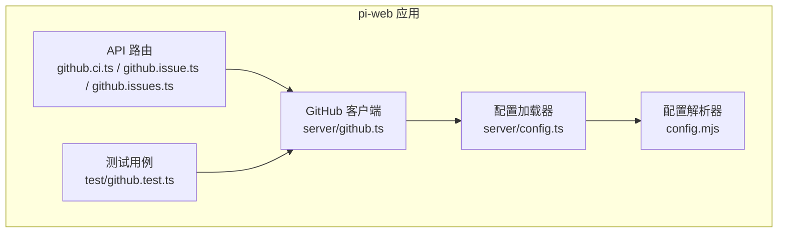
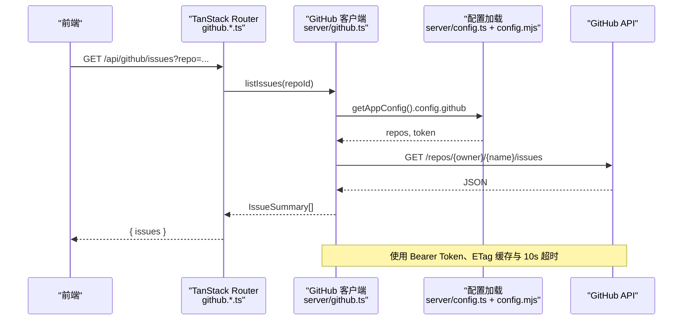
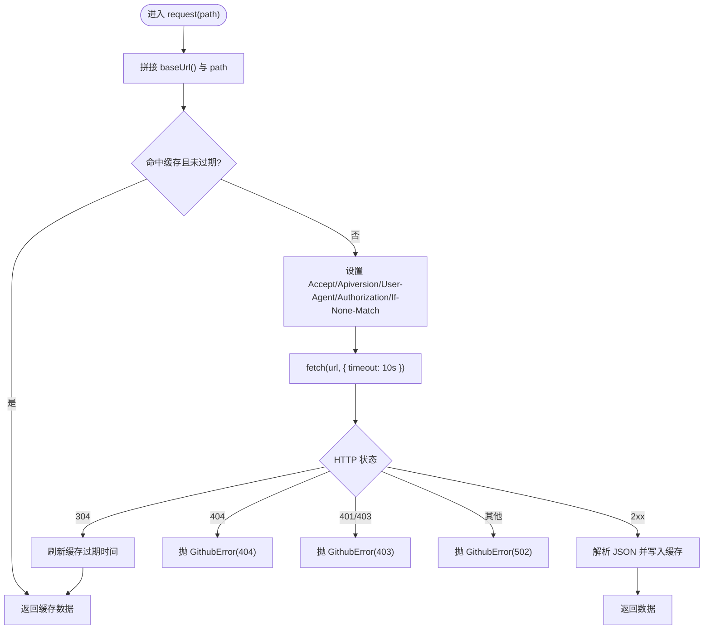
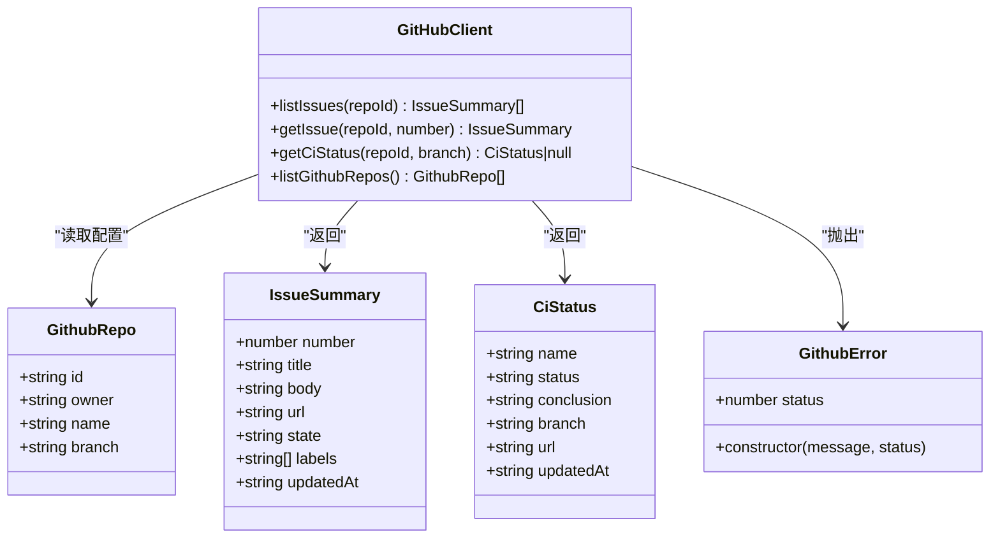
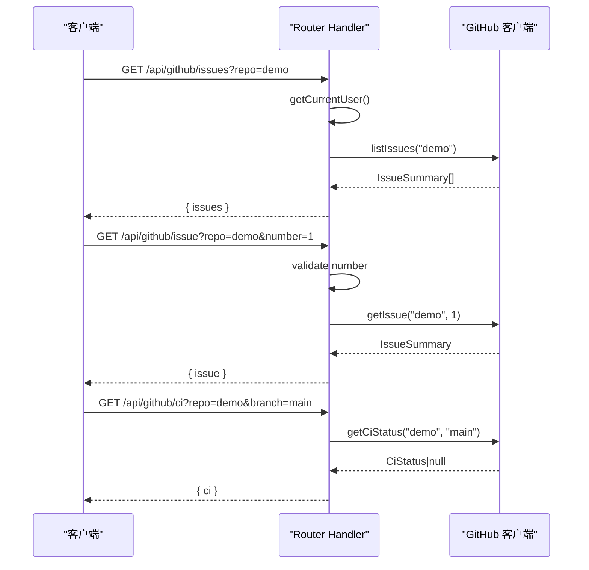
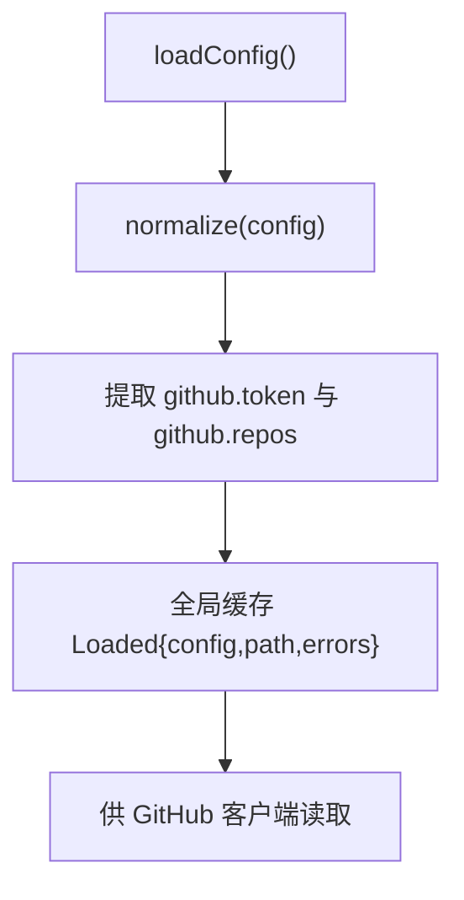
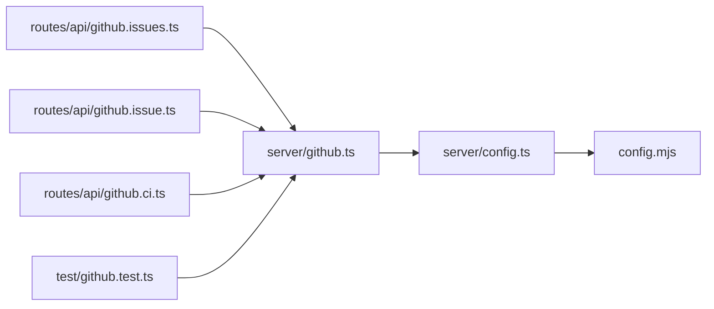

# GitHub集成

**本文引用的文件**   
- [apps/pi-web/src/server/github.ts](https://github.com/FDE-GROUP/oh-my-fde/blob/main/apps/pi-web/src/server/github.ts)
- [apps/pi-web/src/routes/api/github.ci.ts](https://github.com/FDE-GROUP/oh-my-fde/blob/main/apps/pi-web/src/routes/api/github.ci.ts)
- [apps/pi-web/src/routes/api/github.issue.ts](https://github.com/FDE-GROUP/oh-my-fde/blob/main/apps/pi-web/src/routes/api/github.issue.ts)
- [apps/pi-web/src/routes/api/github.issues.ts](https://github.com/FDE-GROUP/oh-my-fde/blob/main/apps/pi-web/src/routes/api/github.issues.ts)
- [apps/pi-web/src/server/config.ts](https://github.com/FDE-GROUP/oh-my-fde/blob/main/apps/pi-web/src/server/config.ts)
- [apps/pi-web/config.mjs](https://github.com/FDE-GROUP/oh-my-fde/blob/main/apps/pi-web/config.mjs)
- [apps/pi-web/test/github.test.ts](https://github.com/FDE-GROUP/oh-my-fde/blob/main/apps/pi-web/test/github.test.ts)

## 目录
1. [简介](#简介)
2. [项目结构](#项目结构)
3. [核心组件](#核心组件)
4. [架构总览](#架构总览)
5. [详细组件分析](#详细组件分析)
6. [依赖关系分析](#依赖关系分析)
7. [性能与缓存](#性能与缓存)
8. [故障排查指南](#故障排查指南)
9. [结论](#结论)

## 简介
本仓库的 GitHub 集成面向服务端，提供对 GitHub Issues 和 Actions CI 状态的只读查询能力。前端通过 TanStack Router 的文件路由暴露 REST API，后端统一封装 GitHub API 调用、认证、错误处理与内存缓存，并从应用配置中读取仓库白名单与令牌。该设计将外部服务访问限制在服务端，避免向浏览器泄露 Token，同时通过 ETag 与本地 Map 缓存降低请求频率。

## 项目结构
GitHub 相关代码集中在 pi-web 应用中：
- 服务端客户端与类型定义：`apps/pi-web/src/server/github.ts`
- API 路由：`apps/pi-web/src/routes/api/github.*.ts`
- 配置加载与校验：`apps/pi-web/src/server/config.ts`、`apps/pi-web/config.mjs`
- 单元测试：`apps/pi-web/test/github.test.ts`

**图表来源**
- [apps/pi-web/src/routes/api/github.ci.ts:10-27](https://github.com/FDE-GROUP/oh-my-fde/blob/main/apps/pi-web/src/routes/api/github.ci.ts#L10-L27)
- [apps/pi-web/src/routes/api/github.issue.ts:10-30](https://github.com/FDE-GROUP/oh-my-fde/blob/main/apps/pi-web/src/routes/api/github.issue.ts#L10-L30)
- [apps/pi-web/src/routes/api/github.issues.ts:10-25](https://github.com/FDE-GROUP/oh-my-fde/blob/main/apps/pi-web/src/routes/api/github.issues.ts#L10-L25)
- [apps/pi-web/src/server/github.ts:1-227](https://github.com/FDE-GROUP/oh-my-fde/blob/main/apps/pi-web/src/server/github.ts#L1-L227)
- [apps/pi-web/src/server/config.ts:10-33](https://github.com/FDE-GROUP/oh-my-fde/blob/main/apps/pi-web/src/server/config.ts#L10-L33)
- [apps/pi-web/config.mjs:30-65](https://github.com/FDE-GROUP/oh-my-fde/blob/main/apps/pi-web/config.mjs#L30-L65)
- [apps/pi-web/test/github.test.ts:1-135](https://github.com/FDE-GROUP/oh-my-fde/blob/main/apps/pi-web/test/github.test.ts#L1-L135)

**章节来源**
- [apps/pi-web/src/server/github.ts:1-227](https://github.com/FDE-GROUP/oh-my-fde/blob/main/apps/pi-web/src/server/github.ts#L1-L227)
- [apps/pi-web/src/routes/api/github.ci.ts:1-28](https://github.com/FDE-GROUP/oh-my-fde/blob/main/apps/pi-web/src/routes/api/github.ci.ts#L1-L28)
- [apps/pi-web/src/routes/api/github.issue.ts:1-31](https://github.com/FDE-GROUP/oh-my-fde/blob/main/apps/pi-web/src/routes/api/github.issue.ts#L1-L31)
- [apps/pi-web/src/routes/api/github.issues.ts:1-26](https://github.com/FDE-GROUP/oh-my-fde/blob/main/apps/pi-web/src/routes/api/github.issues.ts#L1-L26)
- [apps/pi-web/src/server/config.ts:1-34](https://github.com/FDE-GROUP/oh-my-fde/blob/main/apps/pi-web/src/server/config.ts#L1-L34)
- [apps/pi-web/config.mjs:30-65](https://github.com/FDE-GROUP/oh-my-fde/blob/main/apps/pi-web/config.mjs#L30-L65)
- [apps/pi-web/test/github.test.ts:1-135](https://github.com/FDE-GROUP/oh-my-fde/blob/main/apps/pi-web/test/github.test.ts#L1-L135)

## 核心组件
- GitHub 客户端与服务端类型
  - 仓库配置 `GithubRepo`
  - Issue 摘要 `IssueSummary`
  - CI 状态 `CiStatus`
  - 自定义异常 `GithubError`
  - 对外方法：`listIssues`、`getIssue`、`getCiStatus`、`listGithubRepos`
- API 路由层
  - `/api/github/issues`：列出已配置的 open issues（过滤 PR）
  - `/api/github/issue`：获取单条 issue
  - `/api/github/ci`：查询最近一次 workflow run
- 配置层
  - `server/config.ts`：缓存并返回应用配置对象
  - `config.mjs`：解析并规范化 `github.token` 与 `github.repos`

**章节来源**
- [apps/pi-web/src/server/github.ts:17-51](https://github.com/FDE-GROUP/oh-my-fde/blob/main/apps/pi-web/src/server/github.ts#L17-L51)
- [apps/pi-web/src/server/github.ts:137-226](https://github.com/FDE-GROUP/oh-my-fde/blob/main/apps/pi-web/src/server/github.ts#L137-L226)
- [apps/pi-web/src/routes/api/github.issues.ts:10-25](https://github.com/FDE-GROUP/oh-my-fde/blob/main/apps/pi-web/src/routes/api/github.issues.ts#L10-L25)
- [apps/pi-web/src/routes/api/github.issue.ts:10-30](https://github.com/FDE-GROUP/oh-my-fde/blob/main/apps/pi-web/src/routes/api/github.issue.ts#L10-L30)
- [apps/pi-web/src/routes/api/github.ci.ts:10-27](https://github.com/FDE-GROUP/oh-my-fde/blob/main/apps/pi-web/src/routes/api/github.ci.ts#L10-L27)
- [apps/pi-web/src/server/config.ts:20-33](https://github.com/FDE-GROUP/oh-my-fde/blob/main/apps/pi-web/src/server/config.ts#L20-L33)
- [apps/pi-web/config.mjs:63-65](https://github.com/FDE-GROUP/oh-my-fde/blob/main/apps/pi-web/config.mjs#L63-L65)

## 架构总览
GitHub 集成采用“路由层 → 客户端层 → 配置层 → 外部 GitHub API”的分层结构。所有敏感信息（Token）仅存在于服务端；客户端仅接收脱敏后的数据。

**图表来源**
- [apps/pi-web/src/routes/api/github.issues.ts:10-25](https://github.com/FDE-GROUP/oh-my-fde/blob/main/apps/pi-web/src/routes/api/github.issues.ts#L10-L25)
- [apps/pi-web/src/server/github.ts:93-128](https://github.com/FDE-GROUP/oh-my-fde/blob/main/apps/pi-web/src/server/github.ts#L93-L128)
- [apps/pi-web/src/server/config.ts:20-33](https://github.com/FDE-GROUP/oh-my-fde/blob/main/apps/pi-web/src/server/config.ts#L20-L33)
- [apps/pi-web/config.mjs:63-65](https://github.com/FDE-GROUP/oh-my-fde/blob/main/apps/pi-web/config.mjs#L63-L65)

## 详细组件分析

### GitHub 客户端（server/github.ts）
职责：
- 从配置或环境变量读取 GitHub API 地址与 Token
- 发起带鉴权与超时的 HTTP 请求
- 基于 URL 与 ETag 的内存缓存
- 标准化 Issue 与 CI 数据结构
- 抛出结构化异常 `GithubError`

关键流程要点：
- 基础地址优先使用 `PI_WEB_GITHUB_API`，默认 `https://api.github.com`
- Token 优先使用 `PI_WEB_GITHUB_TOKEN`，否则回退到配置文件中的 `github.token`
- 请求头包含 GitHub API 版本与用户代理
- 若响应为 304 且存在缓存，则延长缓存有效期并直接返回
- 非 2xx 时按状态码映射为业务错误（404、401/403、其他 502）

**图表来源**
- [apps/pi-web/src/server/github.ts:85-128](https://github.com/FDE-GROUP/oh-my-fde/blob/main/apps/pi-web/src/server/github.ts#L85-L128)

对外接口：
- `listIssues(repoId)`：列出指定仓库的 open issues，过滤 PR，最多返回 50 条
- `getIssue(repoId, number)`：读取单条 issue，若编号对应 PR 则拒绝
- `getCiStatus(repoId, branch?)`：查询最近一次 workflow run，支持分支覆盖
- `listGithubRepos()`：返回不含 Token 的仓库列表

**图表来源**
- [apps/pi-web/src/server/github.ts:17-51](https://github.com/FDE-GROUP/oh-my-fde/blob/main/apps/pi-web/src/server/github.ts#L17-L51)
- [apps/pi-web/src/server/github.ts:58-66](https://github.com/FDE-GROUP/oh-my-fde/blob/main/apps/pi-web/src/server/github.ts#L58-L66)
- [apps/pi-web/src/server/github.ts:137-226](https://github.com/FDE-GROUP/oh-my-fde/blob/main/apps/pi-web/src/server/github.ts#L137-L226)

**章节来源**
- [apps/pi-web/src/server/github.ts:1-227](https://github.com/FDE-GROUP/oh-my-fde/blob/main/apps/pi-web/src/server/github.ts#L1-L227)

### API 路由层
三个路由均遵循相同模式：
- 校验当前用户（鉴权前置）
- 解析查询参数
- 调用 GitHub 客户端
- 捕获 `GithubError` 并返回相应 HTTP 状态码

路由清单：
- `GET /api/github/issues?repo=<id>`
  - 返回 `{ issues: IssueSummary[] }`
- `GET /api/github/issue?repo=<id>&number=<n>`
  - 返回 `{ issue: IssueSummary }`
  - 当 number 非法时返回 400
- `GET /api/github/ci?repo=<id>&branch=<branch?>`
  - 返回 `{ ci: CiStatus|null }`

**图表来源**
- [apps/pi-web/src/routes/api/github.issues.ts:10-25](https://github.com/FDE-GROUP/oh-my-fde/blob/main/apps/pi-web/src/routes/api/github.issues.ts#L10-L25)
- [apps/pi-web/src/routes/api/github.issue.ts:10-30](https://github.com/FDE-GROUP/oh-my-fde/blob/main/apps/pi-web/src/routes/api/github.issue.ts#L10-L30)
- [apps/pi-web/src/routes/api/github.ci.ts:10-27](https://github.com/FDE-GROUP/oh-my-fde/blob/main/apps/pi-web/src/routes/api/github.ci.ts#L10-L27)

**章节来源**
- [apps/pi-web/src/routes/api/github.issues.ts:1-26](https://github.com/FDE-GROUP/oh-my-fde/blob/main/apps/pi-web/src/routes/api/github.issues.ts#L1-L26)
- [apps/pi-web/src/routes/api/github.issue.ts:1-31](https://github.com/FDE-GROUP/oh-my-fde/blob/main/apps/pi-web/src/routes/api/github.issue.ts#L1-L31)
- [apps/pi-web/src/routes/api/github.ci.ts:1-28](https://github.com/FDE-GROUP/oh-my-fde/blob/main/apps/pi-web/src/routes/api/github.ci.ts#L1-L28)

### 配置层
- `server/config.ts`：在进程内缓存已加载的配置，避免重复解析
- `config.mjs`：解析并规范化配置，其中 GitHub 相关字段包括：
  - `github.token`：可选字符串
  - `github.repos`：数组，每项含 `id`、`owner`、`name`、可选 `branch`

**图表来源**
- [apps/pi-web/src/server/config.ts:20-33](https://github.com/FDE-GROUP/oh-my-fde/blob/main/apps/pi-web/src/server/config.ts#L20-L33)
- [apps/pi-web/config.mjs:30-65](https://github.com/FDE-GROUP/oh-my-fde/blob/main/apps/pi-web/config.mjs#L30-L65)

**章节来源**
- [apps/pi-web/src/server/config.ts:1-34](https://github.com/FDE-GROUP/oh-my-fde/blob/main/apps/pi-web/src/server/config.ts#L1-L34)
- [apps/pi-web/config.mjs:30-65](https://github.com/FDE-GROUP/oh-my-fde/blob/main/apps/pi-web/config.mjs#L30-L65)

## 依赖关系分析
- 路由层依赖：
  - `@tanstack/react-router` 的路由创建函数
  - `../../server/user.ts` 的 `getCurrentUser`（鉴权）
  - `../../server/github.ts` 的客户端方法与异常类型
- 客户端依赖：
  - `./config.ts` 的应用配置
  - Node.js 环境下的 `fetch`、`AbortSignal.timeout`
- 测试依赖：
  - Vitest 与 Node 标准库，模拟 GitHub API 响应与配置路径

**图表来源**
- [apps/pi-web/src/routes/api/github.issues.ts:1-26](https://github.com/FDE-GROUP/oh-my-fde/blob/main/apps/pi-web/src/routes/api/github.issues.ts#L1-L26)
- [apps/pi-web/src/routes/api/github.issue.ts:1-31](https://github.com/FDE-GROUP/oh-my-fde/blob/main/apps/pi-web/src/routes/api/github.issue.ts#L1-L31)
- [apps/pi-web/src/routes/api/github.ci.ts:1-28](https://github.com/FDE-GROUP/oh-my-fde/blob/main/apps/pi-web/src/routes/api/github.ci.ts#L1-L28)
- [apps/pi-web/src/server/github.ts:1-227](https://github.com/FDE-GROUP/oh-my-fde/blob/main/apps/pi-web/src/server/github.ts#L1-L227)
- [apps/pi-web/src/server/config.ts:1-34](https://github.com/FDE-GROUP/oh-my-fde/blob/main/apps/pi-web/src/server/config.ts#L1-L34)
- [apps/pi-web/config.mjs:30-65](https://github.com/FDE-GROUP/oh-my-fde/blob/main/apps/pi-web/config.mjs#L30-L65)
- [apps/pi-web/test/github.test.ts:1-135](https://github.com/FDE-GROUP/oh-my-fde/blob/main/apps/pi-web/test/github.test.ts#L1-L135)

**章节来源**
- [apps/pi-web/src/server/github.ts:1-227](https://github.com/FDE-GROUP/oh-my-fde/blob/main/apps/pi-web/src/server/github.ts#L1-L227)
- [apps/pi-web/src/server/config.ts:1-34](https://github.com/FDE-GROUP/oh-my-fde/blob/main/apps/pi-web/src/server/config.ts#L1-L34)
- [apps/pi-web/config.mjs:30-65](https://github.com/FDE-GROUP/oh-my-fde/blob/main/apps/pi-web/config.mjs#L30-L65)
- [apps/pi-web/test/github.test.ts:1-135](https://github.com/FDE-GROUP/oh-my-fde/blob/main/apps/pi-web/test/github.test.ts#L1-L135)

## 性能与缓存
- 内存缓存
  - 以请求 URL 为键，缓存响应体与 ETag，有效期 60 秒
  - 遇到 304 Not Modified 时刷新过期时间并复用旧数据
- 请求超时
  - 所有 GitHub 请求强制 10 秒超时，避免长尾阻塞
- 数据裁剪
  - Issue 列表仅取前 50 条，减少传输与渲染压力
- 建议
  - 在高并发场景下可考虑引入分布式缓存（如 Redis）替代进程内 Map
  - 对高频读取的 CI 状态可增加短周期轮询或事件驱动更新

**章节来源**
- [apps/pi-web/src/server/github.ts:68-75](https://github.com/FDE-GROUP/oh-my-fde/blob/main/apps/pi-web/src/server/github.ts#L68-L75)
- [apps/pi-web/src/server/github.ts:93-128](https://github.com/FDE-GROUP/oh-my-fde/blob/main/apps/pi-web/src/server/github.ts#L93-L128)
- [apps/pi-web/src/server/github.ts:137-159](https://github.com/FDE-GROUP/oh-my-fde/blob/main/apps/pi-web/src/server/github.ts#L137-L159)

## 故障排查指南
常见问题与定位方式：
- 资源不存在（404）
  - 可能原因：仓库未配置、编号错误或 GitHub 侧资源缺失
  - 现象：抛出 `GithubError`，状态码 404
- 认证失败或无权限（401/403）
  - 可能原因：Token 无效、缺少权限或 Token 未正确注入
  - 现象：抛出 `GithubError`，状态码 403
- 网络或上游错误（502）
  - 可能原因：GitHub API 不可用、超时或返回非预期状态
  - 现象：抛出 `GithubError`，状态码 502
- 参数校验失败
  - 例如 issue 编号为空或非正整数
  - 现象：路由层直接返回 400 错误消息

调试建议：
- 检查环境变量 `PI_WEB_GITHUB_API` 与 `PI_WEB_GITHUB_TOKEN`
- 检查配置文件中的 `github.repos` 是否包含目标仓库
- 使用测试用例中的 Mock 思路验证本地行为与缓存逻辑

**章节来源**
- [apps/pi-web/src/server/github.ts:58-66](https://github.com/FDE-GROUP/oh-my-fde/blob/main/apps/pi-web/src/server/github.ts#L58-L66)
- [apps/pi-web/src/server/github.ts:117-127](https://github.com/FDE-GROUP/oh-my-fde/blob/main/apps/pi-web/src/server/github.ts#L117-L127)
- [apps/pi-web/src/routes/api/github.issue.ts:13-29](https://github.com/FDE-GROUP/oh-my-fde/blob/main/apps/pi-web/src/routes/api/github.issue.ts#L13-L29)
- [apps/pi-web/test/github.test.ts:112-134](https://github.com/FDE-GROUP/oh-my-fde/blob/main/apps/pi-web/test/github.test.ts#L112-L134)

## 结论
GitHub 集成通过清晰的分层与严格的错误处理，提供了稳定、安全的 Issues 与 CI 状态查询能力。服务端集中管理 Token 与仓库白名单，结合 ETag 与内存缓存提升性能。建议在后续迭代中补充更完善的监控与告警，并在高负载环境下评估分布式缓存方案。