# Pi Web UI 前端界面


**本文引用的文件**   
- [apps/pi-web/package.json](https://github.com/FDE-GROUP/oh-my-fde/blob/main/apps/pi-web/package.json)
- [apps/pi-web/server.mjs](https://github.com/FDE-GROUP/oh-my-fde/blob/main/apps/pi-web/server.mjs)
- [apps/pi-web/src/router.tsx](https://github.com/FDE-GROUP/oh-my-fde/blob/main/apps/pi-web/src/router.tsx)
- [apps/pi-web/src/routes/__root.tsx](https://github.com/FDE-GROUP/oh-my-fde/blob/main/apps/pi-web/src/routes/__root.tsx)
- [apps/pi-web/src/routes/index.tsx](https://github.com/FDE-GROUP/oh-my-fde/blob/main/apps/pi-web/src/routes/index.tsx)
- [apps/pi-web/src/routes/session.$sessionId.tsx](https://github.com/FDE-GROUP/oh-my-fde/blob/main/apps/pi-web/src/routes/session.$sessionId.tsx)
- [apps/pi-web/src/components/layout/AppFrame.tsx](https://github.com/FDE-GROUP/oh-my-fde/blob/main/apps/pi-web/src/components/layout/AppFrame.tsx)
- [apps/pi-web/src/components/layout/Sidebar.tsx](https://github.com/FDE-GROUP/oh-my-fde/blob/main/apps/pi-web/src/components/layout/Sidebar.tsx)
- [apps/pi-web/src/components/layout/RightPanel.tsx](https://github.com/FDE-GROUP/oh-my-fde/blob/main/apps/pi-web/src/components/layout/RightPanel.tsx)
- [apps/pi-web/src/components/layout/ThemeControl.tsx](https://github.com/FDE-GROUP/oh-my-fde/blob/main/apps/pi-web/src/components/layout/ThemeControl.tsx)
- [apps/pi-web/src/components/layout/NotificationBell.tsx](https://github.com/FDE-GROUP/oh-my-fde/blob/main/apps/pi-web/src/components/layout/NotificationBell.tsx)
- [apps/pi-web/src/components/layout/RetentionPanel.tsx](https://github.com/FDE-GROUP/oh-my-fde/blob/main/apps/pi-web/src/components/layout/RetentionPanel.tsx)
- [apps/pi-web/src/components/conversation/Conversation.tsx](https://github.com/FDE-GROUP/oh-my-fde/blob/main/apps/pi-web/src/components/conversation/Conversation.tsx)
- [apps/pi-web/src/components/conversation/MessageList.tsx](https://github.com/FDE-GROUP/oh-my-fde/blob/main/apps/pi-web/src/components/conversation/MessageList.tsx)
- [apps/pi-web/src/components/conversation/SessionBar.tsx](https://github.com/FDE-GROUP/oh-my-fde/blob/main/apps/pi-web/src/components/conversation/SessionBar.tsx)
- [apps/pi-web/src/components/conversation/Composer.tsx](https://github.com/FDE-GROUP/oh-my-fde/blob/main/apps/pi-web/src/components/conversation/Composer.tsx)
- [apps/pi-web/src/components/tools/ToolCard.tsx](https://github.com/FDE-GROUP/oh-my-fde/blob/main/apps/pi-web/src/components/tools/ToolCard.tsx)
- [apps/pi-web/src/lib/api.ts](https://github.com/FDE-GROUP/oh-my-fde/blob/main/apps/pi-web/src/lib/api.ts)
- [apps/pi-web/src/lib/conversation.ts](https://github.com/FDE-GROUP/oh-my-fde/blob/main/apps/pi-web/src/lib/conversation.ts)
- [apps/pi-web/src/lib/images.ts](https://github.com/FDE-GROUP/oh-my-fde/blob/main/apps/pi-web/src/lib/images.ts)
- [apps/pi-web/src/lib/theme.ts](https://github.com/FDE-GROUP/oh-my-fde/blob/main/apps/pi-web/src/lib/theme.ts)
- [apps/pi-web/src/lib/viewport.ts](https://github.com/FDE-GROUP/oh-my-fde/blob/main/apps/pi-web/src/lib/viewport.ts)
- [apps/pi-web/src/lib/notifications.ts](https://github.com/FDE-GROUP/oh-my-fde/blob/main/apps/pi-web/src/lib/notifications.ts)
- [apps/pi-web/src/styles/app.css](https://github.com/FDE-GROUP/oh-my-fde/blob/main/apps/pi-web/src/styles/app.css)
- [apps/pi-web/src/server/health.ts](https://github.com/FDE-GROUP/oh-my-fde/blob/main/apps/pi-web/src/server/health.ts)
- [apps/pi-web/src/server/sessions.ts](https://github.com/FDE-GROUP/oh-my-fde/blob/main/apps/pi-web/src/server/sessions.ts)
- [apps/pi-web/src/server/files.ts](https://github.com/FDE-GROUP/oh-my-fde/blob/main/apps/pi-web/src/server/files.ts)
- [apps/pi-web/src/server/user.ts](https://github.com/FDE-GROUP/oh-my-fde/blob/main/apps/pi-web/src/server/user.ts)
- [apps/pi-web/src/server/workspaces.ts](https://github.com/FDE-GROUP/oh-my-fde/blob/main/apps/pi-web/src/server/workspaces.ts)
- [apps/pi-web/src/server/access.ts](https://github.com/FDE-GROUP/oh-my-fde/blob/main/apps/pi-web/src/server/access.ts)
- [apps/pi-web/src/server/owners.ts](https://github.com/FDE-GROUP/oh-my-fde/blob/main/apps/pi-web/src/server/owners.ts)
- [apps/pi-web/src/server/config.ts](https://github.com/FDE-GROUP/oh-my-fde/blob/main/apps/pi-web/src/server/config.ts)
- [apps/pi-web/src/server/github.ts](https://github.com/FDE-GROUP/oh-my-fde/blob/main/apps/pi-web/src/server/github.ts)
- [apps/pi-web/src/server/retention.ts](https://github.com/FDE-GROUP/oh-my-fde/blob/main/apps/pi-web/src/server/retention.ts)
- [apps/pi-web/src/routes/api/sessions.ts](https://github.com/FDE-GROUP/oh-my-fde/blob/main/apps/pi-web/src/routes/api/sessions.ts)
- [apps/pi-web/src/routes/api/sessions.$sessionId.ts](https://github.com/FDE-GROUP/oh-my-fde/blob/main/apps/pi-web/src/routes/api/sessions.$sessionId.ts)
- [apps/pi-web/src/routes/api/sessions.$sessionId.commands.ts](https://github.com/FDE-GROUP/oh-my-fde/blob/main/apps/pi-web/src/routes/api/sessions.$sessionId.commands.ts)
- [apps/pi-web/src/routes/api/sessions.$sessionId.events.ts](https://github.com/FDE-GROUP/oh-my-fde/blob/main/apps/pi-web/src/routes/api/sessions.$sessionId.events.ts)
- [apps/pi-web/src/routes/api/sessions.$sessionId.fork.ts](https://github.com/FDE-GROUP/oh-my-fde/blob/main/apps/pi-web/src/routes/api/sessions.$sessionId.fork.ts)
- [apps/pi-web/src/routes/api/sessions.$sessionId.clone.ts](https://github.com/FDE-GROUP/oh-my-fde/blob/main/apps/pi-web/src/routes/api/sessions.$sessionId.clone.ts)
- [apps/pi-web/src/routes/api/files.expand.ts](https://github.com/FDE-GROUP/oh-my-fde/blob/main/apps/pi-web/src/routes/api/files.expand.ts)
- [apps/pi-web/src/routes/api/files.search.ts](https://github.com/FDE-GROUP/oh-my-fde/blob/main/apps/pi-web/src/routes/api/files.search.ts)
- [apps/pi-web/src/routes/api/workspaces.ts](https://github.com/FDE-GROUP/oh-my-fde/blob/main/apps/pi-web/src/routes/api/workspaces.ts)
- [apps/pi-web/src/routes/api/github.ci.ts](https://github.com/FDE-GROUP/oh-my-fde/blob/main/apps/pi-web/src/routes/api/github.ci.ts)
- [apps/pi-web/src/routes/api/github.issue.ts](https://github.com/FDE-GROUP/oh-my-fde/blob/main/apps/pi-web/src/routes/api/github.issue.ts)
- [apps/pi-web/src/routes/api/github.issues.ts](https://github.com/FDE-GROUP/oh-my-fde/blob/main/apps/pi-web/src/routes/api/github.issues.ts)
- [apps/pi-web/src/routes/api/admin.retention.ts](https://github.com/FDE-GROUP/oh-my-fde/blob/main/apps/pi-web/src/routes/api/admin.retention.ts)
- [apps/pi-web/src/server/runtime-manager.ts](https://github.com/FDE-GROUP/oh-my-fde/blob/main/apps/pi-web/src/server/runtime-manager.ts)
- [apps/pi-web/src/server/runtime.ts](https://github.com/FDE-GROUP/oh-my-fde/blob/main/apps/pi-web/src/server/runtime.ts)
- [apps/pi-web/public/manifest.webmanifest](https://github.com/FDE-GROUP/oh-my-fde/blob/main/apps/pi-web/public/manifest.webmanifest)
- [apps/omfde/bin/omfde.mjs](https://github.com/FDE-GROUP/oh-my-fde/blob/main/apps/omfde/bin/omfde.mjs)
- [apps/omfde/README.md](https://github.com/FDE-GROUP/oh-my-fde/blob/main/apps/omfde/README.md)


## 更新摘要
**变更内容**   
- 新增 GitHub 集成能力，支持 Issue 列表查询、单条 Issue 读取和 CI 状态监控
- 实现通知系统，支持页面内通知和浏览器原生通知，提供通知铃铛组件
- 添加会话保留管理功能，支持预览和清理过期会话、分享和审计日志
- 新增 /api/github/* API 端点，包括 CI 状态、Issue 列表和单条 Issue 查询
- 新增 /api/admin/retention 管理员接口，支持保留策略预览和应用
- 增强 SessionBar 组件，显示 CI 状态链接和失败提示
- 完善权限控制，管理员角色访问保留清理功能

## 目录
1. [简介](#简介)
2. [项目结构](#项目结构)
3. [核心组件](#核心组件)
4. [架构总览](#架构总览)
5. [详细组件分析](#详细组件分析)
6. [依赖关系分析](#依赖关系分析)
7. [性能与可维护性](#性能与可维护性)
8. [故障排查指南](#故障排查指南)
9. [结论](#结论)

## 简介
Pi Web 是 Pi 的完整Web前端界面，现已从单用户平台升级为多用户、多工作区的现代化Web UI。**当前版本通过omfde启动器默认提供Web UI体验**，同时保留TUI模式作为备选方案。主要特性包括：
- **omfde启动器默认Web UI**，提供现代化的浏览器界面体验
- **多用户认证系统**，支持基于请求头的用户身份识别和会话所有权管理
- **工作区隔离机制**，支持配置化的多工作区访问控制和资源隔离
- **会话归属索引**，使用独立文件存储会话与用户的映射关系
- **完整的图像附件系统**，支持图片上传、压缩和预览
- **文件引用系统(@file)**，支持项目文件搜索和内容展开
- **斜杠命令界面(/command)**，提供可扩展的命令系统
- **增强的会话管理**，支持分叉(fork)和克隆(clone)操作
- **并行会话支持**，提升多任务处理能力
- **PWA支持**，提供离线应用能力和桌面图标安装
- **GitHub 集成**，支持 Issue 管理和 CI 状态监控
- **通知系统**，提供页面内通知和浏览器原生通知
- **会话保留管理**，支持自动清理过期数据
- 主题系统与响应式布局
- 健康检查与服务端函数

该文档从代码层面梳理前端界面与后端运行时的协作方式，帮助读者快速理解整体架构、关键数据流与扩展点。

## 项目结构
Pi Web 采用按功能域组织的目录结构：
- routes：页面路由与接口路由
- components：UI组件（布局、对话、原语、工具）
- lib：通用逻辑（API客户端、对话状态、图像附件、主题、视口、通知）
- server：服务端能力（健康检查、JSONL分帧、运行时与运行时管理器、会话管理、文件处理、用户认证、工作区管理、权限控制、GitHub集成、保留管理）
- styles：样式入口与Token映射

```mermaid
graph TB
subgraph "应用入口"
Pkg["package.json"]
Server["server.mjs"]
Router["router.tsx"]
Root["routes/__root.tsx"]
end
subgraph "页面与接口"
Index["routes/index.tsx"]
SessionPage["routes/session.$sessionId.tsx"]
ApiSessions["routes/api/sessions.ts"]
ApiSessionId["routes/api/sessions.$sessionId.ts"]
ApiCommands["routes/api/sessions.$sessionId.commands.ts"]
ApiEvents["routes/api/sessions.$sessionId.events.ts"]
ApiFork["routes/api/sessions.$sessionId.fork.ts"]
ApiClone["routes/api/sessions.$sessionId.clone.ts"]
ApiFilesExpand["routes/api/files.expand.ts"]
ApiFilesSearch["routes/api/files.search.ts"]
ApiWorkspaces["routes/api/workspaces.ts"]
ApiGithubCI["routes/api/github.ci.ts"]
ApiGithubIssue["routes/api/github.issue.ts"]
ApiGithubIssues["routes/api/github.issues.ts"]
ApiAdminRetention["routes/api/admin.retention.ts"]
end
subgraph "UI 组件"
AppFrame["components/layout/AppFrame.tsx"]
Sidebar["components/layout/Sidebar.tsx"]
RightPanel["components/layout/RightPanel.tsx"]
ThemeControl["components/layout/ThemeControl.tsx"]
NotificationBell["components/layout/NotificationBell.tsx"]
RetentionPanel["components/layout/RetentionPanel.tsx"]
Conversation["components/conversation/Conversation.tsx"]
MessageList["components/conversation/MessageList.tsx"]
SessionBar["components/conversation/SessionBar.tsx"]
Composer["components/conversation/Composer.tsx"]
ToolCard["components/tools/ToolCard.tsx"]
end
subgraph "服务层"
Health["server/health.ts"]
Sessions["server/sessions.ts"]
Files["server/files.ts"]
User["server/user.ts"]
Workspaces["server/workspaces.ts"]
Access["server/access.ts"]
Owners["server/owners.ts"]
Config["server/config.ts"]
Github["server/github.ts"]
Retention["server/retention.ts"]
RuntimeMgr["server/runtime-manager.ts"]
Runtime["server/runtime.ts"]
end
subgraph "样式与工具"
Theme["lib/theme.ts"]
Viewport["viewport.ts"]
Api["lib/api.ts"]
Images["lib/images.ts"]
ConversationState["lib/conversation.ts"]
Notifications["lib/notifications.ts"]
Styles["styles/app.css"]
Manifest["public/manifest.webmanifest"]
end
Pkg --> Server
Server --> Router
Router --> Root
Root --> Index
Index --> AppFrame
SessionPage --> AppFrame
AppFrame --> Sidebar
AppFrame --> RightPanel
AppFrame --> ThemeControl
AppFrame --> NotificationBell
AppFrame --> Conversation
Conversation --> MessageList
Conversation --> SessionBar
Conversation --> Composer
MessageList --> ToolCard
Index --> Health
ApiSessions --> RuntimeMgr
ApiSessionId --> RuntimeMgr
ApiCommands --> RuntimeMgr
ApiEvents --> RuntimeMgr
ApiFork --> RuntimeMgr
ApiClone --> RuntimeMgr
ApiFilesExpand --> Files
ApiFilesSearch --> Files
ApiWorkspaces --> Workspaces
ApiGithubCI --> Github
ApiGithubIssue --> Github
ApiGithubIssues --> Github
ApiAdminRetention --> Retention
RuntimeMgr --> Runtime
AppFrame --> Viewport
Root --> Theme
Root --> Styles
```

**图示来源**
- [apps/pi-web/package.json:1-41](https://github.com/FDE-GROUP/oh-my-fde/blob/main/apps/pi-web/package.json#L1-L41)
- [apps/pi-web/server.mjs:1-139](https://github.com/FDE-GROUP/oh-my-fde/blob/main/apps/pi-web/server.mjs#L1-L139)
- [apps/pi-web/src/router.tsx:1-18](https://github.com/FDE-GROUP/oh-my-fde/blob/main/apps/pi-web/src/router.tsx#L1-L18)
- [apps/pi-web/src/routes/__root.tsx:1-32](https://github.com/FDE-GROUP/oh-my-fde/blob/main/apps/pi-web/src/routes/__root.tsx#L1-L32)
- [apps/pi-web/src/routes/index.tsx:1-14](https://github.com/FDE-GROUP/oh-my-fde/blob/main/apps/pi-web/src/routes/index.tsx#L1-L14)
- [apps/pi-web/src/routes/session.$sessionId.tsx:1-20](https://github.com/FDE-GROUP/oh-my-fde/blob/main/apps/pi-web/src/routes/session.$sessionId.tsx#L1-L20)
- [apps/pi-web/src/components/layout/AppFrame.tsx:1-62](https://github.com/FDE-GROUP/oh-my-fde/blob/main/apps/pi-web/src/components/layout/AppFrame.tsx#L1-L62)
- [apps/pi-web/src/components/layout/Sidebar.tsx:1-77](https://github.com/FDE-GROUP/oh-my-fde/blob/main/apps/pi-web/src/components/layout/Sidebar.tsx#L1-L77)
- [apps/pi-web/src/components/layout/RightPanel.tsx:1-10](https://github.com/FDE-GROUP/oh-my-fde/blob/main/apps/pi-web/src/components/layout/RightPanel.tsx#L1-L10)
- [apps/pi-web/src/components/layout/ThemeControl.tsx:1-71](https://github.com/FDE-GROUP/oh-my-fde/blob/main/apps/pi-web/src/components/layout/ThemeControl.tsx#L1-L71)
- [apps/pi-web/src/components/layout/NotificationBell.tsx:1-113](https://github.com/FDE-GROUP/oh-my-fde/blob/main/apps/pi-web/src/components/layout/NotificationBell.tsx#L1-L113)
- [apps/pi-web/src/components/layout/RetentionPanel.tsx:1-128](https://github.com/FDE-GROUP/oh-my-fde/blob/main/apps/pi-web/src/components/layout/RetentionPanel.tsx#L1-L128)
- [apps/pi-web/src/components/conversation/Conversation.tsx:1-386](https://github.com/FDE-GROUP/oh-my-fde/blob/main/apps/pi-web/src/components/conversation/Conversation.tsx#L1-L386)
- [apps/pi-web/src/components/conversation/MessageList.tsx:1-232](https://github.com/FDE-GROUP/oh-my-fde/blob/main/apps/pi-web/src/components/conversation/MessageList.tsx#L1-L232)
- [apps/pi-web/src/components/conversation/SessionBar.tsx:1-68](https://github.com/FDE-GROUP/oh-my-fde/blob/main/apps/pi-web/src/components/conversation/SessionBar.tsx#L1-L68)
- [apps/pi-web/src/components/conversation/Composer.tsx:1-386](https://github.com/FDE-GROUP/oh-my-fde/blob/main/apps/pi-web/src/components/conversation/Composer.tsx#L1-L386)
- [apps/pi-web/src/components/tools/ToolCard.tsx:1-124](https://github.com/FDE-GROUP/oh-my-fde/blob/main/apps/pi-web/src/components/tools/ToolCard.tsx#L1-L124)
- [apps/pi-web/src/server/health.ts:1-46](https://github.com/FDE-GROUP/oh-my-fde/blob/main/apps/pi-web/src/server/health.ts#L1-L46)
- [apps/pi-web/src/server/sessions.ts:1-120](https://github.com/FDE-GROUP/oh-my-fde/blob/main/apps/pi-web/src/server/sessions.ts#L1-L120)
- [apps/pi-web/src/server/files.ts:1-187](https://github.com/FDE-GROUP/oh-my-fde/blob/main/apps/pi-web/src/server/files.ts#L1-L187)
- [apps/pi-web/src/server/user.ts:1-33](https://github.com/FDE-GROUP/oh-my-fde/blob/main/apps/pi-web/src/server/user.ts#L1-L33)
- [apps/pi-web/src/server/workspaces.ts:1-51](https://github.com/FDE-GROUP/oh-my-fde/blob/main/apps/pi-web/src/server/workspaces.ts#L1-L51)
- [apps/pi-web/src/server/access.ts:1-25](https://github.com/FDE-GROUP/oh-my-fde/blob/main/apps/pi-web/src/server/access.ts#L1-L25)
- [apps/pi-web/src/server/owners.ts:1-118](https://github.com/FDE-GROUP/oh-my-fde/blob/main/apps/pi-web/src/server/owners.ts#L1-L118)
- [apps/pi-web/src/server/config.ts:1-34](https://github.com/FDE-GROUP/oh-my-fde/blob/main/apps/pi-web/src/server/config.ts#L1-L34)
- [apps/pi-web/src/server/github.ts:1-227](https://github.com/FDE-GROUP/oh-my-fde/blob/main/apps/pi-web/src/server/github.ts#L1-L227)
- [apps/pi-web/src/server/retention.ts:1-173](https://github.com/FDE-GROUP/oh-my-fde/blob/main/apps/pi-web/src/server/retention.ts#L1-L173)
- [apps/pi-web/src/routes/api/sessions.ts:1-59](https://github.com/FDE-GROUP/oh-my-fde/blob/main/apps/pi-web/src/routes/api/sessions.ts#L1-L59)
- [apps/pi-web/src/routes/api/sessions.$sessionId.ts:1-48](https://github.com/FDE-GROUP/oh-my-fde/blob/main/apps/pi-web/src/routes/api/sessions.$sessionId.ts#L1-L48)
- [apps/pi-web/src/routes/api/sessions.$sessionId.commands.ts:1-40](https://github.com/FDE-GROUP/oh-my-fde/blob/main/apps/pi-web/src/routes/api/sessions.$sessionId.commands.ts#L1-L40)
- [apps/pi-web/src/routes/api/sessions.$sessionId.events.ts:1-92](https://github.com/FDE-GROUP/oh-my-fde/blob/main/apps/pi-web/src/routes/api/sessions.$sessionId.events.ts#L1-L92)
- [apps/pi-web/src/routes/api/sessions.$sessionId.fork.ts:1-38](https://github.com/FDE-GROUP/oh-my-fde/blob/main/apps/pi-web/src/routes/api/sessions.$sessionId.fork.ts#L1-L38)
- [apps/pi-web/src/routes/api/sessions.$sessionId.clone.ts:1-32](https://github.com/FDE-GROUP/oh-my-fde/blob/main/apps/pi-web/src/routes/api/sessions.$sessionId.clone.ts#L1-L32)
- [apps/pi-web/src/routes/api/files.expand.ts:1-31](https://github.com/FDE-GROUP/oh-my-fde/blob/main/apps/pi-web/src/routes/api/files.expand.ts#L1-L31)
- [apps/pi-web/src/routes/api/files.search.ts:1-23](https://github.com/FDE-GROUP/oh-my-fde/blob/main/apps/pi-web/src/routes/api/files.search.ts#L1-L23)
- [apps/pi-web/src/routes/api/workspaces.ts:1-17](https://github.com/FDE-GROUP/oh-my-fde/blob/main/apps/pi-web/src/routes/api/workspaces.ts#L1-L17)
- [apps/pi-web/src/routes/api/github.ci.ts:1-28](https://github.com/FDE-GROUP/oh-my-fde/blob/main/apps/pi-web/src/routes/api/github.ci.ts#L1-L28)
- [apps/pi-web/src/routes/api/github.issue.ts:1-31](https://github.com/FDE-GROUP/oh-my-fde/blob/main/apps/pi-web/src/routes/api/github.issue.ts#L1-L31)
- [apps/pi-web/src/routes/api/github.issues.ts:1-26](https://github.com/FDE-GROUP/oh-my-fde/blob/main/apps/pi-web/src/routes/api/github.issues.ts#L1-L26)
- [apps/pi-web/src/routes/api/admin.retention.ts:1-42](https://github.com/FDE-GROUP/oh-my-fde/blob/main/apps/pi-web/src/routes/api/admin.retention.ts#L1-L42)
- [apps/pi-web/src/server/runtime-manager.ts:1-194](https://github.com/FDE-GROUP/oh-my-fde/blob/main/apps/pi-web/src/server/runtime-manager.ts#L1-L194)
- [apps/pi-web/src/server/runtime.ts:1-337](https://github.com/FDE-GROUP/oh-my-fde/blob/main/apps/pi-web/src/server/runtime.ts#L1-L337)
- [apps/pi-web/src/lib/theme.ts:1-123](https://github.com/FDE-GROUP/oh-my-fde/blob/main/apps/pi-web/src/lib/theme.ts#L1-L123)
- [apps/pi-web/src/lib/viewport.ts:1-41](https://github.com/FDE-GROUP/oh-my-fde/blob/main/apps/pi-web/src/lib/viewport.ts#L1-L41)
- [apps/pi-web/src/lib/api.ts:1-275](https://github.com/FDE-GROUP/oh-my-fde/blob/main/apps/pi-web/src/lib/api.ts#L1-L275)
- [apps/pi-web/src/lib/images.ts:1-109](https://github.com/FDE-GROUP/oh-my-fde/blob/main/apps/pi-web/src/lib/images.ts#L1-L109)
- [apps/pi-web/src/lib/conversation.ts:1-226](https://github.com/FDE-GROUP/oh-my-fde/blob/main/apps/pi-web/src/lib/conversation.ts#L1-L226)
- [apps/pi-web/src/lib/notifications.ts:1-142](https://github.com/FDE-GROUP/oh-my-fde/blob/main/apps/pi-web/src/lib/notifications.ts#L1-L142)
- [apps/pi-web/src/styles/app.css:1-95](https://github.com/FDE-GROUP/oh-my-fde/blob/main/apps/pi-web/src/styles/app.css#L1-L95)
- [apps/pi-web/public/manifest.webmanifest:1-30](https://github.com/FDE-GROUP/oh-my-fde/blob/main/apps/pi-web/public/manifest.webmanifest#L1-L30)

**章节来源**
- [apps/pi-web/package.json:1-41](https://github.com/FDE-GROUP/oh-my-fde/blob/main/apps/pi-web/package.json#L1-L41)
- [apps/pi-web/server.mjs:1-139](https://github.com/FDE-GROUP/oh-my-fde/blob/main/apps/pi-web/server.mjs#L1-L139)
- [apps/pi-web/src/router.tsx:1-18](https://github.com/FDE-GROUP/oh-my-fde/blob/main/apps/pi-web/src/router.tsx#L1-L18)
- [apps/pi-web/src/routes/__root.tsx:1-32](https://github.com/FDE-GROUP/oh-my-fde/blob/main/apps/pi-web/src/routes/__root.tsx#L1-L32)
- [apps/pi-web/src/routes/index.tsx:1-14](https://github.com/FDE-GROUP/oh-my-fde/blob/main/apps/pi-web/src/routes/index.tsx#L1-L14)

## 核心组件
- **omfde启动器**
  - **新增** omfde.mjs作为平台启动器，默认启动Pi Web UI而非TUI
  - 支持完整的命令行参数解析：--tui、--port、--host、--config、--no-open
  - 实现浏览器自动打开功能，提升用户体验
  - 支持环境变量配置：PI_WEB_CWD、PI_WEB_HOST、PI_WEB_PORT、PI_WEB_CONFIG
  - 提供优雅的错误处理和用户反馈
- **多用户认证系统**
  - user.ts 提供当前请求用户信息的读取，支持生产环境通过请求头注入用户身份，开发模式回退为本地用户。
  - 支持 `x-piweb-user` 和 `x-piweb-user-name` 请求头，用于传递用户ID和名称。
  - 生产环境由边缘层在认证通过后注入用户信息，并删除浏览器传入的同名头。
- **工作区管理系统**
  - workspaces.ts 实现工作区白名单管理和配置化工作区访问。
  - 支持按id查找工作区，提供默认工作区回退机制。
  - 工作区配置来自应用配置，支持多个工作区同时存在。
- **会话归属索引系统**
  - owners.ts 维护会话与用户的映射关系，使用 `~/.pi-web/sessions.json` 存储。
  - 支持会话归属记录、查询、删除和按用户列出功能。
  - 使用临时文件+rename原子写入，权限设置为0600确保安全性。
- **权限控制系统**
  - access.ts 实现会话访问控制，校验用户是否可访问特定会话。
  - 支持归属检查和local用户特权，非local用户只能访问自己的会话。
- **服务器实现与安全**
  - server.mjs 提供完整的HTTP服务器，包含安全头部、主机验证和内容类型处理。
  - 支持静态文件服务和动态请求转发到TanStack Start应用。
  - 实现CSP、X-Frame-Options等安全头部配置。
- **PWA支持**
  - manifest.webmanifest 定义PWA应用元数据，包括应用名称、图标和启动URL。
  - 支持standalone显示模式和自定义主题颜色。
- **路由与根文档**
  - 通过 TanStack Router 创建路由器并挂载全局路由树，启用滚动恢复与意图预加载。
  - 根路由注入 HTML 元信息、样式与主题初始化脚本，确保首屏无闪烁。
  - 新增会话页面路由 `/session/$sessionId`。
- **图像附件系统**
  - images.ts 实现图片预处理、压缩和base64编码。
  - 支持拖拽、粘贴和文件选择三种输入方式。
  - 自动压缩图片到2048px边长，最大5MB大小限制。
- **文件引用系统(@file)**
  - files.ts 实现项目文件搜索和安全的内容展开。
  - 支持文本文件和图片文件的智能识别。
  - 内置敏感文件过滤和路径安全检查。
- **斜杠命令界面(/command)**
  - Composer.tsx 实现命令自动补全和执行。
  - 支持扩展命令、提示词和技能三类命令源。
  - 提供流畅的用户交互体验。
- **增强的会话管理**
  - 支持分叉(fork)操作，从指定消息点创建新会话分支。
  - 支持克隆(clone)操作，复制当前会话状态。
  - 并行会话支持，提升多任务处理能力。
- **GitHub 集成系统**
  - github.ts 实现 GitHub API 客户端，支持 Issue 管理和 CI 状态查询。
  - 支持仓库配置、令牌认证和请求缓存。
  - 提供 Issue 列表、单条 Issue 和 CI 状态查询功能。
- **通知系统**
  - notifications.ts 实现页面内通知和浏览器原生通知。
  - 支持通知持久化、未读计数和浏览器通知权限管理。
  - NotificationBell 组件提供通知铃铛界面。
- **会话保留管理**
  - retention.ts 实现会话、分享和审计日志的保留清理。
  - 支持预览和实际应用清理操作。
  - RetentionPanel 组件提供保留清理界面。
- **对话组件系统**
  - Conversation 组件管理会话状态、模型选择和消息流。
  - MessageList 组件渲染消息历史、工具调用和流式输出。
  - SessionBar 组件显示模型选择、使用统计、成本信息和 CI 状态。
  - ToolCard 组件展示工具调用的参数、执行状态和结果。
  - Composer 组件集成所有输入功能的统一界面。
- **侧边栏与右侧面板**
  - Sidebar 提供品牌标识、新建会话按钮、会话列表与主题切换控件。
  - RightPanel 为预留插槽，默认隐藏，后续可扩展停靠面板。
  - ThemeControl 组件提供主题选择界面。
- **主题与视口**
  - theme.ts 实现主题偏好读取、解析与应用，支持系统主题监听与发丝线宽度适配。
  - viewport.ts 订阅浏览器视口宽度，避免 SSR/CSR 不一致。
- **健康检查与会话管理**
  - health.ts 暴露服务端函数，返回进程工作目录、Node 版本与 PID。
  - sessions.ts 提供会话列表查询和路径查找功能，支持按用户和工作区过滤。
- **会话运行时与 API**
  - runtime-manager.ts 管理多个 Pi 子进程运行时，具备并发上限、空闲回收与清理定时器。
  - runtime.ts 封装单个 Pi RPC 子进程的生命周期、命令收发、事件分发与快照获取。
  - REST API路由：创建会话、获取快照、关闭会话、发送命令、事件流、分叉、克隆、文件操作、工作区列表、GitHub 集成、保留管理。

**章节来源**
- [apps/omfde/bin/omfde.mjs:1-146](https://github.com/FDE-GROUP/oh-my-fde/blob/main/apps/omfde/bin/omfde.mjs#L1-L146)
- [apps/pi-web/server.mjs:1-139](https://github.com/FDE-GROUP/oh-my-fde/blob/main/apps/pi-web/server.mjs#L1-L139)
- [apps/pi-web/src/router.tsx:1-18](https://github.com/FDE-GROUP/oh-my-fde/blob/main/apps/pi-web/src/router.tsx#L1-L18)
- [apps/pi-web/src/routes/__root.tsx:1-32](https://github.com/FDE-GROUP/oh-my-fde/blob/main/apps/pi-web/src/routes/__root.tsx#L1-L32)
- [apps/pi-web/src/routes/index.tsx:1-14](https://github.com/FDE-GROUP/oh-my-fde/blob/main/apps/pi-web/src/routes/index.tsx#L1-L14)
- [apps/pi-web/src/routes/session.$sessionId.tsx:1-20](https://github.com/FDE-GROUP/oh-my-fde/blob/main/apps/pi-web/src/routes/session.$sessionId.tsx#L1-L20)
- [apps/pi-web/src/components/layout/AppFrame.tsx:1-62](https://github.com/FDE-GROUP/oh-my-fde/blob/main/apps/pi-web/src/components/layout/AppFrame.tsx#L1-L62)
- [apps/pi-web/src/components/layout/Sidebar.tsx:1-77](https://github.com/FDE-GROUP/oh-my-fde/blob/main/apps/pi-web/src/components/layout/Sidebar.tsx#L1-L77)
- [apps/pi-web/src/components/layout/RightPanel.tsx:1-10](https://github.com/FDE-GROUP/oh-my-fde/blob/main/apps/pi-web/src/components/layout/RightPanel.tsx#L1-L10)
- [apps/pi-web/src/components/layout/ThemeControl.tsx:1-71](https://github.com/FDE-GROUP/oh-my-fde/blob/main/apps/pi-web/src/components/layout/ThemeControl.tsx#L1-L71)
- [apps/pi-web/src/components/layout/NotificationBell.tsx:1-113](https://github.com/FDE-GROUP/oh-my-fde/blob/main/apps/pi-web/src/components/layout/NotificationBell.tsx#L1-L113)
- [apps/pi-web/src/components/layout/RetentionPanel.tsx:1-128](https://github.com/FDE-GROUP/oh-my-fde/blob/main/apps/pi-web/src/components/layout/RetentionPanel.tsx#L1-L128)
- [apps/pi-web/src/components/conversation/Conversation.tsx:1-386](https://github.com/FDE-GROUP/oh-my-fde/blob/main/apps/pi-web/src/components/conversation/Conversation.tsx#L1-L386)
- [apps/pi-web/src/components/conversation/MessageList.tsx:1-232](https://github.com/FDE-GROUP/oh-my-fde/blob/main/apps/pi-web/src/components/conversation/MessageList.tsx#L1-L232)
- [apps/pi-web/src/components/conversation/SessionBar.tsx:1-68](https://github.com/FDE-GROUP/oh-my-fde/blob/main/apps/pi-web/src/components/conversation/SessionBar.tsx#L1-L68)
- [apps/pi-web/src/components/conversation/Composer.tsx:1-386](https://github.com/FDE-GROUP/oh-my-fde/blob/main/apps/pi-web/src/components/conversation/Composer.tsx#L1-L386)
- [apps/pi-web/src/components/tools/ToolCard.tsx:1-124](https://github.com/FDE-GROUP/oh-my-fde/blob/main/apps/pi-web/src/components/tools/ToolCard.tsx#L1-L124)
- [apps/pi-web/src/lib/theme.ts:1-123](https://github.com/FDE-GROUP/oh-my-fde/blob/main/apps/pi-web/src/lib/theme.ts#L1-L123)
- [apps/pi-web/src/lib/viewport.ts:1-41](https://github.com/FDE-GROUP/oh-my-fde/blob/main/apps/pi-web/src/lib/viewport.ts#L1-L41)
- [apps/pi-web/src/lib/images.ts:1-109](https://github.com/FDE-GROUP/oh-my-fde/blob/main/apps/pi-web/src/lib/images.ts#L1-L109)
- [apps/pi-web/src/lib/notifications.ts:1-142](https://github.com/FDE-GROUP/oh-my-fde/blob/main/apps/pi-web/src/lib/notifications.ts#L1-L142)
- [apps/pi-web/src/server/health.ts:1-46](https://github.com/FDE-GROUP/oh-my-fde/blob/main/apps/pi-web/src/server/health.ts#L1-L46)
- [apps/pi-web/src/server/sessions.ts:1-120](https://github.com/FDE-GROUP/oh-my-fde/blob/main/apps/pi-web/src/server/sessions.ts#L1-L120)
- [apps/pi-web/src/server/files.ts:1-187](https://github.com/FDE-GROUP/oh-my-fde/blob/main/apps/pi-web/src/server/files.ts#L1-L187)
- [apps/pi-web/src/server/user.ts:1-33](https://github.com/FDE-GROUP/oh-my-fde/blob/main/apps/pi-web/src/server/user.ts#L1-L33)
- [apps/pi-web/src/server/workspaces.ts:1-51](https://github.com/FDE-GROUP/oh-my-fde/blob/main/apps/pi-web/src/server/workspaces.ts#L1-L51)
- [apps/pi-web/src/server/access.ts:1-25](https://github.com/FDE-GROUP/oh-my-fde/blob/main/apps/pi-web/src/server/access.ts#L1-L25)
- [apps/pi-web/src/server/owners.ts:1-118](https://github.com/FDE-GROUP/oh-my-fde/blob/main/apps/pi-web/src/server/owners.ts#L1-L118)
- [apps/pi-web/src/server/config.ts:1-34](https://github.com/FDE-GROUP/oh-my-fde/blob/main/apps/pi-web/src/server/config.ts#L1-L34)
- [apps/pi-web/src/server/github.ts:1-227](https://github.com/FDE-GROUP/oh-my-fde/blob/main/apps/pi-web/src/server/github.ts#L1-L227)
- [apps/pi-web/src/server/retention.ts:1-173](https://github.com/FDE-GROUP/oh-my-fde/blob/main/apps/pi-web/src/server/retention.ts#L1-L173)
- [apps/pi-web/src/routes/api/sessions.ts:1-59](https://github.com/FDE-GROUP/oh-my-fde/blob/main/apps/pi-web/src/routes/api/sessions.ts#L1-L59)
- [apps/pi-web/src/routes/api/sessions.$sessionId.ts:1-48](https://github.com/FDE-GROUP/oh-my-fde/blob/main/apps/pi-web/src/routes/api/sessions.$sessionId.ts#L1-L48)
- [apps/pi-web/src/routes/api/sessions.$sessionId.commands.ts:1-40](https://github.com/FDE-GROUP/oh-my-fde/blob/main/apps/pi-web/src/routes/api/sessions.$sessionId.commands.ts#L1-L40)
- [apps/pi-web/src/routes/api/sessions.$sessionId.events.ts:1-92](https://github.com/FDE-GROUP/oh-my-fde/blob/main/apps/pi-web/src/routes/api/sessions.$sessionId.events.ts#L1-L92)
- [apps/pi-web/src/routes/api/sessions.$sessionId.fork.ts:1-38](https://github.com/FDE-GROUP/oh-my-fde/blob/main/apps/pi-web/src/routes/api/sessions.$sessionId.fork.ts#L1-L38)
- [apps/pi-web/src/routes/api/sessions.$sessionId.clone.ts:1-32](https://github.com/FDE-GROUP/oh-my-fde/blob/main/apps/pi-web/src/routes/api/sessions.$sessionId.clone.ts#L1-L32)
- [apps/pi-web/src/routes/api/files.expand.ts:1-31](https://github.com/FDE-GROUP/oh-my-fde/blob/main/apps/pi-web/src/routes/api/files.expand.ts#L1-L31)
- [apps/pi-web/src/routes/api/files.search.ts:1-23](https://github.com/FDE-GROUP/oh-my-fde/blob/main/apps/pi-web/src/routes/api/files.search.ts#L1-L23)
- [apps/pi-web/src/routes/api/workspaces.ts:1-17](https://github.com/FDE-GROUP/oh-my-fde/blob/main/apps/pi-web/src/routes/api/workspaces.ts#L1-L17)
- [apps/pi-web/src/routes/api/github.ci.ts:1-28](https://github.com/FDE-GROUP/oh-my-fde/blob/main/apps/pi-web/src/routes/api/github.ci.ts#L1-L28)
- [apps/pi-web/src/routes/api/github.issue.ts:1-31](https://github.com/FDE-GROUP/oh-my-fde/blob/main/apps/pi-web/src/routes/api/github.issue.ts#L1-L31)
- [apps/pi-web/src/routes/api/github.issues.ts:1-26](https://github.com/FDE-GROUP/oh-my-fde/blob/main/apps/pi-web/src/routes/api/github.issues.ts#L1-L26)
- [apps/pi-web/src/routes/api/admin.retention.ts:1-42](https://github.com/FDE-GROUP/oh-my-fde/blob/main/apps/pi-web/src/routes/api/admin.retention.ts#L1-L42)
- [apps/pi-web/src/server/runtime-manager.ts:1-194](https://github.com/FDE-GROUP/oh-my-fde/blob/main/apps/pi-web/src/server/runtime-manager.ts#L1-L194)
- [apps/pi-web/src/server/runtime.ts:1-337](https://github.com/FDE-GROUP/oh-my-fde/blob/main/apps/pi-web/src/server/runtime.ts#L1-L337)
- [apps/pi-web/public/manifest.webmanifest:1-30](https://github.com/FDE-GROUP/oh-my-fde/blob/main/apps/pi-web/public/manifest.webmanifest#L1-L30)

## 架构总览
Pi Web 在前端使用 React + TanStack Router 组织页面与路由；在服务端通过 TanStack Start 的服务端函数与文件系统路由暴露 API。会话由 Node 子进程承载，Web 层通过 JSONL 协议与其进行 RPC 通信。**omfde启动器作为统一的平台入口，默认启动Pi Web UI并提供浏览器集成**。多用户架构的核心是通过请求头注入用户身份，结合会话归属索引和工作区隔离实现资源访问控制。

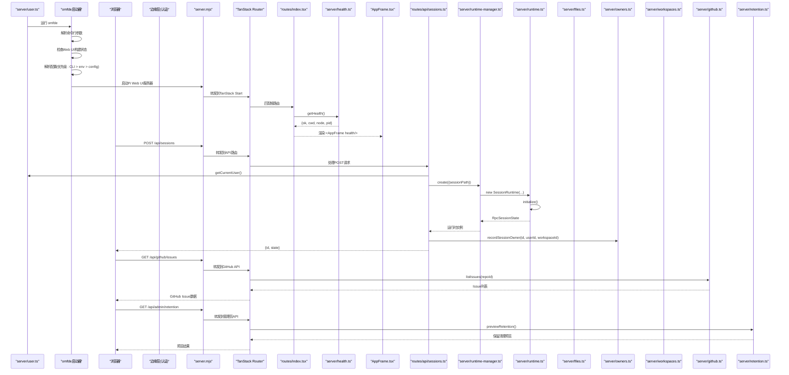

**图示来源**
- [apps/omfde/bin/omfde.mjs:1-146](https://github.com/FDE-GROUP/oh-my-fde/blob/main/apps/omfde/bin/omfde.mjs#L1-L146)
- [apps/pi-web/server.mjs:1-139](https://github.com/FDE-GROUP/oh-my-fde/blob/main/apps/pi-web/server.mjs#L1-L139)
- [apps/pi-web/src/routes/index.tsx:1-14](https://github.com/FDE-GROUP/oh-my-fde/blob/main/apps/pi-web/src/routes/index.tsx#L1-L14)
- [apps/pi-web/src/server/health.ts:1-46](https://github.com/FDE-GROUP/oh-my-fde/blob/main/apps/pi-web/src/server/health.ts#L1-L46)
- [apps/pi-web/src/components/layout/AppFrame.tsx:1-62](https://github.com/FDE-GROUP/oh-my-fde/blob/main/apps/pi-web/src/components/layout/AppFrame.tsx#L1-L62)
- [apps/pi-web/src/routes/api/sessions.ts:1-59](https://github.com/FDE-GROUP/oh-my-fde/blob/main/apps/pi-web/src/routes/api/sessions.ts#L1-L59)
- [apps/pi-web/src/server/runtime-manager.ts:1-194](https://github.com/FDE-GROUP/oh-my-fde/blob/main/apps/pi-web/src/server/runtime-manager.ts#L1-L194)
- [apps/pi-web/src/server/runtime.ts:1-337](https://github.com/FDE-GROUP/oh-my-fde/blob/main/apps/pi-web/src/server/runtime.ts#L1-L337)
- [apps/pi-web/src/server/files.ts:1-187](https://github.com/FDE-GROUP/oh-my-fde/blob/main/apps/pi-web/src/server/files.ts#L1-L187)
- [apps/pi-web/src/server/user.ts:1-33](https://github.com/FDE-GROUP/oh-my-fde/blob/main/apps/pi-web/src/server/user.ts#L1-L33)
- [apps/pi-web/src/server/owners.ts:1-118](https://github.com/FDE-GROUP/oh-my-fde/blob/main/apps/pi-web/src/server/owners.ts#L1-L118)
- [apps/pi-web/src/server/workspaces.ts:1-51](https://github.com/FDE-GROUP/oh-my-fde/blob/main/apps/pi-web/src/server/workspaces.ts#L1-L51)
- [apps/pi-web/src/server/github.ts:1-227](https://github.com/FDE-GROUP/oh-my-fde/blob/main/apps/pi-web/src/server/github.ts#L1-L227)
- [apps/pi-web/src/server/retention.ts:1-173](https://github.com/FDE-GROUP/oh-my-fde/blob/main/apps/pi-web/src/server/retention.ts#L1-L173)
- [apps/pi-web/src/routes/api/workspaces.ts:1-17](https://github.com/FDE-GROUP/oh-my-fde/blob/main/apps/pi-web/src/routes/api/workspaces.ts#L1-L17)

## 详细组件分析

### omfde启动器
**新增** omfde启动器作为平台统一入口，默认启动Pi Web UI并提供完整的命令行参数支持。

- 默认行为变更
  - 默认启动Pi Web UI而非TUI，提供更现代化的用户体验
  - 支持--tui参数切换到TUI模式
  - 自动检测Web UI构建状态，未构建时提供清晰的错误提示
- 命令行参数解析
  - --tui：切换到TUI模式
  - --port \<n>：设置Web UI端口
  - --host \<h>：设置Web UI主机地址
  - --config \<path>：指定配置文件路径
  - --no-open/--open：控制是否自动打开浏览器
  - -h/--help：显示帮助信息
- 配置优先级系统
  - 命令行参数优先级最高
  - 环境变量次之（PI_WEB_HOST、PI_WEB_PORT、PI_WEB_CONFIG）
  - 配置文件最低优先级
  - 默认值：host=127.0.0.1，port=3210
- 浏览器集成
  - 自动检测操作系统并调用相应的浏览器打开命令
  - 支持macOS open、Windows start、Linux xdg-open
  - 优雅的错误处理，无法打开浏览器时仅显示URL
- 环境变量支持
  - PI_WEB_CWD：设置工作目录
  - PI_WEB_HOST：覆盖主机地址
  - PI_WEB_PORT：覆盖端口号
  - PI_WEB_CONFIG：覆盖配置文件路径

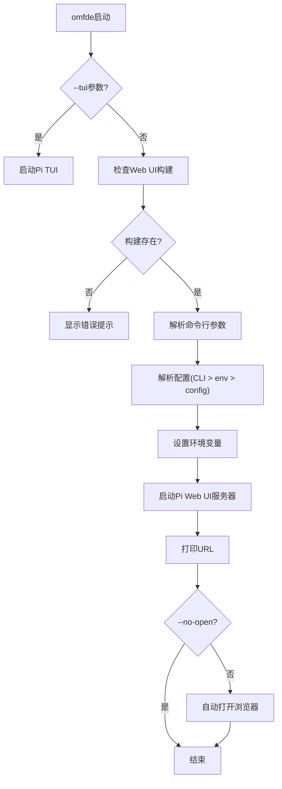

**图示来源**
- [apps/omfde/bin/omfde.mjs:23-66](https://github.com/FDE-GROUP/oh-my-fde/blob/main/apps/omfde/bin/omfde.mjs#L23-L66)
- [apps/omfde/bin/omfde.mjs:95-102](https://github.com/FDE-GROUP/oh-my-fde/blob/main/apps/omfde/bin/omfde.mjs#L95-L102)
- [apps/omfde/bin/omfde.mjs:104-114](https://github.com/FDE-GROUP/oh-my-fde/blob/main/apps/omfde/bin/omfde.mjs#L104-L114)
- [apps/omfde/bin/omfde.mjs:116-145](https://github.com/FDE-GROUP/oh-my-fde/blob/main/apps/omfde/bin/omfde.mjs#L116-L145)

**章节来源**
- [apps/omfde/bin/omfde.mjs:1-146](https://github.com/FDE-GROUP/oh-my-fde/blob/main/apps/omfde/bin/omfde.mjs#L1-L146)

### 多用户认证系统
**新增** Pi Web M2引入了完整的用户认证系统，支持多用户环境下的身份识别和权限控制。

- 用户身份识别
  - 生产环境通过 `x-piweb-user` 和 `x-piweb-user-name` 请求头注入用户信息。
  - 开发模式下回退为本地用户(`local`)，便于调试。
  - 边缘层负责认证处理，确保用户头的安全性。
- 用户信息管理
  - RequestUser接口定义用户ID和名称。
  - getCurrentUser()函数提供统一的用户信息获取接口。
  - 支持用户名的友好显示和本地用户的特殊处理。

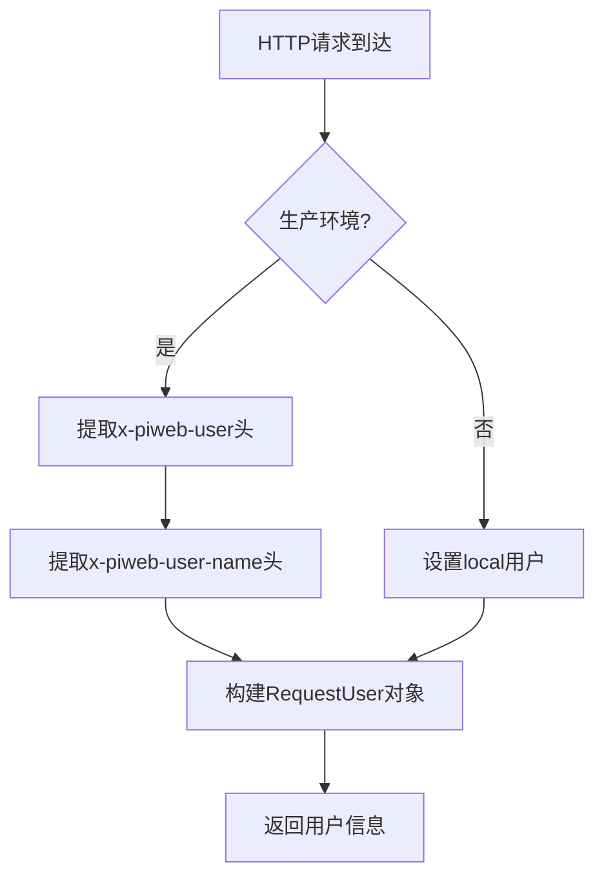

**图示来源**
- [apps/pi-web/src/server/user.ts:1-33](https://github.com/FDE-GROUP/oh-my-fde/blob/main/apps/pi-web/src/server/user.ts#L1-L33)

**章节来源**
- [apps/pi-web/src/server/user.ts:1-33](https://github.com/FDE-GROUP/oh-my-fde/blob/main/apps/pi-web/src/server/user.ts#L1-L33)

### 工作区管理系统
**新增** 实现了灵活的工作区管理机制，支持配置化的多工作区访问控制。

- 工作区配置
  - 从应用配置中读取工作区列表，支持多个工作区同时存在。
  - 每个工作区包含id、name和path属性。
  - 提供默认工作区回退机制，当配置为空时使用当前目录。
- 工作区操作
  - listWorkspaces()列出所有配置的工作区。
  - findWorkspace(id)按id查找特定工作区。
  - defaultWorkspace()获取默认工作区。

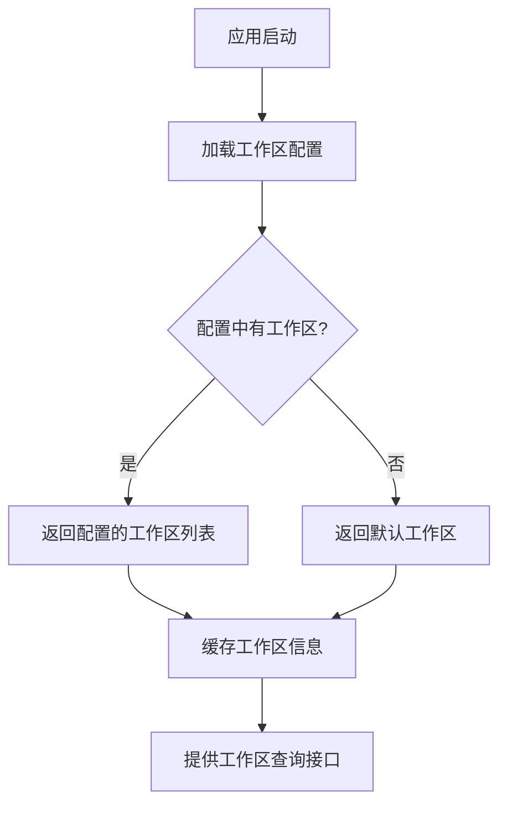

**图示来源**
- [apps/pi-web/src/server/workspaces.ts:1-51](https://github.com/FDE-GROUP/oh-my-fde/blob/main/apps/pi-web/src/server/workspaces.ts#L1-L51)
- [apps/pi-web/src/server/config.ts:1-34](https://github.com/FDE-GROUP/oh-my-fde/blob/main/apps/pi-web/src/server/config.ts#L1-L34)

**章节来源**
- [apps/pi-web/src/server/workspaces.ts:1-51](https://github.com/FDE-GROUP/oh-my-fde/blob/main/apps/pi-web/src/server/workspaces.ts#L1-L51)
- [apps/pi-web/src/server/config.ts:1-34](https://github.com/FDE-GROUP/oh-my-fde/blob/main/apps/pi-web/src/server/config.ts#L1-L34)

### 会话归属索引系统
**新增** 实现了独立的会话归属索引系统，用于跟踪会话与用户的映射关系。

- 索引存储
  - 使用 `~/.pi-web/sessions.json` 文件存储会话归属信息。
  - 每条记录包含会话id、所有者、工作区id和更新时间戳。
  - 使用临时文件+rename原子写入，权限设置为0600确保安全性。
- 索引操作
  - recordSessionOwner()记录会话归属。
  - getSessionOwner()查询会话归属。
  - removeSessionOwner()删除会话归属。
  - listSessionOwners(owner)按用户列出会话。
- 缓存机制
  - 内存缓存提高查询性能。
  - 自动检测配置文件变化并重新加载。
  - 错误处理和日志记录。

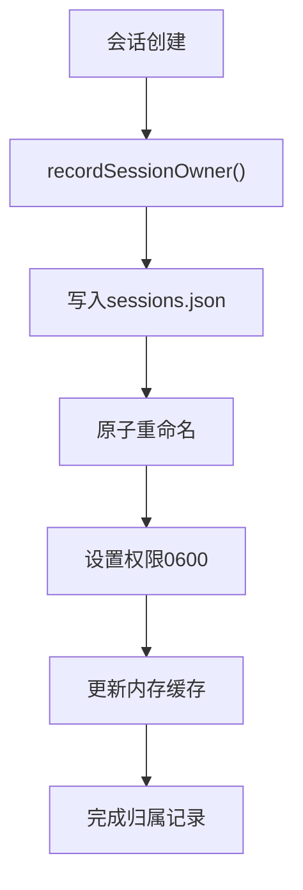

**图示来源**
- [apps/pi-web/src/server/owners.ts:1-118](https://github.com/FDE-GROUP/oh-my-fde/blob/main/apps/pi-web/src/server/owners.ts#L1-L118)

**章节来源**
- [apps/pi-web/src/server/owners.ts:1-118](https://github.com/FDE-GROUP/oh-my-fde/blob/main/apps/pi-web/src/server/owners.ts#L1-L118)

### 权限控制系统
**新增** 实现了细粒度的会话访问控制，确保用户只能访问自己的会话。

- 访问控制逻辑
  - sessionAccess()函数校验用户是否可访问特定会话。
  - 优先检查会话归属，如果归属存在则验证所有者匹配。
  - 对于未记录的会话，非local用户直接拒绝访问。
  - local用户具有特殊权限，可以访问任何会话。
- 会话解析
  - resolveSession()函数根据用户权限解析会话。
  - 支持按工作区范围查找会话。
  - 自动记录首次访问的会话归属。

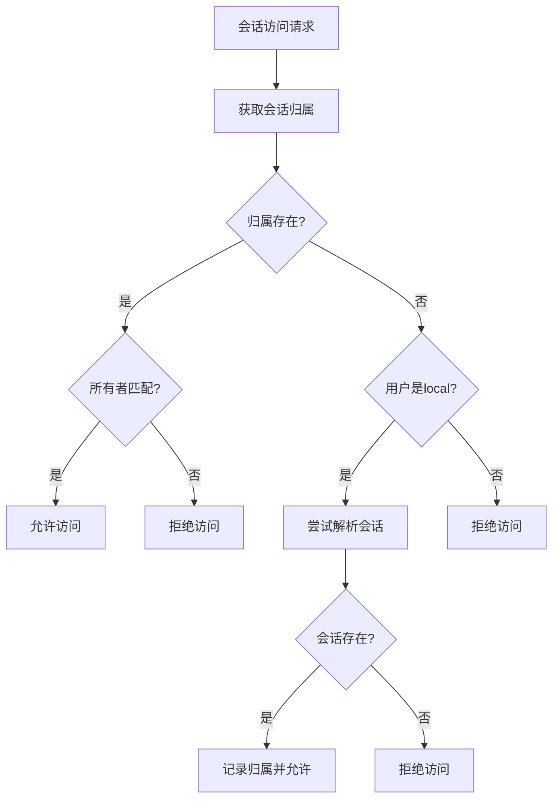

**图示来源**
- [apps/pi-web/src/server/access.ts:1-25](https://github.com/FDE-GROUP/oh-my-fde/blob/main/apps/pi-web/src/server/access.ts#L1-L25)
- [apps/pi-web/src/server/sessions.ts:87-103](https://github.com/FDE-GROUP/oh-my-fde/blob/main/apps/pi-web/src/server/sessions.ts#L87-L103)

**章节来源**
- [apps/pi-web/src/server/access.ts:1-25](https://github.com/FDE-GROUP/oh-my-fde/blob/main/apps/pi-web/src/server/access.ts#L1-L25)
- [apps/pi-web/src/server/sessions.ts:87-103](https://github.com/FDE-GROUP/oh-my-fde/blob/main/apps/pi-web/src/server/sessions.ts#L87-L103)

### PWA支持
**新增** 提供了完整的PWA支持，使Pi Web可以作为独立应用安装和使用。

- PWA配置
  - manifest.webmanifest定义应用元数据，包括名称、描述和图标。
  - 支持standalone显示模式，提供原生应用体验。
  - 配置主题颜色和背景颜色。
- 图标支持
  - 提供多种尺寸图标(192x192, 512x512)。
  - 支持SVG矢量图标。
  - 适用于不同设备和屏幕密度。

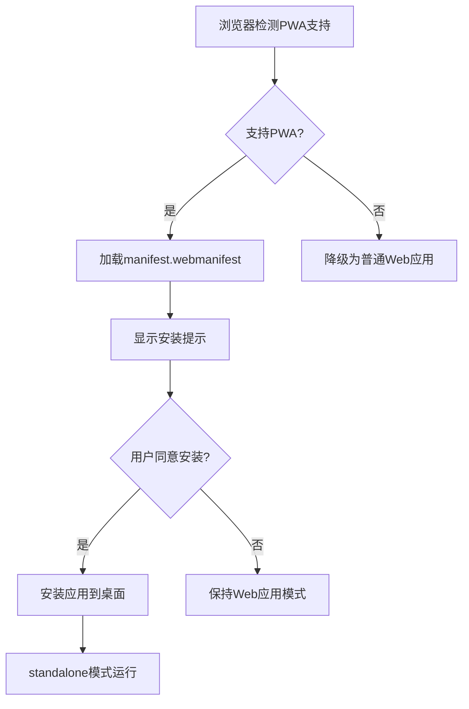

**图示来源**
- [apps/pi-web/public/manifest.webmanifest:1-30](https://github.com/FDE-GROUP/oh-my-fde/blob/main/apps/pi-web/public/manifest.webmanifest#L1-L30)

**章节来源**
- [apps/pi-web/public/manifest.webmanifest:1-30](https://github.com/FDE-GROUP/oh-my-fde/blob/main/apps/pi-web/public/manifest.webmanifest#L1-L30)

### 服务器实现与安全
- HTTP服务器
  - 监听端口默认为3210，支持环境变量配置。
  - 实现安全头部：X-Content-Type-Options、X-Frame-Options、Referrer-Policy、Content-Security-Policy。
  - 主机白名单验证，仅允许localhost和127.0.0.1访问。
  - 跨站请求防护，阻止cross-site请求。
- 静态文件服务
  - 提供client构建产物的静态文件服务。
  - 自动设置正确的Content-Type和缓存策略。
  - 防止路径遍历攻击，限制在client目录内。
- 请求转发
  - 将非静态请求转发到TanStack Start应用。
  - 保持原始请求方法和头部。
  - 错误处理和日志记录。

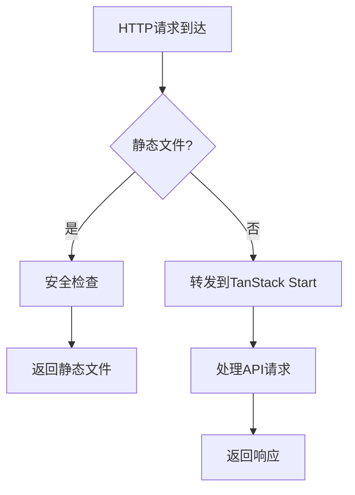

**图示来源**
- [apps/pi-web/server.mjs:1-139](https://github.com/FDE-GROUP/oh-my-fde/blob/main/apps/pi-web/server.mjs#L1-L139)

**章节来源**
- [apps/pi-web/server.mjs:1-139](https://github.com/FDE-GROUP/oh-my-fde/blob/main/apps/pi-web/server.mjs#L1-L139)

### 路由与根文档
- 路由器配置
  - 启用滚动恢复与意图预加载，减少不必要的请求与提升交互流畅度。
- 根文档
  - 注入字符集、视口、标题与全局样式。
  - 在 HTML 中内联主题初始化脚本，避免深色主题首次白屏闪烁。
- 会话页面
  - 新增 `/session/$sessionId` 路由，支持直接访问特定会话。

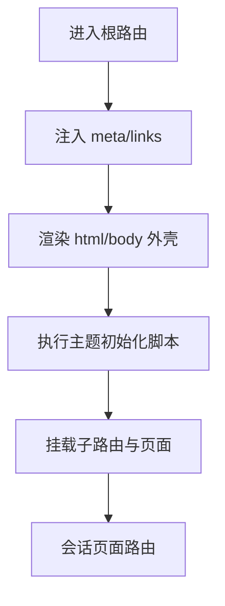

**图示来源**
- [apps/pi-web/src/router.tsx:1-18](https://github.com/FDE-GROUP/oh-my-fde/blob/main/apps/pi-web/src/router.tsx#L1-L18)
- [apps/pi-web/src/routes/__root.tsx:1-32](https://github.com/FDE-GROUP/oh-my-fde/blob/main/apps/pi-web/src/routes/__root.tsx#L1-L32)
- [apps/pi-web/src/routes/session.$sessionId.tsx:1-20](https://github.com/FDE-GROUP/oh-my-fde/blob/main/apps/pi-web/src/routes/session.$sessionId.tsx#L1-L20)

**章节来源**
- [apps/pi-web/src/router.tsx:1-18](https://github.com/FDE-GROUP/oh-my-fde/blob/main/apps/pi-web/src/router.tsx#L1-L18)
- [apps/pi-web/src/routes/__root.tsx:1-32](https://github.com/FDE-GROUP/oh-my-fde/blob/main/apps/pi-web/src/routes/__root.tsx#L1-L32)
- [apps/pi-web/src/routes/session.$sessionId.tsx:1-20](https://github.com/FDE-GROUP/oh-my-fde/blob/main/apps/pi-web/src/routes/session.$sessionId.tsx#L1-L20)

### 图像附件系统
**新增** Pi Web M2引入了完整的图像附件系统，支持多种图片输入方式和智能处理。

- 图像处理流程
  - 支持拖拽、粘贴和文件选择三种输入方式。
  - 自动检测图片格式并进行预处理。
  - 智能压缩：长边限制2048px，质量自适应调整。
  - 大小限制：单张图片不超过5MB。
  - Base64编码传输，支持JPEG格式。
- 用户界面
  - 图片预览缩略图展示。
  - 支持移除已添加的图片。
  - 进度反馈和错误提示。
- 技术实现
  - Canvas API进行图片缩放和压缩。
  - File API处理文件读取。
  - URL.createObjectURL生成预览链接。

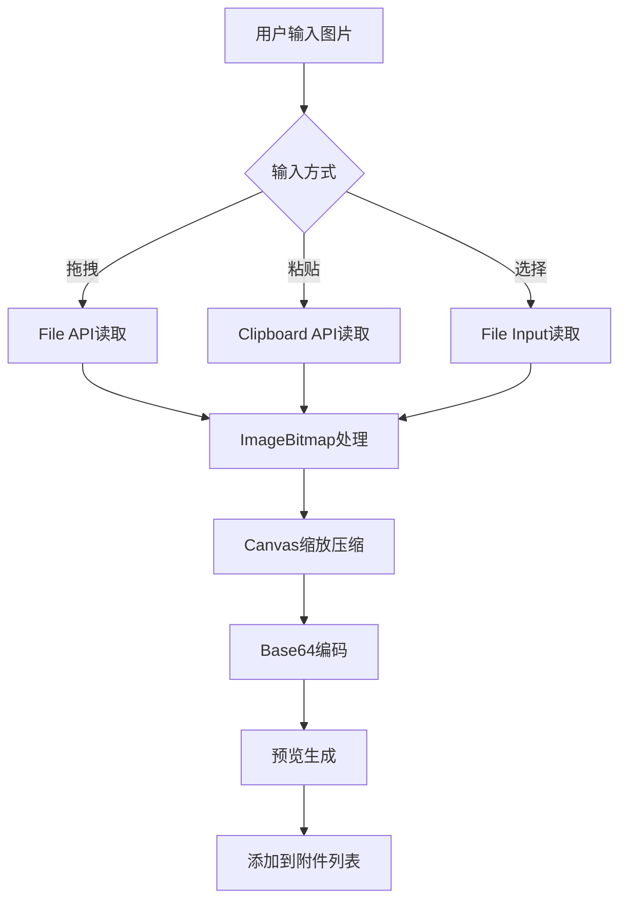

**图示来源**
- [apps/pi-web/src/lib/images.ts:1-109](https://github.com/FDE-GROUP/oh-my-fde/blob/main/apps/pi-web/src/lib/images.ts#L1-L109)
- [apps/pi-web/src/components/conversation/Composer.tsx:168-186](https://github.com/FDE-GROUP/oh-my-fde/blob/main/apps/pi-web/src/components/conversation/Composer.tsx#L168-L186)

**章节来源**
- [apps/pi-web/src/lib/images.ts:1-109](https://github.com/FDE-GROUP/oh-my-fde/blob/main/apps/pi-web/src/lib/images.ts#L1-L109)
- [apps/pi-web/src/components/conversation/Composer.tsx:168-186](https://github.com/FDE-GROUP/oh-my-fde/blob/main/apps/pi-web/src/components/conversation/Composer.tsx#L168-L186)

### 文件引用系统(@file)
**新增** 实现了强大的文件引用系统，支持项目文件的安全访问和内容展开。

- 文件搜索功能
  - 支持文件名和路径片段搜索。
  - 排除敏感目录(.git, node_modules等)。
  - 限制搜索结果数量(默认100条)。
  - 异步搜索，带防抖处理。
- 文件展开机制
  - 智能识别文本文件和图片文件。
  - 文本文件：最大256KB，UTF-8编码。
  - 图片文件：最大10MB，支持多种格式。
  - 安全验证：路径遍历防护、敏感文件过滤。
- 用户体验
  - @符号触发文件自动补全。
  - 实时搜索建议。
  - 展开后自动插入内容。
  - 错误提示和跳过说明。

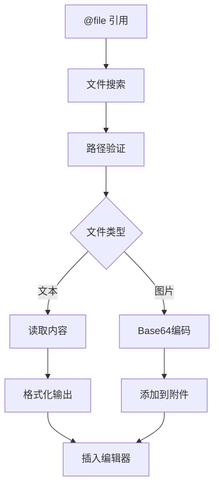

**图示来源**
- [apps/pi-web/src/server/files.ts:128-186](https://github.com/FDE-GROUP/oh-my-fde/blob/main/apps/pi-web/src/server/files.ts#L128-L186)
- [apps/pi-web/src/routes/api/files.expand.ts:1-31](https://github.com/FDE-GROUP/oh-my-fde/blob/main/apps/pi-web/src/routes/api/files.expand.ts#L1-L31)
- [apps/pi-web/src/routes/api/files.search.ts:1-23](https://github.com/FDE-GROUP/oh-my-fde/blob/main/apps/pi-web/src/routes/api/files.search.ts#L1-L23)

**章节来源**
- [apps/pi-web/src/server/files.ts:1-187](https://github.com/FDE-GROUP/oh-my-fde/blob/main/apps/pi-web/src/server/files.ts#L1-L187)
- [apps/pi-web/src/routes/api/files.expand.ts:1-31](https://github.com/FDE-GROUP/oh-my-fde/blob/main/apps/pi-web/src/routes/api/files.expand.ts#L1-L31)
- [apps/pi-web/src/routes/api/files.search.ts:1-23](https://github.com/FDE-GROUP/oh-my-fde/blob/main/apps/pi-web/src/routes/api/files.search.ts#L1-L23)

### 斜杠命令界面(/command)
**新增** 提供了可扩展的命令系统，支持多种命令源和智能补全。

- 命令系统架构
  - 支持三类命令源：extension(扩展)、prompt(提示词)、skill(技能)。
  - 命令自动补全，支持模糊匹配。
  - 命令描述和来源信息显示。
- 用户交互
  - /符号触发命令补全。
  - 键盘导航支持(上下箭头、回车、Tab)。
  - ESC键取消补全。
  - 命令执行后自动插入空格。
- 集成特性
  - 与Composer组件深度集成。
  - 支持命令执行状态反馈。
  - 错误处理和用户提示。

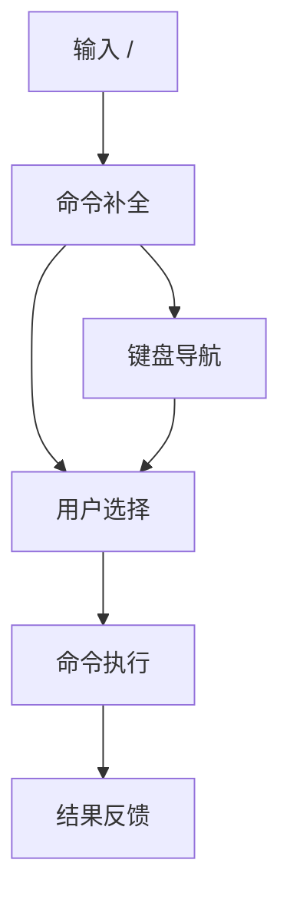

**图示来源**
- [apps/pi-web/src/components/conversation/Composer.tsx:48-61](https://github.com/FDE-GROUP/oh-my-fde/blob/main/apps/pi-web/src/components/conversation/Composer.tsx#L48-L61)
- [apps/pi-web/src/components/conversation/Composer.tsx:114-132](https://github.com/FDE-GROUP/oh-my-fde/blob/main/apps/pi-web/src/components/conversation/Composer.tsx#L114-L132)

**章节来源**
- [apps/pi-web/src/components/conversation/Composer.tsx:48-61](https://github.com/FDE-GROUP/oh-my-fde/blob/main/apps/pi-web/src/components/conversation/Composer.tsx#L48-L61)
- [apps/pi-web/src/components/conversation/Composer.tsx:114-132](https://github.com/FDE-GROUP/oh-my-fde/blob/main/apps/pi-web/src/components/conversation/Composer.tsx#L114-L132)

### 增强的会话管理
**新增** 会话管理功能得到显著增强，支持更灵活的会话操作和多用户环境。

- 分叉(Fork)功能
  - 从指定user消息点创建新会话分支。
  - 保留原始会话的上下文和历史。
  - 支持并行开发不同思路。
  - 自动更新会话ID映射。
- 克隆(Clone)功能
  - 复制当前会话的完整状态。
  - 包括消息历史、工具状态和配置。
  - 用于实验和对比测试。
  - 错误处理：未保存会话的处理。
- 并行会话支持
  - 同时运行多个会话。
  - 资源管理和内存控制。
  - 会话间隔离和状态同步。
- 多用户会话管理
  - 按用户过滤会话列表。
  - 支持工作区范围的会话查找。
  - 自动记录会话归属关系。

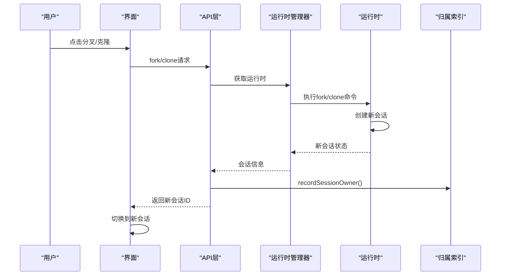

**图示来源**
- [apps/pi-web/src/routes/api/sessions.$sessionId.fork.ts:1-38](https://github.com/FDE-GROUP/oh-my-fde/blob/main/apps/pi-web/src/routes/api/sessions.$sessionId.fork.ts#L1-L38)
- [apps/pi-web/src/routes/api/sessions.$sessionId.clone.ts:1-32](https://github.com/FDE-GROUP/oh-my-fde/blob/main/apps/pi-web/src/routes/api/sessions.$sessionId.clone.ts#L1-L32)
- [apps/pi-web/src/components/conversation/Conversation.tsx:273-298](https://github.com/FDE-GROUP/oh-my-fde/blob/main/apps/pi-web/src/components/conversation/Conversation.tsx#L273-L298)
- [apps/pi-web/src/server/owners.ts:71-74](https://github.com/FDE-GROUP/oh-my-fde/blob/main/apps/pi-web/src/server/owners.ts#L71-L74)

**章节来源**
- [apps/pi-web/src/routes/api/sessions.$sessionId.fork.ts:1-38](https://github.com/FDE-GROUP/oh-my-fde/blob/main/apps/pi-web/src/routes/api/sessions.$sessionId.fork.ts#L1-L38)
- [apps/pi-web/src/routes/api/sessions.$sessionId.clone.ts:1-32](https://github.com/FDE-GROUP/oh-my-fde/blob/main/apps/pi-web/src/routes/api/sessions.$sessionId.clone.ts#L1-L32)
- [apps/pi-web/src/components/conversation/Conversation.tsx:273-298](https://github.com/FDE-GROUP/oh-my-fde/blob/main/apps/pi-web/src/components/conversation/Conversation.tsx#L273-L298)
- [apps/pi-web/src/server/owners.ts:71-74](https://github.com/FDE-GROUP/oh-my-fde/blob/main/apps/pi-web/src/server/owners.ts#L71-L74)

### GitHub 集成系统
**新增** 实现了完整的 GitHub 集成，支持 Issue 管理和 CI 状态监控。

- GitHub API 客户端
  - github.ts 实现 GitHub API 客户端，支持仓库配置和令牌认证。
  - 内置请求缓存机制，ETag 缓存60秒，减少API调用频率。
  - 支持代理环境变量配置(NODE_USE_ENV_PROXY)。
  - 超时保护(10秒)和错误处理。
- Issue 管理功能
  - listIssues() 获取配置的仓库中的开放 Issue 列表。
  - getIssue() 获取单条 Issue 详细信息。
  - 自动过滤 Pull Request，只返回 Issue。
  - 支持 Issue 编号验证和错误处理。
- CI 状态监控
  - getCiStatus() 查询仓库最近的 CI 工作流运行状态。
  - 支持分支过滤，使用仓库配置或指定分支。
  - 返回 CI 状态、结论、分支和链接信息。
- API 端点
  - GET /api/github/issues：获取 Issue 列表。
  - GET /api/github/issue：获取单条 Issue。
  - GET /api/github/ci：获取 CI 状态。
  - 所有端点都需要用户认证。

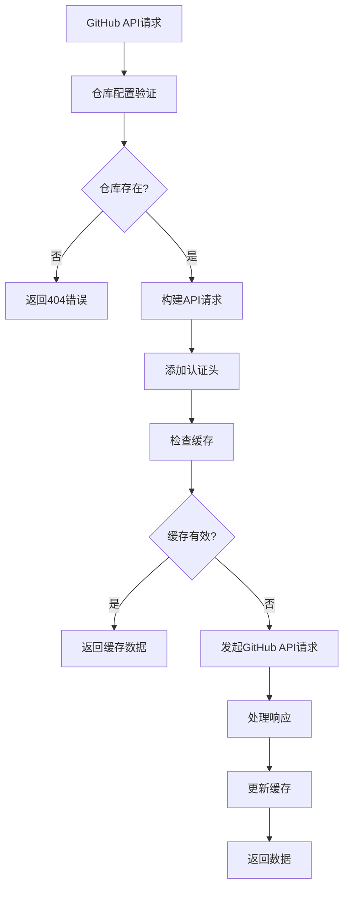

**图示来源**
- [apps/pi-web/src/server/github.ts:93-128](https://github.com/FDE-GROUP/oh-my-fde/blob/main/apps/pi-web/src/server/github.ts#L93-L128)
- [apps/pi-web/src/routes/api/github.ci.ts:1-28](https://github.com/FDE-GROUP/oh-my-fde/blob/main/apps/pi-web/src/routes/api/github.ci.ts#L1-L28)
- [apps/pi-web/src/routes/api/github.issue.ts:1-31](https://github.com/FDE-GROUP/oh-my-fde/blob/main/apps/pi-web/src/routes/api/github.issue.ts#L1-L31)
- [apps/pi-web/src/routes/api/github.issues.ts:1-26](https://github.com/FDE-GROUP/oh-my-fde/blob/main/apps/pi-web/src/routes/api/github.issues.ts#L1-L26)

**章节来源**
- [apps/pi-web/src/server/github.ts:1-227](https://github.com/FDE-GROUP/oh-my-fde/blob/main/apps/pi-web/src/server/github.ts#L1-L227)
- [apps/pi-web/src/routes/api/github.ci.ts:1-28](https://github.com/FDE-GROUP/oh-my-fde/blob/main/apps/pi-web/src/routes/api/github.ci.ts#L1-L28)
- [apps/pi-web/src/routes/api/github.issue.ts:1-31](https://github.com/FDE-GROUP/oh-my-fde/blob/main/apps/pi-web/src/routes/api/github.issue.ts#L1-L31)
- [apps/pi-web/src/routes/api/github.issues.ts:1-26](https://github.com/FDE-GROUP/oh-my-fde/blob/main/apps/pi-web/src/routes/api/github.issues.ts#L1-L26)

### 通知系统
**新增** 实现了完整的通知系统，支持页面内通知和浏览器原生通知。

- 通知存储与管理
  - notifications.ts 实现通知持久化，使用 localStorage 存储最多50条通知。
  - 支持通知订阅机制，实时更新通知列表。
  - 提供通知标记为已读、未读计数等功能。
- 浏览器通知
  - 支持浏览器原生通知 API，需要用户授权。
  - 仅在页面隐藏且会话结束时发送通知。
  - 不包含敏感信息(prompt或工具输出正文)。
  - 用户可通过设置开关控制浏览器通知。
- 通知铃铛组件
  - NotificationBell 组件提供通知铃铛界面。
  - 显示未读通知数量和通知列表。
  - 支持全部标记为已读操作。
  - 提供浏览器通知权限管理。

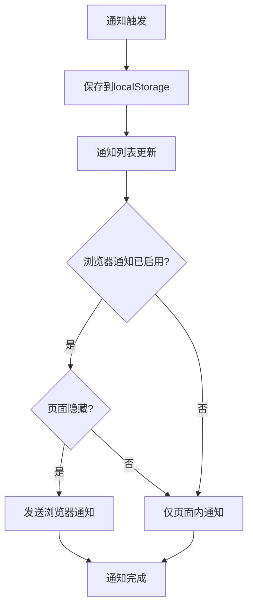

**图示来源**
- [apps/pi-web/src/lib/notifications.ts:74-92](https://github.com/FDE-GROUP/oh-my-fde/blob/main/apps/pi-web/src/lib/notifications.ts#L74-L92)
- [apps/pi-web/src/components/layout/NotificationBell.tsx:1-113](https://github.com/FDE-GROUP/oh-my-fde/blob/main/apps/pi-web/src/components/layout/NotificationBell.tsx#L1-L113)

**章节来源**
- [apps/pi-web/src/lib/notifications.ts:1-142](https://github.com/FDE-GROUP/oh-my-fde/blob/main/apps/pi-web/src/lib/notifications.ts#L1-L142)
- [apps/pi-web/src/components/layout/NotificationBell.tsx:1-113](https://github.com/FDE-GROUP/oh-my-fde/blob/main/apps/pi-web/src/components/layout/NotificationBell.tsx#L1-L113)

### 会话保留管理
**新增** 实现了会话、分享和审计日志的保留清理功能。

- 保留策略
  - retention.ts 实现保留清理逻辑，支持会话、分享和审计日志的独立配置。
  - 只清理有 owner 索引的会话，跳过未知归属和活跃会话。
  - 应用顺序：删除会话文件 → 删除 owner/Issue 关联 → 清理分享 → 清理审计 → 写审计。
- 预览功能
  - previewRetention() 返回将被清理的会话、分享和审计数量。
  - 显示会话详情：ID、所有者、工作区、修改时间。
  - 统计跳过原因：未知归属和活跃会话数量。
- 清理功能
  - applyRetention() 实际执行清理操作。
  - 需要管理员权限(confirm=true)。
  - 返回清理结果和审计日志。
- 管理员界面
  - RetentionPanel 组件提供保留清理界面。
  - 显示预览结果和清理确认。
  - 提供清理操作和结果反馈。
  - 清理完成后发送通知。

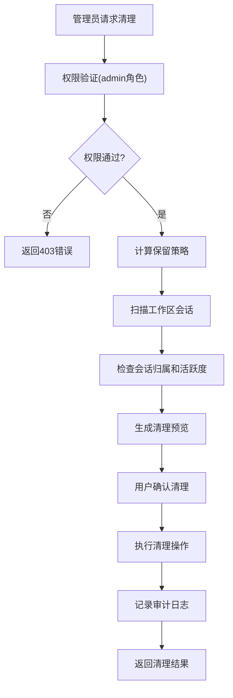

**图示来源**
- [apps/pi-web/src/server/retention.ts:64-123](https://github.com/FDE-GROUP/oh-my-fde/blob/main/apps/pi-web/src/server/retention.ts#L64-L123)
- [apps/pi-web/src/routes/api/admin.retention.ts:1-42](https://github.com/FDE-GROUP/oh-my-fde/blob/main/apps/pi-web/src/routes/api/admin.retention.ts#L1-L42)
- [apps/pi-web/src/components/layout/RetentionPanel.tsx:1-128](https://github.com/FDE-GROUP/oh-my-fde/blob/main/apps/pi-web/src/components/layout/RetentionPanel.tsx#L1-L128)

**章节来源**
- [apps/pi-web/src/server/retention.ts:1-173](https://github.com/FDE-GROUP/oh-my-fde/blob/main/apps/pi-web/src/server/retention.ts#L1-L173)
- [apps/pi-web/src/routes/api/admin.retention.ts:1-42](https://github.com/FDE-GROUP/oh-my-fde/blob/main/apps/pi-web/src/routes/api/admin.retention.ts#L1-L42)
- [apps/pi-web/src/components/layout/RetentionPanel.tsx:1-128](https://github.com/FDE-GROUP/oh-my-fde/blob/main/apps/pi-web/src/components/layout/RetentionPanel.tsx#L1-L128)

### 对话组件系统
- Conversation 组件
  - 管理会话生命周期：创建、恢复、崩溃重启。
  - 处理模型选择、消息发送和流式响应。
  - 集成事件流连接，实时更新会话状态。
  - 错误处理和用户通知。
  - 支持图像附件和文件引用。
  - 支持分叉和克隆操作。
- MessageList 组件
  - 渲染用户消息、助手回复和工具调用。
  - 支持流式文本输出和思维过程展示。
  - 工具结果展示，包括diff视图和输出折叠。
  - 自动滚动到底部和回到底部按钮。
- SessionBar 组件
  - 模型选择下拉框，显示可用模型列表。
  - 上下文使用百分比、token计数和成本显示。
  - 实时统计信息更新。
  - 克隆按钮和权限控制。
  - **新增** CI 状态显示，支持失败状态高亮。
- ToolCard 组件
  - 工具调用状态指示器（运行中、完成、失败）。
  - 参数展示和执行结果输出。
  - diff格式检测和语法高亮。
  - 长输出折叠展开功能。
- Composer 组件
  - 统一的输入界面，集成所有新功能。
  - 支持文本输入、图像附件、文件引用和命令。
  - 智能补全和自动完成。
  - 队列模式：插话(followUp)和引导(steer)。
  - 图片预览和管理。
  - 键盘快捷键支持。

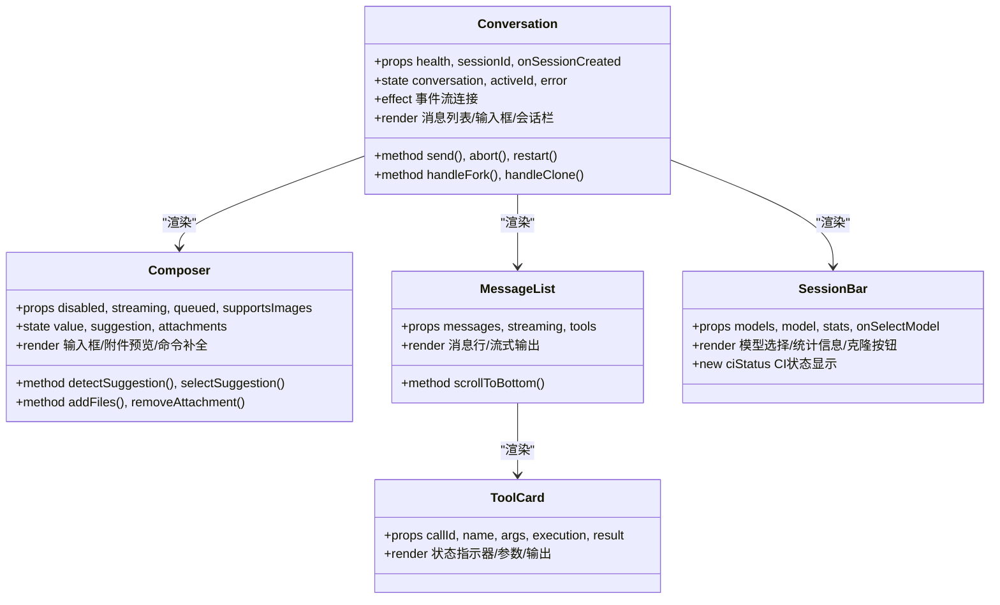

**图示来源**
- [apps/pi-web/src/components/conversation/Conversation.tsx:1-386](https://github.com/FDE-GROUP/oh-my-fde/blob/main/apps/pi-web/src/components/conversation/Conversation.tsx#L1-L386)
- [apps/pi-web/src/components/conversation/Composer.tsx:1-386](https://github.com/FDE-GROUP/oh-my-fde/blob/main/apps/pi-web/src/components/conversation/Composer.tsx#L1-L386)
- [apps/pi-web/src/components/conversation/MessageList.tsx:1-232](https://github.com/FDE-GROUP/oh-my-fde/blob/main/apps/pi-web/src/components/conversation/MessageList.tsx#L1-L232)
- [apps/pi-web/src/components/conversation/SessionBar.tsx:1-68](https://github.com/FDE-GROUP/oh-my-fde/blob/main/apps/pi-web/src/components/conversation/SessionBar.tsx#L1-L68)
- [apps/pi-web/src/components/tools/ToolCard.tsx:1-124](https://github.com/FDE-GROUP/oh-my-fde/blob/main/apps/pi-web/src/components/tools/ToolCard.tsx#L1-L124)

**章节来源**
- [apps/pi-web/src/components/conversation/Conversation.tsx:1-386](https://github.com/FDE-GROUP/oh-my-fde/blob/main/apps/pi-web/src/components/conversation/Conversation.tsx#L1-L386)
- [apps/pi-web/src/components/conversation/Composer.tsx:1-386](https://github.com/FDE-GROUP/oh-my-fde/blob/main/apps/pi-web/src/components/conversation/Composer.tsx#L1-L386)
- [apps/pi-web/src/components/conversation/MessageList.tsx:1-232](https://github.com/FDE-GROUP/oh-my-fde/blob/main/apps/pi-web/src/components/conversation/MessageList.tsx#L1-L232)
- [apps/pi-web/src/components/conversation/SessionBar.tsx:1-68](https://github.com/FDE-GROUP/oh-my-fde/blob/main/apps/pi-web/src/components/conversation/SessionBar.tsx#L1-L68)
- [apps/pi-web/src/components/tools/ToolCard.tsx:1-124](https://github.com/FDE-GROUP/oh-my-fde/blob/main/apps/pi-web/src/components/tools/ToolCard.tsx#L1-L124)

### 主题与视口
- 主题
  - 支持 light/dark/system 三种偏好，持久化到 localStorage。
  - 通过 data-theme 与 CSS 变量驱动样式，避免组件分支判断。
  - 监听系统主题变化，动态更新实际主题。
  - 安装发丝线宽度，保证高 DPI 下边框视觉一致。
- 视口
  - 默认宽度 1280，避免 SSR/CSR 不一致。
  - 监听 resize 事件同步真实宽度。
- 主题控制组件
  - 提供可视化主题选择界面。
  - 支持紧凑模式和展开模式。
  - 图标化主题选项，提升用户体验。

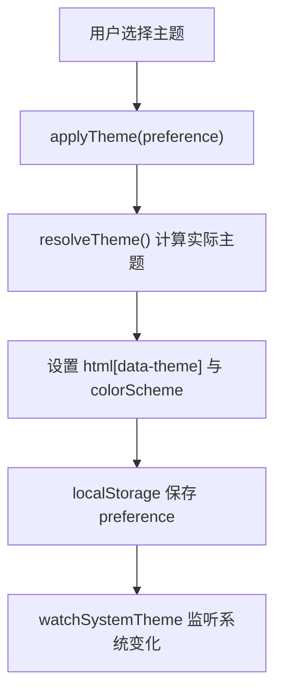

**图示来源**
- [apps/pi-web/src/lib/theme.ts:1-123](https://github.com/FDE-GROUP/oh-my-fde/blob/main/apps/pi-web/src/lib/theme.ts#L1-L123)
- [apps/pi-web/src/components/layout/ThemeControl.tsx:1-71](https://github.com/FDE-GROUP/oh-my-fde/blob/main/apps/pi-web/src/components/layout/ThemeControl.tsx#L1-L71)

**章节来源**
- [apps/pi-web/src/lib/theme.ts:1-123](https://github.com/FDE-GROUP/oh-my-fde/blob/main/apps/pi-web/src/lib/theme.ts#L1-L123)
- [apps/pi-web/src/lib/viewport.ts:1-41](https://github.com/FDE-GROUP/oh-my-fde/blob/main/apps/pi-web/src/lib/viewport.ts#L1-L41)
- [apps/pi-web/src/components/layout/ThemeControl.tsx:1-71](https://github.com/FDE-GROUP/oh-my-fde/blob/main/apps/pi-web/src/components/layout/ThemeControl.tsx#L1-L71)

### 健康检查与会话管理
- 健康检查
  - 服务端函数返回进程基本信息，便于验证 SSR、服务端函数与生产入口连通性。
  - 首页通过 loader 调用并透传给 AppFrame。
- 会话管理
  - listSessions() 列出当前项目的会话，按修改时间排序。
  - findSessionPath() 根据会话ID查找文件路径。
  - 会话摘要信息包含ID、路径、名称、工作目录、时间戳、消息数量等。
  - **新增** 支持按用户过滤会话列表。
  - **新增** 支持工作区范围的会话查找。

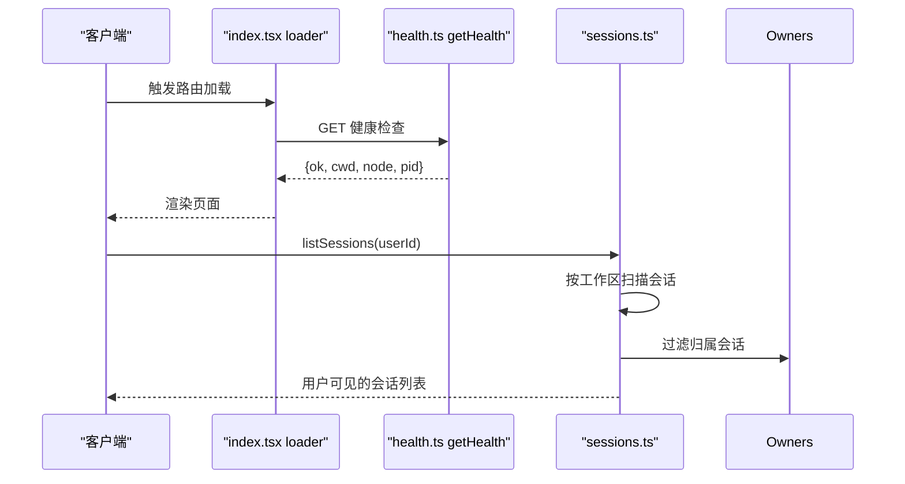

**图示来源**
- [apps/pi-web/src/routes/index.tsx:1-14](https://github.com/FDE-GROUP/oh-my-fde/blob/main/apps/pi-web/src/routes/index.tsx#L1-L14)
- [apps/pi-web/src/server/health.ts:1-46](https://github.com/FDE-GROUP/oh-my-fde/blob/main/apps/pi-web/src/server/health.ts#L1-L46)
- [apps/pi-web/src/server/sessions.ts:68-77](https://github.com/FDE-GROUP/oh-my-fde/blob/main/apps/pi-web/src/server/sessions.ts#L68-L77)
- [apps/pi-web/src/server/owners.ts:105-107](https://github.com/FDE-GROUP/oh-my-fde/blob/main/apps/pi-web/src/server/owners.ts#L105-L107)

**章节来源**
- [apps/pi-web/src/routes/index.tsx:1-14](https://github.com/FDE-GROUP/oh-my-fde/blob/main/apps/pi-web/src/routes/index.tsx#L1-L14)
- [apps/pi-web/src/server/health.ts:1-46](https://github.com/FDE-GROUP/oh-my-fde/blob/main/apps/pi-web/src/server/health.ts#L1-L46)
- [apps/pi-web/src/server/sessions.ts:68-77](https://github.com/FDE-GROUP/oh-my-fde/blob/main/apps/pi-web/src/server/sessions.ts#L68-L77)
- [apps/pi-web/src/server/owners.ts:105-107](https://github.com/FDE-GROUP/oh-my-fde/blob/main/apps/pi-web/src/server/owners.ts#L105-L107)

### 会话运行时与 API
- 运行时管理器
  - 单例进程级管理器，维护活跃运行时 Map。
  - 并发上限与空闲回收：超过上限时优先回收最久未活动且不忙的运行时。
  - 定时清理空闲运行时，释放资源。
- 会话运行时
  - 每个会话对应一个 Pi 子进程，使用 JSONL 协议进行 RPC。
  - 命令发送带超时与错误处理，响应按 id 关联。
  - 事件分发：状态变更、记录事件、退出事件。
  - 快照：并行获取状态、消息与用量统计。
- API 路由
  - POST /api/sessions：创建或恢复会话，返回会话 ID 与初始状态。
  - GET /api/sessions/$sessionId：获取会话快照。
  - DELETE /api/sessions/$sessionId：关闭会话。
  - PATCH /api/sessions/$sessionId：重命名会话。
  - POST /api/sessions/$sessionId/commands：发送RPC命令。
  - GET /api/sessions/$sessionId/events：SSE事件流。
  - POST /api/sessions/$sessionId/fork：从指定消息分叉会话。
  - POST /api/sessions/$sessionId/clone：克隆当前会话。
  - POST /api/files/expand：展开文件引用。
  - GET /api/files/search：搜索项目文件。
  - **新增** GET /api/workspaces：获取工作区列表和用户信息。
  - **新增** GET /api/github/issues：获取 GitHub Issue 列表。
  - **新增** GET /api/github/issue：获取单条 GitHub Issue。
  - **新增** GET /api/github/ci：获取 CI 状态。
  - **新增** GET/POST /api/admin/retention：管理员保留清理接口。

```mermaid
classDiagram
class RuntimeManager {
+create(options) Promise~SessionRuntime~
+get(id) SessionRuntime|undefined
+close(id) Promise~boolean~
+sweep() Promise~number~
+closeAll() Promise~void~
+rekey(oldId, newId) void
-makeRoom() Promise~void~
}
class SessionRuntime {
+initialize() Promise~RpcSessionState~
+snapshot() Promise~SessionSnapshot~
+command(cmd) Promise~Response~
+subscribe(listener) () => void
+dispose() Promise~void~
+status RuntimeStatus
+busy boolean
+lastActivityAt number
+sessionId string|undefined
}
RuntimeManager --> SessionRuntime : "创建/管理"
```

**图示来源**
- [apps/pi-web/src/server/runtime-manager.ts:1-194](https://github.com/FDE-GROUP/oh-my-fde/blob/main/apps/pi-web/src/server/runtime-manager.ts#L1-L194)
- [apps/pi-web/src/server/runtime.ts:1-337](https://github.com/FDE-GROUP/oh-my-fde/blob/main/apps/pi-web/src/server/runtime.ts#L1-L337)

```mermaid
sequenceDiagram
participant Client as "客户端"
participant SessionsAPI as "sessions.ts"
participant Manager as "runtime-manager.ts"
participant Runtime as "runtime.ts"
participant FilesAPI as "files.ts"
participant WorkspacesAPI as "workspaces.ts"
participant GithubAPI as "github.ts"
participant RetentionAPI as "retention.ts"
Client->>SessionsAPI : POST /api/sessions
SessionsAPI->>Manager : create({sessionPath})
Manager->>Runtime : new SessionRuntime(...)
Runtime->>Runtime : initialize()
Runtime-->>Manager : RpcSessionState
Manager-->>SessionsAPI : 运行时实例
SessionsAPI-->>Client : {id, state}
Client->>FilesAPI : POST /api/files/expand
FilesAPI->>FilesAPI : expandFiles(paths)
FilesAPI-->>Client : {text, images, notes}
Client->>SessionsAPI : POST /api/sessions/ : id/fork
SessionsAPI->>Runtime : command({type : "fork"})
Runtime-->>SessionsAPI : 新会话状态
SessionsAPI-->>Client : {id, state}
Client->>WorkspacesAPI : GET /api/workspaces
WorkspacesAPI->>WorkspacesAPI : listWorkspaces()
WorkspacesAPI-->>Client : {user, workspaces}
Client->>GithubAPI : GET /api/github/issues
GithubAPI->>GithubAPI : listIssues(repoId)
GithubAPI-->>Client : Issue列表
Client->>RetentionAPI : GET /api/admin/retention
RetentionAPI->>RetentionAPI : previewRetention()
RetentionAPI-->>Client : 保留清理预览
```

**图示来源**
- [apps/pi-web/src/routes/api/sessions.ts:1-59](https://github.com/FDE-GROUP/oh-my-fde/blob/main/apps/pi-web/src/routes/api/sessions.ts#L1-L59)
- [apps/pi-web/src/routes/api/sessions.$sessionId.ts:1-48](https://github.com/FDE-GROUP/oh-my-fde/blob/main/apps/pi-web/src/routes/api/sessions.$sessionId.ts#L1-L48)
- [apps/pi-web/src/routes/api/sessions.$sessionId.commands.ts:1-40](https://github.com/FDE-GROUP/oh-my-fde/blob/main/apps/pi-web/src/routes/api/sessions.$sessionId.commands.ts#L1-L40)
- [apps/pi-web/src/routes/api/sessions.$sessionId.events.ts:1-92](https://github.com/FDE-GROUP/oh-my-fde/blob/main/apps/pi-web/src/routes/api/sessions.$sessionId.events.ts#L1-L92)
- [apps/pi-web/src/routes/api/sessions.$sessionId.fork.ts:1-38](https://github.com/FDE-GROUP/oh-my-fde/blob/main/apps/pi-web/src/routes/api/sessions.$sessionId.fork.ts#L1-L38)
- [apps/pi-web/src/routes/api/sessions.$sessionId.clone.ts:1-32](https://github.com/FDE-GROUP/oh-my-fde/blob/main/apps/pi-web/src/routes/api/sessions.$sessionId.clone.ts#L1-L32)
- [apps/pi-web/src/routes/api/files.expand.ts:1-31](https://github.com/FDE-GROUP/oh-my-fde/blob/main/apps/pi-web/src/routes/api/files.expand.ts#L1-L31)
- [apps/pi-web/src/routes/api/files.search.ts:1-23](https://github.com/FDE-GROUP/oh-my-fde/blob/main/apps/pi-web/src/routes/api/files.search.ts#L1-L23)
- [apps/pi-web/src/routes/api/workspaces.ts:1-17](https://github.com/FDE-GROUP/oh-my-fde/blob/main/apps/pi-web/src/routes/api/workspaces.ts#L1-L17)
- [apps/pi-web/src/routes/api/github.ci.ts:1-28](https://github.com/FDE-GROUP/oh-my-fde/blob/main/apps/pi-web/src/routes/api/github.ci.ts#L1-L28)
- [apps/pi-web/src/routes/api/github.issue.ts:1-31](https://github.com/FDE-GROUP/oh-my-fde/blob/main/apps/pi-web/src/routes/api/github.issue.ts#L1-L31)
- [apps/pi-web/src/routes/api/github.issues.ts:1-26](https://github.com/FDE-GROUP/oh-my-fde/blob/main/apps/pi-web/src/routes/api/github.issues.ts#L1-L26)
- [apps/pi-web/src/routes/api/admin.retention.ts:1-42](https://github.com/FDE-GROUP/oh-my-fde/blob/main/apps/pi-web/src/routes/api/admin.retention.ts#L1-L42)
- [apps/pi-web/src/server/runtime-manager.ts:1-194](https://github.com/FDE-GROUP/oh-my-fde/blob/main/apps/pi-web/src/server/runtime-manager.ts#L1-L194)
- [apps/pi-web/src/server/runtime.ts:1-337](https://github.com/FDE-GROUP/oh-my-fde/blob/main/apps/pi-web/src/server/runtime.ts#L1-L337)

**章节来源**
- [apps/pi-web/src/routes/api/sessions.ts:1-59](https://github.com/FDE-GROUP/oh-my-fde/blob/main/apps/pi-web/src/routes/api/sessions.ts#L1-L59)
- [apps/pi-web/src/routes/api/sessions.$sessionId.ts:1-48](https://github.com/FDE-GROUP/oh-my-fde/blob/main/apps/pi-web/src/routes/api/sessions.$sessionId.ts#L1-L48)
- [apps/pi-web/src/routes/api/sessions.$sessionId.commands.ts:1-40](https://github.com/FDE-GROUP/oh-my-fde/blob/main/apps/pi-web/src/routes/api/sessions.$sessionId.commands.ts#L1-L40)
- [apps/pi-web/src/routes/api/sessions.$sessionId.events.ts:1-92](https://github.com/FDE-GROUP/oh-my-fde/blob/main/apps/pi-web/src/routes/api/sessions.$sessionId.events.ts#L1-L92)
- [apps/pi-web/src/routes/api/sessions.$sessionId.fork.ts:1-38](https://github.com/FDE-GROUP/oh-my-fde/blob/main/apps/pi-web/src/routes/api/sessions.$sessionId.fork.ts#L1-L38)
- [apps/pi-web/src/routes/api/sessions.$sessionId.clone.ts:1-32](https://github.com/FDE-GROUP/oh-my-fde/blob/main/apps/pi-web/src/routes/api/sessions.$sessionId.clone.ts#L1-L32)
- [apps/pi-web/src/routes/api/files.expand.ts:1-31](https://github.com/FDE-GROUP/oh-my-fde/blob/main/apps/pi-web/src/routes/api/files.expand.ts#L1-L31)
- [apps/pi-web/src/routes/api/files.search.ts:1-23](https://github.com/FDE-GROUP/oh-my-fde/blob/main/apps/pi-web/src/routes/api/files.search.ts#L1-L23)
- [apps/pi-web/src/routes/api/workspaces.ts:1-17](https://github.com/FDE-GROUP/oh-my-fde/blob/main/apps/pi-web/src/routes/api/workspaces.ts#L1-L17)
- [apps/pi-web/src/routes/api/github.ci.ts:1-28](https://github.com/FDE-GROUP/oh-my-fde/blob/main/apps/pi-web/src/routes/api/github.ci.ts#L1-L28)
- [apps/pi-web/src/routes/api/github.issue.ts:1-31](https://github.com/FDE-GROUP/oh-my-fde/blob/main/apps/pi-web/src/routes/api/github.issue.ts#L1-L31)
- [apps/pi-web/src/routes/api/github.issues.ts:1-26](https://github.com/FDE-GROUP/oh-my-fde/blob/main/apps/pi-web/src/routes/api/github.issues.ts#L1-L26)
- [apps/pi-web/src/routes/api/admin.retention.ts:1-42](https://github.com/FDE-GROUP/oh-my-fde/blob/main/apps/pi-web/src/routes/api/admin.retention.ts#L1-L42)
- [apps/pi-web/src/server/runtime-manager.ts:1-194](https://github.com/FDE-GROUP/oh-my-fde/blob/main/apps/pi-web/src/server/runtime-manager.ts#L1-L194)
- [apps/pi-web/src/server/runtime.ts:1-337](https://github.com/FDE-GROUP/oh-my-fde/blob/main/apps/pi-web/src/server/runtime.ts#L1-L337)

## 依赖关系分析
- 前端依赖
  - React 与 ReactDOM 作为 UI 框架。
  - TanStack Router/Start 提供路由与服务端函数能力。
  - TailwindCSS 与自定义 Token 映射构成设计系统。
- 运行时依赖
  - Node child_process 启动 Pi 子进程。
  - @earendil-works/pi-coding-agent 提供 RPC 类型定义和会话管理。
  - JSONL 分帧器用于可靠的消息边界解析。
- 安全依赖
  - 内置安全头部和请求验证。
  - CSP策略限制脚本和样式来源。
  - 主机白名单和跨站请求防护。
- **新增** 多用户依赖
  - 用户身份通过请求头传递，不依赖前端状态。
  - 会话归属索引使用文件系统存储。
  - 工作区配置从应用配置中读取。
- **新增** omfde启动器依赖
  - Node.js child_process用于进程管理
  - fs模块用于配置文件读取
  - os模块用于用户目录获取
  - path模块用于路径处理
- **新增** GitHub 集成依赖
  - fetch API 用于 GitHub API 调用
  - 环境变量配置支持代理和令牌
  - 内置缓存机制减少API调用
- **新增** 通知系统依赖
  - localStorage 用于通知持久化
  - Notification API 用于浏览器通知
  - 事件订阅机制用于实时更新

```mermaid
graph LR
Frontend["React/TanStack/Vite"] --> Routes["routes/*"]
Frontend --> Components["components/*"]
Frontend --> Lib["lib/*"]
Frontend --> Styles["styles/*"]
Routes --> API["routes/api/*"]
API --> Manager["server/runtime-manager.ts"]
Manager --> Runtime["server/runtime.ts"]
Runtime --> Child["node:child_process"]
Runtime --> Agent["@earendil-works/pi-coding-agent"]
Server["server.mjs"] --> Security["安全头部/验证"]
Server --> Static["静态文件服务"]
Server --> Start["TanStack Start"]
API --> User["server/user.ts"]
API --> Workspaces["server/workspaces.ts"]
API --> Owners["server/owners.ts"]
API --> Access["server/access.ts"]
API --> Github["server/github.ts"]
API --> Retention["server/retention.ts"]
OMFDE["omfde.mjs"] --> Server
OMFDE --> Config["配置文件解析"]
OMFDE --> Browser["浏览器集成"]
Lib --> Notifications["lib/notifications.ts"]
```

**图示来源**
- [apps/pi-web/package.json:1-41](https://github.com/FDE-GROUP/oh-my-fde/blob/main/apps/pi-web/package.json#L1-L41)
- [apps/pi-web/server.mjs:1-139](https://github.com/FDE-GROUP/oh-my-fde/blob/main/apps/pi-web/server.mjs#L1-L139)
- [apps/pi-web/src/server/runtime.ts:1-337](https://github.com/FDE-GROUP/oh-my-fde/blob/main/apps/pi-web/src/server/runtime.ts#L1-L337)
- [apps/pi-web/src/server/user.ts:1-33](https://github.com/FDE-GROUP/oh-my-fde/blob/main/apps/pi-web/src/server/user.ts#L1-L33)
- [apps/pi-web/src/server/workspaces.ts:1-51](https://github.com/FDE-GROUP/oh-my-fde/blob/main/apps/pi-web/src/server/workspaces.ts#L1-L51)
- [apps/pi-web/src/server/owners.ts:1-118](https://github.com/FDE-GROUP/oh-my-fde/blob/main/apps/pi-web/src/server/owners.ts#L1-L118)
- [apps/pi-web/src/server/access.ts:1-25](https://github.com/FDE-GROUP/oh-my-fde/blob/main/apps/pi-web/src/server/access.ts#L1-L25)
- [apps/pi-web/src/server/github.ts:1-227](https://github.com/FDE-GROUP/oh-my-fde/blob/main/apps/pi-web/src/server/github.ts#L1-L227)
- [apps/pi-web/src/server/retention.ts:1-173](https://github.com/FDE-GROUP/oh-my-fde/blob/main/apps/pi-web/src/server/retention.ts#L1-L173)
- [apps/pi-web/src/lib/notifications.ts:1-142](https://github.com/FDE-GROUP/oh-my-fde/blob/main/apps/pi-web/src/lib/notifications.ts#L1-L142)
- [apps/omfde/bin/omfde.mjs:1-146](https://github.com/FDE-GROUP/oh-my-fde/blob/main/apps/omfde/bin/omfde.mjs#L1-L146)

**章节来源**
- [apps/pi-web/package.json:1-41](https://github.com/FDE-GROUP/oh-my-fde/blob/main/apps/pi-web/package.json#L1-L41)
- [apps/pi-web/server.mjs:1-139](https://github.com/FDE-GROUP/oh-my-fde/blob/main/apps/pi-web/server.mjs#L1-L139)
- [apps/pi-web/src/server/runtime.ts:1-337](https://github.com/FDE-GROUP/oh-my-fde/blob/main/apps/pi-web/src/server/runtime.ts#L1-L337)
- [apps/pi-web/src/server/user.ts:1-33](https://github.com/FDE-GROUP/oh-my-fde/blob/main/apps/pi-web/src/server/user.ts#L1-L33)
- [apps/pi-web/src/server/workspaces.ts:1-51](https://github.com/FDE-GROUP/oh-my-fde/blob/main/apps/pi-web/src/server/workspaces.ts#L1-L51)
- [apps/pi-web/src/server/owners.ts:1-118](https://github.com/FDE-GROUP/oh-my-fde/blob/main/apps/pi-web/src/server/owners.ts#L1-L118)
- [apps/pi-web/src/server/access.ts:1-25](https://github.com/FDE-GROUP/oh-my-fde/blob/main/apps/pi-web/src/server/access.ts#L1-L25)
- [apps/pi-web/src/server/github.ts:1-227](https://github.com/FDE-GROUP/oh-my-fde/blob/main/apps/pi-web/src/server/github.ts#L1-L227)
- [apps/pi-web/src/server/retention.ts:1-173](https://github.com/FDE-GROUP/oh-my-fde/blob/main/apps/pi-web/src/server/retention.ts#L1-L173)
- [apps/pi-web/src/lib/notifications.ts:1-142](https://github.com/FDE-GROUP/oh-my-fde/blob/main/apps/pi-web/src/lib/notifications.ts#L1-L142)
- [apps/omfde/bin/omfde.mjs:1-146](https://github.com/FDE-GROUP/oh-my-fde/blob/main/apps/omfde/bin/omfde.mjs#L1-L146)

## 性能与可维护性
- 首屏体验
  - 内联主题初始化脚本避免深色主题闪烁。
  - 默认视口宽度避免 SSR/CSR 不一致导致的重排。
  - 静态文件缓存优化，assets目录使用长期缓存。
- 资源与并发
  - 运行时管理器限制最大活跃会话数，防止内存与进程膨胀。
  - 空闲回收与定时清理降低长期驻留成本。
  - SSE事件流心跳机制保持连接活跃。
  - 图像附件的懒加载和内存管理。
  - 文件搜索的异步处理和结果限制。
- 可观测性与健壮性
  - 子进程 stderr 保留最近日志，便于诊断。
  - 命令超时与退出事件统一处理，避免悬挂请求。
  - 错误处理和用户友好的错误提示。
  - 文件操作的安全验证和错误处理。
  - 图像处理的异常捕获和资源清理。
- 安全性
  - 全面的安全头部配置，防止常见Web攻击。
  - 主机白名单和跨站请求防护。
  - 静态文件路径验证，防止路径遍历攻击。
  - 文件访问的安全检查和敏感文件过滤。
  - 图像上传的大小和格式验证。
  - **新增** 用户身份验证和会话访问控制。
  - **新增** 会话归属索引的文件权限保护(0600)。
  - **新增** GitHub API 请求认证和错误处理。
  - **新增** 管理员权限控制，防止未授权访问。
- 样式与设计系统
  - 通过 CSS 变量与 Tailwind 映射设计令牌，主题切换无需组件分支。
  - 发丝线宽度随设备像素比自适应，保证精细边框一致性。
- **新增** 多用户性能优化
  - 会话归属索引使用内存缓存提高查询性能。
  - 工作区配置缓存避免重复文件读取。
  - 按用户过滤会话列表减少数据传输量。
- **新增** omfde启动器优化
  - 配置解析缓存避免重复文件读取。
  - 进程信号处理确保优雅退出。
  - 浏览器打开操作的异步处理。
- **新增** GitHub 集成优化
  - 内置请求缓存，ETag 缓存60秒减少API调用。
  - 超时保护(10秒)防止请求挂起。
  - 错误分类处理，区分网络错误和API错误。
- **新增** 通知系统优化
  - 通知列表限制50条，避免localStorage过大。
  - 浏览器通知仅在页面隐藏时发送，减少干扰。
  - 通知订阅机制避免频繁DOM操作。
- **新增** 保留管理优化
  - 预览功能先计算再执行，避免误操作。
  - 批量删除操作，提高清理效率。
  - 审计日志记录，便于追踪清理历史。

[本节为通用指导，不直接分析具体文件]

## 故障排查指南
- omfde启动器问题
  - 检查Web UI是否已构建，未构建时显示错误提示。
  - 确认命令行参数是否正确，支持--tui、--port、--host、--config、--no-open。
  - 查看环境变量设置：PI_WEB_CWD、PI_WEB_HOST、PI_WEB_PORT、PI_WEB_CONFIG。
  - 参考启动器实现：[apps/omfde/bin/omfde.mjs:1-146](https://github.com/FDE-GROUP/oh-my-fde/blob/main/apps/omfde/bin/omfde.mjs#L1-L146)。
- 服务器启动失败
  - 检查端口是否被占用，确认PI_WEB_PORT或PORT环境变量。
  - 查看控制台输出，确认服务器监听地址。
  - 参考服务器实现：[apps/pi-web/server.mjs:130-132](https://github.com/FDE-GROUP/oh-my-fde/blob/main/apps/pi-web/server.mjs#L130-L132)。
- 健康检查失败
  - 检查 SSR 与服务端函数是否可用，确认 Node 版本与工作目录。
  - 参考健康检查实现路径：[apps/pi-web/src/server/health.ts:1-46](https://github.com/FDE-GROUP/oh-my-fde/blob/main/apps/pi-web/src/server/health.ts#L1-L46)。
- 会话创建失败
  - 若返回 429，表示达到活跃会话上限且无可回收空闲会话。
  - 调整环境变量 PI_WEB_MAX_RUNTIMES 或等待空闲回收。
  - 参考会话创建路由与运行时管理器：[apps/pi-web/src/routes/api/sessions.ts:1-59](https://github.com/FDE-GROUP/oh-my-fde/blob/main/apps/pi-web/src/routes/api/sessions.ts#L1-L59)、[apps/pi-web/src/server/runtime-manager.ts:1-194](https://github.com/FDE-GROUP/oh-my-fde/blob/main/apps/pi-web/src/server/runtime-manager.ts#L1-L194)。
- 子进程异常退出
  - 查看 stderr 最后若干行，定位 Pi 子进程错误。
  - 关注退出事件与 pending 命令拒绝逻辑。
  - 参考运行时实现：[apps/pi-web/src/server/runtime.ts:1-337](https://github.com/FDE-GROUP/oh-my-fde/blob/main/apps/pi-web/src/server/runtime.ts#L1-L337)。
- 主题闪烁或颜色异常
  - 确认主题初始化脚本已执行，html[data-theme] 是否正确设置。
  - 检查 CSS 变量与 Tailwind 映射是否正常加载。
  - 参考主题与样式：[apps/pi-web/src/lib/theme.ts:1-123](https://github.com/FDE-GROUP/oh-my-fde/blob/main/apps/pi-web/src/lib/theme.ts#L1-L123)、[apps/pi-web/src/styles/app.css:1-95](https://github.com/FDE-GROUP/oh-my-fde/blob/main/apps/pi-web/src/styles/app.css#L1-L95)。
- 安全相关错误
  - 检查Host头是否在白名单中，确认访问地址。
  - 查看CSP策略是否阻止了必要的资源加载。
  - 参考安全配置：[apps/pi-web/server.mjs:11-17](https://github.com/FDE-GROUP/oh-my-fde/blob/main/apps/pi-web/server.mjs#L11-L17)。
- 图像附件问题
  - 检查浏览器是否支持Canvas API和File API。
  - 确认图片格式和大小是否符合要求。
  - 查看控制台中的图片处理错误信息。
  - 参考图像处理实现：[apps/pi-web/src/lib/images.ts:65-98](https://github.com/FDE-GROUP/oh-my-fde/blob/main/apps/pi-web/src/lib/images.ts#L65-L98)。
- 文件引用问题
  - 检查文件路径是否正确，确认文件在项目目录内。
  - 查看敏感文件过滤规则，确认文件未被拦截。
  - 检查文件大小限制，文本文件不超过256KB，图片不超过10MB。
  - 参考文件处理实现：[apps/pi-web/src/server/files.ts:128-186](https://github.com/FDE-GROUP/oh-my-fde/blob/main/apps/pi-web/src/server/files.ts#L128-L186)。
- 命令补全问题
  - 检查命令源是否正确加载，确认扩展和提示词可用。
  - 查看命令补全的触发条件，确认@和/符号正确输入。
  - 检查键盘事件处理，确认导航键正常工作。
  - 参考命令处理实现：[apps/pi-web/src/components/conversation/Composer.tsx:48-61](https://github.com/FDE-GROUP/oh-my-fde/blob/main/apps/pi-web/src/components/conversation/Composer.tsx#L48-L61)。
- **新增** 多用户相关问题
  - 检查边缘层是否正确注入用户头(x-piweb-user, x-piweb-user-name)。
  - 确认会话归属索引文件(~/.pi-web/sessions.json)权限正确(0600)。
  - 验证工作区配置是否正确加载。
  - 检查用户是否有权限访问目标会话。
  - 参考用户认证实现：[apps/pi-web/src/server/user.ts:1-33](https://github.com/FDE-GROUP/oh-my-fde/blob/main/apps/pi-web/src/server/user.ts#L1-L33)。
- **新增** 工作区相关问题
  - 检查工作区配置文件中路径是否正确。
  - 确认工作区目录是否存在且有读取权限。
  - 检查默认工作区回退机制是否正常工作。
  - 参考工作区管理实现：[apps/pi-web/src/server/workspaces.ts:1-51](https://github.com/FDE-GROUP/oh-my-fde/blob/main/apps/pi-web/src/server/workspaces.ts#L1-L51)。
- **新增** PWA相关问题
  - 检查manifest.webmanifest文件是否正确部署。
  - 确认浏览器支持PWA功能。
  - 验证图标文件是否正确加载。
  - 参考PWA配置：[apps/pi-web/public/manifest.webmanifest:1-30](https://github.com/FDE-GROUP/oh-my-fde/blob/main/apps/pi-web/public/manifest.webmanifest#L1-L30)。
- **新增** 浏览器打开问题
  - 检查操作系统是否支持相应的浏览器打开命令。
  - 确认浏览器可执行文件路径正确。
  - 查看错误日志中的浏览器打开失败信息。
  - 参考浏览器集成实现：[apps/omfde/bin/omfde.mjs:104-114](https://github.com/FDE-GROUP/oh-my-fde/blob/main/apps/omfde/bin/omfde.mjs#L104-L114)。
- **新增** GitHub 集成问题
  - 检查PI_WEB_GITHUB_TOKEN环境变量是否正确配置。
  - 确认仓库配置是否正确，仓库ID和名称匹配。
  - 查看GitHub API响应状态码，区分认证错误和资源不存在。
  - 检查网络连接和代理设置(NODE_USE_ENV_PROXY)。
  - 参考GitHub客户端实现：[apps/pi-web/src/server/github.ts:89-91](https://github.com/FDE-GROUP/oh-my-fde/blob/main/apps/pi-web/src/server/github.ts#L89-L91)。
- **新增** 通知系统问题
  - 检查浏览器是否支持Notification API。
  - 确认用户已授权浏览器通知权限。
  - 查看localStorage中通知数据是否正常存储。
  - 检查通知订阅机制是否正常工作。
  - 参考通知实现：[apps/pi-web/src/lib/notifications.ts:130-141](https://github.com/FDE-GROUP/oh-my-fde/blob/main/apps/pi-web/src/lib/notifications.ts#L130-L141)。
- **新增** 保留管理问题
  - 检查用户是否具有admin角色权限。
  - 确认保留策略配置是否正确(sessionsDays, sharesDays, auditDays)。
  - 查看会话归属索引是否完整，未知归属的会话不会被清理。
  - 检查活跃会话是否被正确跳过。
  - 参考保留管理实现：[apps/pi-web/src/server/retention.ts:64-123](https://github.com/FDE-GROUP/oh-my-fde/blob/main/apps/pi-web/src/server/retention.ts#L64-L123)。

**章节来源**
- [apps/omfde/bin/omfde.mjs:1-146](https://github.com/FDE-GROUP/oh-my-fde/blob/main/apps/omfde/bin/omfde.mjs#L1-L146)
- [apps/pi-web/server.mjs:11-17](https://github.com/FDE-GROUP/oh-my-fde/blob/main/apps/pi-web/server.mjs#L11-L17)
- [apps/pi-web/server.mjs:130-132](https://github.com/FDE-GROUP/oh-my-fde/blob/main/apps/pi-web/server.mjs#L130-L132)
- [apps/pi-web/src/server/health.ts:1-46](https://github.com/FDE-GROUP/oh-my-fde/blob/main/apps/pi-web/src/server/health.ts#L1-L46)
- [apps/pi-web/src/routes/api/sessions.ts:1-59](https://github.com/FDE-GROUP/oh-my-fde/blob/main/apps/pi-web/src/routes/api/sessions.ts#L1-L59)
- [apps/pi-web/src/server/runtime-manager.ts:1-194](https://github.com/FDE-GROUP/oh-my-fde/blob/main/apps/pi-web/src/server/runtime-manager.ts#L1-L194)
- [apps/pi-web/src/server/runtime.ts:1-337](https://github.com/FDE-GROUP/oh-my-fde/blob/main/apps/pi-web/src/server/runtime.ts#L1-L337)
- [apps/pi-web/src/lib/theme.ts:1-123](https://github.com/FDE-GROUP/oh-my-fde/blob/main/apps/pi-web/src/lib/theme.ts#L1-L123)
- [apps/pi-web/src/styles/app.css:1-95](https://github.com/FDE-GROUP/oh-my-fde/blob/main/apps/pi-web/src/styles/app.css#L1-L95)
- [apps/pi-web/src/lib/images.ts:65-98](https://github.com/FDE-GROUP/oh-my-fde/blob/main/apps/pi-web/src/lib/images.ts#L65-L98)
- [apps/pi-web/src/server/files.ts:128-186](https://github.com/FDE-GROUP/oh-my-fde/blob/main/apps/pi-web/src/server/files.ts#L128-L186)
- [apps/pi-web/src/components/conversation/Composer.tsx:48-61](https://github.com/FDE-GROUP/oh-my-fde/blob/main/apps/pi-web/src/components/conversation/Composer.tsx#L48-L61)
- [apps/pi-web/src/server/user.ts:1-33](https://github.com/FDE-GROUP/oh-my-fde/blob/main/apps/pi-web/src/server/user.ts#L1-L33)
- [apps/pi-web/src/server/workspaces.ts:1-51](https://github.com/FDE-GROUP/oh-my-fde/blob/main/apps/pi-web/src/server/workspaces.ts#L1-L51)
- [apps/pi-web/public/manifest.webmanifest:1-30](https://github.com/FDE-GROUP/oh-my-fde/blob/main/apps/pi-web/public/manifest.webmanifest#L1-L30)
- [apps/pi-web/src/server/github.ts:89-91](https://github.com/FDE-GROUP/oh-my-fde/blob/main/apps/pi-web/src/server/github.ts#L89-L91)
- [apps/pi-web/src/lib/notifications.ts:130-141](https://github.com/FDE-GROUP/oh-my-fde/blob/main/apps/pi-web/src/lib/notifications.ts#L130-L141)
- [apps/pi-web/src/server/retention.ts:64-123](https://github.com/FDE-GROUP/oh-my-fde/blob/main/apps/pi-web/src/server/retention.ts#L64-L123)

## 结论
Pi Web 在当前阶段提供了完整的Web前端界面与安全的服务器实现。**通过omfde启动器的重大更新，平台现在默认提供现代化的Web UI体验**，同时保留TUI模式作为备选方案。新的启动器支持完整的命令行参数解析、浏览器自动打开功能和环境变量配置，为用户提供了更加便捷和直观的使用体验。

**主要更新亮点**：
- omfde启动器默认启动Pi Web UI，提供现代化的浏览器界面
- 完整的命令行参数支持：--port、--host、--config、--no-open等选项
- 环境变量配置系统：PI_WEB_CWD、PI_WEB_HOST、PI_WEB_PORT、PI_WEB_CONFIG
- 浏览器自动打开功能，提升用户体验
- 优雅的错误处理和用户反馈机制
- **新增** GitHub 集成，支持 Issue 管理和 CI 状态监控
- **新增** 通知系统，提供页面内通知和浏览器原生通知
- **新增** 会话保留管理，支持自动清理过期数据
- **新增** 管理员权限控制，保障系统安全

通过这些更新，Pi Web不仅保持了原有的多用户认证、工作区隔离、会话管理等核心功能，还通过omfde启动器提供了更加现代化和易用的平台入口。下一步可在 S2 接入新建会话、S5 接入会话列表，并逐步完善右侧停靠面板与更丰富的交互流程，同时继续优化多用户环境下的性能和安全性。