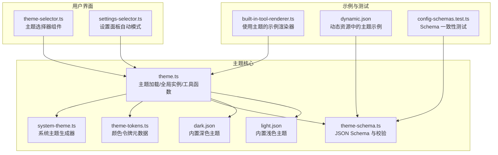
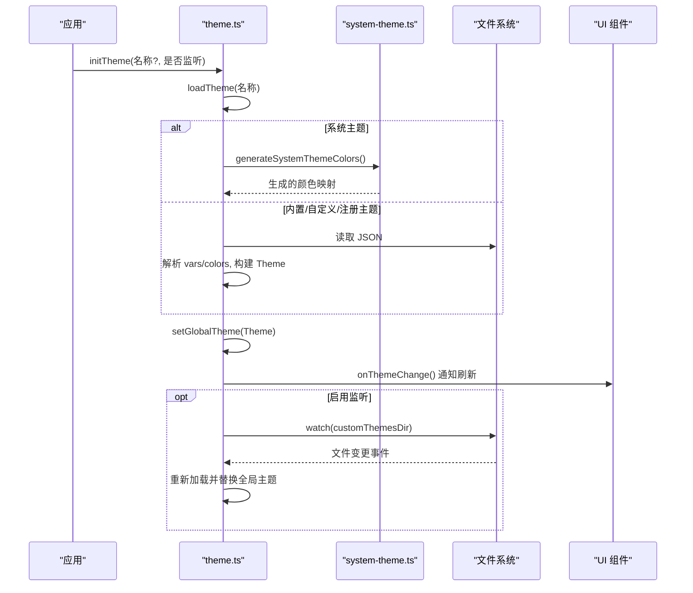
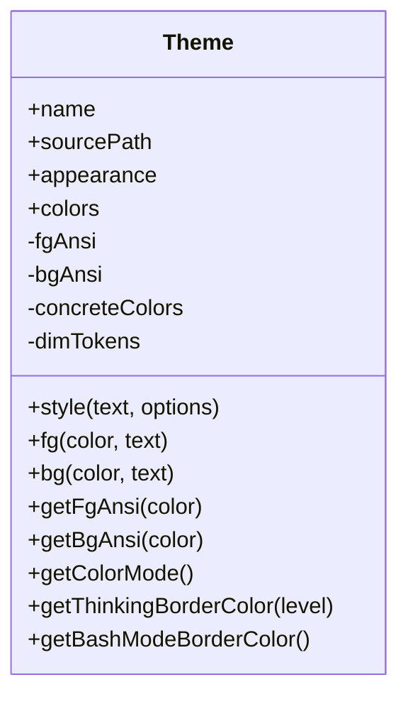
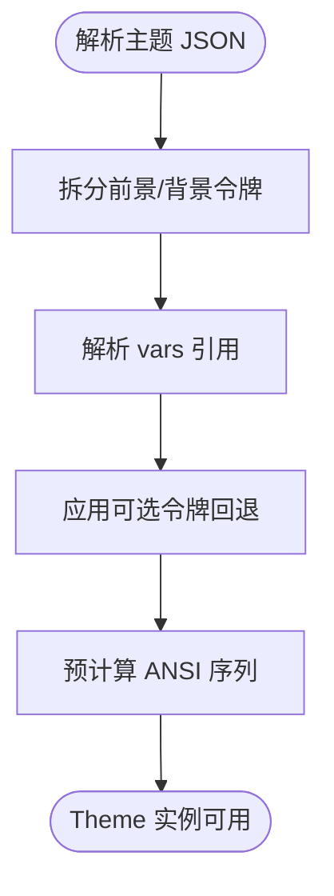
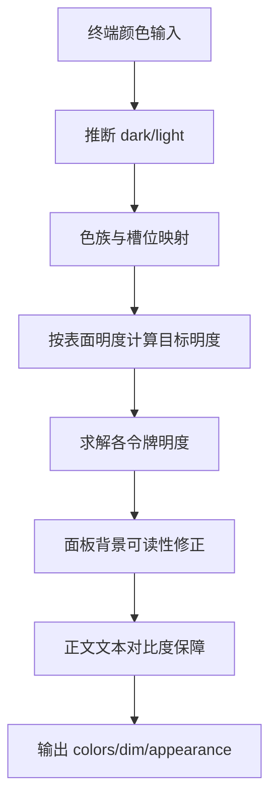
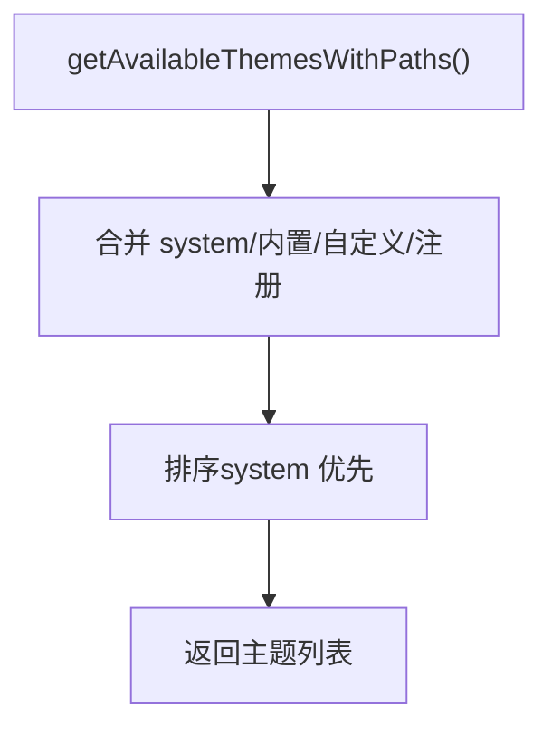
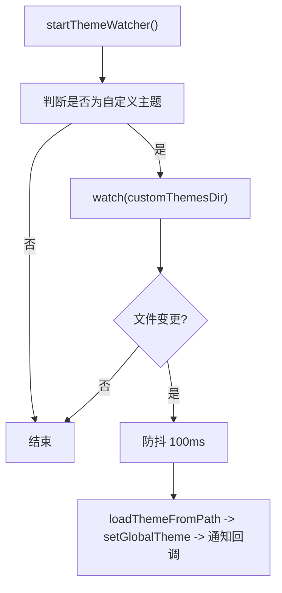
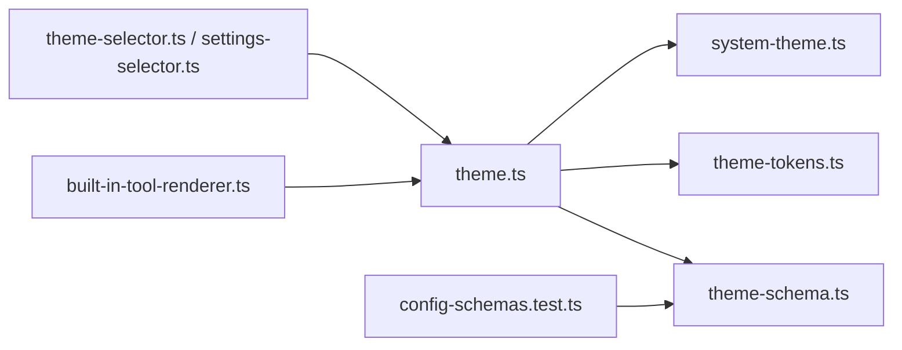

# 主题开发

**本文引用的文件**   
- [theme.ts](https://github.com/FDE-GROUP/oh-my-fde/blob/main/packages/coding-agent/src/modes/interactive/theme/theme.ts)
- [system-theme.ts](https://github.com/FDE-GROUP/oh-my-fde/blob/main/packages/coding-agent/src/modes/interactive/theme/system-theme.ts)
- [theme-tokens.ts](https://github.com/FDE-GROUP/oh-my-fde/blob/main/packages/coding-agent/src/modes/interactive/theme/theme-tokens.ts)
- [theme-schema.ts](https://github.com/FDE-GROUP/oh-my-fde/blob/main/packages/coding-agent/src/modes/interactive/theme/theme-schema.ts)
- [dark.json](https://github.com/FDE-GROUP/oh-my-fde/blob/main/packages/coding-agent/src/modes/interactive/theme/dark.json)
- [light.json](https://github.com/FDE-GROUP/oh-my-fde/blob/main/packages/coding-agent/src/modes/interactive/theme/light.json)
- [theme-selector.ts](https://github.com/FDE-GROUP/oh-my-fde/blob/main/packages/coding-agent/src/modes/interactive/components/theme-selector.ts)
- [settings-selector.ts](https://github.com/FDE-GROUP/oh-my-fde/blob/main/packages/coding-agent/src/modes/interactive/components/settings-selector.ts)
- [built-in-tool-renderer.ts](https://github.com/FDE-GROUP/oh-my-fde/blob/main/packages/coding-agent/examples/extensions/built-in-tool-renderer.ts)
- [dynamic.json](https://github.com/FDE-GROUP/oh-my-fde/blob/main/packages/coding-agent/examples/extensions/dynamic-resources/dynamic.json)
- [config-schemas.test.ts](https://github.com/FDE-GROUP/oh-my-fde/blob/main/packages/coding-agent/test/config-schemas.test.ts)

## 目录
1. [简介](#简介)
2. [项目结构](#项目结构)
3. [核心组件](#核心组件)
4. [架构总览](#架构总览)
5. [详细组件分析](#详细组件分析)
6. [依赖关系分析](#依赖关系分析)
7. [性能与可维护性](#性能与可维护性)
8. [主题测试与预览](#主题测试与预览)
9. [故障排查](#故障排查)
10. [结论](#结论)

## 简介
本指南面向希望为交互式编码代理界面创建、定制和扩展主题的开发人员。文档从主题组成元素、颜色令牌、变量系统、内置主题解析，到运行时加载、自动切换、文件监听热重载、HTML 导出与 TUI 集成等全链路进行说明，并提供从零开始的主题开发示例与最佳实践。

## 项目结构
主题相关代码集中在交互式模式的 theme 子系统中，包含主题类、令牌定义、系统主题生成器、JSON Schema 校验以及内置的深色/浅色主题文件；同时提供 UI 选择器和设置面板入口，以及示例扩展展示如何在渲染中使用主题 API。

图表来源
- [theme.ts:379-566](https://github.com/FDE-GROUP/oh-my-fde/blob/main/packages/coding-agent/src/modes/interactive/theme/theme.ts#L379-L566)
- [system-theme.ts:35-656](https://github.com/FDE-GROUP/oh-my-fde/blob/main/packages/coding-agent/src/modes/interactive/theme/system-theme.ts#L35-L656)
- [theme-tokens.ts:23-122](https://github.com/FDE-GROUP/oh-my-fde/blob/main/packages/coding-agent/src/modes/interactive/theme/theme-tokens.ts#L23-L122)
- [theme-schema.ts:52-147](https://github.com/FDE-GROUP/oh-my-fde/blob/main/packages/coding-agent/src/modes/interactive/theme/theme-schema.ts#L52-L147)
- [dark.json:1-79](https://github.com/FDE-GROUP/oh-my-fde/blob/main/packages/coding-agent/src/modes/interactive/theme/dark.json#L1-L79)
- [light.json:1-79](https://github.com/FDE-GROUP/oh-my-fde/blob/main/packages/coding-agent/src/modes/interactive/theme/light.json#L1-L79)
- [theme-selector.ts:1-52](https://github.com/FDE-GROUP/oh-my-fde/blob/main/packages/coding-agent/src/modes/interactive/components/theme-selector.ts#L1-L52)
- [settings-selector.ts:346-397](https://github.com/FDE-GROUP/oh-my-fde/blob/main/packages/coding-agent/src/modes/interactive/components/settings-selector.ts#L346-L397)
- [built-in-tool-renderer.ts:45-136](https://github.com/FDE-GROUP/oh-my-fde/blob/main/packages/coding-agent/examples/extensions/built-in-tool-renderer.ts#L45-L136)
- [dynamic.json:1-10](https://github.com/FDE-GROUP/oh-my-fde/blob/main/packages/coding-agent/examples/extensions/dynamic-resources/dynamic.json#L1-L10)
- [config-schemas.test.ts:32-66](https://github.com/FDE-GROUP/oh-my-fde/blob/main/packages/coding-agent/test/config-schemas.test.ts#L32-L66)

章节来源
- [theme.ts:379-566](https://github.com/FDE-GROUP/oh-my-fde/blob/main/packages/coding-agent/src/modes/interactive/theme/theme.ts#L379-L566)
- [theme-selector.ts:1-52](https://github.com/FDE-GROUP/oh-my-fde/blob/main/packages/coding-agent/src/modes/interactive/components/theme-selector.ts#L1-L52)
- [settings-selector.ts:346-397](https://github.com/FDE-GROUP/oh-my-fde/blob/main/packages/coding-agent/src/modes/interactive/components/settings-selector.ts#L346-L397)

## 核心组件
- Theme 类：封装前景/背景 ANSI 序列缓存、颜色解析、样式方法（fg/bg/style）、粗体/斜体/下划线等文本修饰，以及思考级别边框色、Bash 模式边框色等专用 API。
- 系统主题生成器：根据终端报告的前景色/背景色/调色板，按对比度曲线与色族规则自动生成一套可读性良好的主题色。
- 令牌系统：集中声明所有可用颜色令牌及其槽位（前景/背景）、描述与可选回退关系，确保主题 JSON 与运行时类型一致。
- Schema 校验：基于 TypeBox 编译的 JSON Schema，对主题文件的 name/appearance/vars/colors/export 字段进行强校验，并给出缺失必填 token 的可读错误信息。
- 内置主题：dark.json 与 light.json 提供完整的令牌映射与 export 段，用于 HTML 导出时的页面/卡片/信息区背景。

章节来源
- [theme.ts:185-373](https://github.com/FDE-GROUP/oh-my-fde/blob/main/packages/coding-agent/src/modes/interactive/theme/theme.ts#L185-L373)
- [system-theme.ts:35-656](https://github.com/FDE-GROUP/oh-my-fde/blob/main/packages/coding-agent/src/modes/interactive/theme/system-theme.ts#L35-L656)
- [theme-tokens.ts:23-122](https://github.com/FDE-GROUP/oh-my-fde/blob/main/packages/coding-agent/src/modes/interactive/theme/theme-tokens.ts#L23-L122)
- [theme-schema.ts:52-147](https://github.com/FDE-GROUP/oh-my-fde/blob/main/packages/coding-agent/src/modes/interactive/theme/theme-schema.ts#L52-L147)
- [dark.json:1-79](https://github.com/FDE-GROUP/oh-my-fde/blob/main/packages/coding-agent/src/modes/interactive/theme/dark.json#L1-L79)
- [light.json:1-79](https://github.com/FDE-GROUP/oh-my-fde/blob/main/packages/coding-agent/src/modes/interactive/theme/light.json#L1-L79)

## 架构总览
主题在运行时的生命周期包括：初始化、加载（内置/自定义/注册）、应用、变更回调、文件监听热重载、HTML/TUI 导出适配。

图表来源
- [theme.ts:687-737](https://github.com/FDE-GROUP/oh-my-fde/blob/main/packages/coding-agent/src/modes/interactive/theme/theme.ts#L687-L737)
- [theme.ts:739-824](https://github.com/FDE-GROUP/oh-my-fde/blob/main/packages/coding-agent/src/modes/interactive/theme/theme.ts#L739-L824)
- [system-theme.ts:465-587](https://github.com/FDE-GROUP/oh-my-fde/blob/main/packages/coding-agent/src/modes/interactive/theme/system-theme.ts#L465-L587)

## 详细组件分析

### 主题类与样式 API
- 颜色解析与回退：支持十六进制、OKLCH/OKHSL、ANSI 索引与空字符串（表示使用终端默认）。通过 vars 实现变量引用，并在内部做循环引用检测。
- 令牌槽位分离：将 tokens 分为前景与背景两类，分别预计算 ANSI 转义序列以优化渲染路径。
- 样式方法：style/fg/bg 返回带 ANSI 的代码串；bold/italic/underline/inverse/strikethrough 复用 chalk 能力。
- 思考级别与 Bash 模式：提供 getThinkingBorderColor(level) 与 getBashModeBorderColor() 便捷方法。

图表来源
- [theme.ts:185-373](https://github.com/FDE-GROUP/oh-my-fde/blob/main/packages/coding-agent/src/modes/interactive/theme/theme.ts#L185-L373)

章节来源
- [theme.ts:79-122](https://github.com/FDE-GROUP/oh-my-fde/blob/main/packages/coding-agent/src/modes/interactive/theme/theme.ts#L79-L122)
- [theme.ts:185-373](https://github.com/FDE-GROUP/oh-my-fde/blob/main/packages/coding-agent/src/modes/interactive/theme/theme.ts#L185-L373)

### 令牌系统与回退机制
- THEME_TOKENS 集中声明所有令牌、槽位、描述与可选回退（如 scrollbarTrack 回退到 muted）。
- 运行时 withThemeTokenFallbacks 会补齐未定义的可选令牌，保证 Theme.colors 始终完整。
- 类型层面区分 ThemeColor（前景）与 ThemeBg（背景），避免误用。

图表来源
- [theme.ts:509-534](https://github.com/FDE-GROUP/oh-my-fde/blob/main/packages/coding-agent/src/modes/interactive/theme/theme.ts#L509-L534)
- [theme-tokens.ts:23-122](https://github.com/FDE-GROUP/oh-my-fde/blob/main/packages/coding-agent/src/modes/interactive/theme/theme-tokens.ts#L23-L122)

章节来源
- [theme-tokens.ts:23-122](https://github.com/FDE-GROUP/oh-my-fde/blob/main/packages/coding-agent/src/modes/interactive/theme/theme-tokens.ts#L23-L122)
- [theme.ts:509-534](https://github.com/FDE-GROUP/oh-my-fde/blob/main/packages/coding-agent/src/modes/interactive/theme/theme.ts#L509-L534)

### 系统主题生成器
- 输入：终端前景/背景/调色板、饱和度系数、外观提示。
- 输出：每个令牌的最终颜色（或空字符串交由终端默认渲染）、哪些前景令牌应“变淡”、推断的外观（dark/light）。
- 算法要点：
  - 色族（family）与 ANSI 槽位映射，保持色调一致性。
  - 对比度曲线（level）按表面明度计算目标明度，必要时放宽约束。
  - 面板背景需满足极端文本的最小 WCAG 对比度。
  - 正文文本优先使用终端前景，若不够清晰则按家族中性色调整。

图表来源
- [system-theme.ts:465-587](https://github.com/FDE-GROUP/oh-my-fde/blob/main/packages/coding-agent/src/modes/interactive/theme/system-theme.ts#L465-L587)

章节来源
- [system-theme.ts:35-656](https://github.com/FDE-GROUP/oh-my-fde/blob/main/packages/coding-agent/src/modes/interactive/theme/system-theme.ts#L35-L656)

### 主题加载与全局实例
- 获取可用主题：合并 system、内置、自定义、已注册主题，并按规则排序。
- 加载顺序：系统主题 > 已注册主题 > 内置主题 > 自定义主题。
- 全局主题：通过 globalThis 共享，避免多模块加载器导致的不一致。
- 自动模式：支持 light/dark 双主题配置（如 "light/dark"），根据终端外观解析。

图表来源
- [theme.ts:394-434](https://github.com/FDE-GROUP/oh-my-fde/blob/main/packages/coding-agent/src/modes/interactive/theme/theme.ts#L394-L434)

章节来源
- [theme.ts:379-566](https://github.com/FDE-GROUP/oh-my-fde/blob/main/packages/coding-agent/src/modes/interactive/theme/theme.ts#L379-L566)
- [theme.ts:578-641](https://github.com/FDE-GROUP/oh-my-fde/blob/main/packages/coding-agent/src/modes/interactive/theme/theme.ts#L578-L641)
- [theme.ts:647-737](https://github.com/FDE-GROUP/oh-my-fde/blob/main/packages/coding-agent/src/modes/interactive/theme/theme.ts#L647-L737)

### 文件监听与热重载
- 仅对自定义主题启用监听（非内置、非 system）。
- 防抖重加载：100ms 延迟，避免频繁写入导致的重复加载。
- 安全策略：忽略无效主题文件、文件名不匹配、主题切换后过期定时器。

图表来源
- [theme.ts:739-824](https://github.com/FDE-GROUP/oh-my-fde/blob/main/packages/coding-agent/src/modes/interactive/theme/theme.ts#L739-L824)

章节来源
- [theme.ts:739-824](https://github.com/FDE-GROUP/oh-my-fde/blob/main/packages/coding-agent/src/modes/interactive/theme/theme.ts#L739-L824)

### HTML 导出与 TUI 适配
- HTML 导出：
  - getResolvedThemeColors：将主题颜色转为 CSS 可用的十六进制。
  - isLightTheme：判断主题外观。
  - getThemeExportColors：读取 theme.json 的 export 段，解析 vars 并转换为 CSS 值。
- TUI 适配：
  - getMarkdownTheme/getSelectListTheme/getEditorTheme/getSettingsListTheme：将主题令牌映射到 UI 组件的着色回调。
  - highlightCode/CodeHighlighter：基于主题令牌进行语法高亮，并缓存结果提升性能。

章节来源
- [theme.ts:827-881](https://github.com/FDE-GROUP/oh-my-fde/blob/main/packages/coding-agent/src/modes/interactive/theme/theme.ts#L827-L881)
- [theme.ts:883-1111](https://github.com/FDE-GROUP/oh-my-fde/blob/main/packages/coding-agent/src/modes/interactive/theme/theme.ts#L883-L1111)

### 主题选择器与设置面板
- 主题选择器组件：列出可用主题，支持当前主题标记、选择回调与取消回调。
- 设置面板：支持“自动模式”下的 lightTheme/darkTheme 配置，并提供预览回调。

章节来源
- [theme-selector.ts:1-52](https://github.com/FDE-GROUP/oh-my-fde/blob/main/packages/coding-agent/src/modes/interactive/components/theme-selector.ts#L1-L52)
- [settings-selector.ts:346-397](https://github.com/FDE-GROUP/oh-my-fde/blob/main/packages/coding-agent/src/modes/interactive/components/settings-selector.ts#L346-L397)

### 示例：在渲染中使用主题
- 示例渲染器通过 theme.fg("toolTitle"/"accent"/"warning"/"success"/"error"/"dim"/"muted") 等方式为工具调用与结果着色，体现主题令牌的实际用法。

章节来源
- [built-in-tool-renderer.ts:45-136](https://github.com/FDE-GROUP/oh-my-fde/blob/main/packages/coding-agent/examples/extensions/built-in-tool-renderer.ts#L45-L136)

## 依赖关系分析
- theme.ts 依赖：
  - system-theme.ts（系统主题生成）
  - theme-tokens.ts（令牌元数据）
  - theme-schema.ts（可选的 JSON 校验）
  - 文件系统与语法高亮工具
- 组件层依赖 theme.ts 提供的主题 API 与辅助函数。
- 示例与测试验证 schema 与内置主题的一致性。

图表来源
- [theme.ts:1-31](https://github.com/FDE-GROUP/oh-my-fde/blob/main/packages/coding-agent/src/modes/interactive/theme/theme.ts#L1-L31)
- [theme-selector.ts:1-52](https://github.com/FDE-GROUP/oh-my-fde/blob/main/packages/coding-agent/src/modes/interactive/components/theme-selector.ts#L1-L52)
- [settings-selector.ts:346-397](https://github.com/FDE-GROUP/oh-my-fde/blob/main/packages/coding-agent/src/modes/interactive/components/settings-selector.ts#L346-L397)
- [built-in-tool-renderer.ts:45-136](https://github.com/FDE-GROUP/oh-my-fde/blob/main/packages/coding-agent/examples/extensions/built-in-tool-renderer.ts#L45-L136)
- [config-schemas.test.ts:32-66](https://github.com/FDE-GROUP/oh-my-fde/blob/main/packages/coding-agent/test/config-schemas.test.ts#L32-L66)

章节来源
- [theme.ts:1-31](https://github.com/FDE-GROUP/oh-my-fde/blob/main/packages/coding-agent/src/modes/interactive/theme/theme.ts#L1-L31)
- [config-schemas.test.ts:32-66](https://github.com/FDE-GROUP/oh-my-fde/blob/main/packages/coding-agent/test/config-schemas.test.ts#L32-L66)

## 性能与可维护性
- 渲染热路径优化：预计算 ANSI 序列，减少 fg/bg 调用开销。
- 高亮缓存：CodeHighlighter 针对同一 owner 的代码块缓存结果，避免重复解析。
- 按需校验：主题 JSON 校验由外部安装，默认内置主题不引入额外依赖体积。
- 可维护性：令牌集中管理，新增/修改令牌只需一处，自动传播至 Schema 与运行时。

章节来源
- [theme.ts:185-373](https://github.com/FDE-GROUP/oh-my-fde/blob/main/packages/coding-agent/src/modes/interactive/theme/theme.ts#L185-L373)
- [theme.ts:961-988](https://github.com/FDE-GROUP/oh-my-fde/blob/main/packages/coding-agent/src/modes/interactive/theme/theme.ts#L961-L988)
- [theme-schema.ts:1-10](https://github.com/FDE-GROUP/oh-my-fde/blob/main/packages/coding-agent/src/modes/interactive/theme/theme-schema.ts#L1-L10)

## 主题测试与预览
- 主题选择器：在 UI 中列出所有可用主题，支持选择与预览回调。
- 设置面板：支持自动模式下分别指定 lightTheme 与 darkTheme，并提供预览回调以便即时生效。
- Schema 测试：确保生成的 theme.schema.json 与源码保持一致，保留编辑器引导与描述。

章节来源
- [theme-selector.ts:1-52](https://github.com/FDE-GROUP/oh-my-fde/blob/main/packages/coding-agent/src/modes/interactive/components/theme-selector.ts#L1-L52)
- [settings-selector.ts:346-397](https://github.com/FDE-GROUP/oh-my-fde/blob/main/packages/coding-agent/src/modes/interactive/components/settings-selector.ts#L346-L397)
- [config-schemas.test.ts:32-66](https://github.com/FDE-GROUP/oh-my-fde/blob/main/packages/coding-agent/test/config-schemas.test.ts#L32-L66)

## 故障排查
- 主题名非法：名称中包含 "/" 会被拒绝，因为该格式保留给自动模式（light/dark）。
- 缺少必填令牌：校验器会列出缺失的颜色令牌，并提示参考内置主题。
- 未知令牌：colors 对象不允许额外属性，拼写错误会导致校验失败。
- 变量引用问题：循环引用或未找到变量会抛出错误。
- 主题文件无效：加载失败时会自动回退到 system 主题，不会中断启动。

章节来源
- [theme-schema.ts:96-147](https://github.com/FDE-GROUP/oh-my-fde/blob/main/packages/coding-agent/src/modes/interactive/theme/theme-schema.ts#L96-L147)
- [theme.ts:461-475](https://github.com/FDE-GROUP/oh-my-fde/blob/main/packages/coding-agent/src/modes/interactive/theme/theme.ts#L461-L475)
- [theme.ts:687-724](https://github.com/FDE-GROUP/oh-my-fde/blob/main/packages/coding-agent/src/modes/interactive/theme/theme.ts#L687-L724)

## 结论
本主题系统通过令牌化、变量化、严格的 Schema 校验与强大的系统主题生成器，提供了稳定、可扩展且高性能的主题能力。开发者可以基于 dark.json/light.json 快速起步，逐步扩展到自定义配色、导出适配与复杂界面定制；借助选择器与设置面板，可在运行时预览与切换主题，并通过文件监听获得热重载体验。