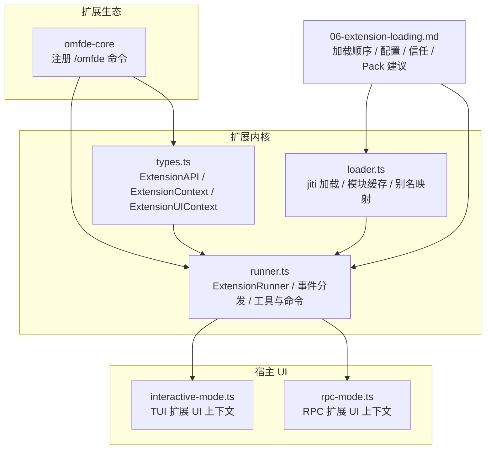
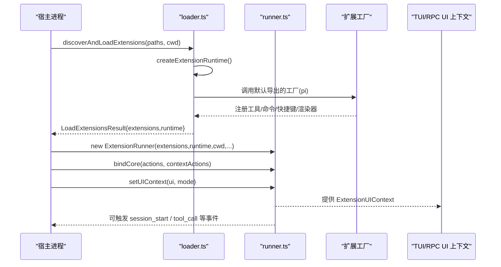
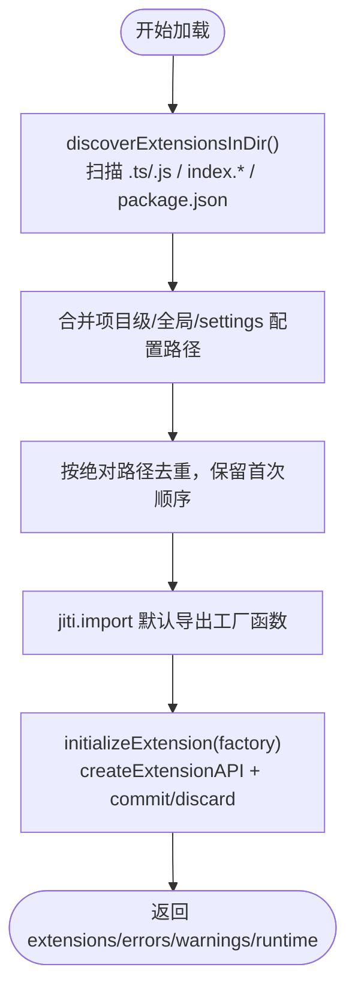
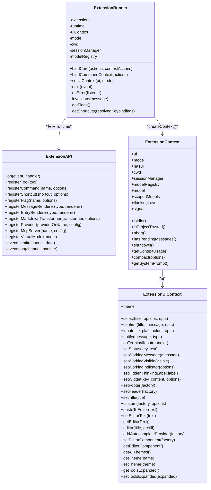
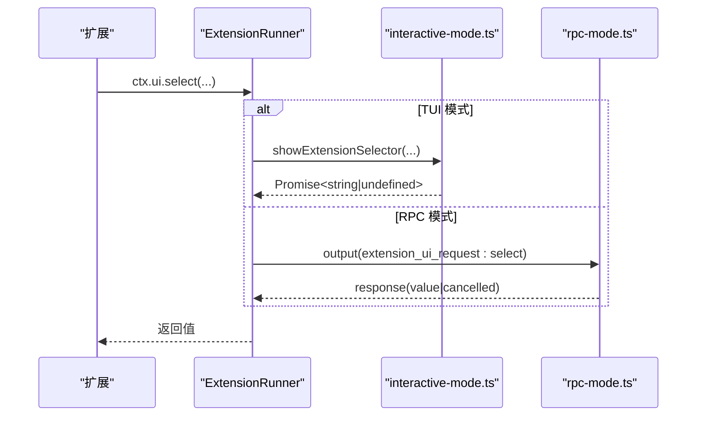
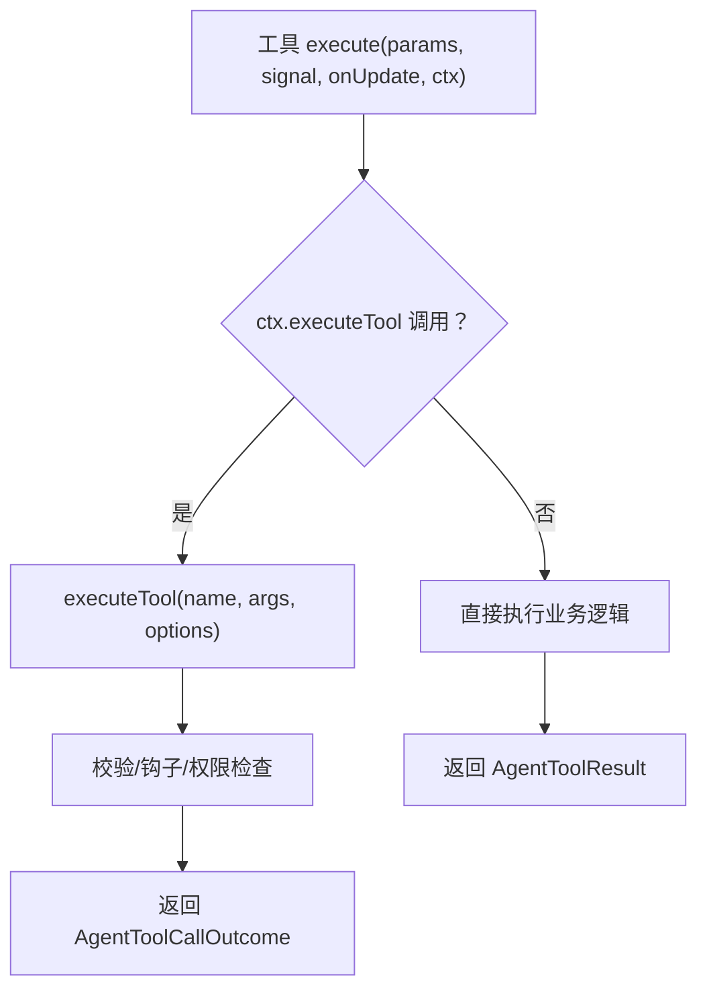
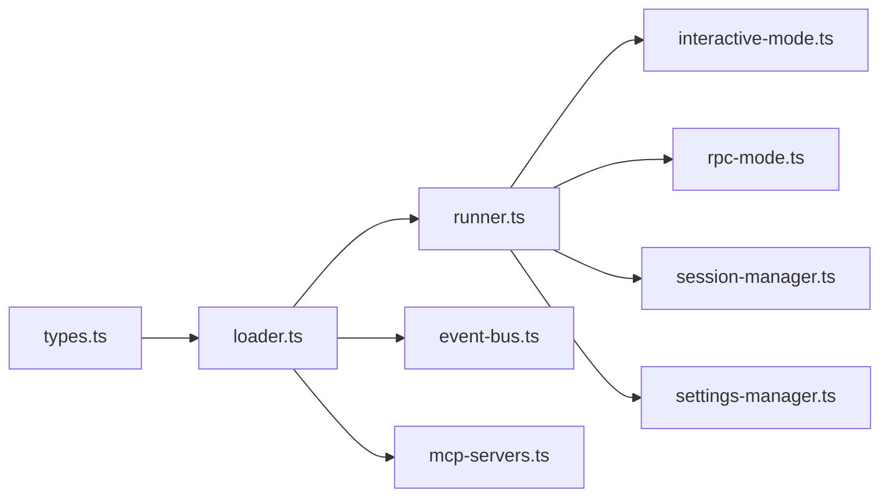

# 扩展架构概述

**本文引用的文件**   
- [extensions/omfde-core/src/index.ts](https://github.com/FDE-GROUP/oh-my-fde/blob/main/extensions/omfde-core/src/index.ts)
- [packages/coding-agent/src/core/extensions/types.ts](https://github.com/FDE-GROUP/oh-my-fde/blob/main/packages/coding-agent/src/core/extensions/types.ts)
- [packages/coding-agent/src/core/extensions/loader.ts](https://github.com/FDE-GROUP/oh-my-fde/blob/main/packages/coding-agent/src/core/extensions/loader.ts)
- [packages/coding-agent/src/core/extensions/runner.ts](https://github.com/FDE-GROUP/oh-my-fde/blob/main/packages/coding-agent/src/core/extensions/runner.ts)
- [packages/coding-agent/src/modes/rpc/rpc-mode.ts](https://github.com/FDE-GROUP/oh-my-fde/blob/main/packages/coding-agent/src/modes/rpc/rpc-mode.ts)
- [packages/coding-agent/src/modes/interactive/interactive-mode.ts](https://github.com/FDE-GROUP/oh-my-fde/blob/main/packages/coding-agent/src/modes/interactive/interactive-mode.ts)
- [docs/explains/06-extension-loading.md](https://github.com/FDE-GROUP/oh-my-fde/blob/main/docs/explains/06-extension-loading.md)

## 目录
1. [简介](#简介)
2. [项目结构](#项目结构)
3. [核心组件](#核心组件)
4. [架构总览](#架构总览)
5. [详细组件分析](#详细组件分析)
6. [依赖关系分析](#依赖关系分析)
7. [性能与可靠性](#性能与可靠性)
8. [故障排查指南](#故障排查指南)
9. [结论](#结论)
10. [附录：扩展开发入门](#附录扩展开发入门)

## 简介
本文件系统性梳理 OMFDE 扩展系统的整体设计、核心概念与组件关系，重点解释扩展生命周期、加载机制、事件系统，以及扩展上下文（ExtensionContext）和 UI 上下文（ExtensionUIContext）等关键接口。同时给出扩展类型、注册方式与最佳实践，并通过仓库中的实际代码路径展示如何构建一个最小可用的扩展。

OMFDE 的扩展能力建立在 Pi 编码代理的扩展框架之上：扩展以 TypeScript 模块形式存在，默认导出工厂函数，由加载器通过 jiti 直接执行；运行期由 ExtensionRunner 统一调度事件、工具、命令、快捷键、渲染器等资源；UI 交互通过 ExtensionUIContext 抽象，支持 TUI 与 RPC 两种宿主模式。

## 项目结构
从扩展视角看，仓库中与扩展架构直接相关的核心位置如下：
- 平台基础扩展示例：extensions/omfde-core/src/index.ts
- 扩展类型与 API 定义：packages/coding-agent/src/core/extensions/types.ts
- 扩展发现与加载：packages/coding-agent/src/core/extensions/loader.ts
- 扩展运行与事件分发：packages/coding-agent/src/core/extensions/runner.ts
- UI 上下文实现（TUI/RPC）：packages/coding-agent/src/modes/interactive/interactive-mode.ts、packages/coding-agent/src/modes/rpc/rpc-mode.ts
- 扩展加载与设计说明：docs/explains/06-extension-loading.md

**图表来源**
- [extensions/omfde-core/src/index.ts:1-20](https://github.com/FDE-GROUP/oh-my-fde/blob/main/extensions/omfde-core/src/index.ts#L1-L20)
- [packages/coding-agent/src/core/extensions/types.ts:1-120](https://github.com/FDE-GROUP/oh-my-fde/blob/main/packages/coding-agent/src/core/extensions/types.ts#L1-L120)
- [packages/coding-agent/src/core/extensions/loader.ts:1-60](https://github.com/FDE-GROUP/oh-my-fde/blob/main/packages/coding-agent/src/core/extensions/loader.ts#L1-L60)
- [packages/coding-agent/src/core/extensions/runner.ts:364-415](https://github.com/FDE-GROUP/oh-my-fde/blob/main/packages/coding-agent/src/core/extensions/runner.ts#L364-L415)
- [packages/coding-agent/src/modes/interactive/interactive-mode.ts:2757-2779](https://github.com/FDE-GROUP/oh-my-fde/blob/main/packages/coding-agent/src/modes/interactive/interactive-mode.ts#L2757-L2779)
- [packages/coding-agent/src/modes/rpc/rpc-mode.ts:119-154](https://github.com/FDE-GROUP/oh-my-fde/blob/main/packages/coding-agent/src/modes/rpc/rpc-mode.ts#L119-L154)
- [docs/explains/06-extension-loading.md:1-40](https://github.com/FDE-GROUP/oh-my-fde/blob/main/docs/explains/06-extension-loading.md#L1-L40)

**章节来源**
- [extensions/omfde-core/src/index.ts:1-20](https://github.com/FDE-GROUP/oh-my-fde/blob/main/extensions/omfde-core/src/index.ts#L1-L20)
- [docs/explains/06-extension-loading.md:1-40](https://github.com/FDE-GROUP/oh-my-fde/blob/main/docs/explains/06-extension-loading.md#L1-L40)

## 核心组件
- 扩展工厂与扩展对象
  - 每个扩展是一个默认导出的工厂函数，接收 ExtensionAPI，在加载阶段向扩展对象注册工具、命令、快捷键、渲染器等。
- 扩展运行时（ExtensionRuntime）
  - 提供共享动作方法（sendMessage、appendEntry、setActiveTools 等），在 loader 中创建并在 runner.bindCore() 时绑定真实实现。
- 扩展 API（ExtensionAPI）
  - 暴露注册类与方法（on、registerTool、registerCommand、registerShortcut、registerFlag、registerMessageRenderer、registerEntryRenderer、registerMarkdownTransformer、registerProvider、registerMcpServer、registerVirtualModel）与查询/动作类方法（getSettings、getActiveTools、setActiveTools、exec、events 等）。
- 扩展运行器（ExtensionRunner）
  - 管理扩展集合、事件分发、工具与命令收集、快捷键冲突检测、UI 提示状态、会话边界事件、MCP 服务器变更通知等。
- 扩展上下文（ExtensionContext）
  - 提供给扩展事件处理器与工具执行器的运行时上下文，包含 ui、mode、hasUI、cwd、sessionManager、modelRegistry、model、scopedModels、thinkingLevel、isIdle、isProjectTrusted、signal、abort、hasPendingMessages、shutdown、getContextUsage、compact、getSystemPrompt 等。
- UI 上下文（ExtensionUIContext）
  - 抽象用户交互能力，包括 select、confirm、input、notify、onTerminalInput、setStatus、setWorkingMessage、setWorkingVisible、setWorkingIndicator、setHiddenThinkingLabel、setWidget、setFooter、setHeader、setTitle、custom、pasteToEditor、setEditorText、getEditorText、editor、addAutocompleteProvider、setEditorComponent、getEditorComponent、theme、getAllThemes、getTheme、setTheme、getToolsExpanded、setToolsExpanded。

**章节来源**
- [packages/coding-agent/src/core/extensions/types.ts:111-385](https://github.com/FDE-GROUP/oh-my-fde/blob/main/packages/coding-agent/src/core/extensions/types.ts#L111-L385)
- [packages/coding-agent/src/core/extensions/loader.ts:160-244](https://github.com/FDE-GROUP/oh-my-fde/blob/main/packages/coding-agent/src/core/extensions/loader.ts#L160-L244)
- [packages/coding-agent/src/core/extensions/loader.ts:253-560](https://github.com/FDE-GROUP/oh-my-fde/blob/main/packages/coding-agent/src/core/extensions/loader.ts#L253-L560)
- [packages/coding-agent/src/core/extensions/runner.ts:364-415](https://github.com/FDE-GROUP/oh-my-fde/blob/main/packages/coding-agent/src/core/extensions/runner.ts#L364-L415)

## 架构总览
扩展系统由“加载层 + 运行层 + 宿主 UI”三层组成：
- 加载层（loader.ts）
  - 使用 jiti 直接执行 TypeScript，避免编译；为宿主包与 typebox 设置别名，保证扩展不会引入第二份运行时；模块必须默认导出工厂函数；加载失败不中断其他扩展。
- 运行层（runner.ts）
  - 将扩展注册的各类资源聚合到 ExtensionRunner，按扩展加载顺序与同一扩展内注册顺序执行；处理事件总线、工具调用、命令、快捷键、消息渲染、MCP 服务器变更等。
- 宿主 UI（interactive-mode.ts、rpc-mode.ts）
  - 为 ExtensionUIContext 提供具体实现：TUI 模式下提供终端交互、对话框栈、工作指示器、编辑器组件等；RPC 模式下通过协议把 UI 请求转发给宿主。

**图表来源**
- [packages/coding-agent/src/core/extensions/loader.ts:688-728](https://github.com/FDE-GROUP/oh-my-fde/blob/main/packages/coding-agent/src/core/extensions/loader.ts#L688-L728)
- [packages/coding-agent/src/core/extensions/runner.ts:417-551](https://github.com/FDE-GROUP/oh-my-fde/blob/main/packages/coding-agent/src/core/extensions/runner.ts#L417-L551)
- [packages/coding-agent/src/modes/interactive/interactive-mode.ts:2757-2779](https://github.com/FDE-GROUP/oh-my-fde/blob/main/packages/coding-agent/src/modes/interactive/interactive-mode.ts#L2757-L2779)
- [packages/coding-agent/src/modes/rpc/rpc-mode.ts:119-154](https://github.com/FDE-GROUP/oh-my-fde/blob/main/packages/coding-agent/src/modes/rpc/rpc-mode.ts#L119-L154)

## 详细组件分析

### 扩展加载与发现
- 发现规则
  - 扫描一层目录：直接 .ts/.js 文件、子目录 index.ts/index.js、或 package.json 声明 pi.extensions。
  - 标准位置顺序：项目级 \<cwd>/.pi/extensions/、全局 ~/.pi/agent/extensions/、settings 显式 configuredPaths。
  - 去重基于解析后的绝对路径，保留首次出现顺序。
- 加载机制
  - 使用 jiti 直接执行 TypeScript，moduleCache: false，每次 reload 都是新模块实例。
  - 宿主包与 typebox 通过 alias 映射到 Pi 自己的副本，避免扩展装出第二份运行时。
  - 模块必须默认导出工厂函数；工厂可以是 async，Pi 会 await 完成再继续启动。
  - 加载失败进入 errors，不影响其他扩展继续加载。
- 替换机制
  - 内置扩展可标记 replaceable；第三方扩展同名 tool/command/flag 会替换内置并产生 warning。
- 配置合并
  - 全局 settings.json 与项目 settings.json 递归合并，项目优先；未受信任的项目配置被忽略。
  - 官方启用/禁用手段包括 packages autoload、disabledBuiltinExtensions、noExtensions、defaultTools 等。

**图表来源**
- [docs/explains/06-extension-loading.md:11-43](https://github.com/FDE-GROUP/oh-my-fde/blob/main/docs/explains/06-extension-loading.md#L11-L43)
- [packages/coding-agent/src/core/extensions/loader.ts:748-800](https://github.com/FDE-GROUP/oh-my-fde/blob/main/packages/coding-agent/src/core/extensions/loader.ts#L748-L800)
- [packages/coding-agent/src/core/extensions/loader.ts:625-668](https://github.com/FDE-GROUP/oh-my-fde/blob/main/packages/coding-agent/src/core/extensions/loader.ts#L625-L668)

**章节来源**
- [docs/explains/06-extension-loading.md:11-109](https://github.com/FDE-GROUP/oh-my-fde/blob/main/docs/explains/06-extension-loading.md#L11-L109)
- [packages/coding-agent/src/core/extensions/loader.ts:748-800](https://github.com/FDE-GROUP/oh-my-fde/blob/main/packages/coding-agent/src/core/extensions/loader.ts#L748-L800)

### 扩展运行器与事件系统
- ExtensionRunner 职责
  - 维护扩展列表、运行时、UI 上下文与工作模式；绑定核心动作与上下文动作；收集工具、命令、快捷键、渲染器；处理事件分发与错误监听。
- 事件模型
  - 通用 emit(event) 与专用 emitXxx()；对 session_before_switch/fork/compact/tree 等事件有强类型结果。
  - project_trust 事件：第一个返回 yes/no 的 handler 胜出，undecided 继续流转。
  - mcp_servers_change：当无扩展连接 MCP 服务器时报告未处理警告。
- UI 提示生命周期
  - wrapUIPromptContext 包装 select/confirm/input/editor/custom，发出 ui_prompt_start/ui_prompt_end 事件，支持嵌套深度计数。
- 失效与重载
  - invalidate() 标记 ctx 过期；reload 后旧 runner 不可用；测试用例验证 session_shutdown 与 session_start(reason:"reload") 行为。

**图表来源**
- [packages/coding-agent/src/core/extensions/runner.ts:364-415](https://github.com/FDE-GROUP/oh-my-fde/blob/main/packages/coding-agent/src/core/extensions/runner.ts#L364-L415)
- [packages/coding-agent/src/core/extensions/loader.ts:253-560](https://github.com/FDE-GROUP/oh-my-fde/blob/main/packages/coding-agent/src/core/extensions/loader.ts#L253-L560)
- [packages/coding-agent/src/core/extensions/types.ts:164-385](https://github.com/FDE-GROUP/oh-my-fde/blob/main/packages/coding-agent/src/core/extensions/types.ts#L164-L385)

**章节来源**
- [packages/coding-agent/src/core/extensions/runner.ts:261-329](https://github.com/FDE-GROUP/oh-my-fde/blob/main/packages/coding-agent/src/core/extensions/runner.ts#L261-L329)
- [packages/coding-agent/src/core/extensions/runner.ts:572-626](https://github.com/FDE-GROUP/oh-my-fde/blob/main/packages/coding-agent/src/core/extensions/runner.ts#L572-L626)
- [packages/coding-agent/src/core/extensions/runner.ts:680-727](https://github.com/FDE-GROUP/oh-my-fde/blob/main/packages/coding-agent/src/core/extensions/runner.ts#L680-L727)

### UI 上下文：TUI 与 RPC
- TUI 模式
  - interactive-mode.ts 提供完整的 ExtensionUIContext：选择器、确认框、输入框、通知、终端输入监听、工作状态、思考标签、widget、footer/header、标题、自定义组件、编辑器粘贴与文本操作、自动补全、主题切换等。
  - 对话框采用栈结构，支持嵌套打开与关闭恢复。
- RPC 模式
  - rpc-mode.ts 通过 extension_ui_request 协议将 UI 请求发送到宿主，等待响应后 resolve/reject；部分能力（如 autocomplete provider 组合、自定义编辑器组件）在 RPC 下不支持。

**图表来源**
- [packages/coding-agent/src/modes/interactive/interactive-mode.ts:2757-2779](https://github.com/FDE-GROUP/oh-my-fde/blob/main/packages/coding-agent/src/modes/interactive/interactive-mode.ts#L2757-L2779)
- [packages/coding-agent/src/modes/interactive/interactive-mode.ts:2811-2839](https://github.com/FDE-GROUP/oh-my-fde/blob/main/packages/coding-agent/src/modes/interactive/interactive-mode.ts#L2811-L2839)
- [packages/coding-agent/src/modes/rpc/rpc-mode.ts:119-154](https://github.com/FDE-GROUP/oh-my-fde/blob/main/packages/coding-agent/src/modes/rpc/rpc-mode.ts#L119-L154)
- [packages/coding-agent/src/modes/rpc/rpc-mode.ts:237-288](https://github.com/FDE-GROUP/oh-my-fde/blob/main/packages/coding-agent/src/modes/rpc/rpc-mode.ts#L237-L288)

**章节来源**
- [packages/coding-agent/src/modes/interactive/interactive-mode.ts:2757-2779](https://github.com/FDE-GROUP/oh-my-fde/blob/main/packages/coding-agent/src/modes/interactive/interactive-mode.ts#L2757-L2779)
- [packages/coding-agent/src/modes/rpc/rpc-mode.ts:119-154](https://github.com/FDE-GROUP/oh-my-fde/blob/main/packages/coding-agent/src/modes/rpc/rpc-mode.ts#L119-L154)

### 扩展上下文与工具执行
- ExtensionContext
  - 提供会话与模型信息、当前 thinkingLevel、是否空闲、项目信任状态、AbortSignal、上下文用量、压缩、系统提示等。
- ExtensionToolContext
  - 在工具 execute() 中提供 tools 与 executeTool(name, args, options)，用于在同一校验、hook 与权限检查链中调用其他工具。
- 工具暴露与命名空间
  - ToolExposure 控制 direct/model-only/codemode/deferred/hidden；ToolNamespace 用于分组（例如 MCP server）。

**图表来源**
- [packages/coding-agent/src/core/extensions/types.ts:387-415](https://github.com/FDE-GROUP/oh-my-fde/blob/main/packages/coding-agent/src/core/extensions/types.ts#L387-L415)
- [packages/coding-agent/src/core/extensions/types.ts:521-583](https://github.com/FDE-GROUP/oh-my-fde/blob/main/packages/coding-agent/src/core/extensions/types.ts#L521-L583)

**章节来源**
- [packages/coding-agent/src/core/extensions/types.ts:326-415](https://github.com/FDE-GROUP/oh-my-fde/blob/main/packages/coding-agent/src/core/extensions/types.ts#L326-L415)
- [packages/coding-agent/src/core/extensions/types.ts:521-583](https://github.com/FDE-GROUP/oh-my-fde/blob/main/packages/coding-agent/src/core/extensions/types.ts#L521-L583)

## 依赖关系分析
- 耦合与内聚
  - loader.ts 负责模块加载与 API 构造，runner.ts 负责运行期调度，types.ts 定义契约，UI 模式文件提供 ExtensionUIContext 实现。
- 外部依赖
  - jiti 用于 TS 直跑；typebox 用于参数 schema；@earendil-works/pi-* 系列包通过别名映射到宿主副本。
- 潜在循环依赖
  - 通过 ExtensionRuntime 的延迟绑定与 pending 队列避免加载期访问未初始化动作。
- 集成点
  - 事件总线（EventBus）、MCP 服务器注册表、模型注册表、会话管理器、设置管理器、键绑定管理等。

**图表来源**
- [packages/coding-agent/src/core/extensions/types.ts:1-120](https://github.com/FDE-GROUP/oh-my-fde/blob/main/packages/coding-agent/src/core/extensions/types.ts#L1-L120)
- [packages/coding-agent/src/core/extensions/loader.ts:1-40](https://github.com/FDE-GROUP/oh-my-fde/blob/main/packages/coding-agent/src/core/extensions/loader.ts#L1-L40)
- [packages/coding-agent/src/core/extensions/runner.ts:1-95](https://github.com/FDE-GROUP/oh-my-fde/blob/main/packages/coding-agent/src/core/extensions/runner.ts#L1-L95)

**章节来源**
- [packages/coding-agent/src/core/extensions/loader.ts:1-40](https://github.com/FDE-GROUP/oh-my-fde/blob/main/packages/coding-agent/src/core/extensions/loader.ts#L1-L40)
- [packages/coding-agent/src/core/extensions/runner.ts:1-95](https://github.com/FDE-GROUP/oh-my-fde/blob/main/packages/coding-agent/src/core/extensions/runner.ts#L1-L95)

## 性能与可靠性
- 性能
  - jiti 直跑避免编译开销；moduleCache: false 确保 reload 隔离；扩展工厂缓存按 cwd 与 generation 控制，减少重复模块导入但允许重新执行工厂。
  - 工具与命令收集使用 Map 去重，避免重复注册。
- 可靠性
  - 加载失败不中断其他扩展；事件处理器异常被捕获并记录；MCP 服务器未连接时发出警告；UI 提示事件包裹 try/finally 保证结束事件发送。
- 安全
  - 项目信任决定前仅加载全局/CLI 扩展；项目级 pack 不能保护“信任决定”本身；扩展在进程内运行，具备同等 OS 权限，真正边界需 OS 级沙箱。

**章节来源**
- [packages/coding-agent/src/core/extensions/loader.ts:136-158](https://github.com/FDE-GROUP/oh-my-fde/blob/main/packages/coding-agent/src/core/extensions/loader.ts#L136-L158)
- [packages/coding-agent/src/core/extensions/loader.ts:571-602](https://github.com/FDE-GROUP/oh-my-fde/blob/main/packages/coding-agent/src/core/extensions/loader.ts#L571-L602)
- [docs/explains/06-extension-loading.md:145-185](https://github.com/FDE-GROUP/oh-my-fde/blob/main/docs/explains/06-extension-loading.md#L145-L185)

## 故障排查指南
- 扩展初始化抛出异常
  - 现象：errors 数组包含该扩展的错误信息，extension 为空。
  - 排查：检查默认导出是否为函数；确认 TypeBox schema 与参数校验；查看 initializeExtension 的 catch 分支。
- 事件处理器抛出异常
  - 现象：onError 回调收到 ExtensionError；project_trust 等事件处理器异常会被收集。
  - 排查：在 runner 的事件分发处添加日志；确认 handler 异步错误处理。
- 快捷键冲突
  - 现象：控制台警告或 ResourceDiagnostic；内置保留快捷键优先级更高。
  - 排查：使用 getShortcuts 与 getShortcutDiagnostics 诊断；避免覆盖 app.* 与 tui.* 保留键。
- 会话重载后上下文失效
  - 现象：调用 stale ctx 抛出“stale”错误。
  - 排查：避免在 ctx.newSession()/fork()/switchSession()/reload() 之后继续使用旧 ctx；将后续逻辑放入 withSession 回调。
- MCP 服务器未连接
  - 现象：reportUnhandledMcpServers 报错。
  - 排查：确保有扩展处理 mcp_servers_change 并连接服务器。

**章节来源**
- [packages/coding-agent/test/extensions-discovery.test.ts:434-447](https://github.com/FDE-GROUP/oh-my-fde/blob/main/packages/coding-agent/test/extensions-discovery.test.ts#L434-L447)
- [packages/coding-agent/test/suite/regressions/7193-event-bus-lifecycle.test.ts:16-25](https://github.com/FDE-GROUP/oh-my-fde/blob/main/packages/coding-agent/test/suite/regressions/7193-event-bus-lifecycle.test.ts#L16-L25)
- [packages/coding-agent/src/core/extensions/runner.ts:729-742](https://github.com/FDE-GROUP/oh-my-fde/blob/main/packages/coding-agent/src/core/extensions/runner.ts#L729-L742)
- [packages/coding-agent/src/core/extensions/runner.ts:759-770](https://github.com/FDE-GROUP/oh-my-fde/blob/main/packages/coding-agent/src/core/extensions/runner.ts#L759-L770)

## 结论
OMFDE 扩展系统以 loader.ts 与 runner.ts 为核心，通过 types.ts 定义的 ExtensionAPI、ExtensionContext、ExtensionUIContext 等接口，将扩展的发现、加载、运行与 UI 交互解耦。扩展以工厂函数形式注册能力，运行期由 ExtensionRunner 统一管理事件、工具、命令与渲染器；TUI 与 RPC 两种 UI 模式提供一致的交互抽象。结合 docs/explains/06-extension-loading.md 的设计建议，可在不修改内核的前提下，通过 pack manifest 增强依赖声明、优先级与配置校验，提升扩展生态的可维护性与安全性。

## 附录：扩展开发入门
- 最小扩展结构
  - 入口文件默认导出工厂函数，接收 ExtensionAPI。
  - 示例路径：extensions/omfde-core/src/index.ts 注册了一个 /omfde 命令，用于探针式加载验证。
- 扩展类型与注册方式
  - 工具：pi.registerTool(\{ name, label, description, parameters, execute \})
  - 命令：pi.registerCommand("name", \{ description, handler \})
  - 快捷键：pi.registerShortcut("key", \{ description, handler \})
  - 标志位：pi.registerFlag("name", \{ type, default \})
  - 渲染器：pi.registerMessageRenderer、pi.registerEntryRenderer、pi.registerMarkdownTransformer、pi.registerToolRenderer
  - 提供者与虚拟模型：pi.registerProvider、pi.registerVirtualModel
  - MCP 服务器：pi.registerMcpServer、pi.unregisterMcpServer、pi.getMcpServers
- 最佳实践
  - 使用 TypeBox 定义参数 schema，避免运行时校验错误。
  - 在工具中使用 ctx.executeTool 调用其他工具，复用校验与权限检查。
  - 谨慎使用 UI 能力：TUI 专属能力需判断 hasUI 与 mode。
  - 避免在 ctx.newSession()/fork()/switchSession()/reload() 之后继续使用旧上下文。
  - 利用 settings.packages 与 disabledBuiltinExtensions 控制扩展启用。
  - 如需 pack 化，建议在 manifest 中声明 requires、order、configSchema，并在启动时校验。

**章节来源**
- [extensions/omfde-core/src/index.ts:1-20](https://github.com/FDE-GROUP/oh-my-fde/blob/main/extensions/omfde-core/src/index.ts#L1-L20)
- [packages/coding-agent/src/core/extensions/types.ts:599-688](https://github.com/FDE-GROUP/oh-my-fde/blob/main/packages/coding-agent/src/core/extensions/types.ts#L599-L688)
- [docs/explains/06-extension-loading.md:187-212](https://github.com/FDE-GROUP/oh-my-fde/blob/main/docs/explains/06-extension-loading.md#L187-L212)