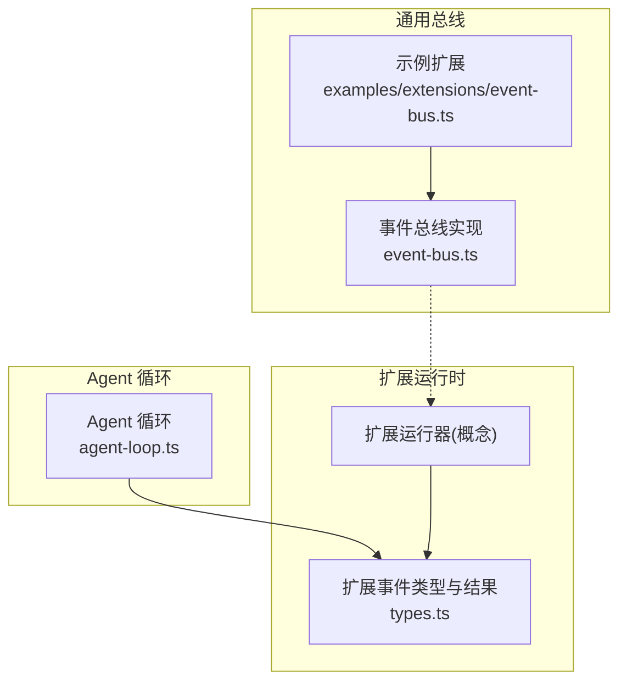
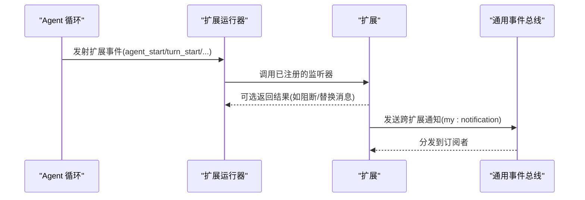
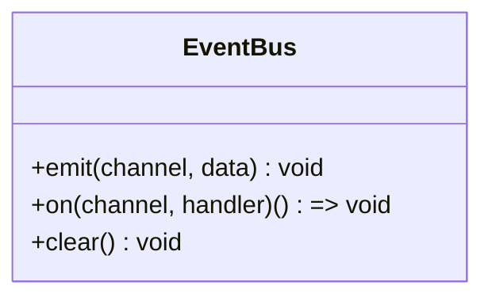
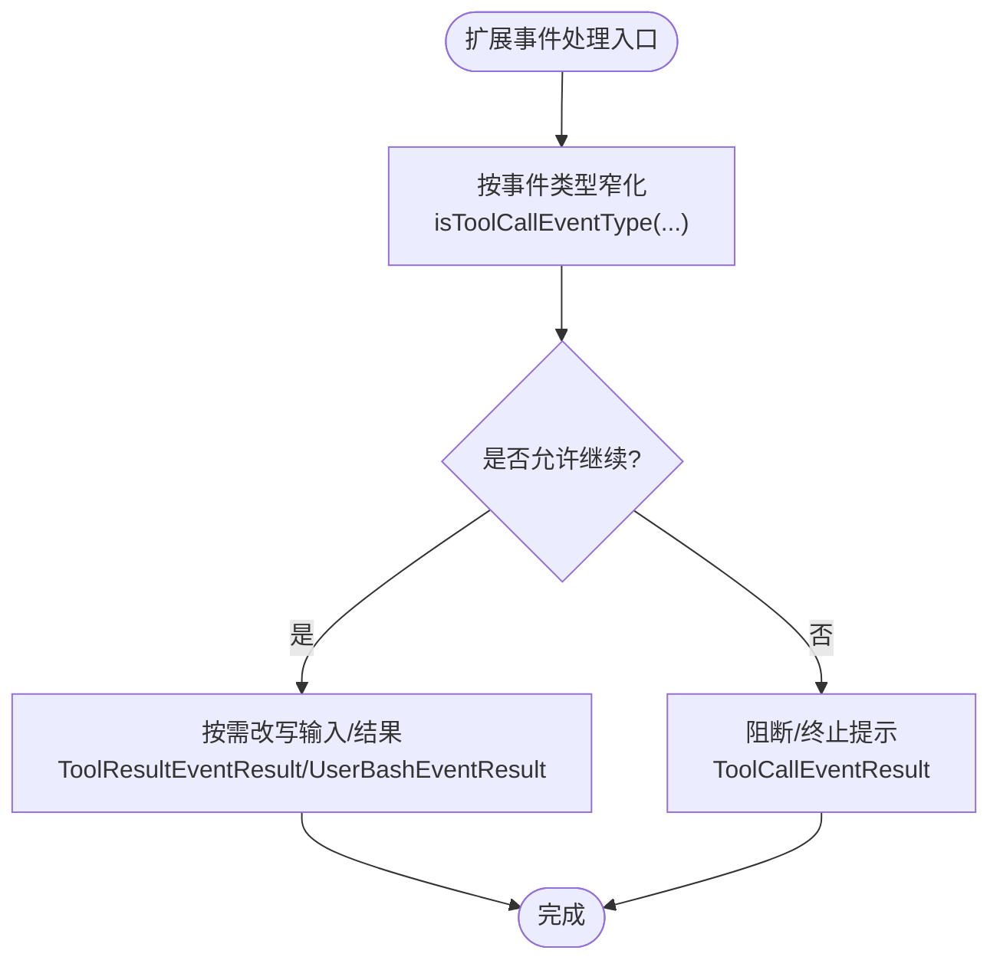
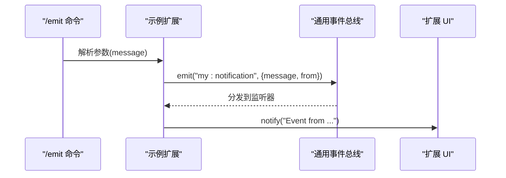
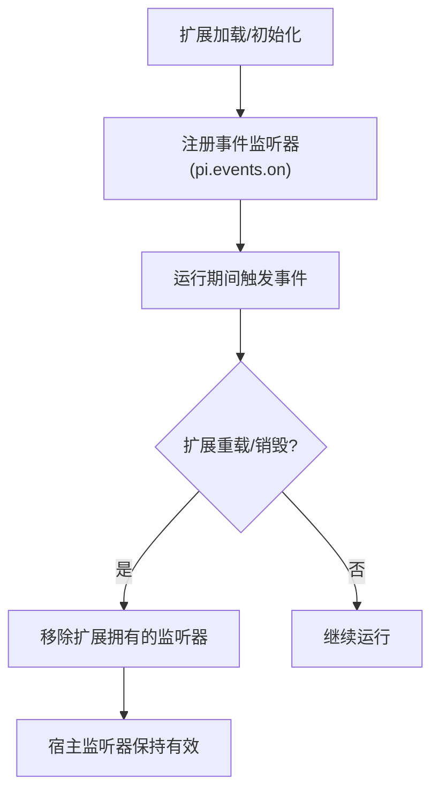
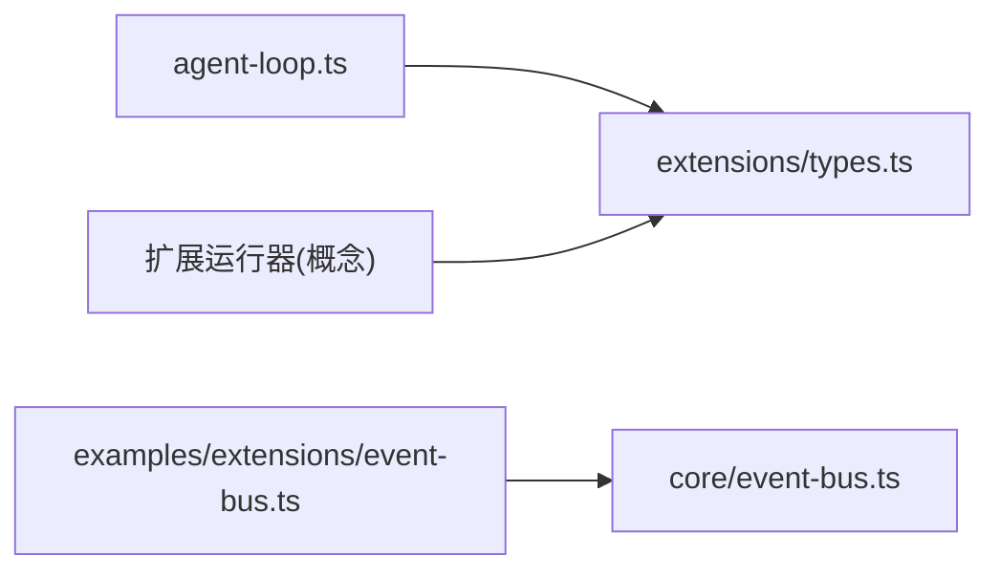

# 事件系统


**本文引用的文件**   
- [packages/coding-agent/src/core/event-bus.ts](https://github.com/FDE-GROUP/oh-my-fde/blob/main/packages/coding-agent/src/core/event-bus.ts)
- [packages/coding-agent/examples/extensions/event-bus.ts](https://github.com/FDE-GROUP/oh-my-fde/blob/main/packages/coding-agent/examples/extensions/event-bus.ts)
- [packages/coding-agent/src/core/extensions/types.ts](https://github.com/FDE-GROUP/oh-my-fde/blob/main/packages/coding-agent/src/core/extensions/types.ts)
- [packages/agent/src/agent-loop.ts](https://github.com/FDE-GROUP/oh-my-fde/blob/main/packages/agent/src/agent-loop.ts)
- [packages/coding-agent/test/suite/regressions/7193-event-bus-lifecycle.test.ts](https://github.com/FDE-GROUP/oh-my-fde/blob/main/packages/coding-agent/test/suite/regressions/7193-event-bus-lifecycle.test.ts)


## 目录
1. [简介](#简介)
2. [项目结构](#项目结构)
3. [核心组件](#核心组件)
4. [架构总览](#架构总览)
5. [详细组件分析](#详细组件分析)
6. [依赖关系分析](#依赖关系分析)
7. [性能考量](#性能考量)
8. [故障排查指南](#故障排查指南)
9. [结论](#结论)
10. [附录](#附录)

## 简介
本文件为事件系统的完整技术参考与开发指南，覆盖以下主题：
- 事件总线架构、监听器管理与异步处理机制
- 预定义事件类型、自定义事件开发与事件传播规则
- 事件调试技巧、性能监控与错误处理策略
- 事件驱动编程模式与最佳实践

该事件系统由两部分组成：
- 扩展运行时事件总线（Extension Runtime Event Bus）：面向扩展与宿主之间的生命周期与业务事件，提供强类型的事件契约与结果回调。
- 通用事件总线（Generic EventBus）：轻量级通道式发布订阅，用于跨扩展的任意消息通信。

## 项目结构
围绕事件系统的核心代码分布在以下位置：
- 通用事件总线实现：packages/coding-agent/src/core/event-bus.ts
- 扩展运行时事件类型与结果契约：packages/coding-agent/src/core/extensions/types.ts
- 扩展间示例通信：packages/coding-agent/examples/extensions/event-bus.ts
- Agent 循环中触发的事件发射点：packages/agent/src/agent-loop.ts
- 事件总线生命周期回归测试：packages/coding-agent/test/suite/regressions/7193-event-bus-lifecycle.test.ts



图表来源
- [packages/coding-agent/src/core/extensions/types.ts:1424-1457](https://github.com/FDE-GROUP/oh-my-fde/blob/main/packages/coding-agent/src/core/extensions/types.ts#L1424-L1457)
- [packages/coding-agent/src/core/event-bus.ts:1-34](https://github.com/FDE-GROUP/oh-my-fde/blob/main/packages/coding-agent/src/core/event-bus.ts#L1-L34)
- [packages/coding-agent/examples/extensions/event-bus.ts:1-44](https://github.com/FDE-GROUP/oh-my-fde/blob/main/packages/coding-agent/examples/extensions/event-bus.ts#L1-L44)
- [packages/agent/src/agent-loop.ts:126-130](https://github.com/FDE-GROUP/oh-my-fde/blob/main/packages/agent/src/agent-loop.ts#L126-L130)

章节来源
- [packages/coding-agent/src/core/event-bus.ts:1-34](https://github.com/FDE-GROUP/oh-my-fde/blob/main/packages/coding-agent/src/core/event-bus.ts#L1-L34)
- [packages/coding-agent/examples/extensions/event-bus.ts:1-44](https://github.com/FDE-GROUP/oh-my-fde/blob/main/packages/coding-agent/examples/extensions/event-bus.ts#L1-L44)
- [packages/coding-agent/src/core/extensions/types.ts:1424-1457](https://github.com/FDE-GROUP/oh-my-fde/blob/main/packages/coding-agent/src/core/extensions/types.ts#L1424-L1457)
- [packages/agent/src/agent-loop.ts:126-130](https://github.com/FDE-GROUP/oh-my-fde/blob/main/packages/agent/src/agent-loop.ts#L126-L130)

## 核心组件
- 通用事件总线（EventBus）
  - 提供 emit/on/clear 三个方法，基于 Node.js EventEmitter 封装，统一捕获并记录监听器异常，避免未捕获异常导致进程崩溃。
  - on 返回取消订阅函数，clear 移除所有监听器。
- 扩展运行时事件（Extension Events）
  - 通过 types.ts 集中定义事件联合类型与结果类型，涵盖会话、上下文、工具调用、模型选择、流式响应等全链路事件。
  - 支持在特定事件中返回结果以修改行为（如阻断工具执行、替换消息、注入系统提示等）。
- Agent 循环事件发射
  - agent-loop.ts 在关键阶段发射 agent_start/turn_start/message_start/message_end/turn_end/agent_end 等事件，供扩展监听与干预。

章节来源
- [packages/coding-agent/src/core/event-bus.ts:1-34](https://github.com/FDE-GROUP/oh-my-fde/blob/main/packages/coding-agent/src/core/event-bus.ts#L1-L34)
- [packages/coding-agent/src/core/extensions/types.ts:1424-1589](https://github.com/FDE-GROUP/oh-my-fde/blob/main/packages/coding-agent/src/core/extensions/types.ts#L1424-L1589)
- [packages/agent/src/agent-loop.ts:126-130](https://github.com/FDE-GROUP/oh-my-fde/blob/main/packages/agent/src/agent-loop.ts#L126-L130)

## 架构总览
下图展示两类事件通道的职责与交互：
- 扩展运行时事件：由 Agent 循环与扩展运行器产生，扩展通过 pi.on(...) 订阅，可返回结果影响流程。
- 通用事件总线：扩展之间通过 pi.events.emit/on 进行解耦通信，适合通知类场景。



图表来源
- [packages/agent/src/agent-loop.ts:126-130](https://github.com/FDE-GROUP/oh-my-fde/blob/main/packages/agent/src/agent-loop.ts#L126-L130)
- [packages/coding-agent/src/core/extensions/types.ts:1424-1457](https://github.com/FDE-GROUP/oh-my-fde/blob/main/packages/coding-agent/src/core/extensions/types.ts#L1424-L1457)
- [packages/coding-agent/examples/extensions/event-bus.ts:16-42](https://github.com/FDE-GROUP/oh-my-fde/blob/main/packages/coding-agent/examples/extensions/event-bus.ts#L16-L42)
- [packages/coding-agent/src/core/event-bus.ts:12-32](https://github.com/FDE-GROUP/oh-my-fde/blob/main/packages/coding-agent/src/core/event-bus.ts#L12-L32)

## 详细组件分析

### 通用事件总线（EventBus）
- 设计要点
  - 安全包装：on 内部将用户处理器包裹为 async 函数，捕获异常并输出日志，避免未捕获异常。
  - 资源清理：clear 移除所有监听器；on 返回取消函数，便于精确释放。
- 使用建议
  - 适用于扩展间的“通知型”通信，不要求返回值。
  - 建议在扩展卸载或重载时主动清理监听器，避免内存泄漏。



图表来源
- [packages/coding-agent/src/core/event-bus.ts:3-32](https://github.com/FDE-GROUP/oh-my-fde/blob/main/packages/coding-agent/src/core/event-bus.ts#L3-L32)

章节来源
- [packages/coding-agent/src/core/event-bus.ts:1-34](https://github.com/FDE-GROUP/oh-my-fde/blob/main/packages/coding-agent/src/core/event-bus.ts#L1-L34)

### 扩展运行时事件（Extension Events）
- 事件集合
  - 会话与上下文：SessionEvent、ContextEvent、ContextWithSystemEvent
  - 模型与推理：BeforeProviderRequestEvent、AfterProviderResponseEvent、ProviderStreamEvent、ModelSelectEvent、ThinkingLevelSelectEvent
  - Agent 生命周期：BeforeAgentStartEvent、AgentStartEvent、AgentEndEvent、AgentBeforeSettleEvent、AgentSettledEvent
  - UI 与轮次：UIPromptStartEvent、UIPromptEndEvent、TurnStartEvent、TurnEndEvent
  - 消息与工具：MessageStartEvent、MessageUpdateEvent、MessageEndEvent、ToolExecutionStartEvent、ToolExecutionUpdateEvent、ToolExecutionEndEvent、ToolCallEvent、ToolResultEvent
  - 其他：ProjectTrustEvent、ResourcesDiscoverEvent、McpServersChangeEvent、UserBashEvent、InputEvent
- 结果类型
  - ToolCallEventResult：可阻断工具执行、提示终止当前批处理
  - UserBashEventResult：可替换执行操作或直接返回结果
  - ToolResultEventResult：可改写内容、结构化内容、错误标记与用量
  - MessageEndEventResult：可替换最终消息
  - BeforeAgentStartEventResult：可注入自定义消息与替换系统提示
  - Session* 系列结果：可取消切换/分叉/压缩、注入摘要等



图表来源
- [packages/coding-agent/src/core/extensions/types.ts:1408-1422](https://github.com/FDE-GROUP/oh-my-fde/blob/main/packages/coding-agent/src/core/extensions/types.ts#L1408-L1422)
- [packages/coding-agent/src/core/extensions/types.ts:1474-1520](https://github.com/FDE-GROUP/oh-my-fde/blob/main/packages/coding-agent/src/core/extensions/types.ts#L1474-L1520)

章节来源
- [packages/coding-agent/src/core/extensions/types.ts:1390-1589](https://github.com/FDE-GROUP/oh-my-fde/blob/main/packages/coding-agent/src/core/extensions/types.ts#L1390-L1589)

### 示例：扩展间事件通信
- 功能说明
  - 示例扩展注册命令 /emit，向总线发出 my:notification 事件。
  - 同一扩展内监听 session_start 并缓存 ctx，收到通知后通过 UI 弹出信息。
- 关键点
  - 使用 pi.events.emit/on 进行跨扩展通信。
  - 事件数据为简单对象，包含 message 与 from 字段。



图表来源
- [packages/coding-agent/examples/extensions/event-bus.ts:16-42](https://github.com/FDE-GROUP/oh-my-fde/blob/main/packages/coding-agent/examples/extensions/event-bus.ts#L16-L42)
- [packages/coding-agent/src/core/event-bus.ts:12-32](https://github.com/FDE-GROUP/oh-my-fde/blob/main/packages/coding-agent/src/core/event-bus.ts#L12-L32)

章节来源
- [packages/coding-agent/examples/extensions/event-bus.ts:1-44](https://github.com/FDE-GROUP/oh-my-fde/blob/main/packages/coding-agent/examples/extensions/event-bus.ts#L1-L44)
- [packages/coding-agent/src/core/event-bus.ts:1-34](https://github.com/FDE-GROUP/oh-my-fde/blob/main/packages/coding-agent/src/core/event-bus.ts#L1-L34)

### Agent 循环事件发射时序
- 典型流程
  - agent_start -> turn_start -> message_start -> message_end -> turn_end -> agent_end
- 扩展可在这些钩子中注入逻辑，例如在 before_agent_start 注入自定义消息与系统提示。

```mermaid
sequenceDiagram
participant Loop as "Agent 循环"
participant Runner as "扩展运行器"
participant Ext as "扩展"
Loop->>Loop : agent_start
Loop->>Loop : turn_start
Loop->>Loop : message_start
Loop->>Loop : message_end
Loop->>Loop : turn_end
Loop->>Loop : agent_end
Note over Loop,Ext : 扩展可通过 pi.on(...) 订阅上述事件
```

图表来源
- [packages/agent/src/agent-loop.ts:126-130](https://github.com/FDE-GROUP/oh-my-fde/blob/main/packages/agent/src/agent-loop.ts#L126-L130)
- [packages/agent/src/agent-loop.ts:262-263](https://github.com/FDE-GROUP/oh-my-fde/blob/main/packages/agent/src/agent-loop.ts#L262-L263)
- [packages/agent/src/agent-loop.ts:296-299](https://github.com/FDE-GROUP/oh-my-fde/blob/main/packages/agent/src/agent-loop.ts#L296-L299)
- [packages/agent/src/agent-loop.ts:329](https://github.com/FDE-GROUP/oh-my-fde/blob/main/packages/agent/src/agent-loop.ts#L329)

章节来源
- [packages/agent/src/agent-loop.ts:126-130](https://github.com/FDE-GROUP/oh-my-fde/blob/main/packages/agent/src/agent-loop.ts#L126-L130)
- [packages/agent/src/agent-loop.ts:262-263](https://github.com/FDE-GROUP/oh-my-fde/blob/main/packages/agent/src/agent-loop.ts#L262-L263)
- [packages/agent/src/agent-loop.ts:296-299](https://github.com/FDE-GROUP/oh-my-fde/blob/main/packages/agent/src/agent-loop.ts#L296-L299)
- [packages/agent/src/agent-loop.ts:329](https://github.com/FDE-GROUP/oh-my-fde/blob/main/packages/agent/src/agent-loop.ts#L329)

### 事件总线生命周期与清理
- 问题背景
  - 扩展重载或销毁时需要移除其拥有的事件总线监听器，避免重复触发与内存泄漏。
- 验证方式
  - 测试用例验证在 reload/dispose 后，扩展注册的监听器被正确移除，且宿主侧监听不受影响。



图表来源
- [packages/coding-agent/test/suite/regressions/7193-event-bus-lifecycle.test.ts:16-25](https://github.com/FDE-GROUP/oh-my-fde/blob/main/packages/coding-agent/test/suite/regressions/7193-event-bus-lifecycle.test.ts#L16-L25)

章节来源
- [packages/coding-agent/test/suite/regressions/7193-event-bus-lifecycle.test.ts:1-25](https://github.com/FDE-GROUP/oh-my-fde/blob/main/packages/coding-agent/test/suite/regressions/7193-event-bus-lifecycle.test.ts#L1-L25)

## 依赖关系分析
- 模块耦合
  - agent-loop.ts 仅负责发射事件，不感知具体监听器实现，降低耦合。
  - types.ts 作为扩展事件的权威契约，被运行器与扩展共同消费。
  - event-bus.ts 独立于扩展运行时，提供通用通道能力。
- 外部依赖
  - event-bus.ts 依赖 Node.js 内置 events 模块。



图表来源
- [packages/agent/src/agent-loop.ts:126-130](https://github.com/FDE-GROUP/oh-my-fde/blob/main/packages/agent/src/agent-loop.ts#L126-L130)
- [packages/coding-agent/src/core/extensions/types.ts:1424-1457](https://github.com/FDE-GROUP/oh-my-fde/blob/main/packages/coding-agent/src/core/extensions/types.ts#L1424-L1457)
- [packages/coding-agent/examples/extensions/event-bus.ts:16-42](https://github.com/FDE-GROUP/oh-my-fde/blob/main/packages/coding-agent/examples/extensions/event-bus.ts#L16-L42)
- [packages/coding-agent/src/core/event-bus.ts:1-34](https://github.com/FDE-GROUP/oh-my-fde/blob/main/packages/coding-agent/src/core/event-bus.ts#L1-L34)

章节来源
- [packages/agent/src/agent-loop.ts:126-130](https://github.com/FDE-GROUP/oh-my-fde/blob/main/packages/agent/src/agent-loop.ts#L126-L130)
- [packages/coding-agent/src/core/extensions/types.ts:1424-1457](https://github.com/FDE-GROUP/oh-my-fde/blob/main/packages/coding-agent/src/core/extensions/types.ts#L1424-L1457)
- [packages/coding-agent/examples/extensions/event-bus.ts:16-42](https://github.com/FDE-GROUP/oh-my-fde/blob/main/packages/coding-agent/examples/extensions/event-bus.ts#L16-L42)
- [packages/coding-agent/src/core/event-bus.ts:1-34](https://github.com/FDE-GROUP/oh-my-fde/blob/main/packages/coding-agent/src/core/event-bus.ts#L1-L34)

## 性能考量
- 监听器数量与顺序
  - 大量监听器会增加事件分发开销；建议合并同类监听逻辑，减少重复注册。
- 异步处理
  - 通用事件总线对监听器进行异步包装并捕获异常，避免阻塞主流程；但应避免在监听器中进行长时间同步阻塞操作。
- 资源清理
  - 及时调用 on 返回的取消函数或 clear，防止内存泄漏与重复触发。
- 事件粒度
  - 合理拆分事件，避免单条事件携带过大负载；必要时采用批量事件或增量更新。

[本节为通用指导，不涉及具体文件分析]

## 故障排查指南
- 监听器抛出异常
  - 现象：控制台出现“Event handler error (channel): ...”
  - 原因：监听器内部未捕获的异常被通用事件总线捕获并打印。
  - 处理：检查对应 channel 的监听器实现，确保异常被捕获或抛出前进行必要清理。
- 事件未触发
  - 可能原因：监听器未注册、已被取消、或在分发过程中被移除。
  - 排查：确认注册时机与取消时机；在重载/销毁路径上检查清理逻辑。
- 扩展重载后的监听器残留
  - 现象：事件被多次触发或内存增长。
  - 处理：确保在扩展 dispose/reload 时移除自身监听器；参考生命周期测试用例。

章节来源
- [packages/coding-agent/src/core/event-bus.ts:18-27](https://github.com/FDE-GROUP/oh-my-fde/blob/main/packages/coding-agent/src/core/event-bus.ts#L18-L27)
- [packages/coding-agent/test/suite/regressions/7193-event-bus-lifecycle.test.ts:16-25](https://github.com/FDE-GROUP/oh-my-fde/blob/main/packages/coding-agent/test/suite/regressions/7193-event-bus-lifecycle.test.ts#L16-L25)

## 结论
- 事件系统分为两类：扩展运行时事件（强类型、可返回结果）与通用事件总线（轻量、跨扩展通知）。
- Agent 循环在关键阶段发射事件，扩展可据此注入逻辑、阻断流程或改写数据。
- 通用事件总线提供安全的异步监听器包装与清理能力，适合解耦通信。
- 遵循类型契约、合理拆分事件、及时清理监听器，可获得稳定、可维护的事件驱动架构。

[本节为总结性内容，不涉及具体文件分析]

## 附录

### 预定义事件类型速览
- 会话与上下文
  - SessionEvent、ContextEvent、ContextWithSystemEvent
- 模型与推理
  - BeforeProviderRequestEvent、AfterProviderResponseEvent、ProviderStreamEvent、ModelSelectEvent、ThinkingLevelSelectEvent
- Agent 生命周期
  - BeforeAgentStartEvent、AgentStartEvent、AgentEndEvent、AgentBeforeSettleEvent、AgentSettledEvent
- UI 与轮次
  - UIPromptStartEvent、UIPromptEndEvent、TurnStartEvent、TurnEndEvent
- 消息与工具
  - MessageStartEvent、MessageUpdateEvent、MessageEndEvent、ToolExecutionStartEvent、ToolExecutionUpdateEvent、ToolExecutionEndEvent、ToolCallEvent、ToolResultEvent
- 其他
  - ProjectTrustEvent、ResourcesDiscoverEvent、McpServersChangeEvent、UserBashEvent、InputEvent

章节来源
- [packages/coding-agent/src/core/extensions/types.ts:1424-1457](https://github.com/FDE-GROUP/oh-my-fde/blob/main/packages/coding-agent/src/core/extensions/types.ts#L1424-L1457)

### 自定义事件开发指南
- 使用通用事件总线
  - 通过 pi.events.emit(channel, payload) 发送事件，其他扩展通过 pi.events.on(channel, handler) 订阅。
  - 事件载荷建议使用简单对象，避免复杂引用；必要时序列化后再传输。
- 命名规范
  - 使用冒号分隔命名空间，如 my:notification，避免冲突。
- 生命周期管理
  - 在扩展卸载或重载时，务必移除监听器，避免重复触发与内存泄漏。

章节来源
- [packages/coding-agent/examples/extensions/event-bus.ts:16-42](https://github.com/FDE-GROUP/oh-my-fde/blob/main/packages/coding-agent/examples/extensions/event-bus.ts#L16-L42)
- [packages/coding-agent/src/core/event-bus.ts:12-32](https://github.com/FDE-GROUP/oh-my-fde/blob/main/packages/coding-agent/src/core/event-bus.ts#L12-L32)

### 事件驱动编程最佳实践
- 明确事件边界：区分“控制流事件”（如 agent_start/turn_start）与“通知事件”（如 my:notification）。
- 最小副作用：监听器尽量只做副作用较小的工作，避免阻塞主流程。
- 幂等与重试：对网络或 I/O 操作增加幂等性与重试策略。
- 可观测性：为关键事件添加埋点与指标，便于定位性能瓶颈。
- 类型优先：优先使用扩展运行时事件与 isToolCallEventType 等工具进行类型收窄，提升可维护性。

[本节为通用指导，不涉及具体文件分析]