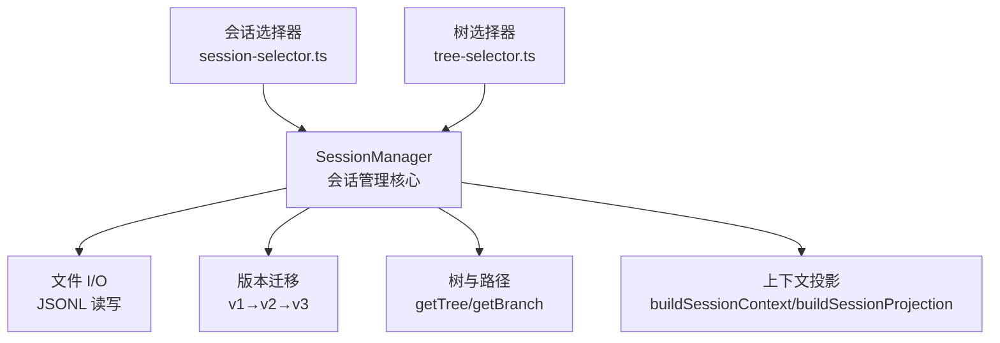
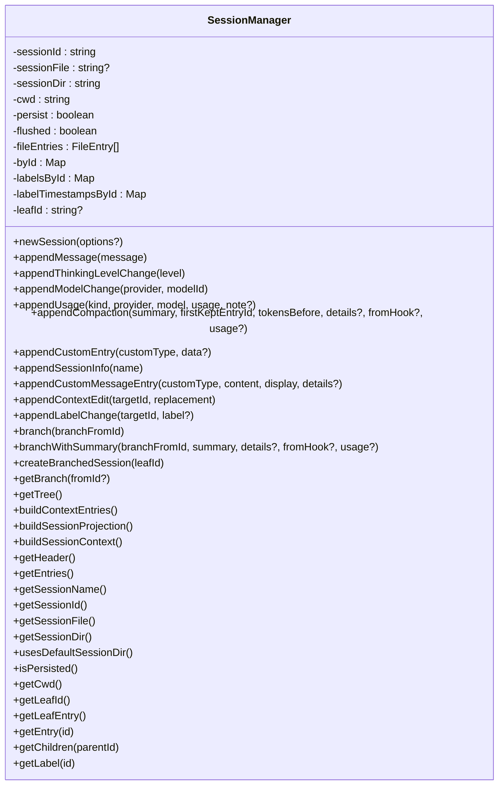
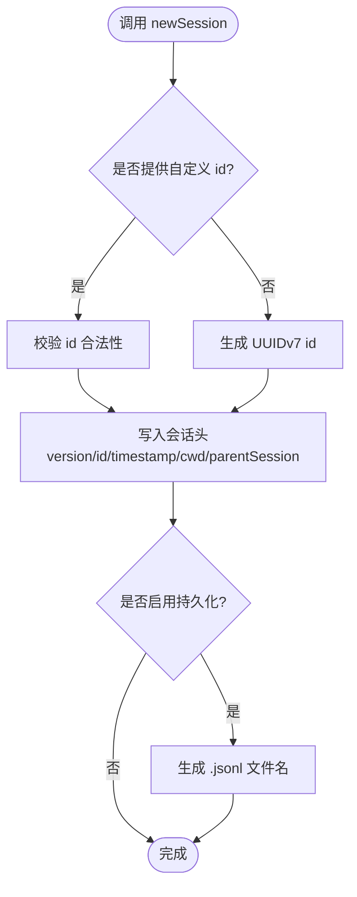
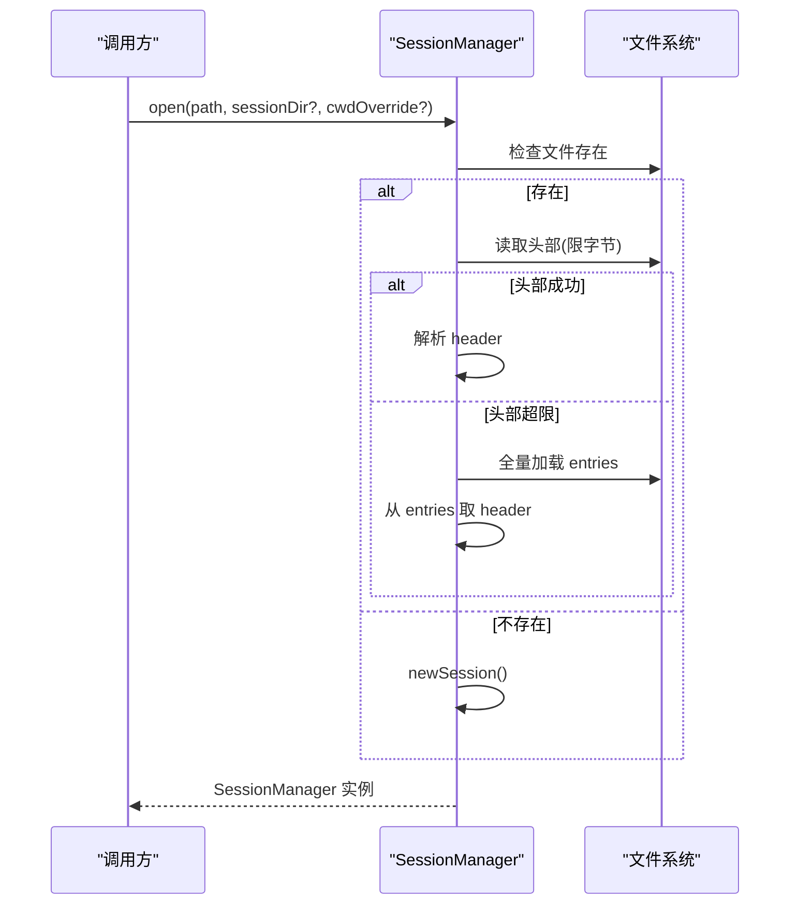
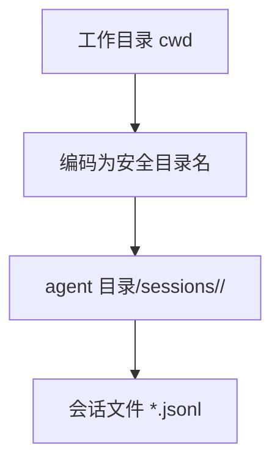
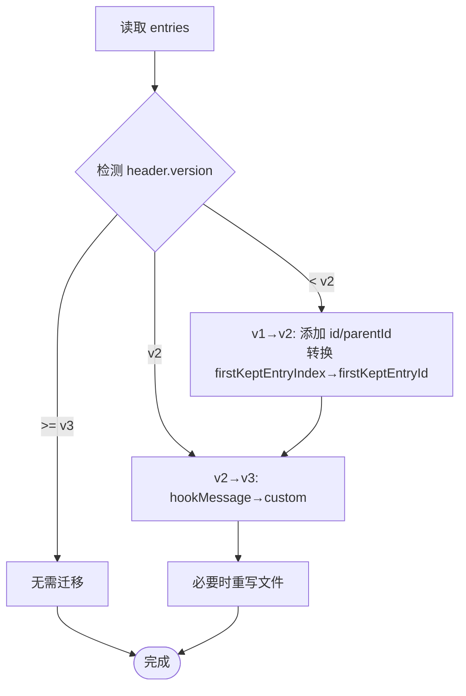
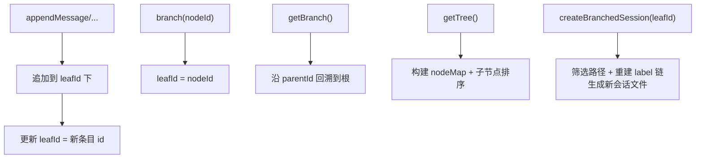
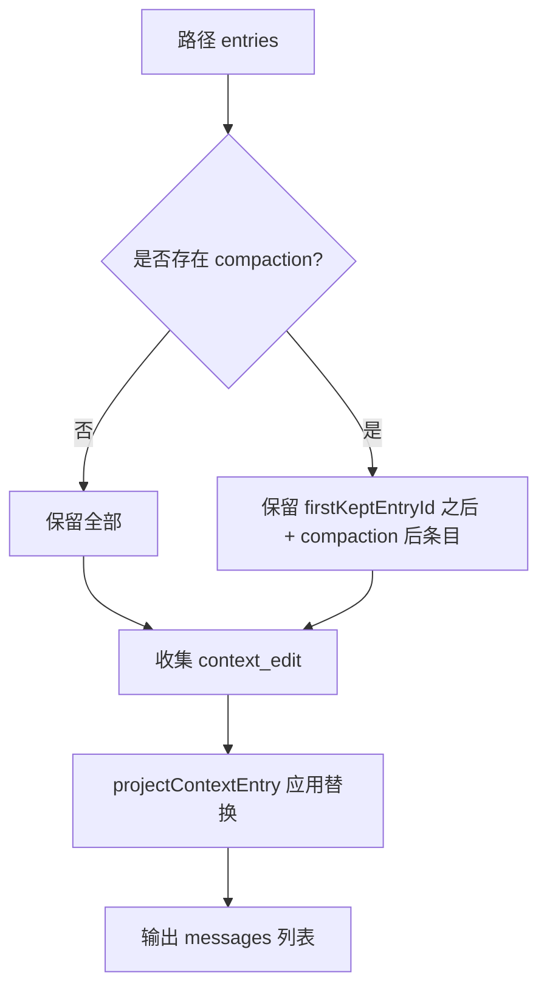
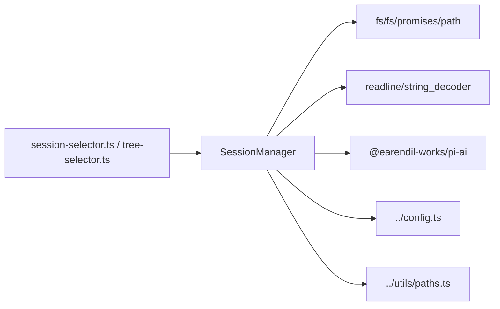

# 会话管理器


**本文引用的文件**   
- [session-manager.ts](https://github.com/FDE-GROUP/oh-my-fde/blob/main/packages/coding-agent/src/core/session-manager.ts)
- [migration.test.ts](https://github.com/FDE-GROUP/oh-my-fde/blob/main/packages/coding-agent/test/session-manager/migration.test.ts)
- [file-operations.test.ts](https://github.com/FDE-GROUP/oh-my-fde/blob/main/packages/coding-agent/test/session-manager/file-operations.test.ts)
- [load-entries.test.ts](https://github.com/FDE-GROUP/oh-my-fde/blob/main/packages/coding-agent/test/session-manager/load-entries.test.ts)
- [save-entry.test.ts](https://github.com/FDE-GROUP/oh-my-fde/blob/main/packages/coding-agent/test/session-manager/save-entry.test.ts)
- [tree-traversal.test.ts](https://github.com/FDE-GROUP/oh-my-fde/blob/main/packages/coding-agent/test/session-manager/tree-traversal.test.ts)
- [custom-session-id.test.ts](https://github.com/FDE-GROUP/oh-my-fde/blob/main/packages/coding-agent/test/session-manager/custom-session-id.test.ts)
- [labels.test.ts](https://github.com/FDE-GROUP/oh-my-fde/blob/main/packages/coding-agent/test/session-manager/labels.test.ts)
- [session-selector.ts](https://github.com/FDE-GROUP/oh-my-fde/blob/main/packages/coding-agent/src/modes/interactive/components/session-selector.ts)
- [tree-selector.ts](https://github.com/FDE-GROUP/oh-my-fde/blob/main/packages/coding-agent/src/modes/interactive/components/tree-selector.ts)


## 目录
1. [简介](#简介)
2. [项目结构](#项目结构)
3. [核心组件](#核心组件)
4. [架构总览](#架构总览)
5. [详细组件分析](#详细组件分析)
6. [依赖关系分析](#依赖关系分析)
7. [性能与扩展性](#性能与扩展性)
8. [故障排查指南](#故障排查指南)
9. [结论](#结论)
10. [附录：开发指南与最佳实践](#附录开发指南与最佳实践)

## 简介
本文件面向开发者，系统化说明 SessionManager 的设计与实现，覆盖以下主题：
- 设计模式与职责边界：会话创建、持久化、恢复、清理。
- 会话文件格式与目录组织：JSONL 行式存储、默认会话目录、按工作区隔离。
- 版本管理与数据迁移：v1→v2→v3 的演进策略与幂等迁移。
- 会话树形结构与分支管理：父子关系、叶子节点、分支与合并（导出路径）。
- 上下文投影与压缩摘要：构建 LLM 可见消息、compaction 保留策略。
- 扩展点：自定义条目、自定义消息、标签、上下文编辑。
- 可扩展存储后端建议：如何替换或增强持久化层。

## 项目结构
SessionManager 位于编码代理的核心模块中，负责会话生命周期、树形结构、上下文投影和文件 I/O。相关测试覆盖了迁移、文件操作、树遍历、标签、会话 ID 生成等关键行为。UI 侧通过会话选择器与树选择器消费会话元信息与树结构。



**图表来源**
- [session-manager.ts:988-2030](https://github.com/FDE-GROUP/oh-my-fde/blob/main/packages/coding-agent/src/core/session-manager.ts#L988-L2030)
- [session-selector.ts:966-1009](https://github.com/FDE-GROUP/oh-my-fde/blob/main/packages/coding-agent/src/modes/interactive/components/session-selector.ts#L966-L1009)
- [tree-selector.ts:216-301](https://github.com/FDE-GROUP/oh-my-fde/blob/main/packages/coding-agent/src/modes/interactive/components/tree-selector.ts#L216-L301)

**章节来源**
- [session-manager.ts:1-2030](https://github.com/FDE-GROUP/oh-my-fde/blob/main/packages/coding-agent/src/core/session-manager.ts#L1-L2030)
- [session-selector.ts:966-1009](https://github.com/FDE-GROUP/oh-my-fde/blob/main/packages/coding-agent/src/modes/interactive/components/session-selector.ts#L966-L1009)
- [tree-selector.ts:216-301](https://github.com/FDE-GROUP/oh-my-fde/blob/main/packages/coding-agent/src/modes/interactive/components/tree-selector.ts#L216-L301)

## 核心组件
- SessionHeader：会话头，包含 version、id、timestamp、cwd、parentSession。
- FileEntry / SessionEntry：文件级与逻辑级条目联合类型，支持 message、model_change、thinking_level_change、usage、compaction、branch_summary、custom、custom_message、context_edit、label、session_info。
- SessionTreeNode：树节点，包含 entry、children、label、labelTimestamp。
- SessionProjection / SessionContext：模型可见的消息集合与上下文状态。
- SessionInfo：会话元信息（路径、ID、cwd、名称、父会话、时间戳、消息统计）。

这些类型共同定义了“追加不可变”的会话数据结构，并通过 id/parentId 形成有向无环树。

**章节来源**
- [session-manager.ts:41-243](https://github.com/FDE-GROUP/oh-my-fde/blob/main/packages/coding-agent/src/core/session-manager.ts#L41-L243)

## 架构总览
SessionManager 采用“追加日志 + 内存索引 + 按需持久化”的模式：
- 所有变更以追加方式写入 JSONL 文件，保证可审计与可回放。
- 内存中维护 byId 索引、labelsById、labelTimestampsById 与 leafId，提供 O(1) 查找与快速路径重建。
- 首次出现用户/助手消息时才落盘，避免空会话产生无用文件。
- 读取时先扫描头部，再流式解析；对损坏行容错跳过。
- 提供多种静态工厂方法：create/open/continueRecent/inMemory/forkFrom/list/findById/listAll。



**图表来源**
- [session-manager.ts:988-2030](https://github.com/FDE-GROUP/oh-my-fde/blob/main/packages/coding-agent/src/core/session-manager.ts#L988-L2030)

**章节来源**
- [session-manager.ts:988-2030](https://github.com/FDE-GROUP/oh-my-fde/blob/main/packages/coding-agent/src/core/session-manager.ts#L988-L2030)

## 详细组件分析

### 会话创建与命名
- newSession：生成会话头，设置 CURRENT_SESSION_VERSION，分配 sessionId（UUIDv7），记录 cwd 与可选 parentSession。若启用持久化，则根据时间戳与 sessionId 生成 .jsonl 文件名。
- assertValidSessionId：校验自定义会话 ID 仅含字母数字及有限符号，且首尾为字母数字。
- create/open/continueRecent/inMemory/forkFrom：提供不同场景的构造入口。forkFrom 会复制源会话内容到新文件并建立 parentSession 引用。



**图表来源**
- [session-manager.ts:1058-1084](https://github.com/FDE-GROUP/oh-my-fde/blob/main/packages/coding-agent/src/core/session-manager.ts#L1058-L1084)
- [session-manager.ts:264-274](https://github.com/FDE-GROUP/oh-my-fde/blob/main/packages/coding-agent/src/core/session-manager.ts#L264-L274)

**章节来源**
- [session-manager.ts:264-274](https://github.com/FDE-GROUP/oh-my-fde/blob/main/packages/coding-agent/src/core/session-manager.ts#L264-L274)
- [session-manager.ts:1058-1084](https://github.com/FDE-GROUP/oh-my-fde/blob/main/packages/coding-agent/src/core/session-manager.ts#L1058-L1084)
- [custom-session-id.test.ts:32-97](https://github.com/FDE-GROUP/oh-my-fde/blob/main/packages/coding-agent/test/session-manager/custom-session-id.test.ts#L32-L97)

### 持久化与恢复
- _persist：首次写入用户/助手消息前不写磁盘；之后追加写入新条目。
- loadEntriesFromFile：逐行解析 JSONL，跳过非法行；要求首个有效条目为 session 头。
- readSessionHeader：限制扫描字节数，快速发现会话头；超大头部回退到全量加载。
- open：优先尝试头部扫描，失败时全量加载并提取头；支持 cwdOverride。
- continueRecent：在默认或指定会话目录中查找最近会话，按 mtime 排序并过滤 cwd。



**图表来源**
- [session-manager.ts:1777-1797](https://github.com/FDE-GROUP/oh-my-fde/blob/main/packages/coding-agent/src/core/session-manager.ts#L1777-L1797)
- [session-manager.ts:628-671](https://github.com/FDE-GROUP/oh-my-fde/blob/main/packages/coding-agent/src/core/session-manager.ts#L628-L671)
- [session-manager.ts:686-728](https://github.com/FDE-GROUP/oh-my-fde/blob/main/packages/coding-agent/src/core/session-manager.ts#L686-L728)

**章节来源**
- [session-manager.ts:1173-1190](https://github.com/FDE-GROUP/oh-my-fde/blob/main/packages/coding-agent/src/core/session-manager.ts#L1173-L1190)
- [session-manager.ts:628-671](https://github.com/FDE-GROUP/oh-my-fde/blob/main/packages/coding-agent/src/core/session-manager.ts#L628-L671)
- [session-manager.ts:686-728](https://github.com/FDE-GROUP/oh-my-fde/blob/main/packages/coding-agent/src/core/session-manager.ts#L686-L728)
- [session-manager.ts:1777-1797](https://github.com/FDE-GROUP/oh-my-fde/blob/main/packages/coding-agent/src/core/session-manager.ts#L1777-L1797)
- [file-operations.test.ts:359-435](https://github.com/FDE-GROUP/oh-my-fde/blob/main/packages/coding-agent/test/session-manager/file-operations.test.ts#L359-L435)

### 目录组织与默认路径
- getDefaultSessionDirPath：基于 cwd 生成安全目录名，置于 agent 目录下的 sessions 子目录。
- getDefaultSessionDir：确保目录存在并返回路径。
- usesDefaultSessionDir：判断当前会话目录是否为默认路径。
- list/listAll：支持按 cwd 过滤与跨项目扫描，并发加载会话元信息。



**图表来源**
- [session-manager.ts:590-603](https://github.com/FDE-GROUP/oh-my-fde/blob/main/packages/coding-agent/src/core/session-manager.ts#L590-L603)
- [session-manager.ts:1916-1931](https://github.com/FDE-GROUP/oh-my-fde/blob/main/packages/coding-agent/src/core/session-manager.ts#L1916-L1931)
- [session-manager.ts:1937-2028](https://github.com/FDE-GROUP/oh-my-fde/blob/main/packages/coding-agent/src/core/session-manager.ts#L1937-L2028)

**章节来源**
- [session-manager.ts:590-603](https://github.com/FDE-GROUP/oh-my-fde/blob/main/packages/coding-agent/src/core/session-manager.ts#L590-L603)
- [session-manager.ts:1916-1931](https://github.com/FDE-GROUP/oh-my-fde/blob/main/packages/coding-agent/src/core/session-manager.ts#L1916-L1931)
- [session-manager.ts:1937-2028](https://github.com/FDE-GROUP/oh-my-fde/blob/main/packages/coding-agent/src/core/session-manager.ts#L1937-L2028)

### 版本管理与数据迁移
- CURRENT_SESSION_VERSION：当前会话版本（v3）。
- migrateV1ToV2：为旧会话添加 id/parentId 树结构，并将 compaction.firstKeptEntryIndex 转换为 firstKeptEntryId。
- migrateV2ToV3：将 hookMessage role 重命名为 custom。
- migrateToCurrentVersion：顺序应用迁移，幂等执行。



**图表来源**
- [session-manager.ts:286-347](https://github.com/FDE-GROUP/oh-my-fde/blob/main/packages/coding-agent/src/core/session-manager.ts#L286-L347)

**章节来源**
- [session-manager.ts:286-347](https://github.com/FDE-GROUP/oh-my-fde/blob/main/packages/coding-agent/src/core/session-manager.ts#L286-L347)
- [migration.test.ts:1-78](https://github.com/FDE-GROUP/oh-my-fde/blob/main/packages/coding-agent/test/session-manager/migration.test.ts#L1-L78)

### 会话树形结构、父子关系与分支
- 每个 SessionEntry 具有 id 与 parentId，构成树。
- leafId 指向当前活动叶子；appendXXX 均追加到 leafId 下并推进 leafId。
- branch(branchFromId)：移动 leafId 到历史节点，后续追加形成新分支。
- getBranch(fromId?)：从根到叶子（或指定节点）的路径。
- getTree()：构建完整树，按时间排序子节点，处理孤儿节点作为根。
- createBranchedSession(leafId)：导出从根到指定叶子的路径为新会话，同时重建 label 链。



**图表来源**
- [session-manager.ts:1192-1207](https://github.com/FDE-GROUP/oh-my-fde/blob/main/packages/coding-agent/src/core/session-manager.ts#L1192-L1207)
- [session-manager.ts:1480-1490](https://github.com/FDE-GROUP/oh-my-fde/blob/main/packages/coding-agent/src/core/session-manager.ts#L1480-L1490)
- [session-manager.ts:1540-1578](https://github.com/FDE-GROUP/oh-my-fde/blob/main/packages/coding-agent/src/core/session-manager.ts#L1540-L1578)
- [session-manager.ts:1590-1595](https://github.com/FDE-GROUP/oh-my-fde/blob/main/packages/coding-agent/src/core/session-manager.ts#L1590-L1595)
- [session-manager.ts:1643-1759](https://github.com/FDE-GROUP/oh-my-fde/blob/main/packages/coding-agent/src/core/session-manager.ts#L1643-L1759)

**章节来源**
- [session-manager.ts:1192-1207](https://github.com/FDE-GROUP/oh-my-fde/blob/main/packages/coding-agent/src/core/session-manager.ts#L1192-L1207)
- [session-manager.ts:1480-1490](https://github.com/FDE-GROUP/oh-my-fde/blob/main/packages/coding-agent/src/core/session-manager.ts#L1480-L1490)
- [session-manager.ts:1540-1578](https://github.com/FDE-GROUP/oh-my-fde/blob/main/packages/coding-agent/src/core/session-manager.ts#L1540-L1578)
- [session-manager.ts:1590-1595](https://github.com/FDE-GROUP/oh-my-fde/blob/main/packages/coding-agent/src/core/session-manager.ts#L1590-L1595)
- [session-manager.ts:1643-1759](https://github.com/FDE-GROUP/oh-my-fde/blob/main/packages/coding-agent/src/core/session-manager.ts#L1643-L1759)
- [tree-traversal.test.ts:107-150](https://github.com/FDE-GROUP/oh-my-fde/blob/main/packages/coding-agent/test/session-manager/tree-traversal.test.ts#L107-L150)
- [tree-traversal.test.ts:189-226](https://github.com/FDE-GROUP/oh-my-fde/blob/main/packages/coding-agent/test/session-manager/tree-traversal.test.ts#L189-L226)
- [tree-traversal.test.ts:438-476](https://github.com/FDE-GROUP/oh-my-fde/blob/main/packages/coding-agent/test/session-manager/tree-traversal.test.ts#L438-L476)

### 上下文投影与压缩摘要
- buildSessionProjection：基于路径构建带 provenance 的投影，应用 context_edit，聚合 messages。
- buildContextEntries：根据最新 compaction 决定保留范围（firstKeptEntryId 之后的条目）。
- sessionEntryToContextMessages：将不同类型条目转为模型可见消息（message、custom_message、branch_summary、compaction）。
- projectContextEntry：应用最新的 context_edit 替换目标内容。



**图表来源**
- [session-manager.ts:476-512](https://github.com/FDE-GROUP/oh-my-fde/blob/main/packages/coding-agent/src/core/session-manager.ts#L476-L512)
- [session-manager.ts:519-541](https://github.com/FDE-GROUP/oh-my-fde/blob/main/packages/coding-agent/src/core/session-manager.ts#L519-L541)
- [session-manager.ts:544-584](https://github.com/FDE-GROUP/oh-my-fde/blob/main/packages/coding-agent/src/core/session-manager.ts#L544-L584)
- [session-manager.ts:439-466](https://github.com/FDE-GROUP/oh-my-fde/blob/main/packages/coding-agent/src/core/session-manager.ts#L439-L466)

**章节来源**
- [session-manager.ts:439-466](https://github.com/FDE-GROUP/oh-my-fde/blob/main/packages/coding-agent/src/core/session-manager.ts#L439-L466)
- [session-manager.ts:476-512](https://github.com/FDE-GROUP/oh-my-fde/blob/main/packages/coding-agent/src/core/session-manager.ts#L476-L512)
- [session-manager.ts:519-541](https://github.com/FDE-GROUP/oh-my-fde/blob/main/packages/coding-agent/src/core/session-manager.ts#L519-L541)
- [session-manager.ts:544-584](https://github.com/FDE-GROUP/oh-my-fde/blob/main/packages/coding-agent/src/core/session-manager.ts#L544-L584)

### 标签、会话信息与扩展点
- LabelEntry：为任意条目打标签，支持清除；labelsById 维护最新标签与时间戳。
- SessionInfoEntry：用于用户定义显示名称，getSessionName 取最新值。
- CustomEntry：扩展自定义数据，不参与 LLM 上下文。
- CustomMessageEntry：扩展注入消息，参与 LLM 上下文，display 控制 TUI 渲染。
- ContextEditEntry：对早期模型可见内容进行追加式替换，不影响原始消息元数据。

```mermaid
classDiagram
class LabelEntry {
+type : "label"
+targetId : string
+label : string?
}
class SessionInfoEntry {
+type : "session_info"
+name? : string
}
class CustomEntry {
+type : "custom"
+customType : string
+data? : any
}
class CustomMessageEntry {
+type : "custom_message"
+customType : string
+content : string | (TextContent|ImageContent)[]
+details? : any
+display : boolean
}
class ContextEditEntry {
+type : "context_edit"
+targetId : string
+replacement : { content } | null
}
```

**图表来源**
- [session-manager.ts:128-194](https://github.com/FDE-GROUP/oh-my-fde/blob/main/packages/coding-agent/src/core/session-manager.ts#L128-L194)
- [session-manager.ts:1452-1473](https://github.com/FDE-GROUP/oh-my-fde/blob/main/packages/coding-agent/src/core/session-manager.ts#L1452-L1473)
- [session-manager.ts:1314-1326](https://github.com/FDE-GROUP/oh-my-fde/blob/main/packages/coding-agent/src/core/session-manager.ts#L1314-L1326)
- [session-manager.ts:1350-1368](https://github.com/FDE-GROUP/oh-my-fde/blob/main/packages/coding-agent/src/core/session-manager.ts#L1350-L1368)
- [session-manager.ts:1371-1409](https://github.com/FDE-GROUP/oh-my-fde/blob/main/packages/coding-agent/src/core/session-manager.ts#L1371-L1409)

**章节来源**
- [labels.test.ts:1-42](https://github.com/FDE-GROUP/oh-my-fde/blob/main/packages/coding-agent/test/session-manager/labels.test.ts#L1-L42)
- [save-entry.test.ts:1-55](https://github.com/FDE-GROUP/oh-my-fde/blob/main/packages/coding-agent/test/session-manager/save-entry.test.ts#L1-L55)

### 会话清理与删除
- 代码库未提供直接删除会话的方法。清理通常由外部工具或文件系统操作完成。
- 建议在 UI 层提供删除确认与二次校验，避免误删。
- 对于长时间未使用的会话，可通过 listAll 结合修改时间进行归档或清理。

[本节为通用指导，不直接分析具体文件]

## 依赖关系分析
- SessionManager 依赖 fs/fs/promises/path/readline/string_decoder/crypto 等 Node.js 标准库。
- 依赖 @earendil-works/pi-ai 提供的消息类型与 uuidv7。
- 依赖 ../config.ts 获取 APP_NAME、默认 agent 目录与会话目录。
- 依赖 ../utils/paths.ts 进行路径规范化与比较。
- UI 组件通过会话列表与树结构消费会话元信息与树节点。



**图表来源**
- [session-manager.ts:1-33](https://github.com/FDE-GROUP/oh-my-fde/blob/main/packages/coding-agent/src/core/session-manager.ts#L1-L33)
- [session-selector.ts:966-1009](https://github.com/FDE-GROUP/oh-my-fde/blob/main/packages/coding-agent/src/modes/interactive/components/session-selector.ts#L966-L1009)
- [tree-selector.ts:216-301](https://github.com/FDE-GROUP/oh-my-fde/blob/main/packages/coding-agent/src/modes/interactive/components/tree-selector.ts#L216-L301)

**章节来源**
- [session-manager.ts:1-33](https://github.com/FDE-GROUP/oh-my-fde/blob/main/packages/coding-agent/src/core/session-manager.ts#L1-L33)
- [session-selector.ts:966-1009](https://github.com/FDE-GROUP/oh-my-fde/blob/main/packages/coding-agent/src/modes/interactive/components/session-selector.ts#L966-L1009)
- [tree-selector.ts:216-301](https://github.com/FDE-GROUP/oh-my-fde/blob/main/packages/coding-agent/src/modes/interactive/components/tree-selector.ts#L216-L301)

## 性能与扩展性
- 文件 I/O：
  - 使用 Buffer 与 StringDecoder 流式读取，避免一次性加载大文件。
  - 头部扫描限制 MAX_SESSION_HEADER_SCAN_BYTES，提升发现速度。
  - 会话列表加载使用并发 mapWithConcurrency，限制并发度以避免系统过载。
- 内存结构：
  - byId 索引 O(1) 查找；labelsById/labelTimestampsById 加速标签查询。
  - getTree 使用迭代后序遍历避免深树栈溢出。
- 扩展点：
  - CustomEntry/CustomMessageEntry 允许扩展保存状态与注入上下文。
  - appendContextEdit 支持对历史消息内容的追加式替换，保持追加不可变语义。
  - 可通过 forkFrom 将会话复制到新项目，便于并行实验与对比。

[本节为通用指导，不直接分析具体文件]

## 故障排查指南
- 无效会话头：
  - loadEntriesFromFile 要求首个有效条目为 session 头，否则返回空数组。
  - open 对非空但非 pi 会话的文件抛出错误，且不修改原文件。
- 损坏行：
  - 解析 JSONL 时跳过非法行，保证其他有效条目仍可被加载。
- 头部过大：
  - readSessionHeader 超过扫描限制抛出 SessionHeaderScanLimitError；open 会回退到全量加载。
- 会话 ID 不合法：
  - assertValidSessionId 校验失败抛出错误，需调整自定义 ID。
- 标签与上下文编辑：
  - appendLabelChange 要求 targetId 存在；appendContextEdit 要求 targetId 在当前分支且可编辑。

**章节来源**
- [file-operations.test.ts:59-93](https://github.com/FDE-GROUP/oh-my-fde/blob/main/packages/coding-agent/test/session-manager/file-operations.test.ts#L59-L93)
- [file-operations.test.ts:359-435](https://github.com/FDE-GROUP/oh-my-fde/blob/main/packages/coding-agent/test/session-manager/file-operations.test.ts#L359-L435)
- [session-manager.ts:628-671](https://github.com/FDE-GROUP/oh-my-fde/blob/main/packages/coding-agent/src/core/session-manager.ts#L628-L671)
- [session-manager.ts:686-728](https://github.com/FDE-GROUP/oh-my-fde/blob/main/packages/coding-agent/src/core/session-manager.ts#L686-L728)
- [session-manager.ts:1371-1409](https://github.com/FDE-GROUP/oh-my-fde/blob/main/packages/coding-agent/src/core/session-manager.ts#L1371-L1409)
- [session-manager.ts:1452-1473](https://github.com/FDE-GROUP/oh-my-fde/blob/main/packages/coding-agent/src/core/session-manager.ts#L1452-L1473)

## 结论
SessionManager 通过追加日志、树形结构与上下文投影，提供了稳健的会话管理能力。其版本迁移机制保证了向后兼容，目录组织与并发加载提升了可用性。扩展点允许插件体系在会话中持久化状态与注入上下文，满足复杂交互场景。对于存储后端，可在不破坏追加语义的前提下替换或增强持久化层。

[本节为总结性内容，不直接分析具体文件]

## 附录：开发指南与最佳实践

### 会话文件结构与命名
- 文件扩展名：.jsonl，每行一个 JSON 对象。
- 首行必须为 session 头，包含 version、id、timestamp、cwd、parentSession。
- 文件名格式：YYYY-MM-DDTHH-mm-ss-SSSZ_\<sessionId>.jsonl。
- 示例路径：~/.pi/agent/sessions/\<encoded-cwd>/\<filename>.jsonl。

**章节来源**
- [session-manager.ts:1058-1084](https://github.com/FDE-GROUP/oh-my-fde/blob/main/packages/coding-agent/src/core/session-manager.ts#L1058-L1084)
- [session-manager.ts:590-603](https://github.com/FDE-GROUP/oh-my-fde/blob/main/packages/coding-agent/src/core/session-manager.ts#L590-L603)

### 版本迁移策略
- 新增字段应向后兼容，优先在迁移函数中转换旧字段。
- 迁移函数必须幂等，避免重复迁移导致数据不一致。
- 对 message.role 等关键字段的重命名应在迁移中统一处理。

**章节来源**
- [session-manager.ts:286-347](https://github.com/FDE-GROUP/oh-my-fde/blob/main/packages/coding-agent/src/core/session-manager.ts#L286-L347)
- [migration.test.ts:1-78](https://github.com/FDE-GROUP/oh-my-fde/blob/main/packages/coding-agent/test/session-manager/migration.test.ts#L1-L78)

### 树与分支最佳实践
- 使用 branch 切换叶子后再追加，形成新分支。
- 使用 createBranchedSession 导出单一路径为新会话，注意 label 链重建。
- 使用 getTree 展示分支结构，注意子节点按时间排序。

**章节来源**
- [session-manager.ts:1590-1595](https://github.com/FDE-GROUP/oh-my-fde/blob/main/packages/coding-agent/src/core/session-manager.ts#L1590-L1595)
- [session-manager.ts:1643-1759](https://github.com/FDE-GROUP/oh-my-fde/blob/main/packages/coding-agent/src/core/session-manager.ts#L1643-L1759)
- [session-manager.ts:1540-1578](https://github.com/FDE-GROUP/oh-my-fde/blob/main/packages/coding-agent/src/core/session-manager.ts#L1540-L1578)
- [tree-traversal.test.ts:189-226](https://github.com/FDE-GROUP/oh-my-fde/blob/main/packages/coding-agent/test/session-manager/tree-traversal.test.ts#L189-L226)

### 扩展与自定义存储后端
- 使用 appendCustomEntry 保存扩展状态，reload 时扫描 custom 条目恢复内部状态。
- 使用 appendCustomMessageEntry 注入模型可见消息，display 控制 TUI 渲染。
- 如需自定义存储后端：
  - 保持追加不可变语义，所有变更以追加形式写入。
  - 提供 loadEntriesFromFile 等价能力，跳过非法行并验证 session 头。
  - 实现 readSessionHeader 等价能力，支持头部扫描与回退全量加载。
  - 保持 byId/labelsById/labelTimestampsById 索引一致性。
  - 遵循 CURRENT_SESSION_VERSION 与迁移策略，确保向后兼容。

[本节为通用指导，不直接分析具体文件]