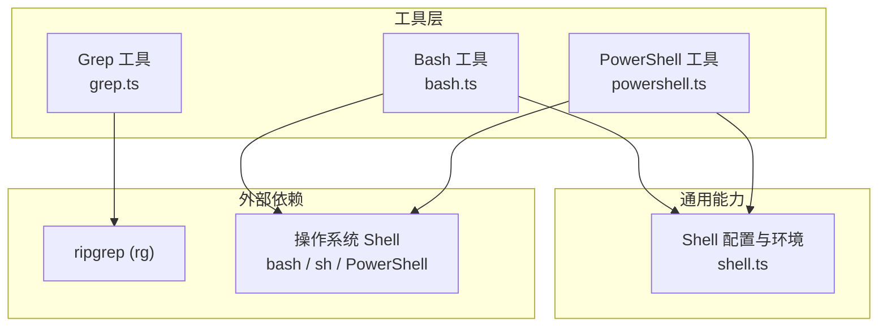
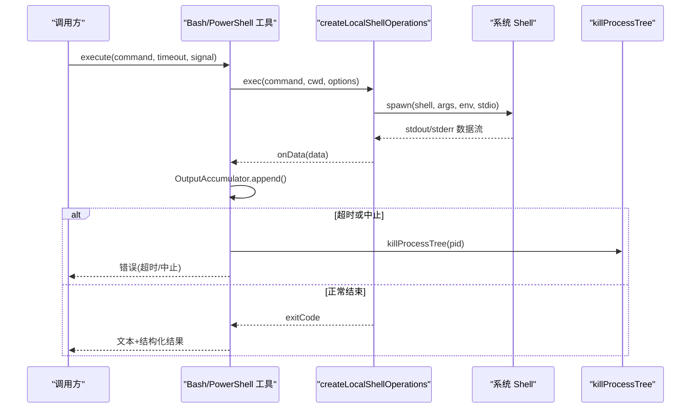
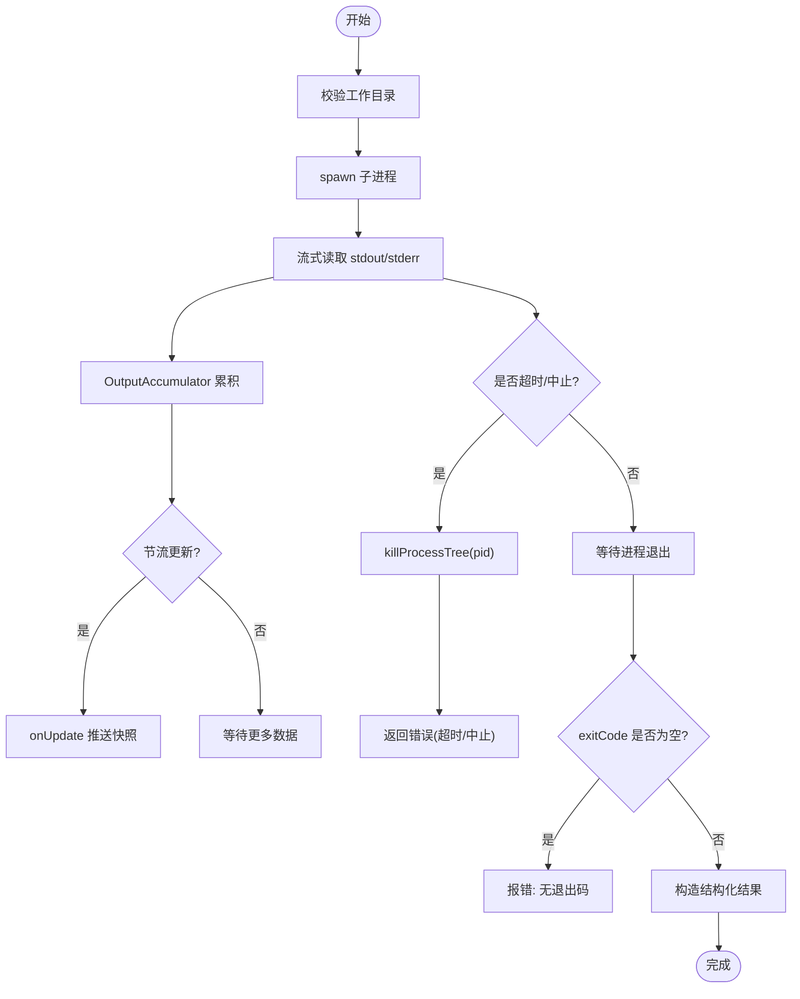
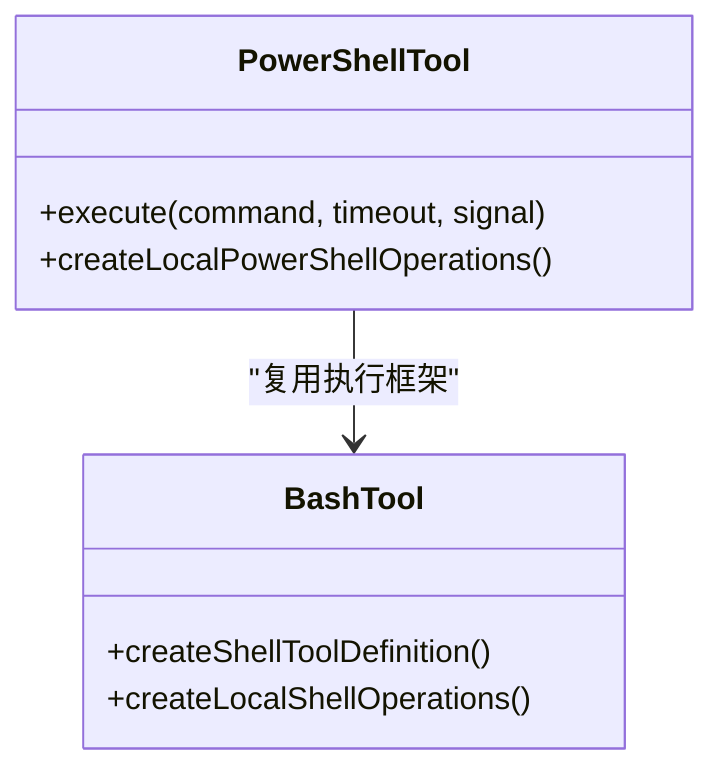
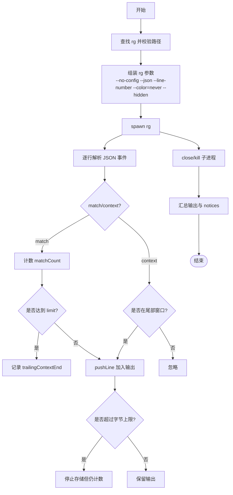
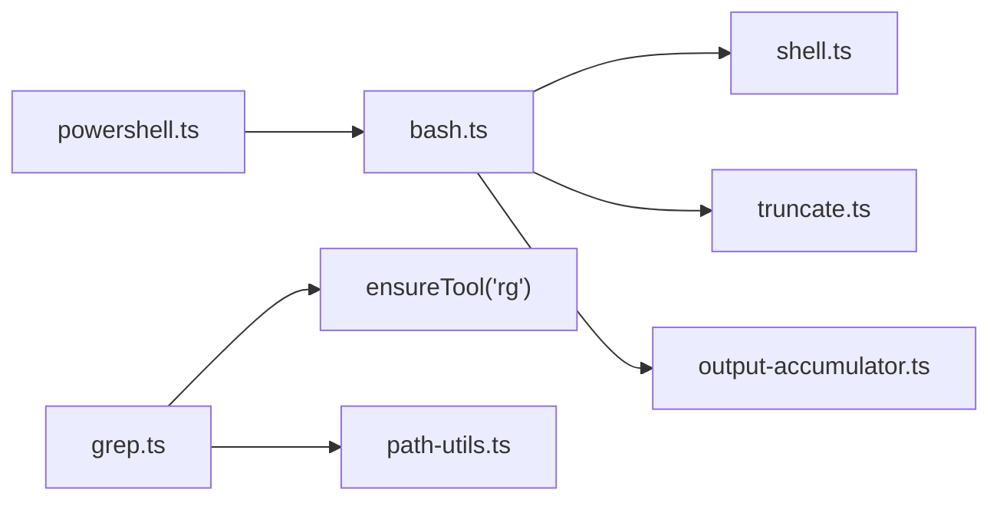
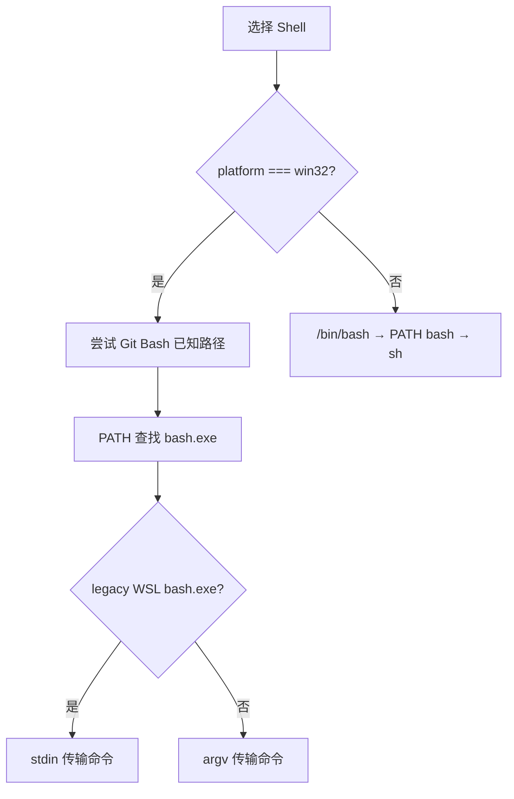

# Shell 命令工具

**本文引用的文件**   
- [packages/coding-agent/src/core/tools/bash.ts](https://github.com/FDE-GROUP/oh-my-fde/blob/main/packages/coding-agent/src/core/tools/bash.ts)
- [packages/coding-agent/src/core/tools/powershell.ts](https://github.com/FDE-GROUP/oh-my-fde/blob/main/packages/coding-agent/src/core/tools/powershell.ts)
- [packages/coding-agent/src/utils/shell.ts](https://github.com/FDE-GROUP/oh-my-fde/blob/main/packages/coding-agent/src/utils/shell.ts)
- [packages/coding-agent/src/core/tools/grep.ts](https://github.com/FDE-GROUP/oh-my-fde/blob/main/packages/coding-agent/src/core/tools/grep.ts)
- [packages/coding-agent/test/tools.test.ts](https://github.com/FDE-GROUP/oh-my-fde/blob/main/packages/coding-agent/test/tools.test.ts)
- [packages/coding-agent/test/powershell-tool.test.ts](https://github.com/FDE-GROUP/oh-my-fde/blob/main/packages/coding-agent/test/powershell-tool.test.ts)
- [scripts/repro-5893-wsl-bash.mjs](https://github.com/FDE-GROUP/oh-my-fde/blob/main/scripts/repro-5893-wsl-bash.mjs)

## 目录
1. [简介](#简介)
2. [项目结构](#项目结构)
3. [核心组件](#核心组件)
4. [架构总览](#架构总览)
5. [详细组件分析](#详细组件分析)
6. [依赖关系分析](#依赖关系分析)
7. [性能与输出管理](#性能与输出管理)
8. [跨平台兼容性说明](#跨平台兼容性说明)
9. [安全机制与最佳实践](#安全机制与最佳实践)
10. [故障排查指南](#故障排查指南)
11. [结论](#结论)

## 简介
本文件面向“Shell 命令工具”的 Bash、PowerShell 执行能力与 grep 搜索工具，系统性说明其安全机制、环境变量处理、输出管理与截断策略、正则与 ripgrep 集成、性能优化点，以及跨平台兼容性与安全最佳实践。文档同时给出可操作的白名单与沙箱建议，帮助在不可信或无人值守场景下降低风险。

## 项目结构
围绕 Shell 命令工具的核心代码集中在 coding-agent 包中：
- Bash/PowerShell 工具定义与执行逻辑位于 core/tools 目录。
- 通用 Shell 解析、环境构建、进程树清理等能力位于 utils/shell.ts。
- grep 工具基于本地 ripgrep（rg）实现，位于 core/tools/grep.ts。
- 测试与复现脚本覆盖 WSL bash、PowerShell 行为与参数。

**图表来源**
- [packages/coding-agent/src/core/tools/bash.ts:1-477](https://github.com/FDE-GROUP/oh-my-fde/blob/main/packages/coding-agent/src/core/tools/bash.ts#L1-L477)
- [packages/coding-agent/src/core/tools/powershell.ts:1-68](https://github.com/FDE-GROUP/oh-my-fde/blob/main/packages/coding-agent/src/core/tools/powershell.ts#L1-L68)
- [packages/coding-agent/src/utils/shell.ts:1-263](https://github.com/FDE-GROUP/oh-my-fde/blob/main/packages/coding-agent/src/utils/shell.ts#L1-L263)
- [packages/coding-agent/src/core/tools/grep.ts:1-322](https://github.com/FDE-GROUP/oh-my-fde/blob/main/packages/coding-agent/src/core/tools/grep.ts#L1-L322)

**章节来源**
- [packages/coding-agent/src/core/tools/bash.ts:1-477](https://github.com/FDE-GROUP/oh-my-fde/blob/main/packages/coding-agent/src/core/tools/bash.ts#L1-L477)
- [packages/coding-agent/src/core/tools/powershell.ts:1-68](https://github.com/FDE-GROUP/oh-my-fde/blob/main/packages/coding-agent/src/core/tools/powershell.ts#L1-L68)
- [packages/coding-agent/src/utils/shell.ts:1-263](https://github.com/FDE-GROUP/oh-my-fde/blob/main/packages/coding-agent/src/utils/shell.ts#L1-L263)
- [packages/coding-agent/src/core/tools/grep.ts:1-322](https://github.com/FDE-GROUP/oh-my-fde/blob/main/packages/coding-agent/src/core/tools/grep.ts#L1-L322)

## 核心组件
- Bash 工具：提供命令执行、超时控制、输出流式累积与截断、结构化结果返回、工作目录校验、进程树清理、可选命令前缀与环境注入。
- PowerShell 工具：复用 Bash 的执行框架，增加 UTF-8 输出初始化与 Windows 专用参数。
- Shell 工具库：负责 shell 路径解析、PowerShell 发现、PATH 注入、二进制输出清洗、进程树终止。
- Grep 工具：调用本地 ripgrep，支持正则/字面量匹配、大小写不敏感、glob 过滤、上下文行、匹配数限制、字节级输出截断与长行截断。

**章节来源**
- [packages/coding-agent/src/core/tools/bash.ts:39-68](https://github.com/FDE-GROUP/oh-my-fde/blob/main/packages/coding-agent/src/core/tools/bash.ts#L39-L68)
- [packages/coding-agent/src/core/tools/powershell.ts:16-37](https://github.com/FDE-GROUP/oh-my-fde/blob/main/packages/coding-agent/src/core/tools/powershell.ts#L16-L37)
- [packages/coding-agent/src/utils/shell.ts:6-10](https://github.com/FDE-GROUP/oh-my-fde/blob/main/packages/coding-agent/src/utils/shell.ts#L6-L10)
- [packages/coding-agent/src/core/tools/grep.ts:20-32](https://github.com/FDE-GROUP/oh-my-fde/blob/main/packages/coding-agent/src/core/tools/grep.ts#L20-L32)

## 架构总览
Bash/PowerShell 工具通过统一的 createShellToolDefinition 创建工具定义，内部使用 createLocalShellOperations 启动子进程并流式收集输出；PowerShell 工具在此基础上追加 UTF-8 初始化前缀。Shell 工具库统一负责 shell 选择、环境变量准备、进程生命周期管理。Grep 工具独立于 shell 执行，直接调用 ripgrep 并以 JSON 事件流解析结果。

**图表来源**
- [packages/coding-agent/src/core/tools/bash.ts:109-194](https://github.com/FDE-GROUP/oh-my-fde/blob/main/packages/coding-agent/src/core/tools/bash.ts#L109-L194)
- [packages/coding-agent/src/core/tools/bash.ts:289-446](https://github.com/FDE-GROUP/oh-my-fde/blob/main/packages/coding-agent/src/core/tools/bash.ts#L289-L446)
- [packages/coding-agent/src/utils/shell.ts:218-262](https://github.com/FDE-GROUP/oh-my-fde/blob/main/packages/coding-agent/src/utils/shell.ts#L218-L262)

## 详细组件分析

### Bash 工具
- 输入模型：command、timeout。
- 执行流程：
  - 校验工作目录存在。
  - 根据 ShellConfig 决定以 argv 或 stdin 方式传递命令。
  - 启动子进程，分离 detached 子进程 pid 以便父进程退出时清理。
  - 流式收集 stdout/stderr，节流更新 UI。
  - 支持 AbortSignal 取消与超时终止。
  - 将非零退出码标记为错误结果，并提供 wall_time_seconds 与完整输出路径（当被截断）。
- 环境变量：
  - 默认注入 getShellEnv()，包含 binDir 到 PATH 头部。
  - 可选择暴露 PI_* 会话元数据，也可通过 spawnHook 调整 command/cwd/env。
- 输出管理：
  - 按行数与字节数双重上限截断，必要时保存完整输出到临时文件。
  - 对二进制输出进行清洗，避免显示崩溃。

**图表来源**
- [packages/coding-agent/src/core/tools/bash.ts:109-194](https://github.com/FDE-GROUP/oh-my-fde/blob/main/packages/coding-agent/src/core/tools/bash.ts#L109-L194)
- [packages/coding-agent/src/core/tools/bash.ts:389-446](https://github.com/FDE-GROUP/oh-my-fde/blob/main/packages/coding-agent/src/core/tools/bash.ts#L389-L446)

**章节来源**
- [packages/coding-agent/src/core/tools/bash.ts:39-68](https://github.com/FDE-GROUP/oh-my-fde/blob/main/packages/coding-agent/src/core/tools/bash.ts#L39-L68)
- [packages/coding-agent/src/core/tools/bash.ts:109-194](https://github.com/FDE-GROUP/oh-my-fde/blob/main/packages/coding-agent/src/core/tools/bash.ts#L109-L194)
- [packages/coding-agent/src/core/tools/bash.ts:214-240](https://github.com/FDE-GROUP/oh-my-fde/blob/main/packages/coding-agent/src/core/tools/bash.ts#L214-L240)
- [packages/coding-agent/src/core/tools/bash.ts:289-446](https://github.com/FDE-GROUP/oh-my-fde/blob/main/packages/coding-agent/src/core/tools/bash.ts#L289-L446)

### PowerShell 工具
- 复用 Bash 的工具定义与执行框架。
- 在执行前自动注入 UTF-8 编码初始化语句，确保控制台输出为 UTF-8。
- 使用固定参数集：-NoProfile、-NonInteractive、-ExecutionPolicy Bypass、-Command。
- 仅 Windows 可用，未安装时会抛出明确错误。

**图表来源**
- [packages/coding-agent/src/core/tools/powershell.ts:16-37](https://github.com/FDE-GROUP/oh-my-fde/blob/main/packages/coding-agent/src/core/tools/powershell.ts#L16-L37)
- [packages/coding-agent/src/core/tools/bash.ts:271-449](https://github.com/FDE-GROUP/oh-my-fde/blob/main/packages/coding-agent/src/core/tools/bash.ts#L271-L449)

**章节来源**
- [packages/coding-agent/src/core/tools/powershell.ts:16-37](https://github.com/FDE-GROUP/oh-my-fde/blob/main/packages/coding-agent/src/core/tools/powershell.ts#L16-L37)
- [packages/coding-agent/src/core/tools/powershell.ts:49-67](https://github.com/FDE-GROUP/oh-my-fde/blob/main/packages/coding-agent/src/core/tools/powershell.ts#L49-L67)
- [packages/coding-agent/test/powershell-tool.test.ts:12-29](https://github.com/FDE-GROUP/oh-my-fde/blob/main/packages/coding-agent/test/powershell-tool.test.ts#L12-L29)

### Grep 工具
- 调用本地 ripgrep（rg），强制 --no-config 以避免用户配置影响工具契约。
- 支持参数：pattern、path、glob、ignoreCase、literal、context、limit。
- 解析 rg 的 JSON 事件流，区分 match 与 context 事件，维护 lastFile 与 trailingContextEnd 窗口。
- 输出限制：
  - 匹配数量限制（默认 100），达到后继续消费尾部上下文行直到确认“确实被截断”。
  - 字节级输出上限（DEFAULT_MAX_BYTES），超出部分丢弃但计入统计。
  - 单行长度截断（GREP_MAX_LINE_LENGTH），提示使用 read 查看完整行。
- 错误处理：
  - rg 不可用则拒绝执行。
  - 路径不存在时报错。
  - 非 0/1 退出码视为错误，合并 stderr 信息。

**图表来源**
- [packages/coding-agent/src/core/tools/grep.ts:120-162](https://github.com/FDE-GROUP/oh-my-fde/blob/main/packages/coding-agent/src/core/tools/grep.ts#L120-L162)
- [packages/coding-agent/src/core/tools/grep.ts:222-308](https://github.com/FDE-GROUP/oh-my-fde/blob/main/packages/coding-agent/src/core/tools/grep.ts#L222-L308)

**章节来源**
- [packages/coding-agent/src/core/tools/grep.ts:20-32](https://github.com/FDE-GROUP/oh-my-fde/blob/main/packages/coding-agent/src/core/tools/grep.ts#L20-L32)
- [packages/coding-agent/src/core/tools/grep.ts:120-162](https://github.com/FDE-GROUP/oh-my-fde/blob/main/packages/coding-agent/src/core/tools/grep.ts#L120-L162)
- [packages/coding-agent/src/core/tools/grep.ts:222-308](https://github.com/FDE-GROUP/oh-my-fde/blob/main/packages/coding-agent/src/core/tools/grep.ts#L222-L308)

## 依赖关系分析
- Bash/PowerShell 工具依赖：
  - child_process.spawn 启动子进程。
  - utils/shell.ts 提供 ShellConfig、getShellEnv、killProcessTree、trackDetachedChildPid 等。
  - OutputAccumulator 与 truncate 模块负责输出累积与截断。
- Grep 工具依赖：
  - child_process.spawn 调用 rg。
  - ensureTool("rg") 确保 ripgrep 可用。
  - path-utils.resolveToCwd 解析搜索路径。

**图表来源**
- [packages/coding-agent/src/core/tools/bash.ts:1-19](https://github.com/FDE-GROUP/oh-my-fde/blob/main/packages/coding-agent/src/core/tools/bash.ts#L1-L19)
- [packages/coding-agent/src/core/tools/powershell.ts:1-14](https://github.com/FDE-GROUP/oh-my-fde/blob/main/packages/coding-agent/src/core/tools/powershell.ts#L1-L14)
- [packages/coding-agent/src/core/tools/grep.ts:1-18](https://github.com/FDE-GROUP/oh-my-fde/blob/main/packages/coding-agent/src/core/tools/grep.ts#L1-L18)

**章节来源**
- [packages/coding-agent/src/core/tools/bash.ts:1-19](https://github.com/FDE-GROUP/oh-my-fde/blob/main/packages/coding-agent/src/core/tools/bash.ts#L1-L19)
- [packages/coding-agent/src/core/tools/powershell.ts:1-14](https://github.com/FDE-GROUP/oh-my-fde/blob/main/packages/coding-agent/src/core/tools/powershell.ts#L1-L14)
- [packages/coding-agent/src/core/tools/grep.ts:1-18](https://github.com/FDE-GROUP/oh-my-fde/blob/main/packages/coding-agent/src/core/tools/grep.ts#L1-L18)

## 性能与输出管理
- Bash/PowerShell：
  - 输出节流更新，避免频繁 UI 刷新。
  - 结构化输出最大字节限制（STRUCTURED_OUTPUT_MAX_BYTES），避免大输出阻塞程序化调用者。
  - 超时与中止双通道保护，确保进程树及时清理。
- Grep：
  - 使用 ripgrep 原生 JSON 模式，减少 I/O 与解析开销。
  - 匹配数限制与字节级截断并行，尽早终止 rg 子进程。
  - 长行截断减少渲染压力，配合 read 工具获取完整内容。

**章节来源**
- [packages/coding-agent/src/core/tools/bash.ts:21-24](https://github.com/FDE-GROUP/oh-my-fde/blob/main/packages/coding-agent/src/core/tools/bash.ts#L21-L24)
- [packages/coding-agent/src/core/tools/bash.ts:331-344](https://github.com/FDE-GROUP/oh-my-fde/blob/main/packages/coding-agent/src/core/tools/bash.ts#L331-L344)
- [packages/coding-agent/src/core/tools/grep.ts:138-160](https://github.com/FDE-GROUP/oh-my-fde/blob/main/packages/coding-agent/src/core/tools/grep.ts#L138-L160)
- [packages/coding-agent/src/core/tools/grep.ts:204-251](https://github.com/FDE-GROUP/oh-my-fde/blob/main/packages/coding-agent/src/core/tools/grep.ts#L204-L251)

## 跨平台兼容性说明
- Bash 解析顺序：
  - Windows：优先 Git Bash 已知路径，其次 PATH 中的 bash.exe，失败抛错并给出安装指引。
  - Unix：/bin/bash → PATH 中的 bash → 回退到 sh。
  - 特殊路径 C:\Windows\System32\bash.exe 被视为 WSL legacy launcher，采用 stdin 传输命令。
- PowerShell 解析顺序：
  - 优先 pwsh.exe（PowerShell 7），其次 ProgramFiles 下的安装路径，再 powershell.exe，最后 SystemRoot 下的 Windows PowerShell。
  - 非 Windows 平台直接抛错。
- 环境变量：
  - getShellEnv 将 binDir 插入 PATH 头部，保持跨平台分隔符。
- 进程清理：
  - Windows 使用 taskkill /F /T /PID 递归终止。
  - macOS 先 SIGSTOP 进程组，再 SIGKILL 进程组，回退到单进程 SIGKILL。
  - Linux 直接 SIGKILL 进程组。

**图表来源**
- [packages/coding-agent/src/utils/shell.ts:12-27](https://github.com/FDE-GROUP/oh-my-fde/blob/main/packages/coding-agent/src/utils/shell.ts#L12-L27)
- [packages/coding-agent/src/utils/shell.ts:84-137](https://github.com/FDE-GROUP/oh-my-fde/blob/main/packages/coding-agent/src/utils/shell.ts#L84-L137)
- [packages/coding-agent/src/utils/shell.ts:141-167](https://github.com/FDE-GROUP/oh-my-fde/blob/main/packages/coding-agent/src/utils/shell.ts#L141-L167)
- [packages/coding-agent/src/utils/shell.ts:218-262](https://github.com/FDE-GROUP/oh-my-fde/blob/main/packages/coding-agent/src/utils/shell.ts#L218-L262)

**章节来源**
- [packages/coding-agent/src/utils/shell.ts:12-27](https://github.com/FDE-GROUP/oh-my-fde/blob/main/packages/coding-agent/src/utils/shell.ts#L12-L27)
- [packages/coding-agent/src/utils/shell.ts:84-137](https://github.com/FDE-GROUP/oh-my-fde/blob/main/packages/coding-agent/src/utils/shell.ts#L84-L137)
- [packages/coding-agent/src/utils/shell.ts:141-167](https://github.com/FDE-GROUP/oh-my-fde/blob/main/packages/coding-agent/src/utils/shell.ts#L141-L167)
- [packages/coding-agent/src/utils/shell.ts:169-181](https://github.com/FDE-GROUP/oh-my-fde/blob/main/packages/coding-agent/src/utils/shell.ts#L169-L181)
- [packages/coding-agent/src/utils/shell.ts:218-262](https://github.com/FDE-GROUP/oh-my-fde/blob/main/packages/coding-agent/src/utils/shell.ts#L218-L262)
- [scripts/repro-5893-wsl-bash.mjs:1-55](https://github.com/FDE-GROUP/oh-my-fde/blob/main/scripts/repro-5893-wsl-bash.mjs#L1-L55)

## 安全机制与最佳实践

### 安全机制
- 工作目录校验：执行前检查 cwd 存在，防止误操作。
- 进程隔离与清理：
  - 非 Windows 平台以 detached 方式运行，便于父进程退出时清理。
  - 跟踪 detached 子进程 pid，统一在父进程关闭时 killProcessTree。
  - 支持 AbortSignal 立即终止整个进程树。
- 超时保护：
  - 自定义 ShellTimeoutError，携带 shellExit 信息，区分“shell 已退出但后台进程仍在写管道”的情况。
- 环境变量最小化：
  - 默认删除 PI_SESSION_ID、PI_SESSION_FILE、PI_PROVIDER、PI_MODEL、PI_REASONING_LEVEL，除非显式开启 exposeSessionEnvironment。
  - 可通过 spawnHook 进一步裁剪 command/cwd/env。
- Grep 工具契约稳定：
  - 强制 --no-config，避免用户 RIPGREP_CONFIG_PATH 影响行为。
  - 严格解析 rg JSON 事件，避免任意命令注入。

### 命令白名单建议
- 只允许只读命令：如 ls、cat、head、tail、wc、grep、find、git status、git diff、git log、git show、node -e、python -c 等。
- 禁止写入与破坏性命令：rm、mv、cp、mkdir、touch、重定向 >、>>、sudo、kill、reboot、shutdown、systemctl、docker、npm install/yarn add/pip install/brew install 等。
- 禁止危险语法：分号链式、&&、||、反引号、$()、$( )、eval、source、exec、tee、xargs、curl/wget 下载、base64 解码等。
- 限制工作目录：始终在受信任的项目根目录下执行，禁止 .. 逃逸。
- 限制网络访问：禁用 curl/wget/ssh/scp/rsync 等网络相关命令。
- 限制资源消耗：设置合理 timeout、maxBytes、maxLines、maxMatches。

### 沙箱限制建议
- 容器化：在 Docker 或轻量容器中运行 pi，限制文件系统挂载与网络权限。
- 用户权限：以低权限用户运行，禁用 sudo/root。
- 文件系统沙箱：只挂载必要目录，使用只读镜像层。
- 进程沙箱：结合 cgroups/SELinux/AppArmor/Windows Job Object 限制 CPU/内存/IO。
- 扩展替换：通过 extension 机制替换内置工具，实现更严格的白名单与审计。

**章节来源**
- [packages/coding-agent/src/core/tools/bash.ts:117-122](https://github.com/FDE-GROUP/oh-my-fde/blob/main/packages/coding-agent/src/core/tools/bash.ts#L117-L122)
- [packages/coding-agent/src/core/tools/bash.ts:136-194](https://github.com/FDE-GROUP/oh-my-fde/blob/main/packages/coding-agent/src/core/tools/bash.ts#L136-L194)
- [packages/coding-agent/src/core/tools/bash.ts:214-240](https://github.com/FDE-GROUP/oh-my-fde/blob/main/packages/coding-agent/src/core/tools/bash.ts#L214-L240)
- [packages/coding-agent/src/core/tools/grep.ts:152-160](https://github.com/FDE-GROUP/oh-my-fde/blob/main/packages/coding-agent/src/core/tools/grep.ts#L152-L160)

## 故障排查指南
- “找不到 bash”：
  - Windows 需安装 Git for Windows 或将 bash 加入 PATH，或在设置中指定 shellPath。
  - 若使用 WSL legacy bash.exe，会自动切换为 stdin 传输命令。
- “找不到 PowerShell”：
  - 仅在 Windows 可用；确保安装 PowerShell 7 或启用 Windows PowerShell，并将可执行文件加入 PATH。
- “命令超时”：
  - 检查是否设置了过短的 timeout；注意后台进程可能继续写管道，工具会报告 shellExit 信息。
- “输出为空或被截断”：
  - Bash/PowerShell：查看 details.fullOutputPath 获取完整输出。
  - Grep：检查是否达到 matchLimitReached 或 DEFAULT_MAX_BYTES 限制，适当增大 limit 或缩小搜索范围。
- “PowerShell 输出乱码”：
  - 工具已自动注入 UTF-8 初始化；确认终端编码与 PowerShell 版本。

**章节来源**
- [packages/coding-agent/src/utils/shell.ts:117-123](https://github.com/FDE-GROUP/oh-my-fde/blob/main/packages/coding-agent/src/utils/shell.ts#L117-L123)
- [packages/coding-agent/src/utils/shell.ts:162-164](https://github.com/FDE-GROUP/oh-my-fde/blob/main/packages/coding-agent/src/utils/shell.ts#L162-L164)
- [packages/coding-agent/src/core/tools/bash.ts:399-416](https://github.com/FDE-GROUP/oh-my-fde/blob/main/packages/coding-agent/src/core/tools/bash.ts#L399-L416)
- [packages/coding-agent/src/core/tools/grep.ts:276-301](https://github.com/FDE-GROUP/oh-my-fde/blob/main/packages/coding-agent/src/core/tools/grep.ts#L276-L301)
- [packages/coding-agent/test/tools.test.ts:653-740](https://github.com/FDE-GROUP/oh-my-fde/blob/main/packages/coding-agent/test/tools.test.ts#L653-L740)
- [packages/coding-agent/test/powershell-tool.test.ts:12-29](https://github.com/FDE-GROUP/oh-my-fde/blob/main/packages/coding-agent/test/powershell-tool.test.ts#L12-L29)

## 结论
该 Shell 命令工具集在 Bash 与 PowerShell 上提供了稳健的执行框架，具备完善的超时与中止保护、进程树清理、环境变量最小化与输出截断机制。Grep 工具基于 ripgrep 提供高性能、可控的正则搜索能力。通过合理的命令白名单与容器/权限沙箱，可在不可信环境中显著降低风险。建议在自动化与无人值守场景中，结合 spawnHook 与 operations 接口实现更细粒度的安全策略与审计。