# 工具系统

**本文引用的文件**   
- [12-tools.md](https://github.com/FDE-GROUP/oh-my-fde/blob/main/docs/explains/12-tools.md)
- [index.ts](https://github.com/FDE-GROUP/oh-my-fde/blob/main/packages/coding-agent/src/core/tools/index.ts)
- [tool-definition-wrapper.ts](https://github.com/FDE-GROUP/oh-my-fde/blob/main/packages/coding-agent/src/core/tools/tool-definition-wrapper.ts)
- [bash.ts](https://github.com/FDE-GROUP/oh-my-fde/blob/main/packages/coding-agent/src/core/tools/bash.ts)
- [read.ts](https://github.com/FDE-GROUP/oh-my-fde/blob/main/packages/coding-agent/src/core/tools/read.ts)
- [edit.ts](https://github.com/FDE-GROUP/oh-my-fde/blob/main/packages/coding-agent/src/core/tools/edit.ts)
- [write.ts](https://github.com/FDE-GROUP/oh-my-fde/blob/main/packages/coding-agent/src/core/tools/write.ts)
- [file-mutation-queue.ts](https://github.com/FDE-GROUP/oh-my-fde/blob/main/packages/coding-agent/src/core/tools/file-mutation-queue.ts)
- [path-utils.ts](https://github.com/FDE-GROUP/oh-my-fde/blob/main/packages/coding-agent/src/core/tools/path-utils.ts)
- [truncate.ts](https://github.com/FDE-GROUP/oh-my-fde/blob/main/packages/coding-agent/src/core/tools/truncate.ts)
- [agent-session-dynamic-tools.test.ts](https://github.com/FDE-GROUP/oh-my-fde/blob/main/packages/coding-agent/test/agent-session-dynamic-tools.test.ts)

## 目录
1. [引言](#引言)
2. [项目结构](#项目结构)
3. [核心组件](#核心组件)
4. [架构总览](#架构总览)
5. [详细组件分析](#详细组件分析)
6. [依赖关系分析](#依赖关系分析)
7. [性能与容量控制](#性能与容量控制)
8. [安全、权限与沙箱](#安全权限与沙箱)
9. [自定义工具开发指南](#自定义工具开发指南)
10. [调用流程、错误处理与结果格式化](#调用流程错误处理与结果格式化)
11. [故障排查](#故障排查)
12. [结论](#结论)

## 引言
本文件面向开发者，系统性说明工具系统的注册机制、执行环境、权限边界、内置工具能力、参数配置、输出截断、并发控制、错误处理和结果格式化。文档同时给出扩展点、安全建议与性能优化策略，帮助你在现有生态中快速构建可靠、可观测、可扩展的工具。

## 项目结构
工具系统位于 `packages/coding-agent/src/core/tools`，采用“工厂函数 + Operations 接口”的解耦设计：每个工具暴露定义工厂和运行时包装器，底层 I/O 通过可替换的 Operations 实现，便于远程化（例如 SSH）或测试替换。

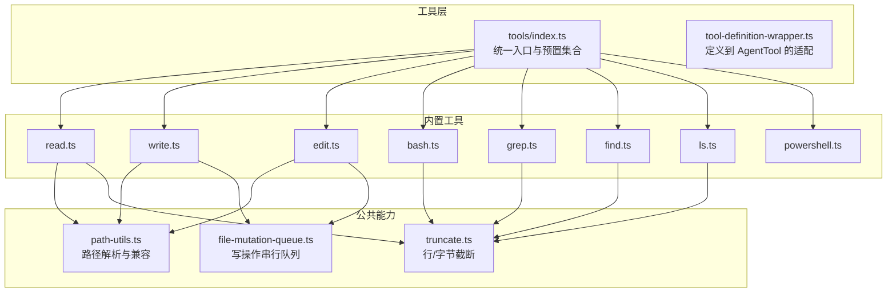

图表来源
- [index.ts:118-193](https://github.com/FDE-GROUP/oh-my-fde/blob/main/packages/coding-agent/src/core/tools/index.ts#L118-L193)
- [tool-definition-wrapper.ts:27-49](https://github.com/FDE-GROUP/oh-my-fde/blob/main/packages/coding-agent/src/core/tools/tool-definition-wrapper.ts#L27-L49)
- [read.ts:228-357](https://github.com/FDE-GROUP/oh-my-fde/blob/main/packages/coding-agent/src/core/tools/read.ts#L228-L357)
- [write.ts:43-91](https://github.com/FDE-GROUP/oh-my-fde/blob/main/packages/coding-agent/src/core/tools/write.ts#L43-L91)
- [edit.ts:140-212](https://github.com/FDE-GROUP/oh-my-fde/blob/main/packages/coding-agent/src/core/tools/edit.ts#L140-L212)
- [bash.ts:271-448](https://github.com/FDE-GROUP/oh-my-fde/blob/main/packages/coding-agent/src/core/tools/bash.ts#L271-L448)
- [path-utils.ts:44-50](https://github.com/FDE-GROUP/oh-my-fde/blob/main/packages/coding-agent/src/core/tools/path-utils.ts#L44-L50)
- [truncate.ts:11-13](https://github.com/FDE-GROUP/oh-my-fde/blob/main/packages/coding-agent/src/core/tools/truncate.ts#L11-L13)
- [file-mutation-queue.ts:32-61](https://github.com/FDE-GROUP/oh-my-fde/blob/main/packages/coding-agent/src/core/tools/file-mutation-queue.ts#L32-L61)

章节来源
- [12-tools.md:1-33](https://github.com/FDE-GROUP/oh-my-fde/blob/main/docs/explains/12-tools.md#L1-L33)
- [index.ts:1-225](https://github.com/FDE-GROUP/oh-my-fde/blob/main/packages/coding-agent/src/core/tools/index.ts#L1-L225)

## 核心组件
- 工具定义与运行时
  - `ToolDefinition`：面向扩展侧，描述 name、description、parameters、promptSnippet、promptGuidelines、renderers 等元数据。
  - `AgentTool`：运行时对象，包含 execute、executionMode、outputSchema 等。
  - `wrapToolDefinition()`：将 ToolDefinition 适配为 AgentTool；`createToolDefinitionFromAgentTool()`：反向合成最小 ToolDefinition。
- 内置工具
  - read、bash、powershell、edit、write、grep、find、ls。
  - 默认激活集：`createCodingTools()` 提供 read、bash、edit、write；`createReadOnlyTools()` 提供 read、grep、find、ls。
- 公共能力
  - 路径解析：`resolveToCwd`、`resolveReadPath`、`resolveReadPathAsync`。
  - 输出截断：`truncateHead`、`truncateTail`、`truncateLine`、`sliceHead`、`sliceTail`。
  - 写操作串行：`withFileMutationQueue`。

章节来源
- [12-tools.md:1-33](https://github.com/FDE-GROUP/oh-my-fde/blob/main/docs/explains/12-tools.md#L1-L33)
- [tool-definition-wrapper.ts:1-78](https://github.com/FDE-GROUP/oh-my-fde/blob/main/packages/coding-agent/src/core/tools/tool-definition-wrapper.ts#L1-L78)
- [index.ts:93-225](https://github.com/FDE-GROUP/oh-my-fde/blob/main/packages/coding-agent/src/core/tools/index.ts#L93-L225)
- [path-utils.ts:44-118](https://github.com/FDE-GROUP/oh-my-fde/blob/main/packages/coding-agent/src/core/tools/path-utils.ts#L44-L118)
- [truncate.ts:1-303](https://github.com/FDE-GROUP/oh-my-fde/blob/main/packages/coding-agent/src/core/tools/truncate.ts#L1-L303)
- [file-mutation-queue.ts:1-62](https://github.com/FDE-GROUP/oh-my-fde/blob/main/packages/coding-agent/src/core/tools/file-mutation-queue.ts#L1-L62)

## 架构总览
工具系统由三层组成：
- 定义层：各工具的 `createXxxToolDefinition` 返回 ToolDefinition，声明参数 schema、输出 schema、提示词片段与渲染器。
- 适配层：`wrapToolDefinition` 把 ToolDefinition 转为 AgentTool，注入上下文与回调。
- 执行层：具体 execute 逻辑，使用 Operations 抽象访问文件系统、外部命令或远程后端。

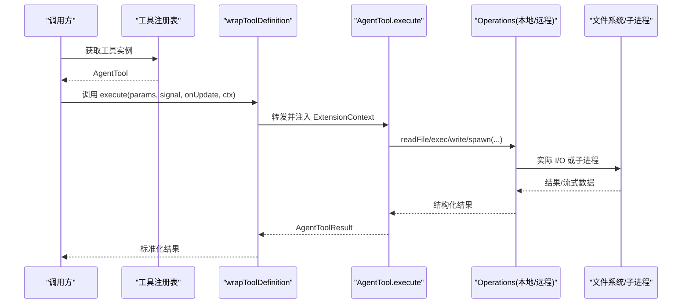

图表来源
- [tool-definition-wrapper.ts:27-49](https://github.com/FDE-GROUP/oh-my-fde/blob/main/packages/coding-agent/src/core/tools/tool-definition-wrapper.ts#L27-L49)
- [index.ts:118-193](https://github.com/FDE-GROUP/oh-my-fde/blob/main/packages/coding-agent/src/core/tools/index.ts#L118-L193)
- [bash.ts:271-448](https://github.com/FDE-GROUP/oh-my-fde/blob/main/packages/coding-agent/src/core/tools/bash.ts#L271-L448)
- [read.ts:228-357](https://github.com/FDE-GROUP/oh-my-fde/blob/main/packages/coding-agent/src/core/tools/read.ts#L228-L357)

## 详细组件分析

### 工具注册与发现
- 统一入口：`index.ts` 提供 `createTool`、`createToolDefinition`、`createAllTools`、`createCodingTools`、`createReadOnlyTools` 等工厂。
- 名称枚举：`allToolNames` 集中管理内置工具名。
- 动态注册：扩展可在会话生命周期内通过 `registerTool` 注册新工具，并在会话绑定后生效。

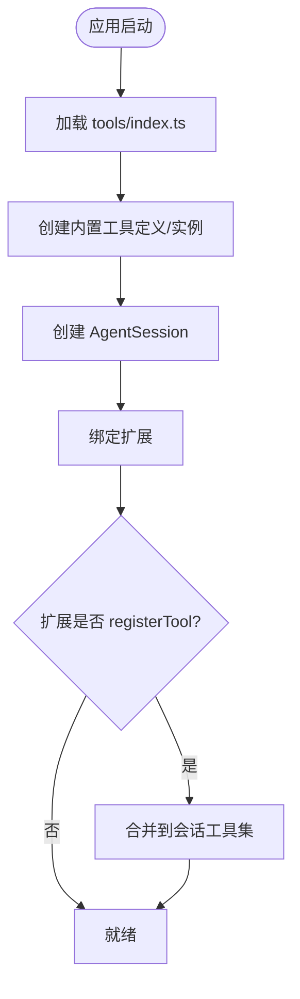

图表来源
- [index.ts:93-225](https://github.com/FDE-GROUP/oh-my-fde/blob/main/packages/coding-agent/src/core/tools/index.ts#L93-L225)
- [agent-session-dynamic-tools.test.ts:99-166](https://github.com/FDE-GROUP/oh-my-fde/blob/main/packages/coding-agent/test/agent-session-dynamic-tools.test.ts#L99-L166)

章节来源
- [index.ts:93-225](https://github.com/FDE-GROUP/oh-my-fde/blob/main/packages/coding-agent/src/core/tools/index.ts#L93-L225)
- [agent-session-dynamic-tools.test.ts:99-166](https://github.com/FDE-GROUP/oh-my-fde/blob/main/packages/coding-agent/test/agent-session-dynamic-tools.test.ts#L99-L166)

### 工具定义与包装
- `wrapToolDefinition`：将 ToolDefinition 映射为 AgentTool，透传 parameters、outputSchema、constrainedSampling、prepareArguments、executionMode 与 execute。
- `TypeBoxAgentTool`：为 TypeBox 参数类型提供强类型 execute 与 prepareArguments。
- `createToolDefinitionFromAgentTool`：从已有 AgentTool 反推最小 ToolDefinition，保持内部注册一致性。

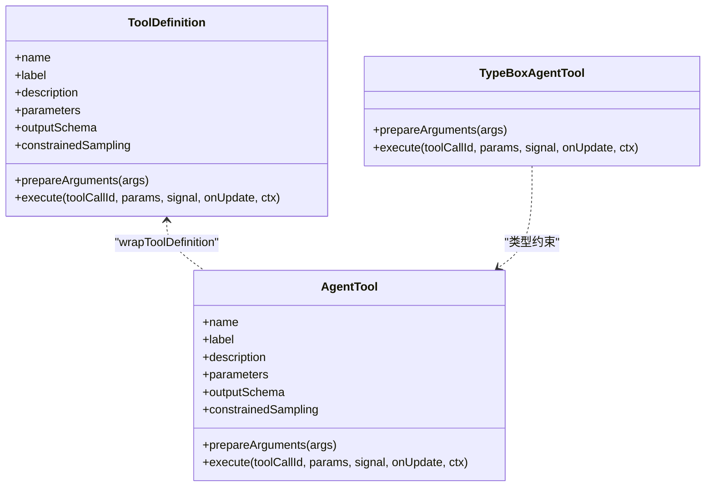

图表来源
- [tool-definition-wrapper.ts:1-78](https://github.com/FDE-GROUP/oh-my-fde/blob/main/packages/coding-agent/src/core/tools/tool-definition-wrapper.ts#L1-L78)

章节来源
- [tool-definition-wrapper.ts:1-78](https://github.com/FDE-GROUP/oh-my-fde/blob/main/packages/coding-agent/src/core/tools/tool-definition-wrapper.ts#L1-L78)

### 路径解析与兼容性
- `resolveToCwd`：展开 `~`、规范化 Unicode 空格、去掉 `@` 前缀、按 cwd 解析相对路径。注意：它不限制路径必须在 cwd 内，因此不是沙箱。
- `resolveReadPath` / `resolveReadPathAsync`：在基础解析之上，额外处理 macOS 文件名差异（AM/PM 窄不换行空格、NFD 分解形式、弯引号等），仅用于读。

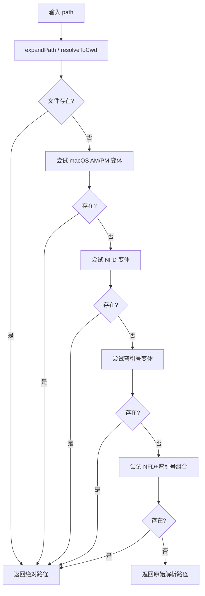

图表来源
- [path-utils.ts:44-118](https://github.com/FDE-GROUP/oh-my-fde/blob/main/packages/coding-agent/src/core/tools/path-utils.ts#L44-L118)

章节来源
- [path-utils.ts:1-118](https://github.com/FDE-GROUP/oh-my-fde/blob/main/packages/coding-agent/src/core/tools/path-utils.ts#L1-L118)
- [12-tools.md:34-55](https://github.com/FDE-GROUP/oh-my-fde/blob/main/docs/explains/12-tools.md#L34-L55)

### 文件写入串行化
- `withFileMutationQueue`：对同一文件的写操作串行，不同文件并行；使用 realpath 作为 key，不存在时回退到 resolve；registrationQueue 保证队列注册原子性；完成后释放下一个任务并清理空队列。
- write 与 edit 均使用该队列，避免并发覆盖。

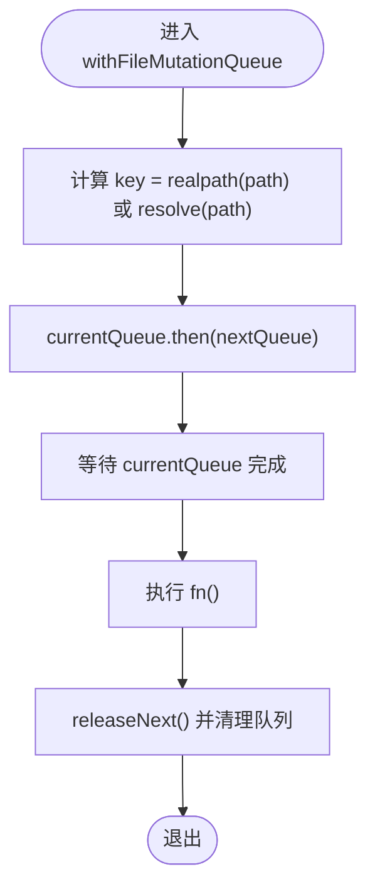

图表来源
- [file-mutation-queue.ts:16-61](https://github.com/FDE-GROUP/oh-my-fde/blob/main/packages/coding-agent/src/core/tools/file-mutation-queue.ts#L16-L61)

章节来源
- [file-mutation-queue.ts:1-62](https://github.com/FDE-GROUP/oh-my-fde/blob/main/packages/coding-agent/src/core/tools/file-mutation-queue.ts#L1-L62)
- [12-tools.md:56-67](https://github.com/FDE-GROUP/oh-my-fde/blob/main/docs/explains/12-tools.md#L56-L67)

### 输出截断与内存控制
- 双限策略：行数上限（默认 2000）与字节上限（默认 50KB），先到先停。
- truncateHead：保留头部，永不返回半行；若首行超限，返回空内容并标记 firstLineExceedsLimit。
- truncateTail：保留尾部，最后一行超限时取尾部并标记 lastLinePartial。
- sliceHead/sliceTail：避免切断 surrogate pair。

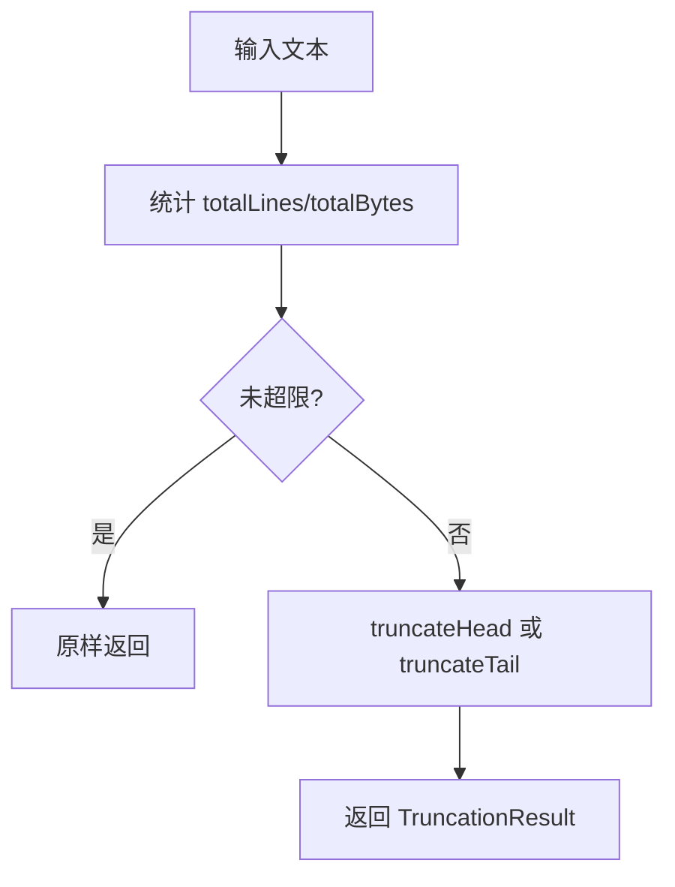

图表来源
- [truncate.ts:11-13](https://github.com/FDE-GROUP/oh-my-fde/blob/main/packages/coding-agent/src/core/tools/truncate.ts#L11-L13)
- [truncate.ts:78-159](https://github.com/FDE-GROUP/oh-my-fde/blob/main/packages/coding-agent/src/core/tools/truncate.ts#L78-L159)
- [truncate.ts:168-240](https://github.com/FDE-GROUP/oh-my-fde/blob/main/packages/coding-agent/src/core/tools/truncate.ts#L168-L240)
- [truncate.ts:278-302](https://github.com/FDE-GROUP/oh-my-fde/blob/main/packages/coding-agent/src/core/tools/truncate.ts#L278-L302)

章节来源
- [truncate.ts:1-303](https://github.com/FDE-GROUP/oh-my-fde/blob/main/packages/coding-agent/src/core/tools/truncate.ts#L1-L303)
- [12-tools.md:68-90](https://github.com/FDE-GROUP/oh-my-fde/blob/main/docs/explains/12-tools.md#L68-L90)

### 内置工具详解

#### read：读取文件与图片
- 参数：path、offset（1-indexed）、limit。
- 行为：检测 MIME；图片走 processImage 并按模型限制缩放；非视觉模型附加省略提示；文本优先流式读取，只保留显示行；用户 limit 优先于截断；截断时提示下一步 offset。
- 结构化输出：文本直接返回字符串；图片返回 image block，供 codemode 使用。

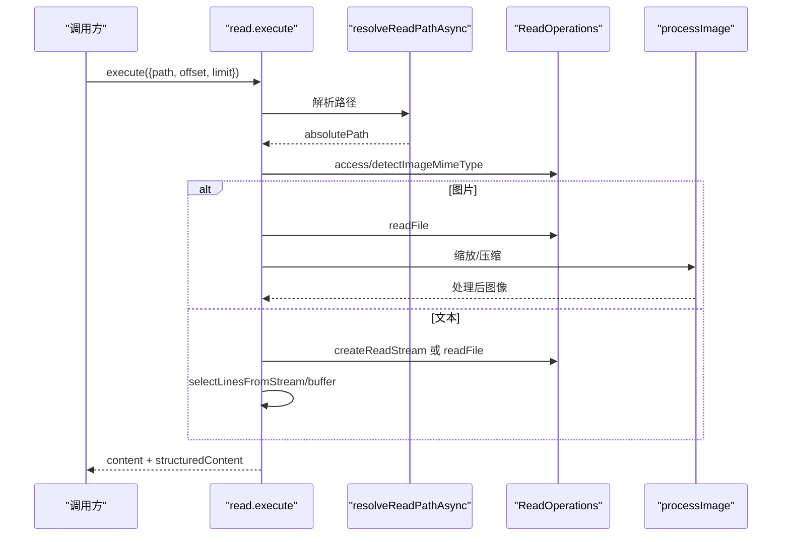

图表来源
- [read.ts:228-357](https://github.com/FDE-GROUP/oh-my-fde/blob/main/packages/coding-agent/src/core/tools/read.ts#L228-L357)

章节来源
- [read.ts:1-363](https://github.com/FDE-GROUP/oh-my-fde/blob/main/packages/coding-agent/src/core/tools/read.ts#L1-L363)
- [12-tools.md:91-105](https://github.com/FDE-GROUP/oh-my-fde/blob/main/docs/explains/12-tools.md#L91-L105)

#### write：整文件写入
- 参数：path、content。
- 行为：创建父目录、覆盖写入、同文件串行。
- 无 diff 输出（全量覆盖）。

章节来源
- [write.ts:1-97](https://github.com/FDE-GROUP/oh-my-fde/blob/main/packages/coding-agent/src/core/tools/write.ts#L1-L97)
- [12-tools.md:107-114](https://github.com/FDE-GROUP/oh-my-fde/blob/main/docs/explains/12-tools.md#L107-L114)

#### edit：精确文本替换
- 参数：path、edits[]（{oldText, newText}）。
- 参数兼容：支持 edits 为 JSON 字符串、单个对象、顶层 oldText/newText。
- 匹配规则：全部基于原始内容匹配，非增量；先精确匹配，再模糊匹配（NFKC、去尾空白、智能引号转 ASCII、Unicode 破折号归一、特殊空格归一）；重复匹配报错；多条按位置排序并检测重叠；从后往前应用以保持偏移稳定。
- 保留原始字节：模糊匹配发生在规范化内容上，但写回时只重写变更行，其余行原样复制。
- 换行与 BOM：检测并恢复原始换行；剥离 BOM 后再匹配，写回加回。
- 输出：diff、unified patch、firstChangedLine。

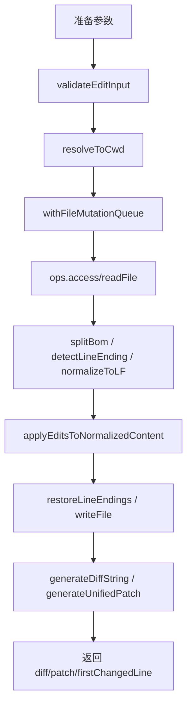

图表来源
- [edit.ts:100-138](https://github.com/FDE-GROUP/oh-my-fde/blob/main/packages/coding-agent/src/core/tools/edit.ts#L100-L138)
- [edit.ts:140-212](https://github.com/FDE-GROUP/oh-my-fde/blob/main/packages/coding-agent/src/core/tools/edit.ts#L140-L212)

章节来源
- [edit.ts:1-218](https://github.com/FDE-GROUP/oh-my-fde/blob/main/packages/coding-agent/src/core/tools/edit.ts#L1-L218)
- [12-tools.md:116-164](https://github.com/FDE-GROUP/oh-my-fde/blob/main/docs/explains/12-tools.md#L116-L164)

#### bash/powershell：命令执行
- 参数：command、timeout（秒）。
- 执行：shell 配置来自 settings；Unix detached=true，Windows 不 detached；waitForChildProcess 避免被继承 stdio 卡住；信号杀死时 exitCode=128+signal。
- 环境：默认暴露 PI_SESSION_ID、PI_SESSION_FILE、PI_PROVIDER、PI_MODEL、PI_REASONING_LEVEL；可通过 exposeSessionEnvironment=false 关闭；spawnHook 可改写 command/cwd/env。
- 输出：OutputAccumulator 边流式接收边维护滚动窗口；超过限制打开临时文件保存完整输出；节流推送 onUpdate；超时区分 shell 本身超时与后台进程仍在写输出；非零退出码 isError=true。
- 结构化输出：{output, truncated, full_output_path?, exit_code, wall_time_seconds}。

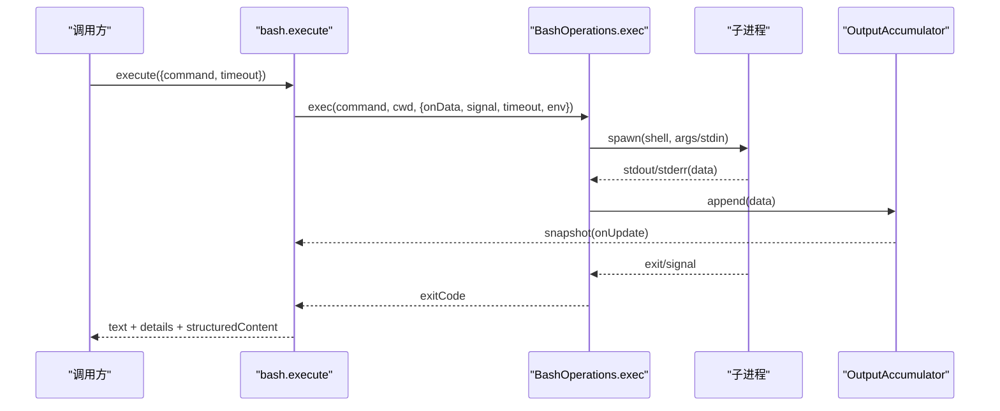

图表来源
- [bash.ts:109-194](https://github.com/FDE-GROUP/oh-my-fde/blob/main/packages/coding-agent/src/core/tools/bash.ts#L109-L194)
- [bash.ts:271-448](https://github.com/FDE-GROUP/oh-my-fde/blob/main/packages/coding-agent/src/core/tools/bash.ts#L271-L448)

章节来源
- [bash.ts:1-477](https://github.com/FDE-GROUP/oh-my-fde/blob/main/packages/coding-agent/src/core/tools/bash.ts#L1-L477)
- [12-tools.md:165-213](https://github.com/FDE-GROUP/oh-my-fde/blob/main/docs/explains/12-tools.md#L165-L213)

#### grep：正则搜索
- 调用 ripgrep，禁用配置文件，JSON 事件解析，路径相对搜索目录，每行截断至 500 字符，命中上限默认 100，字节上限 50KB，abort 时杀掉 rg。

章节来源
- [12-tools.md:214-231](https://github.com/FDE-GROUP/oh-my-fde/blob/main/docs/explains/12-tools.md#L214-L231)

#### find：文件查找
- 调用 fd，git-aware 行为，含 `/` 的 pattern 加 --full-path，Windows 斜杠替换，结果相对搜索根目录，分隔符统一为 `/，limit+1 区分“正好 N 个”和“超过 N 个”。

章节来源
- [12-tools.md:233-253](https://github.com/FDE-GROUP/oh-my-fde/blob/main/docs/explains/12-tools.md#L233-L253)

#### ls：目录列表
- 默认 limit 500，最小 1；大小写不敏感字母序；目录加 `/`；包含 dotfiles；跳过无法 stat 的条目；仅字节截断。

章节来源
- [12-tools.md:255-263](https://github.com/FDE-GROUP/oh-my-fde/blob/main/docs/explains/12-tools.md#L255-L263)

### OutputAccumulator 流式输出
- 流式解码 Buffer，维护 tailText，超过 2*maxBytes 时 trim；统计 totalLines/totalBytes/currentLineBytes；超过限制时把原始 chunk 写入临时文件；trimTail 跳过 UTF-8 续字节；readFullOutput 返回“头部 + 省略标记 + 尾部”。

章节来源
- [12-tools.md:264-278](https://github.com/FDE-GROUP/oh-my-fde/blob/main/docs/explains/12-tools.md#L264-L278)

## 依赖关系分析
- 工具定义与运行时解耦：所有工具通过 ToolDefinition 暴露元数据，再由 wrapToolDefinition 适配为 AgentTool。
- Operations 抽象：read、write、edit、bash、grep、find、ls 各自定义 Operations 接口，便于替换为远程实现。
- 公共模块：path-utils、truncate、file-mutation-queue 被多个工具复用。

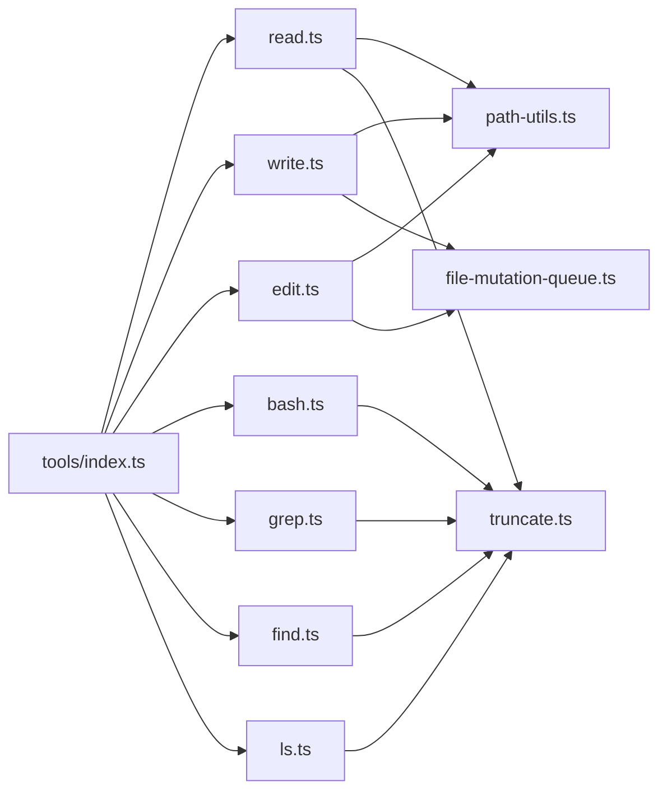

图表来源
- [index.ts:1-225](https://github.com/FDE-GROUP/oh-my-fde/blob/main/packages/coding-agent/src/core/tools/index.ts#L1-L225)
- [read.ts:1-363](https://github.com/FDE-GROUP/oh-my-fde/blob/main/packages/coding-agent/src/core/tools/read.ts#L1-L363)
- [write.ts:1-97](https://github.com/FDE-GROUP/oh-my-fde/blob/main/packages/coding-agent/src/core/tools/write.ts#L1-L97)
- [edit.ts:1-218](https://github.com/FDE-GROUP/oh-my-fde/blob/main/packages/coding-agent/src/core/tools/edit.ts#L1-L218)
- [bash.ts:1-477](https://github.com/FDE-GROUP/oh-my-fde/blob/main/packages/coding-agent/src/core/tools/bash.ts#L1-L477)
- [path-utils.ts:1-118](https://github.com/FDE-GROUP/oh-my-fde/blob/main/packages/coding-agent/src/core/tools/path-utils.ts#L1-L118)
- [truncate.ts:1-303](https://github.com/FDE-GROUP/oh-my-fde/blob/main/packages/coding-agent/src/core/tools/truncate.ts#L1-L303)
- [file-mutation-queue.ts:1-62](https://github.com/FDE-GROUP/oh-my-fde/blob/main/packages/coding-agent/src/core/tools/file-mutation-queue.ts#L1-L62)

章节来源
- [index.ts:1-225](https://github.com/FDE-GROUP/oh-my-fde/blob/main/packages/coding-agent/src/core/tools/index.ts#L1-L225)

## 性能与容量控制
- 输出截断：read/grep/find/ls 使用 truncateHead；bash 使用 truncateTail；grep 单行使用 truncateLine。
- 流式读取：read 优先使用 createReadStream，仅保留需要显示的行，降低内存占用。
- 输出节流：bash 的 onUpdate 节流推送，避免 UI 频繁刷新。
- 临时文件：当输出超限时，OutputAccumulator 将完整输出落盘，避免内存膨胀。
- 并发控制：不同文件写操作并行，同一文件串行，减少竞争与覆盖风险。

章节来源
- [truncate.ts:1-303](https://github.com/FDE-GROUP/oh-my-fde/blob/main/packages/coding-agent/src/core/tools/truncate.ts#L1-L303)
- [read.ts:141-226](https://github.com/FDE-GROUP/oh-my-fde/blob/main/packages/coding-agent/src/core/tools/read.ts#L141-L226)
- [bash.ts:304-364](https://github.com/FDE-GROUP/oh-my-fde/blob/main/packages/coding-agent/src/core/tools/bash.ts#L304-L364)
- [file-mutation-queue.ts:28-61](https://github.com/FDE-GROUP/oh-my-fde/blob/main/packages/coding-agent/src/core/tools/file-mutation-queue.ts#L28-L61)

## 安全、权限与沙箱
- 路径解析不限制 cwd：resolveToCwd 只做解析，不检查是否在 cwd 内；这是当前权限层缺失的直接体现。
- 读路径兼容增强：resolveReadPath 系列仅用于读，且针对 macOS 文件名差异做兼容，但不改变权限语义。
- 环境变量暴露：bash 默认暴露 PI_* 会话变量，可通过 exposeSessionEnvironment=false 关闭。
- 命令执行隔离：Unix 上 detached=true，killProcessTree 确保进程树清理；Windows 因无法获取子进程而不 detached。
- 建议
  - 在扩展层增加路径白名单或 chroot 策略，限制工具只能访问指定目录。
  - 对 bash/powershell 启用最小权限 shell 账户，限制网络与敏感命令。
  - 对 write/edit 增加二次确认或审计日志。
  - 对远程 Operations 实现进行资源配额与超时控制。

章节来源
- [12-tools.md:34-44](https://github.com/FDE-GROUP/oh-my-fde/blob/main/docs/explains/12-tools.md#L34-L44)
- [12-tools.md:177-190](https://github.com/FDE-GROUP/oh-my-fde/blob/main/docs/explains/12-tools.md#L177-L190)
- [bash.ts:109-194](https://github.com/FDE-GROUP/oh-my-fde/blob/main/packages/coding-agent/src/core/tools/bash.ts#L109-L194)
- [path-utils.ts:44-118](https://github.com/FDE-GROUP/oh-my-fde/blob/main/packages/coding-agent/src/core/tools/path-utils.ts#L44-L118)

## 自定义工具开发指南
- 定义工具
  - 编写 ToolDefinition：声明 name、label、description、parameters（TypeBox）、outputSchema、promptSnippet、promptGuidelines、renderers、execute。
  - 如需强类型参数：使用 TypeBoxAgentTool 包装。
  - 将 ToolDefinition 转换为 AgentTool：wrapToolDefinition。
- 注册工具
  - 静态注册：通过 index.ts 的 createTool/createToolDefinition 或 createAllTools 加入工具集。
  - 动态注册：在扩展中调用 registerTool，会话绑定后生效。
- 替换后端
  - 提供自定义 Operations：如 ReadOperations、WriteOperations、EditOperations、BashOperations 等，以支持远程执行或测试替身。
- 示例参考
  - 动态工具注册与 sourceInfo 元数据：见测试用例。

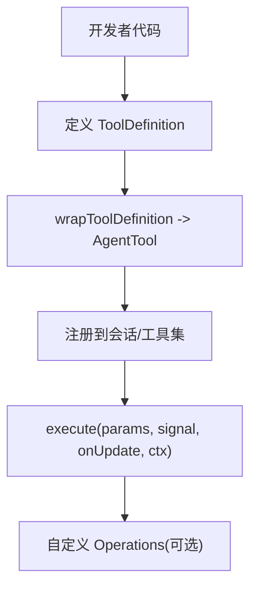

图表来源
- [tool-definition-wrapper.ts:27-49](https://github.com/FDE-GROUP/oh-my-fde/blob/main/packages/coding-agent/src/core/tools/tool-definition-wrapper.ts#L27-L49)
- [agent-session-dynamic-tools.test.ts:99-166](https://github.com/FDE-GROUP/oh-my-fde/blob/main/packages/coding-agent/test/agent-session-dynamic-tools.test.ts#L99-L166)

章节来源
- [tool-definition-wrapper.ts:1-78](https://github.com/FDE-GROUP/oh-my-fde/blob/main/packages/coding-agent/src/core/tools/tool-definition-wrapper.ts#L1-L78)
- [agent-session-dynamic-tools.test.ts:99-166](https://github.com/FDE-GROUP/oh-my-fde/blob/main/packages/coding-agent/test/agent-session-dynamic-tools.test.ts#L99-L166)

## 调用流程、错误处理与结果格式化
- 调用流程
  - 调用方通过会话获取 AgentTool，调用 execute。
  - wrapToolDefinition 注入 ExtensionContext，转发到 ToolDefinition.execute。
  - 工具内部根据类型调用 Operations，最终返回 AgentToolResult。
- 错误处理
  - read：abort 抛错；offset 越界抛错；图片处理失败返回文本提示。
  - write/edit：abort 检查放在 await 之后，避免提前释放队列；文件不可访问抛错。
  - bash：aborted/timeout 分别处理；shell 被信号杀死时 exitCode=128+signal；非零退出码 isError=true。
- 结果格式化
  - read：text 或 image block；structuredContent 对应。
  - bash：text + details(truncation/fullOutputPath) + structuredContent(output/truncated/full_output_path/exit_code/wall_time_seconds)。
  - edit：text + details(diff/patch/firstChangedLine)。
  - write：text 成功消息。

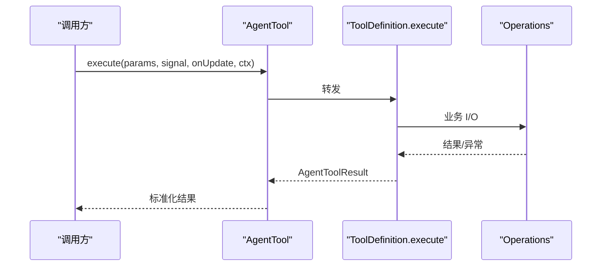

图表来源
- [tool-definition-wrapper.ts:27-49](https://github.com/FDE-GROUP/oh-my-fde/blob/main/packages/coding-agent/src/core/tools/tool-definition-wrapper.ts#L27-L49)
- [read.ts:244-357](https://github.com/FDE-GROUP/oh-my-fde/blob/main/packages/coding-agent/src/core/tools/read.ts#L244-L357)
- [write.ts:57-91](https://github.com/FDE-GROUP/oh-my-fde/blob/main/packages/coding-agent/src/core/tools/write.ts#L57-L91)
- [edit.ts:156-212](https://github.com/FDE-GROUP/oh-my-fde/blob/main/packages/coding-agent/src/core/tools/edit.ts#L156-L212)
- [bash.ts:289-448](https://github.com/FDE-GROUP/oh-my-fde/blob/main/packages/coding-agent/src/core/tools/bash.ts#L289-L448)

章节来源
- [read.ts:244-357](https://github.com/FDE-GROUP/oh-my-fde/blob/main/packages/coding-agent/src/core/tools/read.ts#L244-L357)
- [write.ts:57-91](https://github.com/FDE-GROUP/oh-my-fde/blob/main/packages/coding-agent/src/core/tools/write.ts#L57-L91)
- [edit.ts:156-212](https://github.com/FDE-GROUP/oh-my-fde/blob/main/packages/coding-agent/src/core/tools/edit.ts#L156-L212)
- [bash.ts:289-448](https://github.com/FDE-GROUP/oh-my-fde/blob/main/packages/coding-agent/src/core/tools/bash.ts#L289-L448)

## 故障排查
- 路径问题
  - 现象：macOS 截图路径找不到。
  - 原因：文件名包含 AM/PM 窄空格、NFD 或弯引号。
  - 解决：使用 resolveReadPath/resolveReadPathAsync，它们会尝试多种变体。
- 大文件读取
  - 现象：read 输出被截断。
  - 原因：超出 DEFAULT_MAX_LINES 或 DEFAULT_MAX_BYTES。
  - 解决：使用 offset/limit 分页读取；首行超长时使用 bash sed 方案。
- 命令执行超时
  - 现象：bash 报超时。
  - 原因：命令本身超时或 shell 已退出但后台进程仍在写输出。
  - 解决：调整 timeout；检查后台进程；查看 ShellTimeoutError.shellExit 信息。
- 写冲突
  - 现象：并发写导致覆盖。
  - 原因：未使用 withFileMutationQueue。
  - 解决：确保 write/edit 都包裹在该队列中。
- 环境变量泄露
  - 现象：bash 暴露了 PI_* 变量。
  - 原因：exposeSessionEnvironment=true。
  - 解决：设置为 false 或在 spawnHook 中移除。

章节来源
- [path-utils.ts:52-118](https://github.com/FDE-GROUP/oh-my-fde/blob/main/packages/coding-agent/src/core/tools/path-utils.ts#L52-L118)
- [read.ts:317-341](https://github.com/FDE-GROUP/oh-my-fde/blob/main/packages/coding-agent/src/core/tools/read.ts#L317-L341)
- [bash.ts:100-107](https://github.com/FDE-GROUP/oh-my-fde/blob/main/packages/coding-agent/src/core/tools/bash.ts#L100-L107)
- [bash.ts:399-416](https://github.com/FDE-GROUP/oh-my-fde/blob/main/packages/coding-agent/src/core/tools/bash.ts#L399-L416)
- [file-mutation-queue.ts:28-61](https://github.com/FDE-GROUP/oh-my-fde/blob/main/packages/coding-agent/src/core/tools/file-mutation-queue.ts#L28-L61)
- [bash.ts:221-239](https://github.com/FDE-GROUP/oh-my-fde/blob/main/packages/coding-agent/src/core/tools/bash.ts#L221-L239)

## 结论
工具系统通过“定义 + 包装 + Operations”的分层设计，实现了高内聚、低耦合的可插拔工具生态。内置工具覆盖了读写、编辑、搜索、查找与命令执行等常见场景，并提供完善的截断、流式输出、并发控制与错误处理。当前路径解析未实现沙箱，建议在扩展层补充访问控制与环境隔离。对于自定义工具，遵循 ToolDefinition 规范并通过 wrapToolDefinition 接入运行时，即可无缝融入现有生态。