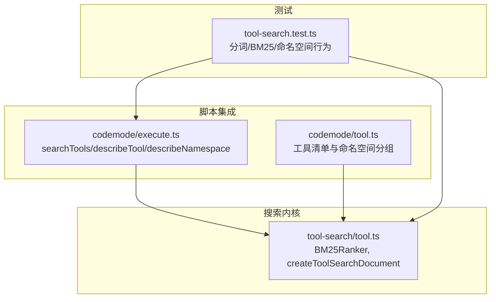
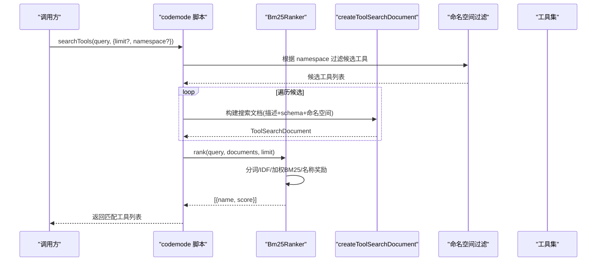
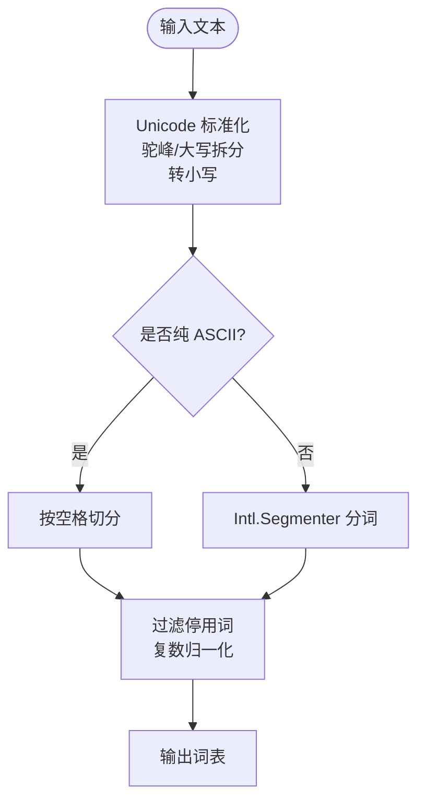
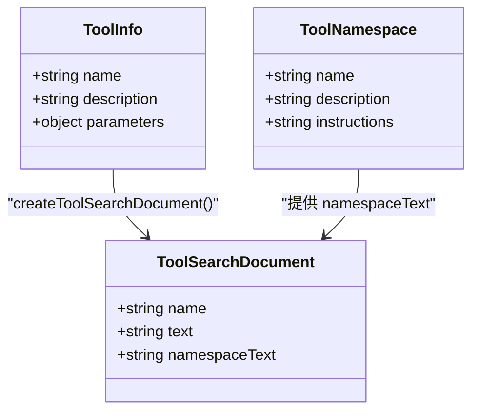
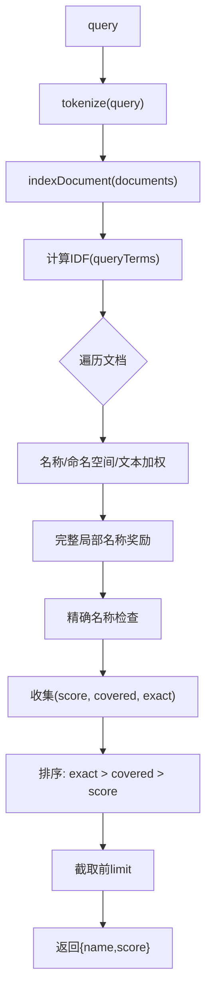
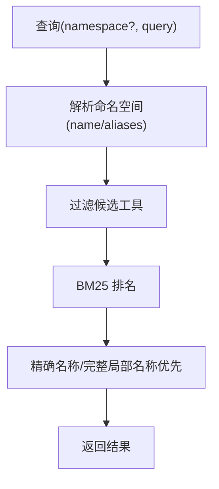
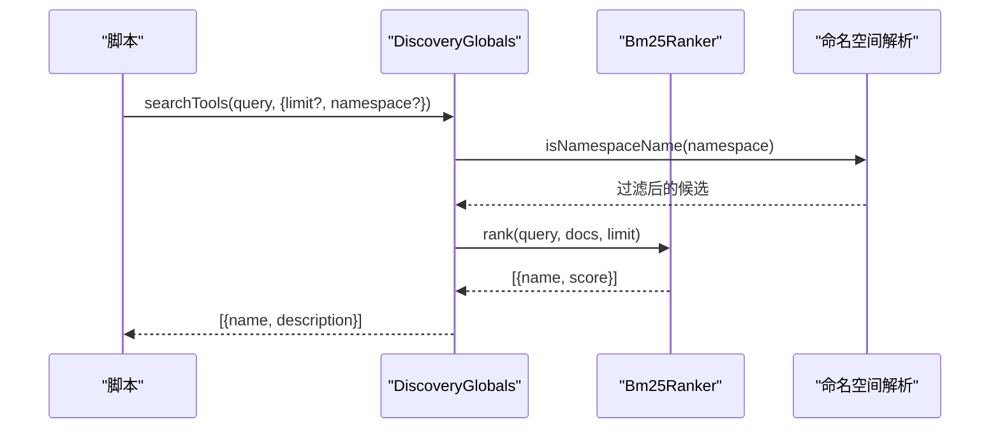
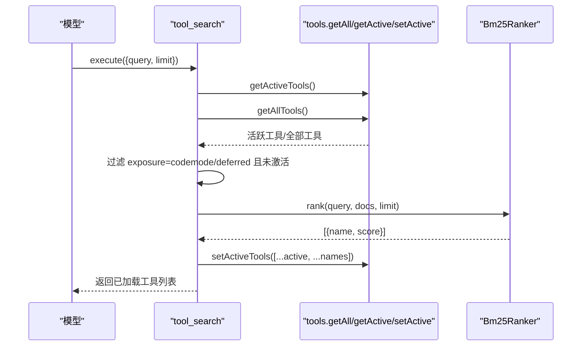
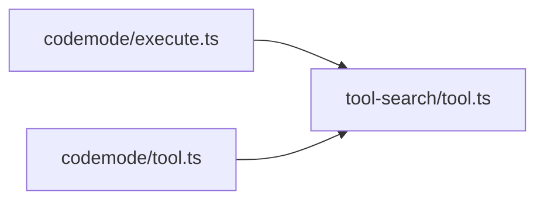

# 工具搜索扩展

**本文引用的文件**   
- [tool-search/tool.ts](https://github.com/FDE-GROUP/oh-my-fde/blob/main/packages/coding-agent/src/extensions/tool-search/tool.ts)
- [codemode/execute.ts](https://github.com/FDE-GROUP/oh-my-fde/blob/main/packages/coding-agent/src/extensions/codemode/execute.ts)
- [codemode/tool.ts](https://github.com/FDE-GROUP/oh-my-fde/blob/main/packages/coding-agent/src/extensions/codemode/tool.ts)
- [tool-search.test.ts](https://github.com/FDE-GROUP/oh-my-fde/blob/main/packages/coding-agent/test/tool-search.test.ts)

## 目录
1. [简介](#简介)
2. [项目结构](#项目结构)
3. [核心组件](#核心组件)
4. [架构总览](#架构总览)
5. [详细组件分析](#详细组件分析)
6. [依赖关系分析](#依赖关系分析)
7. [性能与缓存建议](#性能与缓存建议)
8. [故障排查指南](#故障排查指南)
9. [结论](#结论)

## 简介
本文件面向“工具搜索扩展”，系统性说明如何发现、筛选和排序可用工具，包括：
- 工具描述匹配：基于 BM25 的文本相关性打分。
- 命名空间过滤：按服务器或逻辑分组（如 MCP 服务）缩小搜索范围。
- 优先级排序：名称精确匹配优先、局部名称覆盖加分、多词覆盖数优先。
- 查询语法与结果过滤：支持自然语言、Unicode 分词、停用词过滤、复数归一化等。
- 扩展点：自定义排名器、文档构建器、命名空间解析与脚本级搜索 API。
- 性能调优与缓存策略：索引预构建、批量检索、限制返回数量、避免重复计算。

该能力由两部分组成：
- 通用搜索内核：BM25 排名器、分词、文档构建、命名空间权重。
- 使用层：在 codemode 脚本中暴露 `searchTools` / `describeTool` / `describeNamespace`，以及独立的 `tool_search` 工具用于为模型动态加载未声明的工具。

## 项目结构
围绕工具搜索的关键代码集中在 coding-agent 包的 extensions 目录：
- 搜索内核：`packages/coding-agent/src/extensions/tool-search/tool.ts`
- 脚本侧搜索 API：`packages/coding-agent/src/extensions/codemode/execute.ts`
- 工具清单与命名空间展示：`packages/coding-agent/src/extensions/codemode/tool.ts`
- 行为验证用例：`packages/coding-agent/test/tool-search.test.ts`

**图表来源**
- [tool-search/tool.ts:1-338](https://github.com/FDE-GROUP/oh-my-fde/blob/main/packages/coding-agent/src/extensions/tool-search/tool.ts#L1-L338)
- [codemode/execute.ts:650-735](https://github.com/FDE-GROUP/oh-my-fde/blob/main/packages/coding-agent/src/extensions/codemode/execute.ts#L650-L735)
- [codemode/tool.ts:179-270](https://github.com/FDE-GROUP/oh-my-fde/blob/main/packages/coding-agent/src/extensions/codemode/tool.ts#L179-L270)
- [tool-search.test.ts:1-258](https://github.com/FDE-GROUP/oh-my-fde/blob/main/packages/coding-agent/test/tool-search.test.ts#L1-L258)

**章节来源**
- [tool-search/tool.ts:1-338](https://github.com/FDE-GROUP/oh-my-fde/blob/main/packages/coding-agent/src/extensions/tool-search/tool.ts#L1-L338)
- [codemode/execute.ts:650-735](https://github.com/FDE-GROUP/oh-my-fde/blob/main/packages/coding-agent/src/extensions/codemode/execute.ts#L650-L735)
- [codemode/tool.ts:179-270](https://github.com/FDE-GROUP/oh-my-fde/blob/main/packages/coding-agent/src/extensions/codemode/tool.ts#L179-L270)
- [tool-search.test.ts:1-258](https://github.com/FDE-GROUP/oh-my-fde/blob/main/packages/coding-agent/test/tool-search.test.ts#L1-L258)

## 核心组件
- 分词器 tokenize：处理 Unicode、驼峰/下划线分割、停用词、简单复数归一化。
- 文档构建器 createToolSearchDocument：聚合工具名、描述、参数 schema 描述与属性名，以及命名空间信息。
- 排名器 Bm25Ranker：实现 Okapi BM25，并对名称字段、命名空间字段进行加权；对“完整局部名称”和“精确名称”给予额外奖励。
- 脚本搜索 API：searchTools、describeTool、describeNamespace，封装在 codemode 执行环境中。
- tool_search 工具：对外暴露给模型，搜索并激活尚未声明的工具（codemode/deferred）。

**章节来源**
- [tool-search/tool.ts:42-92](https://github.com/FDE-GROUP/oh-my-fde/blob/main/packages/coding-agent/src/extensions/tool-search/tool.ts#L42-L92)
- [tool-search/tool.ts:98-129](https://github.com/FDE-GROUP/oh-my-fde/blob/main/packages/coding-agent/src/extensions/tool-search/tool.ts#L98-L129)
- [tool-search/tool.ts:174-250](https://github.com/FDE-GROUP/oh-my-fde/blob/main/packages/coding-agent/src/extensions/tool-search/tool.ts#L174-L250)
- [codemode/execute.ts:669-735](https://github.com/FDE-GROUP/oh-my-fde/blob/main/packages/coding-agent/src/extensions/codemode/execute.ts#L669-L735)
- [tool-search/tool.ts:252-337](https://github.com/FDE-GROUP/oh-my-fde/blob/main/packages/coding-agent/src/extensions/tool-search/tool.ts#L252-L337)

## 架构总览
工具搜索的整体流程如下：
- 输入：用户或模型的查询字符串，可选 limit 与 namespace。
- 预处理：分词、去停用词、复数归一化；将工具元数据转换为可搜索文档。
- 过滤：按命名空间过滤候选工具集合。
- 评分：BM25 计算相关性分数，叠加名称权重、命名空间权重、完整局部名称奖励、精确名称奖励。
- 排序与截断：先按是否精确名称、再按覆盖词数、最后按分数排序，取前 limit 条。
- 输出：返回工具名与分数；若通过 tool_search 调用，则激活匹配工具供下一次模型调用使用。

**图表来源**
- [codemode/execute.ts:669-735](https://github.com/FDE-GROUP/oh-my-fde/blob/main/packages/coding-agent/src/extensions/codemode/execute.ts#L669-L735)
- [tool-search/tool.ts:119-129](https://github.com/FDE-GROUP/oh-my-fde/blob/main/packages/coding-agent/src/extensions/tool-search/tool.ts#L119-L129)
- [tool-search/tool.ts:201-250](https://github.com/FDE-GROUP/oh-my-fde/blob/main/packages/coding-agent/src/extensions/tool-search/tool.ts#L201-L250)

## 详细组件分析

### 分词与文本规范化
- 功能要点：
  - Unicode 标准化（NFC），驼峰/大写字段拆分，非字母数字字符替换为空格。
  - 英文停用词过滤，简单复数归一化（如 issues→issue）。
  - 对纯 ASCII 走快速 split，其他语言走 Intl.Segmenter 分词。
- 复杂度：
  - 单次分词 O(n)，n 为输入长度；Intl.Segmenter 仅用于非 ASCII 路径。
- 边界情况：
  - 空查询、标点与表情符号被忽略。
  - 多语言混合标识符正确拆分。

**图表来源**
- [tool-search/tool.ts:42-92](https://github.com/FDE-GROUP/oh-my-fde/blob/main/packages/coding-agent/src/extensions/tool-search/tool.ts#L42-L92)

**章节来源**
- [tool-search/tool.ts:42-92](https://github.com/FDE-GROUP/oh-my-fde/blob/main/packages/coding-agent/src/extensions/tool-search/tool.ts#L42-L92)
- [tool-search.test.ts:18-57](https://github.com/FDE-GROUP/oh-my-fde/blob/main/packages/coding-agent/test/tool-search.test.ts#L18-L57)

### 搜索文档构建
- 功能要点：
  - 聚合工具 description、schema 的 description 与属性名、递归 anyOf/oneOf/allOf。
  - 可选命名空间 name/description/instructions 合并为 namespaceText。
- 设计动机：
  - 让参数描述与属性名也参与搜索，提高语义召回率。
  - 命名空间作为独立字段，帮助定位服务器或逻辑组。

**图表来源**
- [tool-search/tool.ts:23-30](https://github.com/FDE-GROUP/oh-my-fde/blob/main/packages/coding-agent/src/extensions/tool-search/tool.ts#L23-L30)
- [tool-search/tool.ts:98-129](https://github.com/FDE-GROUP/oh-my-fde/blob/main/packages/coding-agent/src/extensions/tool-search/tool.ts#L98-L129)

**章节来源**
- [tool-search/tool.ts:98-129](https://github.com/FDE-GROUP/oh-my-fde/blob/main/packages/coding-agent/src/extensions/tool-search/tool.ts#L98-L129)

### BM25 排名算法
- 关键机制：
  - IDF 基于 query terms 在所有文档中的出现频率计算。
  - 名称字段权重 NAME_WEIGHT=3，命名空间字段权重 NAMESPACE_WEIGHT=0.5。
  - 完整局部名称（如 app 在 mcp__peekaboo__app）获得额外奖励，等于所有 query term IDF 之和。
  - 精确名称查询（全名或 __ 后缀）直接置顶。
  - 最终排序：exact > covered > score，covered 表示覆盖了多少个 query terms。
- 复杂度：
  - 对每个文档遍历 query terms，O(D × T)，D 为文档数，T 为词项数。
  - IDF 预计算一次，平均长度一次性统计。

**图表来源**
- [tool-search/tool.ts:174-250](https://github.com/FDE-GROUP/oh-my-fde/blob/main/packages/coding-agent/src/extensions/tool-search/tool.ts#L174-L250)

**章节来源**
- [tool-search/tool.ts:174-250](https://github.com/FDE-GROUP/oh-my-fde/blob/main/packages/coding-agent/src/extensions/tool-search/tool.ts#L174-L250)
- [tool-search.test.ts:59-196](https://github.com/FDE-GROUP/oh-my-fde/blob/main/packages/coding-agent/test/tool-search.test.ts#L59-L196)

### 命名空间过滤与优先级
- 过滤规则：
  - 通过 isNamespaceName 匹配命名空间的 name 与 aliases，同时兼容脚本标识符写法（如 dev-radius ↔ dev_radius）。
  - 若指定 namespace，仅保留属于该命名空间的工具。
- 优先级体现：
  - 名称精确匹配优先于描述提及。
  - 完整局部名称覆盖多个 query terms 时，即使分数不高也能胜出。
  - 命名空间权重较低，适合定位服务器而非具体工具。

**图表来源**
- [codemode/execute.ts:658-663](https://github.com/FDE-GROUP/oh-my-fde/blob/main/packages/coding-agent/src/extensions/codemode/execute.ts#L658-L663)
- [codemode/execute.ts:691-696](https://github.com/FDE-GROUP/oh-my-fde/blob/main/packages/coding-agent/src/extensions/codemode/execute.ts#L691-L696)
- [tool-search/tool.ts:131-146](https://github.com/FDE-GROUP/oh-my-fde/blob/main/packages/coding-agent/src/extensions/tool-search/tool.ts#L131-L146)

**章节来源**
- [codemode/execute.ts:658-663](https://github.com/FDE-GROUP/oh-my-fde/blob/main/packages/coding-agent/src/extensions/codemode/execute.ts#L658-L663)
- [codemode/execute.ts:691-696](https://github.com/FDE-GROUP/oh-my-fde/blob/main/packages/coding-agent/src/extensions/codemode/execute.ts#L691-L696)
- [tool-search/tool.ts:131-146](https://github.com/FDE-GROUP/oh-my-fde/blob/main/packages/coding-agent/src/extensions/tool-search/tool.ts#L131-L146)

### 脚本级搜索 API
- searchTools(query, {limit?, namespace?})：
  - 校验参数类型与取值范围。
  - 按命名空间过滤后构建文档并排名。
  - 返回 {name, description}[]。
- describeTool(name)：
  - 按工具名或脚本标识符查找，返回样本声明或 undefined。
- describeNamespace(name)：
  - 按命名空间名或别名查找，返回 {name, description?, instructions?, tools[]}。

**图表来源**
- [codemode/execute.ts:669-735](https://github.com/FDE-GROUP/oh-my-fde/blob/main/packages/coding-agent/src/extensions/codemode/execute.ts#L669-L735)

**章节来源**
- [codemode/execute.ts:669-735](https://github.com/FDE-GROUP/oh-my-fde/blob/main/packages/coding-agent/src/extensions/codemode/execute.ts#L669-L735)

### tool_search 工具（模型侧动态加载）
- 作用：
  - 搜索尚未向模型声明的工具（exposure 为 codemode 或 deferred）。
  - 将匹配到的工具加入 active set，使下一次模型调用可见。
  - 记录到会话转录，分支恢复与 fork 后仍保持已加载状态。
- 输入输出：
  - 输入：{query, limit?}，默认 limit 为 DEFAULT_TOOL_SEARCH_LIMIT。
  - 输出：文本提示已加载工具及其描述，details.loaded 包含工具名列表。

**图表来源**
- [tool-search/tool.ts:279-302](https://github.com/FDE-GROUP/oh-my-fde/blob/main/packages/coding-agent/src/extensions/tool-search/tool.ts#L279-L302)
- [tool-search/tool.ts:310-337](https://github.com/FDE-GROUP/oh-my-fde/blob/main/packages/coding-agent/src/extensions/tool-search/tool.ts#L310-L337)

**章节来源**
- [tool-search/tool.ts:279-302](https://github.com/FDE-GROUP/oh-my-fde/blob/main/packages/coding-agent/src/extensions/tool-search/tool.ts#L279-L302)
- [tool-search/tool.ts:310-337](https://github.com/FDE-GROUP/oh-my-fde/blob/main/packages/coding-agent/src/extensions/tool-search/tool.ts#L310-L337)

## 依赖关系分析
- 模块耦合：
  - codemode/execute.ts 依赖 tool-search/tool.ts 的 Bm25Ranker 与 createToolSearchDocument。
  - codemode/tool.ts 负责工具清单与命名空间分组，间接影响搜索上下文。
- 外部依赖：
  - typebox 用于 schema 描述提取。
  - Intl.Segmenter 用于非 ASCII 分词。
- 潜在循环依赖：
  - 当前搜索内核不反向依赖执行层，无循环。

**图表来源**
- [codemode/execute.ts:669-735](https://github.com/FDE-GROUP/oh-my-fde/blob/main/packages/coding-agent/src/extensions/codemode/execute.ts#L669-L735)
- [codemode/tool.ts:179-270](https://github.com/FDE-GROUP/oh-my-fde/blob/main/packages/coding-agent/src/extensions/codemode/tool.ts#L179-L270)
- [tool-search/tool.ts:1-338](https://github.com/FDE-GROUP/oh-my-fde/blob/main/packages/coding-agent/src/extensions/tool-search/tool.ts#L1-L338)

**章节来源**
- [codemode/execute.ts:669-735](https://github.com/FDE-GROUP/oh-my-fde/blob/main/packages/coding-agent/src/extensions/codemode/execute.ts#L669-L735)
- [codemode/tool.ts:179-270](https://github.com/FDE-GROUP/oh-my-fde/blob/main/packages/coding-agent/src/extensions/codemode/tool.ts#L179-L270)
- [tool-search/tool.ts:1-338](https://github.com/FDE-GROUP/oh-my-fde/blob/main/packages/coding-agent/src/extensions/tool-search/tool.ts#L1-L338)

## 性能与缓存建议
- 索引预构建：
  - 将 createToolSearchDocument 的结果缓存为 ToolSearchDocument，避免每次查询重复解析 schema 与命名空间。
  - 对频繁使用的命名空间，可维护 namespaceText 的映射表。
- 批量检索：
  - 对同一批次的 searchTools 调用复用 Bm25Ranker 实例，减少 IDF 与平均长度的重复计算。
- 限制返回数量：
  - 合理设置 limit（默认 DEFAULT_TOOL_SEARCH_LIMIT），避免不必要的排序开销。
- 分词优化：
  - 对纯 ASCII 查询走快速 split，避免 Intl.Segmenter 开销。
- 缓存策略：
  - 对静态工具元数据（description、parameters、namespace）做不可变缓存。
  - 对动态工具（如 MCP 连接后新增）增量更新索引。
- 评估与监控：
  - 记录每次搜索的文档数、词项数、耗时与命中数，便于容量规划。

[本节为通用指导，不直接分析具体文件]

## 故障排查指南
- 常见问题与定位：
  - 查询为空或仅停用词：rank 返回空数组。
  - limit 非正整数或类型错误：searchTools 抛出参数错误。
  - namespace 类型错误：searchTools 抛出参数错误。
  - 未知工具名：describeTool 返回 undefined。
  - 命名空间不存在：describeNamespace 返回 undefined。
- 调试建议：
  - 打印 tokenize 结果，确认分词是否符合预期。
  - 检查 createToolSearchDocument 生成的 text 与 namespaceText。
  - 验证命名空间 name/aliases 是否与查询一致（含脚本标识符转换）。
  - 对于 tool_search 未生效，检查工具的 exposure 是否为 codemode 或 deferred，以及是否已被激活。

**章节来源**
- [tool-search/tool.ts:201-250](https://github.com/FDE-GROUP/oh-my-fde/blob/main/packages/coding-agent/src/extensions/tool-search/tool.ts#L201-L250)
- [codemode/execute.ts:680-696](https://github.com/FDE-GROUP/oh-my-fde/blob/main/packages/coding-agent/src/extensions/codemode/execute.ts#L680-L696)
- [tool-search/tool.ts:323-335](https://github.com/FDE-GROUP/oh-my-fde/blob/main/packages/coding-agent/src/extensions/tool-search/tool.ts#L323-L335)

## 结论
工具搜索扩展以 BM25 为核心，结合名称与命名空间加权、完整局部名称奖励与精确名称置顶，实现了高相关性的工具发现。通过脚本级 API 与 model-only 的 tool_search 工具，既支持开发者在 codemode 中灵活组合工具，也允许模型按需发现并加载未声明工具。配合合理的索引缓存、批量检索与 limit 控制，可在大规模工具集上保持低延迟与高可用性。

[本节为总结性内容，不直接分析具体文件]