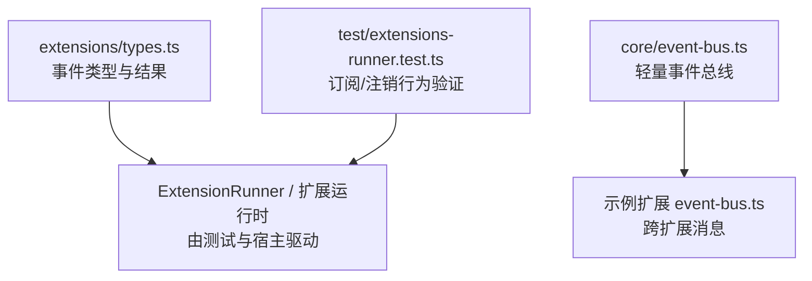
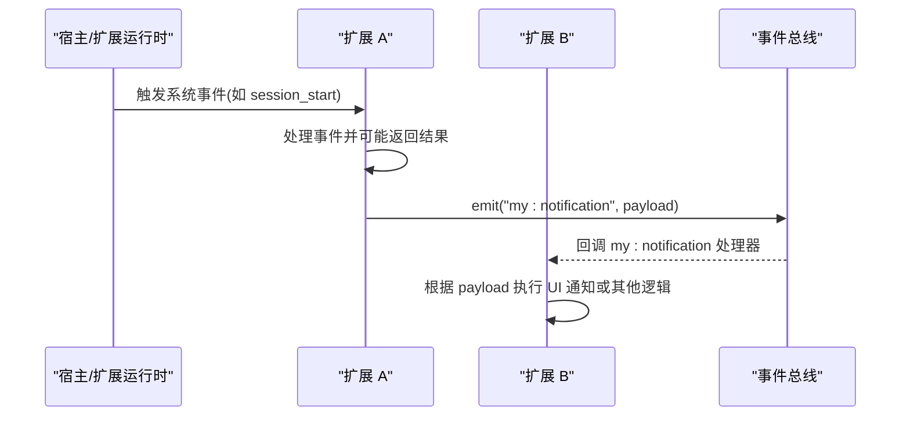
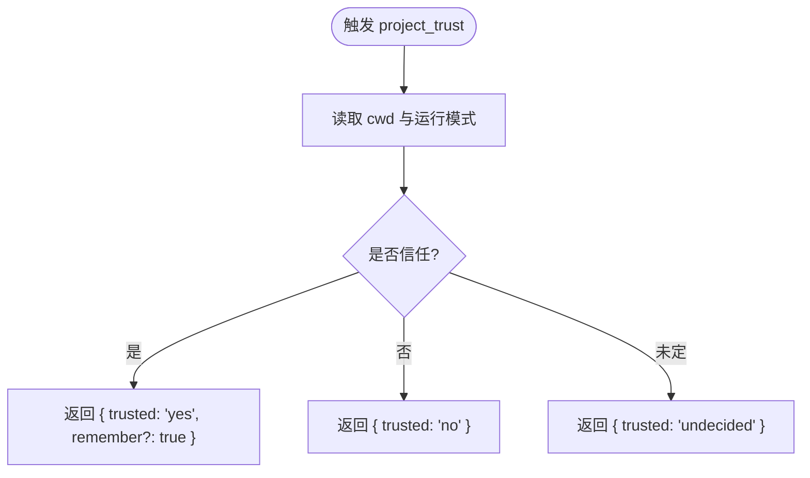
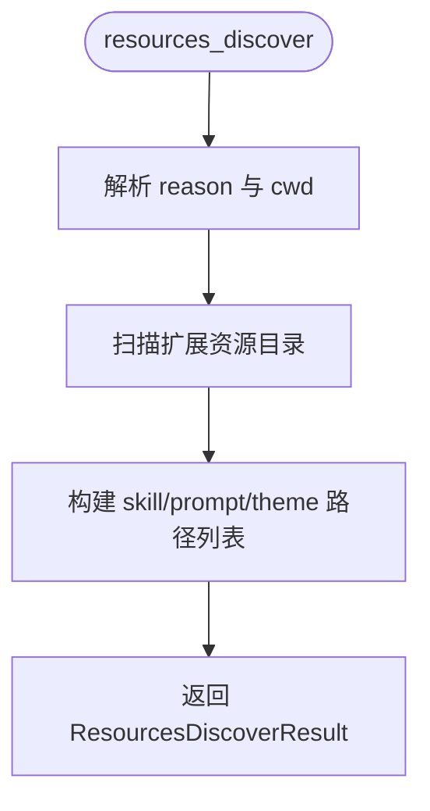
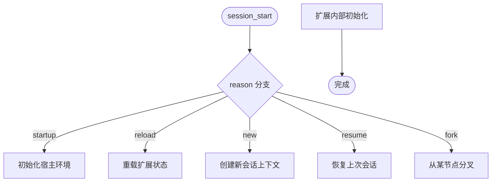
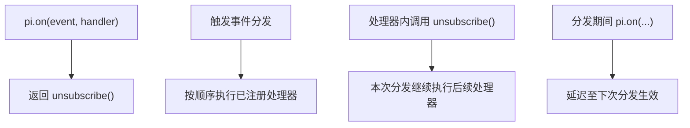
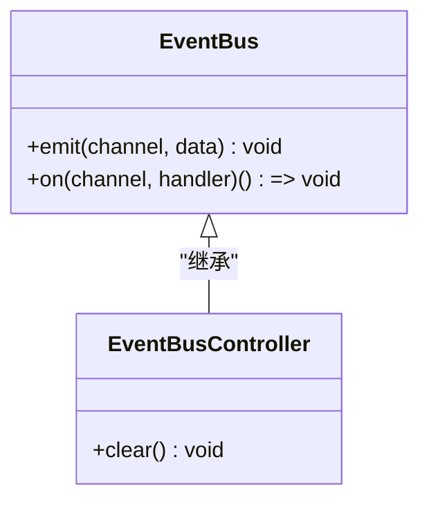
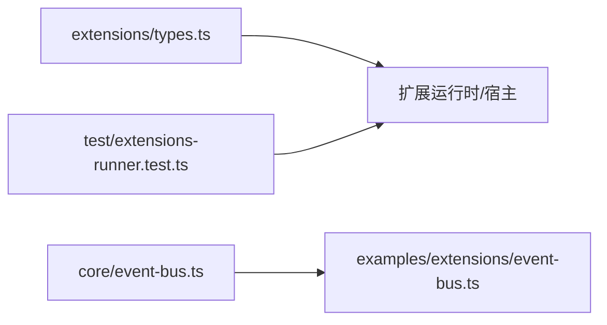

# 事件系统 API

**本文引用的文件**   
- [packages/coding-agent/src/core/extensions/types.ts](https://github.com/FDE-GROUP/oh-my-fde/blob/main/packages/coding-agent/src/core/extensions/types.ts)
- [packages/coding-agent/src/core/event-bus.ts](https://github.com/FDE-GROUP/oh-my-fde/blob/main/packages/coding-agent/src/core/event-bus.ts)
- [packages/coding-agent/examples/extensions/event-bus.ts](https://github.com/FDE-GROUP/oh-my-fde/blob/main/packages/coding-agent/examples/extensions/event-bus.ts)
- [packages/coding-agent/test/extensions-runner.test.ts](https://github.com/FDE-GROUP/oh-my-fde/blob/main/packages/coding-agent/test/extensions-runner.test.ts)

## 目录
1. [简介](#简介)
2. [项目结构](#项目结构)
3. [核心组件](#核心组件)
4. [架构总览](#架构总览)
5. [详细组件分析](#详细组件分析)
6. [依赖关系分析](#依赖关系分析)
7. [性能与最佳实践](#性能与最佳实践)
8. [故障排查指南](#故障排查指南)
9. [结论](#结论)

## 简介
本文件面向扩展开发者，系统化说明 Pi Coding Agent 的事件系统 API。内容覆盖：
- 事件类型定义与数据结构，包括 SessionStartEvent、ProjectTrustEvent、ResourcesDiscoverEvent 等
- 事件监听器的注册与注销机制
- 事件数据传递、错误处理与生命周期行为
- 性能优化建议与常见陷阱
- 通过示例展示如何订阅和处理不同类型的系统事件

## 项目结构
事件系统相关代码主要位于 coding-agent 包中：
- 事件类型与结果类型集中在 extensions/types.ts
- 跨扩展的轻量事件总线在 core/event-bus.ts
- 示例扩展演示了如何在扩展间使用事件总线通信
- 测试用例覆盖了事件订阅/注销语义和分发行为

**图表来源**
- [packages/coding-agent/src/core/extensions/types.ts:716-1457](https://github.com/FDE-GROUP/oh-my-fde/blob/main/packages/coding-agent/src/core/extensions/types.ts#L716-L1457)
- [packages/coding-agent/src/core/event-bus.ts:1-34](https://github.com/FDE-GROUP/oh-my-fde/blob/main/packages/coding-agent/src/core/event-bus.ts#L1-L34)
- [packages/coding-agent/examples/extensions/event-bus.ts:1-44](https://github.com/FDE-GROUP/oh-my-fde/blob/main/packages/coding-agent/examples/extensions/event-bus.ts#L1-L44)
- [packages/coding-agent/test/extensions-runner.test.ts:1281-1400](https://github.com/FDE-GROUP/oh-my-fde/blob/main/packages/coding-agent/test/extensions-runner.test.ts#L1281-L1400)

**章节来源**
- [packages/coding-agent/src/core/extensions/types.ts:716-1457](https://github.com/FDE-GROUP/oh-my-fde/blob/main/packages/coding-agent/src/core/extensions/types.ts#L716-L1457)
- [packages/coding-agent/src/core/event-bus.ts:1-34](https://github.com/FDE-GROUP/oh-my-fde/blob/main/packages/coding-agent/src/core/event-bus.ts#L1-L34)
- [packages/coding-agent/examples/extensions/event-bus.ts:1-44](https://github.com/FDE-GROUP/oh-my-fde/blob/main/packages/coding-agent/examples/extensions/event-bus.ts#L1-L44)
- [packages/coding-agent/test/extensions-runner.test.ts:1281-1400](https://github.com/FDE-GROUP/oh-my-fde/blob/main/packages/coding-agent/test/extensions-runner.test.ts#L1281-L1400)

## 核心组件
- 事件类型体系：所有系统事件的联合类型、事件载荷、以及各事件的结果类型均集中定义。
- 事件总线：提供 channel 级别的 on/emit 能力，用于扩展之间解耦通信。
- 扩展事件钩子：扩展通过 pi.on(eventType, handler) 订阅系统事件；handler 可返回特定结果以影响流程。

关键要点：
- 事件类型以 type 字段区分，便于运行时分发。
- 部分事件支持“可取消”或“可替换”的结果对象，例如会话切换前、分叉前、压缩前、树导航前等。
- 工具调用前后、消息流式更新、模型选择、用户输入等均有对应事件。

**章节来源**
- [packages/coding-agent/src/core/extensions/types.ts:716-1457](https://github.com/FDE-GROUP/oh-my-fde/blob/main/packages/coding-agent/src/core/extensions/types.ts#L716-L1457)

## 架构总览
下图展示了事件系统的整体交互：扩展订阅系统事件，宿主在合适时机触发事件；同时扩展之间可通过事件总线进行异步通信。

**图表来源**
- [packages/coding-agent/examples/extensions/event-bus.ts:16-42](https://github.com/FDE-GROUP/oh-my-fde/blob/main/packages/coding-agent/examples/extensions/event-bus.ts#L16-L42)
- [packages/coding-agent/src/core/event-bus.ts:12-32](https://github.com/FDE-GROUP/oh-my-fde/blob/main/packages/coding-agent/src/core/event-bus.ts#L12-L32)

## 详细组件分析

### 事件类型与数据结构
以下重点说明文档目标中提到的三类事件及其处理方式。

#### ProjectTrustEvent
- 用途：在项目信任决策时触发，允许扩展决定当前工作目录是否可信。
- 载荷：type、cwd。
- 结果：ProjectTrustEventResult，包含 trusted（yes/no/undecided）与可选 remember。
- 上下文：ProjectTrustContext 提供 cwd、mode、hasUI 及受限 UI 方法。
- 典型用法：扩展根据项目特征或用户偏好决定是否信任，并可提示用户确认。

**图表来源**
- [packages/coding-agent/src/core/extensions/types.ts:720-742](https://github.com/FDE-GROUP/oh-my-fde/blob/main/packages/coding-agent/src/core/extensions/types.ts#L720-L742)

**章节来源**
- [packages/coding-agent/src/core/extensions/types.ts:720-742](https://github.com/FDE-GROUP/oh-my-fde/blob/main/packages/coding-agent/src/core/extensions/types.ts#L720-L742)

#### ResourcesDiscoverEvent
- 用途：在 session_start 之后触发，允许扩展提供额外的资源路径（技能、提示词、主题）。
- 载荷：type、cwd、reason（startup/reload）。
- 结果：ResourcesDiscoverResult，包含 skillPaths、promptPaths、themePaths。
- 典型用法：扩展扫描自身目录或配置，返回需要加载的资源路径。

**图表来源**
- [packages/coding-agent/src/core/extensions/types.ts:744-756](https://github.com/FDE-GROUP/oh-my-fde/blob/main/packages/coding-agent/src/core/extensions/types.ts#L744-L756)

**章节来源**
- [packages/coding-agent/src/core/extensions/types.ts:744-756](https://github.com/FDE-GROUP/oh-my-fde/blob/main/packages/coding-agent/src/core/extensions/types.ts#L744-L756)

#### SessionStartEvent
- 用途：会话启动、加载或重载时触发。
- 载荷：type、reason（startup/reload/new/resume/fork）、previousSessionFile（某些场景存在）。
- 典型用法：初始化扩展状态、准备上下文、订阅其他事件、显示欢迎信息等。

**图表来源**
- [packages/coding-agent/src/core/extensions/types.ts:774-781](https://github.com/FDE-GROUP/oh-my-fde/blob/main/packages/coding-agent/src/core/extensions/types.ts#L774-L781)

**章节来源**
- [packages/coding-agent/src/core/extensions/types.ts:774-781](https://github.com/FDE-GROUP/oh-my-fde/blob/main/packages/coding-agent/src/core/extensions/types.ts#L774-L781)

#### 其他重要事件类别概览
- 会话生命周期：SessionInfoChangedEvent、SessionBeforeSwitchEvent、SessionBeforeForkEvent、SessionBeforeCompactEvent、SessionCompactEvent、SessionCompactFailedEvent、SessionShutdownEvent、SessionBeforeTreeEvent、SessionTreeEvent。
- 代理活动：BeforeAgentStartEvent、AgentStartEvent、AgentEndEvent、AgentBeforeSettleEvent、AgentSettledEvent。
- 消息与流：TurnStartEvent、TurnEndEvent、MessageStartEvent、MessageUpdateEvent、MessageEndEvent。
- 工具执行：ToolExecutionStartEvent、ToolExecutionUpdateEvent、ToolExecutionEndEvent。
- 工具调用与结果：ToolCallEvent、ToolResultEvent（含内置工具与自定义工具的细分类型）。
- 模型与思考级别：ModelSelectEvent、ThinkingLevelSelectEvent。
- 用户输入与 Bash：InputEvent、UserBashEvent。
- 提供者交互：BeforeProviderRequestEvent、BeforeProviderHeadersEvent、AfterProviderResponseEvent、ProviderStreamEvent。

这些事件共同构成完整的扩展钩子系统，允许扩展在关键阶段介入、修改或观察行为。

**章节来源**
- [packages/coding-agent/src/core/extensions/types.ts:782-1457](https://github.com/FDE-GROUP/oh-my-fde/blob/main/packages/coding-agent/src/core/extensions/types.ts#L782-L1457)

### 事件监听器注册与注销机制
- 注册：扩展通过 pi.on(eventType, handler) 订阅系统事件。
- 注销：pi.on 返回一个函数，调用该函数可移除对应监听器。
- 行为保证（来自测试）：
  - 自删除不会跳过相邻处理器。
  - 重复注册可独立移除，且最后一个处理器会被正确清理。
  - 在当前分发过程中被移除的监听器仍会在本次分发中执行。
  - 分发期间注册的监听器会延迟到下一次分发生效。
  - 嵌套分发使用独立的处理器列表，避免互相干扰。

**图表来源**
- [packages/coding-agent/test/extensions-runner.test.ts:1281-1400](https://github.com/FDE-GROUP/oh-my-fde/blob/main/packages/coding-agent/test/extensions-runner.test.ts#L1281-L1400)

**章节来源**
- [packages/coding-agent/test/extensions-runner.test.ts:1281-1400](https://github.com/FDE-GROUP/oh-my-fde/blob/main/packages/coding-agent/test/extensions-runner.test.ts#L1281-L1400)

### 扩展间事件总线
- 接口：EventBus 提供 emit(channel, data) 与 on(channel, handler)。
- 控制器：createEventBus() 返回带 clear() 能力的控制器，便于生命周期管理。
- 安全封装：on 返回的注销函数会移除内部包装后的处理器；处理器异常会被捕获并记录日志，避免阻塞其他处理器。
- 示例：event-bus.ts 展示了如何通过命令触发事件，并在另一扩展中接收并显示通知。

**图表来源**
- [packages/coding-agent/src/core/event-bus.ts:3-10](https://github.com/FDE-GROUP/oh-my-fde/blob/main/packages/coding-agent/src/core/event-bus.ts#L3-L10)

**章节来源**
- [packages/coding-agent/src/core/event-bus.ts:1-34](https://github.com/FDE-GROUP/oh-my-fde/blob/main/packages/coding-agent/src/core/event-bus.ts#L1-L34)
- [packages/coding-agent/examples/extensions/event-bus.ts:1-44](https://github.com/FDE-GROUP/oh-my-fde/blob/main/packages/coding-agent/examples/extensions/event-bus.ts#L1-L44)

### 事件数据传递与结果类型
- 事件载荷：每个事件都有明确的 type 字段与结构化载荷，便于类型推断与校验。
- 结果类型：不同事件有对应的结果类型，例如：
  - ContextEventResult：可替换消息列表。
  - ToolCallEventResult：可阻止工具执行或建议终止。
  - ToolResultEventResult：可修改内容、细节、结构化内容与错误标志。
  - MessageEndEventResult：可替换最终消息。
  - BeforeAgentStartEventResult：可替换系统提示或自定义消息。
  - SessionBeforeSwitchResult、SessionBeforeForkResult、SessionBeforeCompactResult、SessionBeforeTreeResult：可取消操作或提供自定义摘要/指令。

这些结果类型使扩展能够在不侵入核心流程的前提下，实现细粒度的控制与增强。

**章节来源**
- [packages/coding-agent/src/core/extensions/types.ts:1463-1549](https://github.com/FDE-GROUP/oh-my-fde/blob/main/packages/coding-agent/src/core/extensions/types.ts#L1463-L1549)

## 依赖关系分析
- types.ts 定义了所有事件类型与结果类型，是扩展开发者的主要契约。
- event-bus.ts 提供轻量通道式事件总线，供扩展间通信。
- 示例扩展 event-bus.ts 演示了如何使用事件总线。
- 测试文件验证了事件订阅/注销语义，确保扩展行为稳定。

**图表来源**
- [packages/coding-agent/src/core/extensions/types.ts:716-1457](https://github.com/FDE-GROUP/oh-my-fde/blob/main/packages/coding-agent/src/core/extensions/types.ts#L716-L1457)
- [packages/coding-agent/src/core/event-bus.ts:1-34](https://github.com/FDE-GROUP/oh-my-fde/blob/main/packages/coding-agent/src/core/event-bus.ts#L1-L34)
- [packages/coding-agent/examples/extensions/event-bus.ts:1-44](https://github.com/FDE-GROUP/oh-my-fde/blob/main/packages/coding-agent/examples/extensions/event-bus.ts#L1-L44)
- [packages/coding-agent/test/extensions-runner.test.ts:1281-1400](https://github.com/FDE-GROUP/oh-my-fde/blob/main/packages/coding-agent/test/extensions-runner.test.ts#L1281-L1400)

**章节来源**
- [packages/coding-agent/src/core/extensions/types.ts:716-1457](https://github.com/FDE-GROUP/oh-my-fde/blob/main/packages/coding-agent/src/core/extensions/types.ts#L716-L1457)
- [packages/coding-agent/src/core/event-bus.ts:1-34](https://github.com/FDE-GROUP/oh-my-fde/blob/main/packages/coding-agent/src/core/event-bus.ts#L1-L34)
- [packages/coding-agent/examples/extensions/event-bus.ts:1-44](https://github.com/FDE-GROUP/oh-my-fde/blob/main/packages/coding-agent/examples/extensions/event-bus.ts#L1-L44)
- [packages/coding-agent/test/extensions-runner.test.ts:1281-1400](https://github.com/FDE-GROUP/oh-my-fde/blob/main/packages/coding-agent/test/extensions-runner.test.ts#L1281-L1400)

## 性能与最佳实践
- 避免在高频事件中执行重计算：如 message_update、provider_stream_event 等事件频率高，应做节流或去抖。
- 谨慎修改消息与工具结果：仅在必要时替换 content 或 structuredContent，并确保一致性。
- 合理使用可取消事件：如 session_before_switch、session_before_fork、session_before_compact、session_before_tree，尽早拒绝无效操作以减少开销。
- 事件总线命名空间化：使用类似 “extName:action” 的 channel 命名，避免冲突。
- 及时注销监听器：在扩展卸载或会话结束时调用 unsubscribe()，防止内存泄漏。
- 异步处理器：尽量保持处理器快速返回，耗时任务放入后台队列，避免阻塞事件分发。

[本节为通用指导，无需具体文件引用]

## 故障排查指南
- 处理器异常：事件总线对处理器异常进行捕获并记录日志，不会中断其他处理器。若出现静默失败，检查控制台输出中的事件处理器错误信息。
- 订阅失效：若在分发期间移除监听器，本次分发仍会执行；若需立即生效，请调整逻辑或在下一分发点处理。
- 重复注册：多次注册同一处理器可独立移除，注意保留 unsubscribe 引用以便精确清理。
- 嵌套分发：嵌套触发事件时使用独立处理器列表，避免相互干扰；不要在嵌套分发中随意增删监听器。

**章节来源**
- [packages/coding-agent/src/core/event-bus.ts:18-27](https://github.com/FDE-GROUP/oh-my-fde/blob/main/packages/coding-agent/src/core/event-bus.ts#L18-L27)
- [packages/coding-agent/test/extensions-runner.test.ts:1281-1400](https://github.com/FDE-GROUP/oh-my-fde/blob/main/packages/coding-agent/test/extensions-runner.test.ts#L1281-L1400)

## 结论
Pi 的事件系统通过统一的事件类型与结果类型，为扩展提供了强大而灵活的钩子能力。结合轻量事件总线，扩展既能与宿主深度集成，又能彼此解耦协作。遵循本文的最佳实践，可以在保证性能与稳定性的前提下，实现丰富的扩展功能。

[本节为总结性内容，无需具体文件引用]