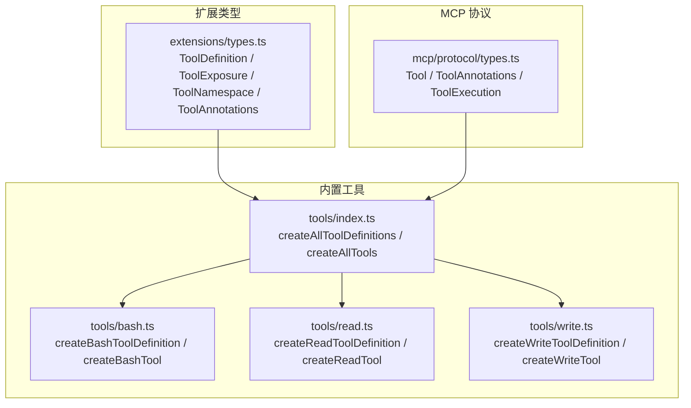
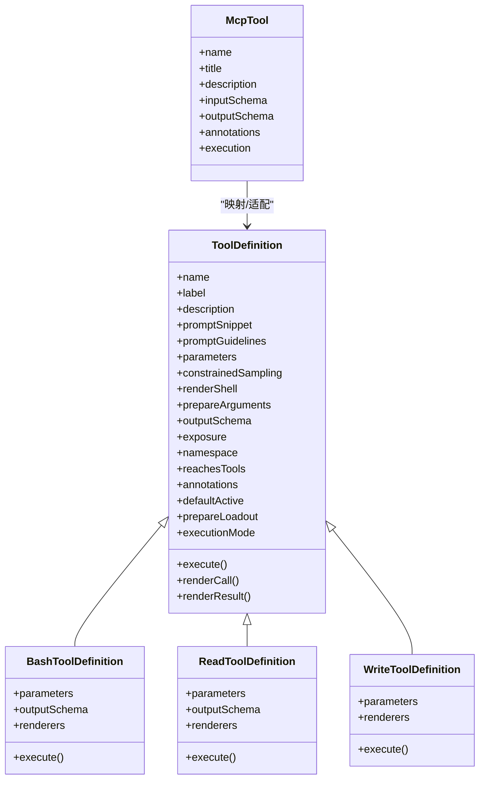
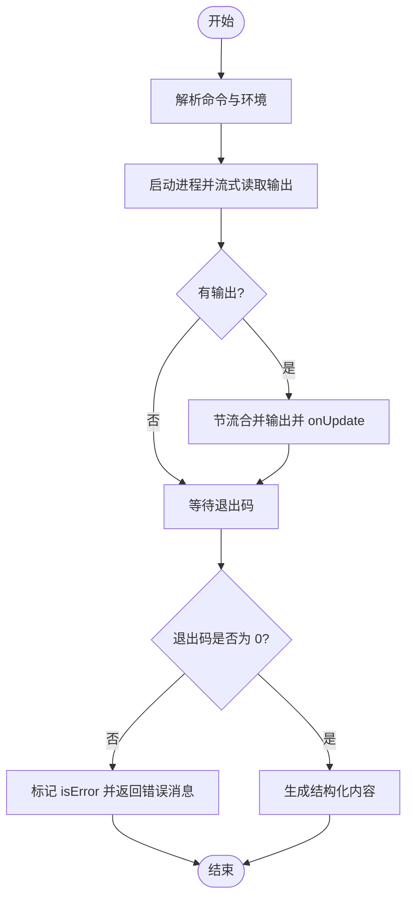
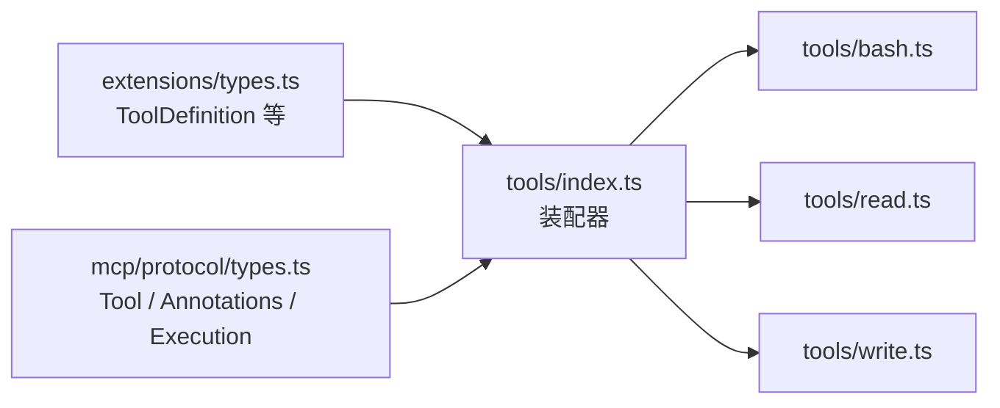

# 工具定义 API

**本文引用的文件**   
- [packages/coding-agent/src/core/extensions/types.ts](https://github.com/FDE-GROUP/oh-my-fde/blob/main/packages/coding-agent/src/core/extensions/types.ts)
- [packages/coding-agent/src/core/tools/index.ts](https://github.com/FDE-GROUP/oh-my-fde/blob/main/packages/coding-agent/src/core/tools/index.ts)
- [packages/coding-agent/src/core/tools/bash.ts](https://github.com/FDE-GROUP/oh-my-fde/blob/main/packages/coding-agent/src/core/tools/bash.ts)
- [packages/coding-agent/src/core/tools/read.ts](https://github.com/FDE-GROUP/oh-my-fde/blob/main/packages/coding-agent/src/core/tools/read.ts)
- [packages/coding-agent/src/core/tools/write.ts](https://github.com/FDE-GROUP/oh-my-fde/blob/main/packages/coding-agent/src/core/tools/write.ts)
- [packages/mcp/src/protocol/types.ts](https://github.com/FDE-GROUP/oh-my-fde/blob/main/packages/mcp/src/protocol/types.ts)

## 目录
1. [简介](#简介)
2. [项目结构](#项目结构)
3. [核心组件](#核心组件)
4. [架构总览](#架构总览)
5. [详细组件分析](#详细组件分析)
6. [依赖关系分析](#依赖关系分析)
7. [性能考虑](#性能考虑)
8. [故障排查指南](#故障排查指南)
9. [结论](#结论)
10. [附录：自定义工具开发示例](#附录自定义工具开发示例)

## 简介
本文面向扩展开发者，系统化说明“工具定义 API”，重点包括：
- ToolDefinition 接口的全部属性与方法，涵盖参数定义、执行逻辑、渲染器配置等。
- 工具暴露模式（direct、model-only、codemode、deferred、hidden）的使用场景与差异。
- 工具命名空间、注解、执行模式等高级特性。
- 从简单工具到复杂交互式工具的完整开发路径与最佳实践。

本指南以代码仓库中的类型定义与内置工具实现为依据，帮助读者在不直接阅读源码的情况下也能正确构建高质量的工具。

## 项目结构
围绕工具定义 API 的关键位置如下：
- 扩展系统与工具类型定义位于扩展类型文件中，包含 ToolDefinition、ToolExposure、ToolNamespace、ToolAnnotations、ToolRenderContext 等核心类型。
- 内置工具工厂集中在 tools 模块中，提供 createXxxToolDefinition 与 createXxxTool 两类构造器，并统一导出常用工具集合。
- MCP 协议侧定义了 Tool、ToolAnnotations、ToolExecution 等协议级类型，便于将外部 MCP 工具映射为系统内部工具。

图表来源
- [packages/coding-agent/src/core/extensions/types.ts:599-714](https://github.com/FDE-GROUP/oh-my-fde/blob/main/packages/coding-agent/src/core/extensions/types.ts#L599-L714)
- [packages/coding-agent/src/core/tools/index.ts:118-224](https://github.com/FDE-GROUP/oh-my-fde/blob/main/packages/coding-agent/src/core/tools/index.ts#L118-L224)
- [packages/mcp/src/protocol/types.ts:64-85](https://github.com/FDE-GROUP/oh-my-fde/blob/main/packages/mcp/src/protocol/types.ts#L64-L85)

章节来源
- [packages/coding-agent/src/core/extensions/types.ts:599-714](https://github.com/FDE-GROUP/oh-my-fde/blob/main/packages/coding-agent/src/core/extensions/types.ts#L599-L714)
- [packages/coding-agent/src/core/tools/index.ts:118-224](https://github.com/FDE-GROUP/oh-my-fde/blob/main/packages/coding-agent/src/core/tools/index.ts#L118-L224)
- [packages/mcp/src/protocol/types.ts:64-85](https://github.com/FDE-GROUP/oh-my-fde/blob/main/packages/mcp/src/protocol/types.ts#L64-L85)

## 核心组件
本节聚焦 ToolDefinition 及其相关类型，解释每个属性的职责与使用方式。

- 基本信息
  - name：LLM 调用时使用的工具名。
  - label：UI 显示的人类可读标签。
  - description：给 LLM 的描述，决定模型是否选择该工具以及如何调用。
  - promptSnippet：可选的一行摘要，用于默认系统提示的“可用工具”部分；未提供时自定义工具会被省略。
  - promptGuidelines：可选的行为指导要点，追加到默认系统提示的 Guidelines 部分。

- 参数与输出
  - parameters：TypeBox 参数 Schema，用于校验输入。
  - prepareArguments：可选的兼容层，在参数校验前对原始参数进行转换，必须返回符合 TParams 的对象。
  - outputSchema：可选的结构化输出 JSON Schema；声明后应始终设置 structuredContent，以便 codemode 脚本接收结构化数据而非纯文本。
  - constrainedSampling：可选的受限采样配置，可设为 false 显式禁用。

- 渲染与交互
  - renderShell：控制 ToolExecutionComponent 是否使用标准着色 shell 或工具自绘框架（"default" | "self"）。
  - renderCall：自定义工具调用展示组件。
  - renderResult：自定义工具结果展示组件。
  - ToolRenderContext：渲染上下文，包含 args、toolCallId、invalidate、state、cwd、executionStarted、argsComplete、isPartial、expanded、showImages、isError、durationMs、outputPad 等。

- 暴露与组织
  - exposure：工具暴露模式，见下节详解。
  - namespace：工具所属命名空间（例如某个 MCP 服务器），支持别名与使用说明。
  - reachesTools：供编排型工具（如 codemode、tool_search）声明其可能触达的其他工具或命名空间。
  - annotations：工具行为提示（只读、破坏性、幂等、开放世界），权限扩展可据此决定是否确认。
  - defaultActive：注册时是否激活工具。
  - prepareLoadout：当活跃工具集变化时，动态调整呈现给模型的负载（描述、隐藏声明等）。

- 执行与调度
  - executionMode：逐工具的执行模式覆盖（sequential | parallel）。
  - execute：核心执行函数，返回 AgentToolResult，支持 onUpdate 增量更新与 AbortSignal 取消。

- 辅助
  - defineTool：保留参数推断的包装函数，适合赋值或放入数组时使用。

章节来源
- [packages/coding-agent/src/core/extensions/types.ts:478-519](https://github.com/FDE-GROUP/oh-my-fde/blob/main/packages/coding-agent/src/core/extensions/types.ts#L478-L519)
- [packages/coding-agent/src/core/extensions/types.ts:521-583](https://github.com/FDE-GROUP/oh-my-fde/blob/main/packages/coding-agent/src/core/extensions/types.ts#L521-L583)
- [packages/coding-agent/src/core/extensions/types.ts:599-714](https://github.com/FDE-GROUP/oh-my-fde/blob/main/packages/coding-agent/src/core/extensions/types.ts#L599-L714)

## 架构总览
下图展示了工具定义、内置工具与 MCP 协议之间的协作关系。

图表来源
- [packages/coding-agent/src/core/extensions/types.ts:599-714](https://github.com/FDE-GROUP/oh-my-fde/blob/main/packages/coding-agent/src/core/extensions/types.ts#L599-L714)
- [packages/coding-agent/src/core/tools/bash.ts:271-448](https://github.com/FDE-GROUP/oh-my-fde/blob/main/packages/coding-agent/src/core/tools/bash.ts#L271-L448)
- [packages/coding-agent/src/core/tools/read.ts:228-357](https://github.com/FDE-GROUP/oh-my-fde/blob/main/packages/coding-agent/src/core/tools/read.ts#L228-L357)
- [packages/coding-agent/src/core/tools/write.ts:43-91](https://github.com/FDE-GROUP/oh-my-fde/blob/main/packages/coding-agent/src/core/tools/write.ts#L43-L91)
- [packages/mcp/src/protocol/types.ts:64-85](https://github.com/FDE-GROUP/oh-my-fde/blob/main/packages/mcp/src/protocol/types.ts#L64-L85)

## 详细组件分析

### 工具暴露模式（ToolExposure）
- direct：向模型声明并在活跃期间可调；默认值。
- model-only：向模型声明但不可被其他工具通过 ctx.executeTool 调用；适合编排或交互式工具。
- codemode：只要已注册即可被 codemode 调用；除非显式激活，否则不向模型声明；codemode 工具会在自身描述中列出它。
- deferred：类似 codemode，但 codemode 工具不会列出它；可通过工具搜索发现。
- hidden：仅注册且不可达；激活无效。

注意：direct 与 model-only 在注册时即激活；其余曝光模式默认不激活，需通过 --tools、defaultTools 或 setActiveTools 显式激活。

章节来源
- [packages/coding-agent/src/core/extensions/types.ts:521-536](https://github.com/FDE-GROUP/oh-my-fde/blob/main/packages/coding-agent/src/core/extensions/types.ts#L521-L536)

### 工具命名空间（ToolNamespace）
- name：命名空间标识，例如 mcp__docs。
- aliases：其他名称，供 describeNamespace 与 searchTools 查找。
- description：简短摘要，随分组在模型侧工具列表中出现一次。
- instructions：较长使用指引，不作为工具列表的一部分；按需由 describeNamespace 返回。

章节来源
- [packages/coding-agent/src/core/extensions/types.ts:553-569](https://github.com/FDE-GROUP/oh-my-fde/blob/main/packages/coding-agent/src/core/extensions/types.ts#L553-L569)

### 工具注解（ToolAnnotations）
- readOnlyHint：不修改环境。
- destructiveHint：可能删除或覆盖数据。
- idempotentHint：相同参数重复调用无额外影响。
- openWorldHint：访问开放世界实体（如网络）。

这些是作者提供的提示，非运行时验证；权限扩展可据此决定是否要求用户确认。

章节来源
- [packages/coding-agent/src/core/extensions/types.ts:538-551](https://github.com/FDE-GROUP/oh-my-fde/blob/main/packages/coding-agent/src/core/extensions/types.ts#L538-L551)
- [packages/mcp/src/protocol/types.ts:64-70](https://github.com/FDE-GROUP/oh-my-fde/blob/main/packages/mcp/src/protocol/types.ts#L64-L70)

### 执行模式（ToolExecutionMode）
- sequential：与其他工具调用串行执行。
- parallel：可与其它工具调用并发执行。
- 未指定时使用默认执行模式。

章节来源
- [packages/coding-agent/src/core/extensions/types.ts:660-667](https://github.com/FDE-GROUP/oh-my-fde/blob/main/packages/coding-agent/src/core/extensions/types.ts#L660-L667)

### 渲染器与上下文（ToolRenderContext）
- args：当前工具调用参数。
- toolCallId：稳定唯一 ID，跨 call/result 渲染保持一致。
- invalidate：使当前工具执行组件失效并重绘。
- state：共享渲染状态，由工具执行组件初始化。
- cwd：本次执行的 working directory。
- executionStarted / argsComplete / isPartial / expanded / showImages / isError / durationMs / outputPad：渲染所需的状态与样式信息。

章节来源
- [packages/coding-agent/src/core/extensions/types.ts:478-519](https://github.com/FDE-GROUP/oh-my-fde/blob/main/packages/coding-agent/src/core/extensions/types.ts#L478-L519)

### 内置工具示例

#### Bash 工具
- 参数：command、timeout。
- 结构化输出：output、truncated、full_output_path、exit_code、wall_time_seconds。
- 关键能力：
  - 本地 Shell 后端可替换（BashOperations）。
  - 支持命令前缀、会话环境变量注入、spawnHook 钩子。
  - 输出节流与截断，超时与中止信号处理。
  - 提供 createBashToolDefinition 与 createBashTool。

图表来源
- [packages/coding-agent/src/core/tools/bash.ts:271-448](https://github.com/FDE-GROUP/oh-my-fde/blob/main/packages/coding-agent/src/core/tools/bash.ts#L271-L448)

章节来源
- [packages/coding-agent/src/core/tools/bash.ts:39-63](https://github.com/FDE-GROUP/oh-my-fde/blob/main/packages/coding-agent/src/core/tools/bash.ts#L39-L63)
- [packages/coding-agent/src/core/tools/bash.ts:242-253](https://github.com/FDE-GROUP/oh-my-fde/blob/main/packages/coding-agent/src/core/tools/bash.ts#L242-L253)
- [packages/coding-agent/src/core/tools/bash.ts:271-448](https://github.com/FDE-GROUP/oh-my-fde/blob/main/packages/coding-agent/src/core/tools/bash.ts#L271-L448)

#### Read 工具
- 参数：path、offset、limit。
- 结构化输出：字符串或图像块（type=image）。
- 关键能力：
  - 自动识别图片并处理（含尺寸建议）。
  - 文本文件支持流式分段读取，按行与字节限制截断。
  - 提供 createReadToolDefinition 与 createReadTool。

章节来源
- [packages/coding-agent/src/core/tools/read.ts:14-38](https://github.com/FDE-GROUP/oh-my-fde/blob/main/packages/coding-agent/src/core/tools/read.ts#L14-L38)
- [packages/coding-agent/src/core/tools/read.ts:86-93](https://github.com/FDE-GROUP/oh-my-fde/blob/main/packages/coding-agent/src/core/tools/read.ts#L86-L93)
- [packages/coding-agent/src/core/tools/read.ts:228-357](https://github.com/FDE-GROUP/oh-my-fde/blob/main/packages/coding-agent/src/core/tools/read.ts#L228-L357)

#### Write 工具
- 参数：path、content。
- 关键能力：
  - 自动创建父目录。
  - 基于文件变更队列保证写入一致性。
  - 提供 createWriteToolDefinition 与 createWriteTool。

章节来源
- [packages/coding-agent/src/core/tools/write.ts:10-18](https://github.com/FDE-GROUP/oh-my-fde/blob/main/packages/coding-agent/src/core/tools/write.ts#L10-L18)
- [packages/coding-agent/src/core/tools/write.ts:38-41](https://github.com/FDE-GROUP/oh-my-fde/blob/main/packages/coding-agent/src/core/tools/write.ts#L38-L41)
- [packages/coding-agent/src/core/tools/write.ts:43-91](https://github.com/FDE-GROUP/oh-my-fde/blob/main/packages/coding-agent/src/core/tools/write.ts#L43-L91)

### 工具加载与装配（tools/index.ts）
- createToolDefinition / createTool：按名称分发到具体工具实现。
- createCodingToolDefinitions / createReadOnlyToolDefinitions / createAllToolDefinitions：批量生成工具定义。
- createCodingTools / createReadOnlyTools / createAllTools：批量生成可执行工具。

章节来源
- [packages/coding-agent/src/core/tools/index.ts:118-224](https://github.com/FDE-GROUP/oh-my-fde/blob/main/packages/coding-agent/src/core/tools/index.ts#L118-L224)

## 依赖关系分析
- 扩展类型（ToolDefinition 等）是所有工具定义的契约中心。
- 内置工具通过各自模块实现具体业务，并通过 index.ts 统一装配。
- MCP 协议类型与内部 ToolDefinition 存在映射关系，便于将外部 MCP 工具纳入系统。

图表来源
- [packages/coding-agent/src/core/extensions/types.ts:599-714](https://github.com/FDE-GROUP/oh-my-fde/blob/main/packages/coding-agent/src/core/extensions/types.ts#L599-L714)
- [packages/coding-agent/src/core/tools/index.ts:118-224](https://github.com/FDE-GROUP/oh-my-fde/blob/main/packages/coding-agent/src/core/tools/index.ts#L118-L224)
- [packages/mcp/src/protocol/types.ts:64-85](https://github.com/FDE-GROUP/oh-my-fde/blob/main/packages/mcp/src/protocol/types.ts#L64-L85)

章节来源
- [packages/coding-agent/src/core/extensions/types.ts:599-714](https://github.com/FDE-GROUP/oh-my-fde/blob/main/packages/coding-agent/src/core/extensions/types.ts#L599-L714)
- [packages/coding-agent/src/core/tools/index.ts:118-224](https://github.com/FDE-GROUP/oh-my-fde/blob/main/packages/coding-agent/src/core/tools/index.ts#L118-L224)
- [packages/mcp/src/protocol/types.ts:64-85](https://github.com/FDE-GROUP/oh-my-fde/blob/main/packages/mcp/src/protocol/types.ts#L64-L85)

## 性能考虑
- 大输出与流式处理：bash 与 read 工具均支持流式输出与截断，避免一次性加载大文件/长输出导致内存压力。
- 节流与增量更新：bash 工具通过节流策略合并 onUpdate，减少 UI 重绘频率。
- 结构化输出：read 与 bash 提供结构化输出，便于上层程序高效消费，同时降低文本解析开销。
- 并发与串行：通过 executionMode 控制工具并发度，避免 I/O 热点相互阻塞。

[本节为通用指导，无需特定文件引用]

## 故障排查指南
- 超时与中止
  - bash 工具在超时时抛出带时间信息的错误，并区分“shell 提前退出但后台进程仍在写输出”的情况。
  - 所有工具实现均检查 AbortSignal，确保及时释放资源。
- 截断与续读
  - read 工具在截断或用户 limit 提前结束时，会给出明确的续读提示（如 offset 下一行）。
- 权限与确认
  - 借助 ToolAnnotations 的 destructiveHint/openWorldHint 等，权限扩展可在高风险调用前弹出确认。

章节来源
- [packages/coding-agent/src/core/tools/bash.ts:100-107](https://github.com/FDE-GROUP/oh-my-fde/blob/main/packages/coding-agent/src/core/tools/bash.ts#L100-L107)
- [packages/coding-agent/src/core/tools/bash.ts:389-446](https://github.com/FDE-GROUP/oh-my-fde/blob/main/packages/coding-agent/src/core/tools/bash.ts#L389-L446)
- [packages/coding-agent/src/core/tools/read.ts:317-341](https://github.com/FDE-GROUP/oh-my-fde/blob/main/packages/coding-agent/src/core/tools/read.ts#L317-L341)
- [packages/coding-agent/src/core/extensions/types.ts:538-551](https://github.com/FDE-GROUP/oh-my-fde/blob/main/packages/coding-agent/src/core/extensions/types.ts#L538-L551)

## 结论
ToolDefinition 提供了统一的工具契约，配合 exposure、namespace、annotations、executionMode 等高级特性，既能满足简单脚本类工具，也能支撑复杂的编排与交互式工具。结合内置工具的实现范式，开发者可以快速构建高质量、可维护、可扩展的工具生态。

[本节为总结性内容，无需特定文件引用]

## 附录：自定义工具开发示例

### 示例一：简单只读工具
目标：提供一个查询天气的只读工具。
步骤：
1. 定义 TypeBox 参数 Schema（城市、单位）。
2. 编写 ToolDefinition：
   - 填写 name、label、description、parameters。
   - 实现 execute，返回 content 与 optional details。
   - 设置 annotations.readOnlyHint = true。
3. 注册工具：
   - 使用 pi.registerTool 或直接放入 customTools。
   - 如需仅在会话内可见但不被其他工具调用，设置 exposure="model-only"。

参考路径
- [packages/coding-agent/src/core/extensions/types.ts:599-714](https://github.com/FDE-GROUP/oh-my-fde/blob/main/packages/coding-agent/src/core/extensions/types.ts#L599-L714)

### 示例二：带结构化输出的工具
目标：返回结构化数据的工具（如统计报告）。
步骤：
1. 定义 outputSchema（JSON Schema）。
2. 在 execute 中始终设置 structuredContent，使其与 outputSchema 一致。
3. 在 codemode 中可直接消费结构化字段，无需解析文本。

参考路径
- [packages/coding-agent/src/core/extensions/types.ts:620-624](https://github.com/FDE-GROUP/oh-my-fde/blob/main/packages/coding-agent/src/core/extensions/types.ts#L620-L624)

### 示例三：交互式工具（需要 UI）
目标：让用户在 TUI 中选择选项后再执行。
步骤：
1. 在 execute 中使用 ExtensionUIContext 的 select/confirm/input 等方法获取用户输入。
2. 根据用户选择分支执行不同逻辑。
3. 若需要自定义渲染，实现 renderCall 与 renderResult，并使用 ToolRenderContext 管理状态与刷新。

参考路径
- [packages/coding-agent/src/core/extensions/types.ts:164-320](https://github.com/FDE-GROUP/oh-my-fde/blob/main/packages/coding-agent/src/core/extensions/types.ts#L164-L320)
- [packages/coding-agent/src/core/extensions/types.ts:478-519](https://github.com/FDE-GROUP/oh-my-fde/blob/main/packages/coding-agent/src/core/extensions/types.ts#L478-L519)

### 示例四：编排型工具（调用其他工具）
目标：一个编排工具，根据输入动态调用多个工具。
步骤：
1. 设置 exposure="codemode" 或 "deferred"，并在 description 中说明如何调用。
2. 实现 reachesTools，声明可能触达的工具或命名空间。
3. 在 execute 中通过 ctx.executeTool 调用其他工具，收集结果并组合输出。
4. 可使用 prepareLoadout 动态调整活跃工具列表的描述，帮助用户理解当前可用能力。

参考路径
- [packages/coding-agent/src/core/extensions/types.ts:521-536](https://github.com/FDE-GROUP/oh-my-fde/blob/main/packages/coding-agent/src/core/extensions/types.ts#L521-L536)
- [packages/coding-agent/src/core/extensions/types.ts:634-641](https://github.com/FDE-GROUP/oh-my-fde/blob/main/packages/coding-agent/src/core/extensions/types.ts#L634-L641)
- [packages/coding-agent/src/core/extensions/types.ts:653-658](https://github.com/FDE-GROUP/oh-my-fde/blob/main/packages/coding-agent/src/core/extensions/types.ts#L653-L658)

### 示例五：命名空间与 MCP 工具集成
目标：将一组 MCP 工具归入同一命名空间，并提供使用说明。
步骤：
1. 定义 ToolNamespace（name、aliases、description、instructions）。
2. 为每个工具设置 namespace，指向该命名空间。
3. 在 MCP 侧，将 Tool.annotations 映射到内部 ToolAnnotations，保持语义一致。

参考路径
- [packages/coding-agent/src/core/extensions/types.ts:553-569](https://github.com/FDE-GROUP/oh-my-fde/blob/main/packages/coding-agent/src/core/extensions/types.ts#L553-L569)
- [packages/mcp/src/protocol/types.ts:64-85](https://github.com/FDE-GROUP/oh-my-fde/blob/main/packages/mcp/src/protocol/types.ts#L64-L85)