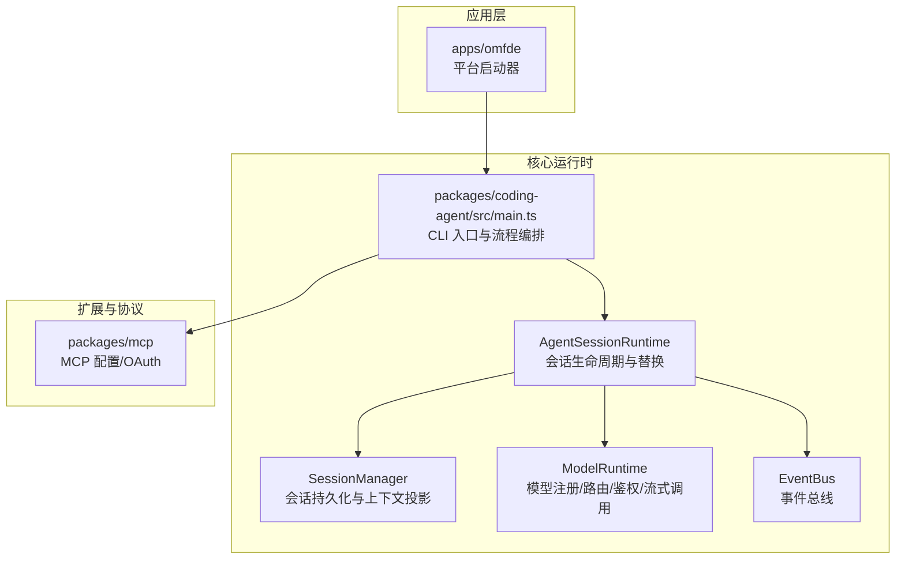
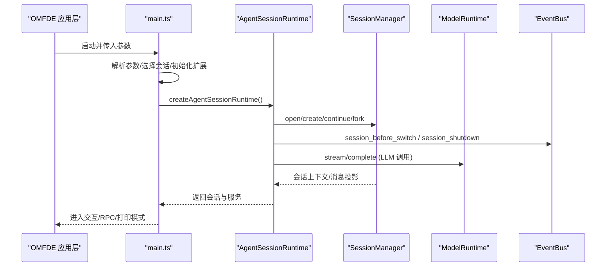
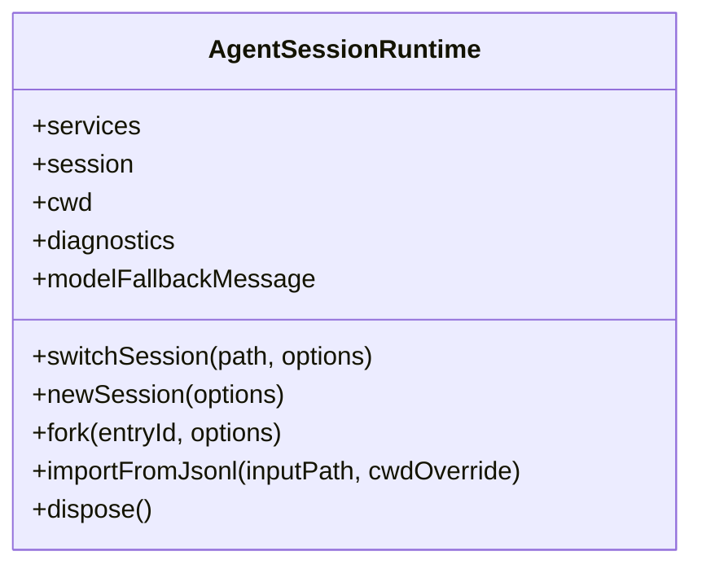
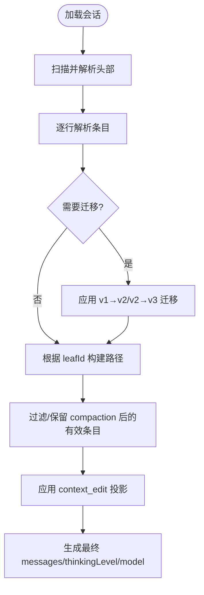
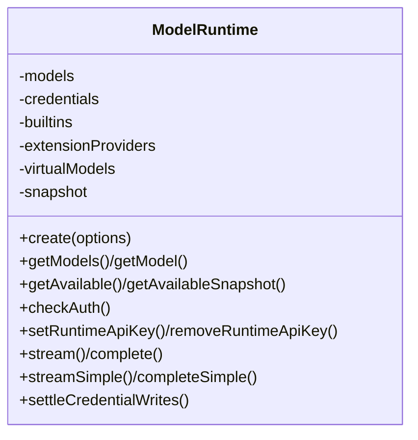
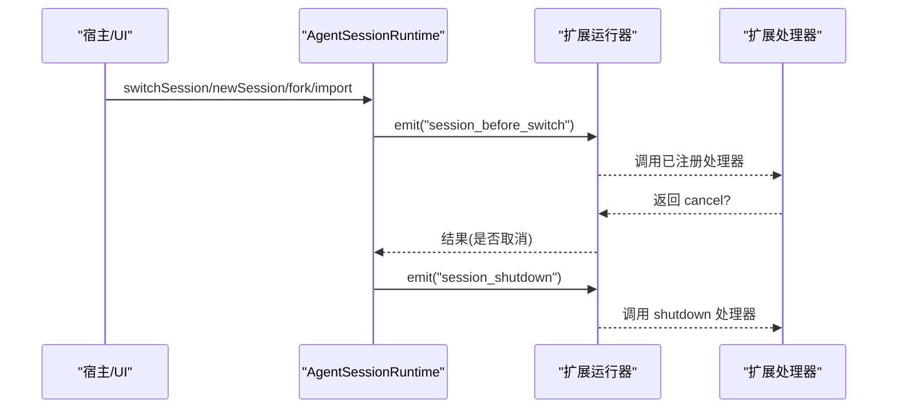
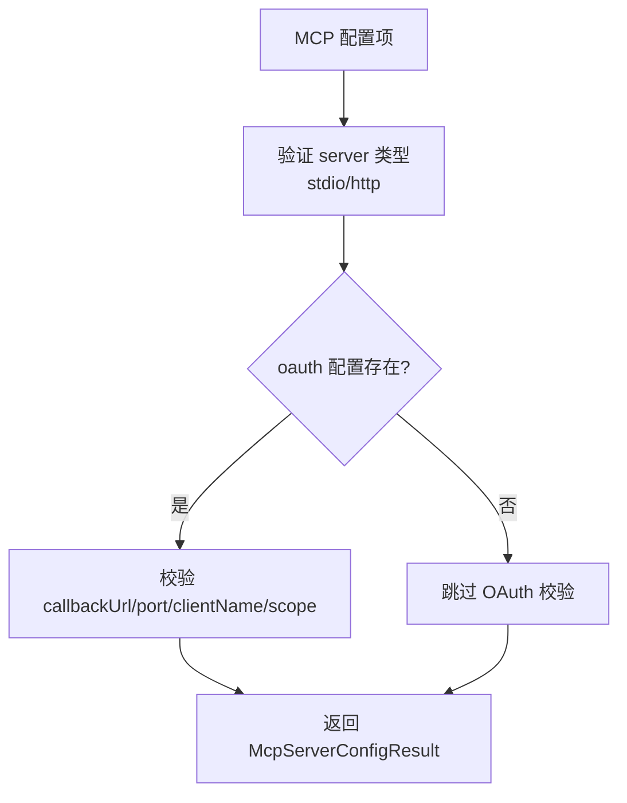
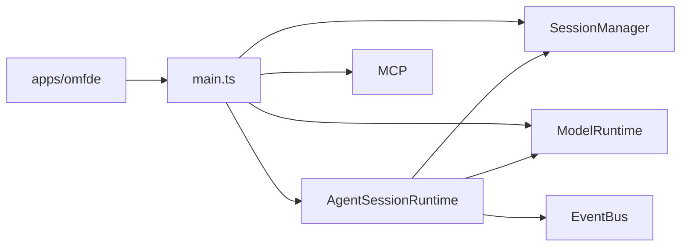

# 核心架构

**本文引用的文件**   
- [README.md](https://github.com/FDE-GROUP/oh-my-fde/blob/main/README.md)
- [apps/omfde/README.md](https://github.com/FDE-GROUP/oh-my-fde/blob/main/apps/omfde/README.md)
- [packages/coding-agent/package.json](https://github.com/FDE-GROUP/oh-my-fde/blob/main/packages/coding-agent/package.json)
- [packages/coding-agent/src/main.ts](https://github.com/FDE-GROUP/oh-my-fde/blob/main/packages/coding-agent/src/main.ts)
- [packages/coding-agent/src/core/agent-session-runtime.ts](https://github.com/FDE-GROUP/oh-my-fde/blob/main/packages/coding-agent/src/core/agent-session-runtime.ts)
- [packages/coding-agent/src/core/session-manager.ts](https://github.com/FDE-GROUP/oh-my-fde/blob/main/packages/coding-agent/src/core/session-manager.ts)
- [packages/coding-agent/src/core/model-runtime.ts](https://github.com/FDE-GROUP/oh-my-fde/blob/main/packages/coding-agent/src/core/model-runtime.ts)
- [packages/coding-agent/src/core/event-bus.ts](https://github.com/FDE-GROUP/oh-my-fde/blob/main/packages/coding-agent/src/core/event-bus.ts)
- [packages/mcp/src/config.ts](https://github.com/FDE-GROUP/oh-my-fde/blob/main/packages/mcp/src/config.ts)

## 目录
1. [简介](#简介)
2. [项目结构](#项目结构)
3. [核心组件](#核心组件)
4. [架构总览](#架构总览)
5. [详细组件分析](#详细组件分析)
6. [依赖关系分析](#依赖关系分析)
7. [性能与可扩展性](#性能与可扩展性)
8. [故障排查指南](#故障排查指南)
9. [结论](#结论)

## 简介
本文件面向开发者，系统化梳理 OMFDE（基于 Pi 的扩展平台）的核心架构与设计决策。重点覆盖：
- 整体设计模式与分层边界
- 代理运行时、会话管理、模型运行时的职责与交互
- 事件驱动架构、插件系统与工具系统的关键机制
- 架构图表与组件依赖图，帮助快速定位问题与扩展点

OMFDE 以 Pi 为内核，通过应用层薄启动器注入平台能力，并通过扩展、配置和公开 API 组合能力，避免直接耦合到 Pi 核心代码。

**章节来源**
- [README.md:13-21](https://github.com/FDE-GROUP/oh-my-fde/blob/main/README.md#L13-L21)
- [apps/omfde/README.md:1-14](https://github.com/FDE-GROUP/oh-my-fde/blob/main/apps/omfde/README.md#L1-L14)

## 项目结构
仓库采用多包工作区组织，关键目录与职责如下：
- apps/omfde：平台可执行入口，负责设置平台环境变量并转发参数给 Pi
- packages/coding-agent：Pi 编码代理 CLI 与核心运行时实现
- packages/mcp：MCP 协议客户端与服务端配置、OAuth 等集成
- packages/ai、packages/tui、packages/telemetry 等：AI 统一接口、终端 UI、遥测等基础库

**图表来源**
- [apps/omfde/README.md:1-14](https://github.com/FDE-GROUP/oh-my-fde/blob/main/apps/omfde/README.md#L1-L14)
- [packages/coding-agent/src/main.ts:1-10](https://github.com/FDE-GROUP/oh-my-fde/blob/main/packages/coding-agent/src/main.ts#L1-L10)
- [packages/coding-agent/src/core/agent-session-runtime.ts:17-41](https://github.com/FDE-GROUP/oh-my-fde/blob/main/packages/coding-agent/src/core/agent-session-runtime.ts#L17-L41)
- [packages/coding-agent/src/core/session-manager.ts:41-227](https://github.com/FDE-GROUP/oh-my-fde/blob/main/packages/coding-agent/src/core/session-manager.ts#L41-L227)
- [packages/coding-agent/src/core/model-runtime.ts:174-269](https://github.com/FDE-GROUP/oh-my-fde/blob/main/packages/coding-agent/src/core/model-runtime.ts#L174-L269)
- [packages/coding-agent/src/core/event-bus.ts:1-34](https://github.com/FDE-GROUP/oh-my-fde/blob/main/packages/coding-agent/src/core/event-bus.ts#L1-L34)
- [packages/mcp/src/config.ts:76-95](https://github.com/FDE-GROUP/oh-my-fde/blob/main/packages/mcp/src/config.ts#L76-L95)

**章节来源**
- [packages/coding-agent/package.json:1-12](https://github.com/FDE-GROUP/oh-my-fde/blob/main/packages/coding-agent/package.json#L1-L12)
- [packages/coding-agent/package.json:43-65](https://github.com/FDE-GROUP/oh-my-fde/blob/main/packages/coding-agent/package.json#L43-L65)

## 核心组件
- 代理运行时（AgentSessionRuntime）：封装当前 AgentSession 与其 cwd 绑定服务，提供 newSession、switchSession、fork、importFromJsonl、dispose 等生命周期方法；在切换前触发扩展事件，确保状态一致性与资源清理。
- 会话管理器（SessionManager）：负责 JSONL 追加写入、会话树构建、压缩摘要、分支与标签、上下文投影与最终模型上下文生成；支持迁移旧版本格式。
- 模型运行时（ModelRuntime）：统一封装 pi-ai Models，处理提供者组合、虚拟模型路由、凭据与 OAuth、可用性刷新、流式与非流式请求、错误诊断。
- 事件总线（EventBus）：基于 Node EventEmitter 的安全事件分发，封装异步处理器异常捕获与订阅移除。

**章节来源**
- [packages/coding-agent/src/core/agent-session-runtime.ts:17-41](https://github.com/FDE-GROUP/oh-my-fde/blob/main/packages/coding-agent/src/core/agent-session-runtime.ts#L17-L41)
- [packages/coding-agent/src/core/session-manager.ts:41-227](https://github.com/FDE-GROUP/oh-my-fde/blob/main/packages/coding-agent/src/core/session-manager.ts#L41-L227)
- [packages/coding-agent/src/core/model-runtime.ts:174-269](https://github.com/FDE-GROUP/oh-my-fde/blob/main/packages/coding-agent/src/core/model-runtime.ts#L174-L269)
- [packages/coding-agent/src/core/event-bus.ts:1-34](https://github.com/FDE-GROUP/oh-my-fde/blob/main/packages/coding-agent/src/core/event-bus.ts#L1-L34)

## 架构总览
OMFDE 的整体数据与控制流如下：
- 应用层 omfde 启动器设置平台标志并转发参数给 Pi
- main.ts 解析参数、选择会话、初始化 Settings/Trust/Extensions，构造 createRuntime 工厂
- AgentSessionRuntime 持有当前会话与服务，并在生命周期变更时触发扩展事件
- SessionManager 维护会话树与上下文投影，供 AgentSession 使用
- ModelRuntime 提供模型发现、鉴权、路由与流式调用，被 AgentSession 用于 LLM 交互
- EventBus 贯穿扩展与内部子系统的事件通信

**图表来源**
- [apps/omfde/README.md:1-14](https://github.com/FDE-GROUP/oh-my-fde/blob/main/apps/omfde/README.md#L1-L14)
- [packages/coding-agent/src/main.ts:1-10](https://github.com/FDE-GROUP/oh-my-fde/blob/main/packages/coding-agent/src/main.ts#L1-L10)
- [packages/coding-agent/src/core/agent-session-runtime.ts:133-178](https://github.com/FDE-GROUP/oh-my-fde/blob/main/packages/coding-agent/src/core/agent-session-runtime.ts#L133-L178)
- [packages/coding-agent/src/core/session-manager.ts:476-584](https://github.com/FDE-GROUP/oh-my-fde/blob/main/packages/coding-agent/src/core/session-manager.ts#L476-L584)
- [packages/coding-agent/src/core/model-runtime.ts:715-785](https://github.com/FDE-GROUP/oh-my-fde/blob/main/packages/coding-agent/src/core/model-runtime.ts#L715-L785)

## 详细组件分析

### 代理运行时（AgentSessionRuntime）
职责与关键点：
- 生命周期管理：newSession、switchSession、fork、importFromJsonl、dispose
- 扩展钩子：session_before_switch、session_before_fork、session_shutdown
- 服务与诊断：暴露 services、diagnostics、modelFallbackMessage
- 安全与一致性：先 abort 当前响应，再触发 shutdown 事件，最后释放旧会话

**图表来源**
- [packages/coding-agent/src/core/agent-session-runtime.ts:74-115](https://github.com/FDE-GROUP/oh-my-fde/blob/main/packages/coding-agent/src/core/agent-session-runtime.ts#L74-L115)
- [packages/coding-agent/src/core/agent-session-runtime.ts:196-418](https://github.com/FDE-GROUP/oh-my-fde/blob/main/packages/coding-agent/src/core/agent-session-runtime.ts#L196-L418)

**章节来源**
- [packages/coding-agent/src/core/agent-session-runtime.ts:17-41](https://github.com/FDE-GROUP/oh-my-fde/blob/main/packages/coding-agent/src/core/agent-session-runtime.ts#L17-L41)
- [packages/coding-agent/src/core/agent-session-runtime.ts:133-178](https://github.com/FDE-GROUP/oh-my-fde/blob/main/packages/coding-agent/src/core/agent-session-runtime.ts#L133-L178)
- [packages/coding-agent/src/core/agent-session-runtime.ts:196-418](https://github.com/FDE-GROUP/oh-my-fde/blob/main/packages/coding-agent/src/core/agent-session-runtime.ts#L196-L418)

### 会话管理器（SessionManager）
职责与关键点：
- 追加日志与 JSONL 读写：高效缓冲读取、头部扫描限制、容错跳过坏行
- 会话树与路径：按 parentId 回溯构建路径，支持 leafId 定位
- 压缩与分支：compaction 与 branch_summary 参与上下文投影
- 上下文投影：context_edit 替换内容，custom_message/custom_entry 区分是否进入 LLM 上下文
- 版本迁移：v1→v2 增加 id/parentId，v2→v3 重命名 hookMessage role

**图表来源**
- [packages/coding-agent/src/core/session-manager.ts:627-671](https://github.com/FDE-GROUP/oh-my-fde/blob/main/packages/coding-agent/src/core/session-manager.ts#L627-L671)
- [packages/coding-agent/src/core/session-manager.ts:337-347](https://github.com/FDE-GROUP/oh-my-fde/blob/main/packages/coding-agent/src/core/session-manager.ts#L337-L347)
- [packages/coding-agent/src/core/session-manager.ts:476-584](https://github.com/FDE-GROUP/oh-my-fde/blob/main/packages/coding-agent/src/core/session-manager.ts#L476-L584)

**章节来源**
- [packages/coding-agent/src/core/session-manager.ts:41-227](https://github.com/FDE-GROUP/oh-my-fde/blob/main/packages/coding-agent/src/core/session-manager.ts#L41-L227)
- [packages/coding-agent/src/core/session-manager.ts:337-347](https://github.com/FDE-GROUP/oh-my-fde/blob/main/packages/coding-agent/src/core/session-manager.ts#L337-L347)
- [packages/coding-agent/src/core/session-manager.ts:476-584](https://github.com/FDE-GROUP/oh-my-fde/blob/main/packages/coding-agent/src/core/session-manager.ts#L476-L584)

### 模型运行时（ModelRuntime）
职责与关键点：
- 提供者组合：内置提供者、原生扩展提供者、配置覆盖、虚拟模型包装
- 凭据与鉴权：API Key、OAuth、环境注入、运行时密钥、最小有效期
- 可用性刷新：批量与增量刷新，错误序列号去抖，快照缓存
- 请求准备：合并 headers/env、OpenCode 会话头、transformHeaders 钩子
- 流式与非流式：stream/complete/streamSimple/completeSimple/deferred

**图表来源**
- [packages/coding-agent/src/core/model-runtime.ts:174-269](https://github.com/FDE-GROUP/oh-my-fde/blob/main/packages/coding-agent/src/core/model-runtime.ts#L174-L269)
- [packages/coding-agent/src/core/model-runtime.ts:327-341](https://github.com/FDE-GROUP/oh-my-fde/blob/main/packages/coding-agent/src/core/model-runtime.ts#L327-L341)
- [packages/coding-agent/src/core/model-runtime.ts:343-440](https://github.com/FDE-GROUP/oh-my-fde/blob/main/packages/coding-agent/src/core/model-runtime.ts#L343-L440)
- [packages/coding-agent/src/core/model-runtime.ts:667-785](https://github.com/FDE-GROUP/oh-my-fde/blob/main/packages/coding-agent/src/core/model-runtime.ts#L667-L785)

**章节来源**
- [packages/coding-agent/src/core/model-runtime.ts:174-269](https://github.com/FDE-GROUP/oh-my-fde/blob/main/packages/coding-agent/src/core/model-runtime.ts#L174-L269)
- [packages/coding-agent/src/core/model-runtime.ts:327-440](https://github.com/FDE-GROUP/oh-my-fde/blob/main/packages/coding-agent/src/core/model-runtime.ts#L327-L440)
- [packages/coding-agent/src/core/model-runtime.ts:667-785](https://github.com/FDE-GROUP/oh-my-fde/blob/main/packages/coding-agent/src/core/model-runtime.ts#L667-L785)

### 事件驱动与扩展系统
- 事件总线：统一 emit/on，自动捕获异步处理器异常，返回取消订阅函数
- 扩展生命周期：session_before_switch、session_before_fork、session_shutdown 由 AgentSessionRuntime 触发
- 扩展注册：通过 ExtensionFactory 注入 Provider、工具、技能、主题等

**图表来源**
- [packages/coding-agent/src/core/event-bus.ts:1-34](https://github.com/FDE-GROUP/oh-my-fde/blob/main/packages/coding-agent/src/core/event-bus.ts#L1-L34)
- [packages/coding-agent/src/core/agent-session-runtime.ts:133-178](https://github.com/FDE-GROUP/oh-my-fde/blob/main/packages/coding-agent/src/core/agent-session-runtime.ts#L133-L178)

**章节来源**
- [packages/coding-agent/src/core/event-bus.ts:1-34](https://github.com/FDE-GROUP/oh-my-fde/blob/main/packages/coding-agent/src/core/event-bus.ts#L1-L34)
- [packages/coding-agent/src/core/agent-session-runtime.ts:133-178](https://github.com/FDE-GROUP/oh-my-fde/blob/main/packages/coding-agent/src/core/agent-session-runtime.ts#L133-L178)

### 工具系统与 MCP 集成
- 工具系统：通过扩展与 SDK 暴露工具，AgentSession 在推理过程中调用工具并回写结果
- MCP 配置：支持 stdio 与 Streamable HTTP 两种服务器类型，包含 OAuth 回调端口/URL 校验、覆盖语义等

**图表来源**
- [packages/mcp/src/config.ts:76-95](https://github.com/FDE-GROUP/oh-my-fde/blob/main/packages/mcp/src/config.ts#L76-L95)
- [packages/mcp/src/config.ts:181-243](https://github.com/FDE-GROUP/oh-my-fde/blob/main/packages/mcp/src/config.ts#L181-L243)

**章节来源**
- [packages/mcp/src/config.ts:76-95](https://github.com/FDE-GROUP/oh-my-fde/blob/main/packages/mcp/src/config.ts#L76-L95)
- [packages/mcp/src/config.ts:181-243](https://github.com/FDE-GROUP/oh-my-fde/blob/main/packages/mcp/src/config.ts#L181-L243)

## 依赖关系分析
- 应用层 omfde 仅做薄包装，避免直接依赖 Pi 核心
- main.ts 依赖：
  - AgentSessionRuntime：会话生命周期
  - SessionManager：会话持久化与上下文
  - ModelRuntime：模型与提供者
  - EventBus：扩展事件
  - MCP：协议集成
- 运行时内聚性高、耦合清晰：
  - AgentSessionRuntime 不直接操作文件系统，而是委托 SessionManager
  - ModelRuntime 对底层 provider 透明，对外暴露统一 Models 接口

**图表来源**
- [apps/omfde/README.md:1-14](https://github.com/FDE-GROUP/oh-my-fde/blob/main/apps/omfde/README.md#L1-L14)
- [packages/coding-agent/src/main.ts:1-10](https://github.com/FDE-GROUP/oh-my-fde/blob/main/packages/coding-agent/src/main.ts#L1-L10)
- [packages/coding-agent/src/core/agent-session-runtime.ts:17-41](https://github.com/FDE-GROUP/oh-my-fde/blob/main/packages/coding-agent/src/core/agent-session-runtime.ts#L17-L41)
- [packages/coding-agent/src/core/session-manager.ts:41-227](https://github.com/FDE-GROUP/oh-my-fde/blob/main/packages/coding-agent/src/core/session-manager.ts#L41-L227)
- [packages/coding-agent/src/core/model-runtime.ts:174-269](https://github.com/FDE-GROUP/oh-my-fde/blob/main/packages/coding-agent/src/core/model-runtime.ts#L174-L269)
- [packages/coding-agent/src/core/event-bus.ts:1-34](https://github.com/FDE-GROUP/oh-my-fde/blob/main/packages/coding-agent/src/core/event-bus.ts#L1-L34)
- [packages/mcp/src/config.ts:76-95](https://github.com/FDE-GROUP/oh-my-fde/blob/main/packages/mcp/src/config.ts#L76-L95)

**章节来源**
- [packages/coding-agent/package.json:43-65](https://github.com/FDE-GROUP/oh-my-fde/blob/main/packages/coding-agent/package.json#L43-L65)

## 性能与可扩展性
- 会话 I/O：大文件分块读取、头部扫描上限、跳过坏行，保证稳定性与吞吐
- 可用性刷新：批量与增量刷新结合，错误序列号去抖，快照缓存减少重复计算
- 流式调用：lazyStream 延迟求值，支持信号中断，降低冷启动开销
- 扩展解耦：事件驱动与 Provider 组合机制，便于热插拔与隔离

[本节为通用指导，无需具体文件引用]

## 故障排查指南
- 会话导入失败：检查输入路径是否存在；若不存在抛出 SessionImportFileNotFoundError
- 会话 cwd 缺失：当导入或恢复会话时 cwd 不可用，需显式提供 cwdOverride 或在交互式模式下选择
- 模型不可用：查看 ModelRuntime.getError()，检查提供者组合错误、可用性刷新错误、凭据未配置
- OAuth 刷新丢失：进程退出前调用 settleCredentialWrites()，等待凭据落盘完成

**章节来源**
- [packages/coding-agent/src/core/agent-session-runtime.ts:359-401](https://github.com/FDE-GROUP/oh-my-fde/blob/main/packages/coding-agent/src/core/agent-session-runtime.ts#L359-L401)
- [packages/coding-agent/src/core/model-runtime.ts:512-521](https://github.com/FDE-GROUP/oh-my-fde/blob/main/packages/coding-agent/src/core/model-runtime.ts#L512-L521)
- [packages/coding-agent/src/core/model-runtime.ts:643-649](https://github.com/FDE-GROUP/oh-my-fde/blob/main/packages/coding-agent/src/core/model-runtime.ts#L643-L649)

## 结论
OMFDE 以 Pi 为核心，通过清晰的三层架构（应用层、运行时、基础设施）与事件驱动扩展机制，实现了高内聚、低耦合的可扩展代理平台。AgentSessionRuntime 作为会话与服务的协调者，SessionManager 保障会话一致性与上下文投影，ModelRuntime 统一模型与提供者抽象并提供鉴权与流式能力。配合 MCP 与工具系统，OMFDE 可在保持默认强大的同时，灵活适配不同工作流与部署形态。