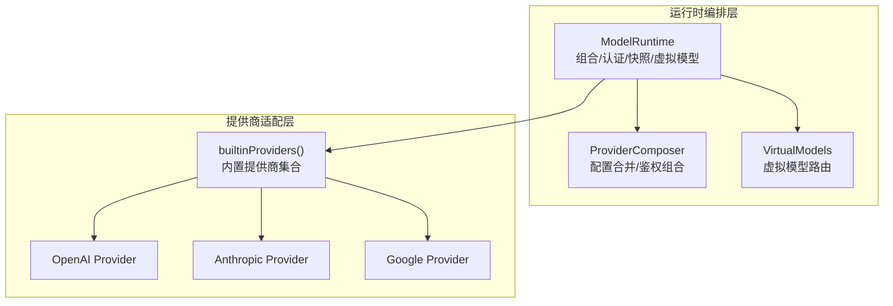
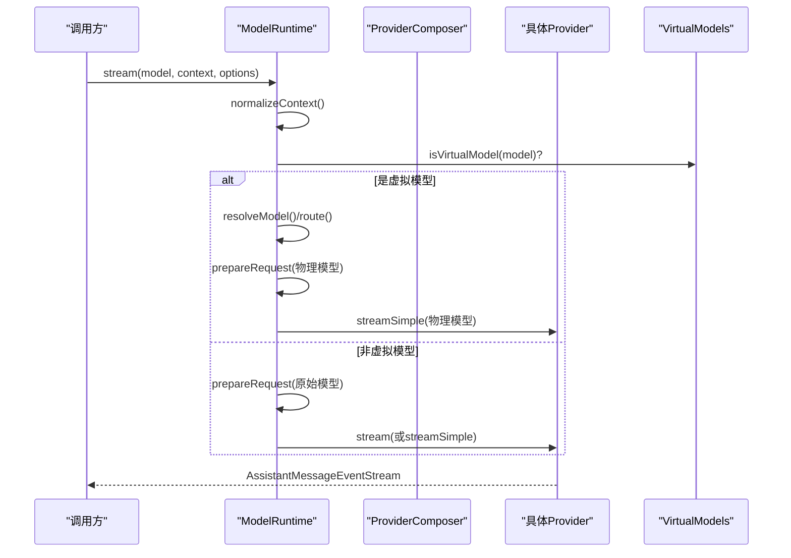
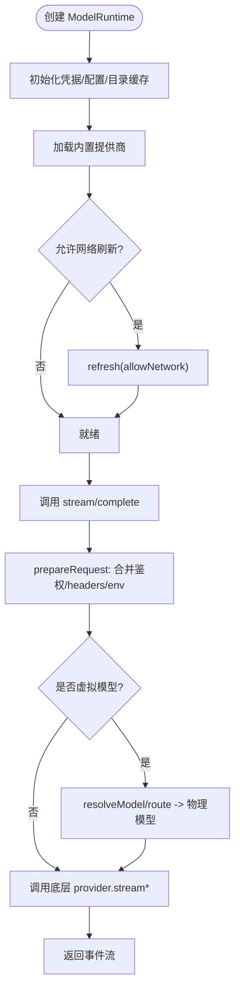
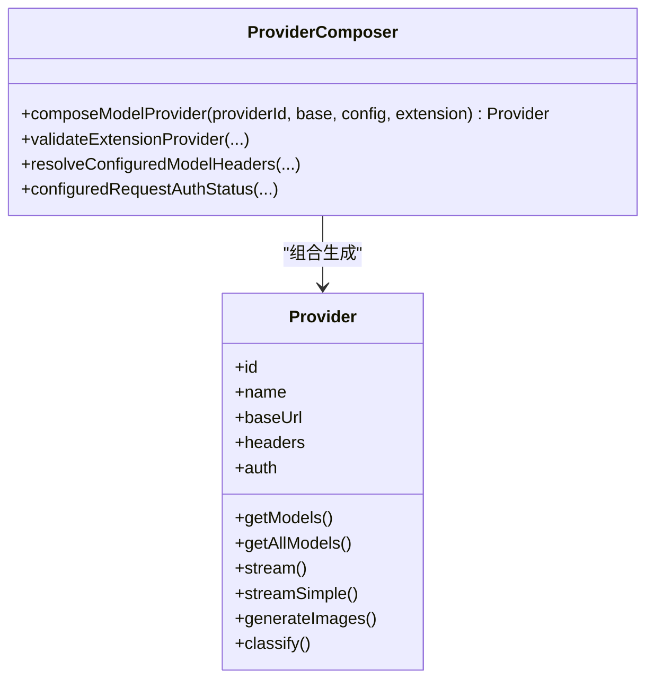
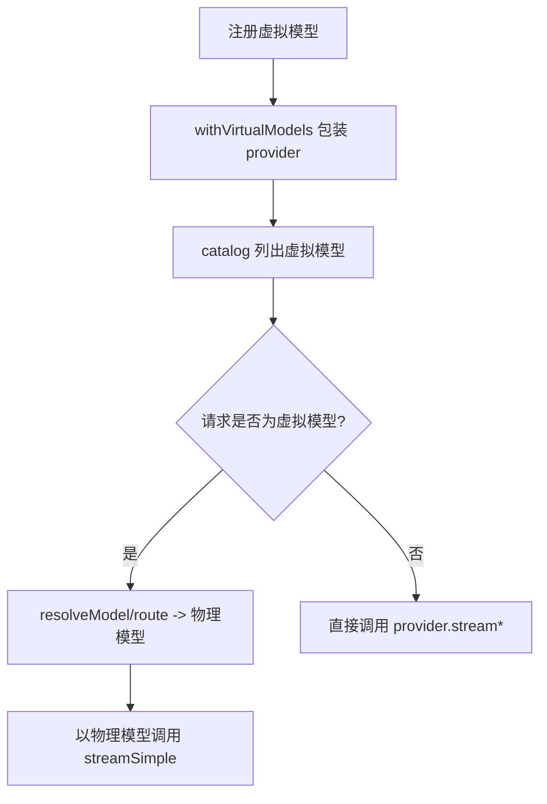
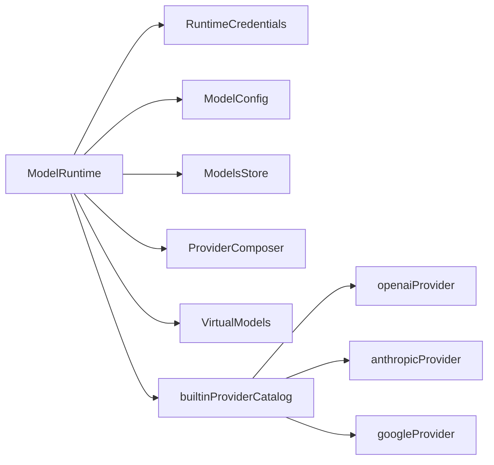

# 提供商抽象层

**本文引用的文件**   
- [packages/coding-agent/src/core/model-runtime.ts](https://github.com/FDE-GROUP/oh-my-fde/blob/main/packages/coding-agent/src/core/model-runtime.ts)
- [packages/coding-agent/src/core/provider-composer.ts](https://github.com/FDE-GROUP/oh-my-fde/blob/main/packages/coding-agent/src/core/provider-composer.ts)
- [packages/coding-agent/src/core/virtual-models.ts](https://github.com/FDE-GROUP/oh-my-fde/blob/main/packages/coding-agent/src/core/virtual-models.ts)
- [packages/ai/src/providers/all.ts](https://github.com/FDE-GROUP/oh-my-fde/blob/main/packages/ai/src/providers/all.ts)
- [packages/ai/src/providers/openai.ts](https://github.com/FDE-GROUP/oh-my-fde/blob/main/packages/ai/src/providers/openai.ts)
- [packages/ai/src/providers/anthropic.ts](https://github.com/FDE-GROUP/oh-my-fde/blob/main/packages/ai/src/providers/anthropic.ts)
- [docs/explains/11-model-runtime.md](https://github.com/FDE-GROUP/oh-my-fde/blob/main/docs/explains/11-model-runtime.md)
- [docs/explains/16-provider-adapters.md](https://github.com/FDE-GROUP/oh-my-fde/blob/main/docs/explains/16-provider-adapters.md)

## 目录
1. [引言](#引言)
2. [项目结构](#项目结构)
3. [核心组件](#核心组件)
4. [架构总览](#架构总览)
5. [详细组件分析](#详细组件分析)
6. [依赖关系分析](#依赖关系分析)
7. [性能与可用性特性](#性能与可用性特性)
8. [主流提供商集成示例](#主流提供商集成示例)
9. [自定义提供商开发指南](#自定义提供商开发指南)
10. [扩展最佳实践](#扩展最佳实践)
11. [故障排除指南](#故障排除指南)
12. [结论](#结论)

## 引言
本文件系统性梳理“提供商抽象层”的设计与实现，重点解释 ModelRuntime 如何统一不同 AI 提供商的接口，并覆盖以下主题：
- 内置提供商、扩展提供商与虚拟模型的管理机制
- 提供商组合器的工作原理与配置合并策略
- 提供商生命周期管理与凭据同步
- OpenAI、Anthropic、Google 等主流提供商的集成要点
- 自定义提供商的开发流程与最佳实践
- 常见问题定位与排错方法

## 项目结构
该能力由两个主要层次构成：
- 运行时编排层（coding-agent）：负责提供商注册、组合、认证、快照、虚拟模型路由与请求准备
- 提供商适配层（pi-ai）：提供各厂商 API 的具体实现与模型目录

图示来源
- [packages/coding-agent/src/core/model-runtime.ts:174-216](https://github.com/FDE-GROUP/oh-my-fde/blob/main/packages/coding-agent/src/core/model-runtime.ts#L174-L216)
- [packages/coding-agent/src/core/provider-composer.ts:546-693](https://github.com/FDE-GROUP/oh-my-fde/blob/main/packages/coding-agent/src/core/provider-composer.ts#L546-L693)
- [packages/coding-agent/src/core/virtual-models.ts:169-238](https://github.com/FDE-GROUP/oh-my-fde/blob/main/packages/coding-agent/src/core/virtual-models.ts#L169-L238)
- [packages/ai/src/providers/all.ts:137-183](https://github.com/FDE-GROUP/oh-my-fde/blob/main/packages/ai/src/providers/all.ts#L137-L183)

章节来源
- [docs/explains/11-model-runtime.md:1-303](https://github.com/FDE-GROUP/oh-my-fde/blob/main/docs/explains/11-model-runtime.md#L1-L303)
- [docs/explains/16-provider-adapters.md:1-216](https://github.com/FDE-GROUP/oh-my-fde/blob/main/docs/explains/16-provider-adapters.md#L1-L216)

## 核心组件
- ModelRuntime：实现 Models 接口，聚合 provider 注册表、认证、模型目录缓存、虚拟模型路由与请求准备；对外暴露 stream/streamSimple/complete 等入口。
- ProviderComposer：将“内置 provider + models.json 覆盖 + 扩展配置”组合为最终 Provider，负责鉴权组合、模型定义合并、流式转发与图像/分类能力拼装。
- VirtualModels：定义虚拟模型元数据与路由协议，将选择层的“虚拟模型”在请求前解析为物理模型，避免虚拟模型直接到达下游厂商。
- Builtin Providers：通过 all.ts 集中导出所有内置提供商实例，包含 OpenAI、Anthropic、Google 等。

章节来源
- [packages/coding-agent/src/core/model-runtime.ts:174-216](https://github.com/FDE-GROUP/oh-my-fde/blob/main/packages/coding-agent/src/core/model-runtime.ts#L174-L216)
- [packages/coding-agent/src/core/provider-composer.ts:546-693](https://github.com/FDE-GROUP/oh-my-fde/blob/main/packages/coding-agent/src/core/provider-composer.ts#L546-L693)
- [packages/coding-agent/src/core/virtual-models.ts:169-238](https://github.com/FDE-GROUP/oh-my-fde/blob/main/packages/coding-agent/src/core/virtual-models.ts#L169-L238)
- [packages/ai/src/providers/all.ts:137-183](https://github.com/FDE-GROUP/oh-my-fde/blob/main/packages/ai/src/providers/all.ts#L137-L183)

## 架构总览
ModelRuntime 作为统一入口，屏蔽了不同提供商的差异，向上提供一致的流式与非流式调用接口；向下通过 ProviderComposer 动态组装每个 provider 的鉴权、模型列表与行为，并通过 VirtualModels 提供“选择层语法糖”。

图示来源
- [packages/coding-agent/src/core/model-runtime.ts:715-780](https://github.com/FDE-GROUP/oh-my-fde/blob/main/packages/coding-agent/src/core/model-runtime.ts#L715-L780)
- [packages/coding-agent/src/core/virtual-models.ts:169-238](https://github.com/FDE-GROUP/oh-my-fde/blob/main/packages/coding-agent/src/core/virtual-models.ts#L169-L238)

## 详细组件分析

### ModelRuntime：统一入口与生命周期管理
- 职责
  - 维护内置 provider、扩展 provider、models.json 覆盖、虚拟模型
  - 组合 provider、刷新模型目录、计算可用性与认证状态
  - 串行化凭据变更（login/logout/setRuntimeApiKey/removeRuntimeApiKey）
  - 请求准备：合并 headers/env/apiKey/baseUrl，处理会话头与 transformHeaders
  - 统一流式入口：lazyStream 延迟认证失败到流内抛出
- 关键流程
  - create(): 初始化 RuntimeCredentials、ModelConfig、ModelsStore，加载内置 provider，按需网络刷新
  - rebuildProviders()/recomposeProvider(): 重建 provider 注册表，挂上虚拟模型
  - getAuth()/prepareRequest(): 合并模型级 headers、baseUrl、env、apiKey
  - stream()/streamSimple(): 对虚拟模型先路由再调用物理模型

图示来源
- [packages/coding-agent/src/core/model-runtime.ts:218-269](https://github.com/FDE-GROUP/oh-my-fde/blob/main/packages/coding-agent/src/core/model-runtime.ts#L218-L269)
- [packages/coding-agent/src/core/model-runtime.ts:298-331](https://github.com/FDE-GROUP/oh-my-fde/blob/main/packages/coding-agent/src/core/model-runtime.ts#L298-L331)
- [packages/coding-agent/src/core/model-runtime.ts:667-713](https://github.com/FDE-GROUP/oh-my-fde/blob/main/packages/coding-agent/src/core/model-runtime.ts#L667-L713)
- [packages/coding-agent/src/core/model-runtime.ts:715-780](https://github.com/FDE-GROUP/oh-my-fde/blob/main/packages/coding-agent/src/core/model-runtime.ts#L715-L780)

章节来源
- [packages/coding-agent/src/core/model-runtime.ts:174-216](https://github.com/FDE-GROUP/oh-my-fde/blob/main/packages/coding-agent/src/core/model-runtime.ts#L174-L216)
- [packages/coding-agent/src/core/model-runtime.ts:218-269](https://github.com/FDE-GROUP/oh-my-fde/blob/main/packages/coding-agent/src/core/model-runtime.ts#L218-L269)
- [packages/coding-agent/src/core/model-runtime.ts:298-331](https://github.com/FDE-GROUP/oh-my-fde/blob/main/packages/coding-agent/src/core/model-runtime.ts#L298-L331)
- [packages/coding-agent/src/core/model-runtime.ts:667-713](https://github.com/FDE-GROUP/oh-my-fde/blob/main/packages/coding-agent/src/core/model-runtime.ts#L667-L713)
- [packages/coding-agent/src/core/model-runtime.ts:715-780](https://github.com/FDE-GROUP/oh-my-fde/blob/main/packages/coding-agent/src/core/model-runtime.ts#L715-L780)
- [docs/explains/11-model-runtime.md:1-303](https://github.com/FDE-GROUP/oh-my-fde/blob/main/docs/explains/11-model-runtime.md#L1-L303)

### ProviderComposer：配置合并与鉴权组合
- 职责
  - 将 base（内置 provider）、config（models.json）、extension（扩展）三层叠加
  - 校验与构造模型定义（chat/image/classifier），应用 modelOverrides
  - 组合 apiKey 与 OAuth 鉴权，注入 headers/authHeader
  - 封装 stream/streamSimple，优先走 extension 实现或 base，否则回退到通用 api 适配器
  - 拼装 generateImages/classify 能力（extension 优先于 base）
- 合并优先级
  - 模型定义：extension.models > applyModelsJson(models.json) > base.getModels()
  - 模型覆盖：modelOverrides 最后生效
  - 鉴权：extension.apiKey/config.apiKey 决定是否存在 apiKey 通道；OAuth 来自 extension.oauth 或 base.auth.oauth
  - 请求头：extension.headers/config.headers 合并，authHeader 可自动注入 Authorization
  - baseUrl：extension.baseUrl/config.baseUrl/base.baseUrl 自上而下覆盖

图示来源
- [packages/coding-agent/src/core/provider-composer.ts:546-693](https://github.com/FDE-GROUP/oh-my-fde/blob/main/packages/coding-agent/src/core/provider-composer.ts#L546-L693)
- [packages/coding-agent/src/core/provider-composer.ts:379-511](https://github.com/FDE-GROUP/oh-my-fde/blob/main/packages/coding-agent/src/core/provider-composer.ts#L379-L511)

章节来源
- [packages/coding-agent/src/core/provider-composer.ts:546-693](https://github.com/FDE-GROUP/oh-my-fde/blob/main/packages/coding-agent/src/core/provider-composer.ts#L546-L693)
- [packages/coding-agent/src/core/provider-composer.ts:379-511](https://github.com/FDE-GROUP/oh-my-fde/blob/main/packages/coding-agent/src/core/provider-composer.ts#L379-L511)
- [docs/explains/16-provider-adapters.md:1-216](https://github.com/FDE-GROUP/oh-my-fde/blob/main/docs/explains/16-provider-adapters.md#L1-L216)

### VirtualModels：虚拟模型路由与状态持久化
- 职责
  - 定义虚拟模型的元数据与路由协议（thinkingLevels/contextWindow/maxTokens/input/route）
  - 将虚拟模型加入 provider 目录，但不进入下游请求
  - 在 streamSimple 中先 resolveModel/route，再用物理模型重试
  - 路由 state 持久化到 session custom entry，按分支恢复
- 关键点
  - VIRTUAL_MODEL_API 固定为 pi-virtual，确保不会到达真实 provider
  - withVirtualModels 包装 provider，过滤物理模型同名 id，保留虚拟模型
  - getBranchSelection 根据最近一次 model_change 或物理响应恢复选择

图示来源
- [packages/coding-agent/src/core/virtual-models.ts:169-238](https://github.com/FDE-GROUP/oh-my-fde/blob/main/packages/coding-agent/src/core/virtual-models.ts#L169-L238)
- [packages/coding-agent/src/core/model-runtime.ts:744-780](https://github.com/FDE-GROUP/oh-my-fde/blob/main/packages/coding-agent/src/core/model-runtime.ts#L744-L780)

章节来源
- [packages/coding-agent/src/core/virtual-models.ts:169-238](https://github.com/FDE-GROUP/oh-my-fde/blob/main/packages/coding-agent/src/core/virtual-models.ts#L169-L238)
- [packages/coding-agent/src/core/model-runtime.ts:744-780](https://github.com/FDE-GROUP/oh-my-fde/blob/main/packages/coding-agent/src/core/model-runtime.ts#L744-L780)
- [docs/explains/11-model-runtime.md:176-238](https://github.com/FDE-GROUP/oh-my-fde/blob/main/docs/explains/11-model-runtime.md#L176-L238)

## 依赖关系分析
- ModelRuntime 依赖：
  - RuntimeCredentials：会话级 API key 覆盖与持久化凭据
  - ModelConfig：models.json 的 provider 覆盖与模型级覆盖
  - ModelsStore：模型目录缓存（文件或内存）
  - builtinProviderCatalog：内置 provider 定义
  - ProviderComposer：provider 组合逻辑
  - VirtualModels：虚拟模型路由与包装
- ProviderComposer 依赖：
  - models.json schema 与 resolve-config-value 工具
  - pi-ai compat 与 utils/model-operations
- Builtin Providers：
  - all.ts 集中导出所有内置 provider，包括 OpenAI、Anthropic、Google 等

图示来源
- [packages/coding-agent/src/core/model-runtime.ts:218-269](https://github.com/FDE-GROUP/oh-my-fde/blob/main/packages/coding-agent/src/core/model-runtime.ts#L218-L269)
- [packages/ai/src/providers/all.ts:137-183](https://github.com/FDE-GROUP/oh-my-fde/blob/main/packages/ai/src/providers/all.ts#L137-L183)

章节来源
- [packages/coding-agent/src/core/model-runtime.ts:218-269](https://github.com/FDE-GROUP/oh-my-fde/blob/main/packages/coding-agent/src/core/model-runtime.ts#L218-L269)
- [packages/ai/src/providers/all.ts:137-183](https://github.com/FDE-GROUP/oh-my-fde/blob/main/packages/ai/src/providers/all.ts#L137-L183)

## 性能与可用性特性
- 异步刷新与序号保护：availabilityRefreshSeq/providerAvailabilitySeq/availabilityErrorSeq 防止旧结果覆盖新结果
- 快照一致性：available 仅包含已认证的 provider 的模型；markProvisionallyConfigured 解决启动竞态
- 串行凭据操作：enqueueCredentialOperation 保证同 provider 的 login/logout/setRuntimeApiKey 等操作串行执行
- lazyStream：认证失败、provider 不存在等错误在真正开始流式时抛出，便于统一编码为流错误
- 模型目录缓存：FileModelsStore/InMemoryCodingAgentModelsStore 支持离线与快速启动

章节来源
- [docs/explains/11-model-runtime.md:55-78](https://github.com/FDE-GROUP/oh-my-fde/blob/main/docs/explains/11-model-runtime.md#L55-L78)
- [docs/explains/11-model-runtime.md:118-137](https://github.com/FDE-GROUP/oh-my-fde/blob/main/docs/explains/11-model-runtime.md#L118-L137)
- [docs/explains/11-model-runtime.md:158-175](https://github.com/FDE-GROUP/oh-my-fde/blob/main/docs/explains/11-model-runtime.md#L158-L175)

## 主流提供商集成示例

### OpenAI
- 特点
  - 默认使用 openai-responses API，同时支持 openai-decisions 分类器
  - 支持 API Key 与 ChatGPT 订阅 OAuth（isSubscription=true）
  - filterAllModels 在 OAuth 下过滤 classifier 模型，因为订阅令牌不兼容 Decisions API
- 集成要点
  - 通过 envApiKeyAuth 读取 OPENAI_API_KEY
  - lazyOAuth 加载 ChatGPT 订阅登录流程
  - 模型目录来自 openai.models.ts 生成的常量

章节来源
- [packages/ai/src/providers/openai.ts:9-35](https://github.com/FDE-GROUP/oh-my-fde/blob/main/packages/ai/src/providers/openai.ts#L9-L35)
- [packages/ai/src/providers/all.ts:137-183](https://github.com/FDE-GROUP/oh-my-fde/blob/main/packages/ai/src/providers/all.ts#L137-L183)

### Anthropic
- 特点
  - 支持多种鉴权路径：存储的 API Key、环境变量、AUTH_TOKEN、OAuth Token、Workload Identity Federation
  - 支持 Claude Pro/Max 订阅 OAuth
  - 模型目录来自 anthropic.models.ts
- 集成要点
  - 多环境变量优先级：stored credential > AUTH_TOKEN > OAUTH_TOKEN/API_KEY > federation env
  - 通过 lazyOAuth 加载 Anthropic OAuth 流程

章节来源
- [packages/ai/src/providers/anthropic.ts:19-72](https://github.com/FDE-GROUP/oh-my-fde/blob/main/packages/ai/src/providers/anthropic.ts#L19-L72)
- [packages/ai/src/providers/anthropic.ts:74-90](https://github.com/FDE-GROUP/oh-my-fde/blob/main/packages/ai/src/providers/anthropic.ts#L74-L90)
- [packages/ai/src/providers/all.ts:137-183](https://github.com/FDE-GROUP/oh-my-fde/blob/main/packages/ai/src/providers/all.ts#L137-L183)

### Google
- 说明
  - 通过 all.ts 注册 googleProvider/googleVertexProvider，接入 Google 与 Vertex 系列模型
  - 具体鉴权与模型细节由各 provider 模块实现

章节来源
- [packages/ai/src/providers/all.ts:137-183](https://github.com/FDE-GROUP/oh-my-fde/blob/main/packages/ai/src/providers/all.ts#L137-L183)

## 自定义提供商开发指南

### 步骤一：实现 Provider
- 必须字段：id、name、auth（至少 apiKey 或 oauth）、getModels()
- 可选字段：baseUrl、headers、getAllModels、refreshModels、filterModels、filterAllModels、stream、streamSimple、fetchDeferred、cancelDeferred、generateImages、classify
- 约定
  - getModels 同步且不抛错
  - stream 接收归一化的 TranscriptContext
  - 请求/运行时错误编码进事件流，而非同步抛出
  - 认证由 Models 解析后作为 options 传入

章节来源
- [docs/explains/16-provider-adapters.md:6-35](https://github.com/FDE-GROUP/oh-my-fde/blob/main/docs/explains/16-provider-adapters.md#L6-L35)

### 步骤二：注册 Provider
- 原生扩展：registerNativeProvider(provider)
- 配置式扩展：registerProvider(id, ProviderConfigInput)，支持 baseUrl、apiKey、api、streamSimple、images、classifiers、headers、authHeader、oauth、models、refreshModels

章节来源
- [packages/coding-agent/src/core/provider-composer.ts:92-110](https://github.com/FDE-GROUP/oh-my-fde/blob/main/packages/coding-agent/src/core/provider-composer.ts#L92-L110)

### 步骤三：组合与验证
- validateExtensionProvider 会校验结构并应用 models.json 与 extension 的模型定义
- composeModelProvider 最终产出 Provider，包含鉴权、模型列表、流式转发与图像/分类能力

章节来源
- [packages/coding-agent/src/core/provider-composer.ts:534-544](https://github.com/FDE-GROUP/oh-my-fde/blob/main/packages/coding-agent/src/core/provider-composer.ts#L534-L544)
- [packages/coding-agent/src/core/provider-composer.ts:546-693](https://github.com/FDE-GROUP/oh-my-fde/blob/main/packages/coding-agent/src/core/provider-composer.ts#L546-L693)

### 步骤四：虚拟模型（可选）
- 若需要“选择层语法糖”，注册 VirtualModelDefinition，并在 ModelRuntime 中通过 registerVirtualModel 添加
- 虚拟模型不会到达下游 provider，仅在 streamSimple 中路由

章节来源
- [packages/coding-agent/src/core/virtual-models.ts:84-102](https://github.com/FDE-GROUP/oh-my-fde/blob/main/packages/coding-agent/src/core/virtual-models.ts#L84-L102)
- [packages/coding-agent/src/core/model-runtime.ts:744-780](https://github.com/FDE-GROUP/oh-my-fde/blob/main/packages/coding-agent/src/core/model-runtime.ts#L744-L780)

## 扩展最佳实践
- 尽量复用 base provider 的 stream/streamSimple，除非有特定优化
- 使用 extension.streamSimple 仅针对匹配的 model.api，避免误用
- 谨慎使用 authHeader：仅在确实需要 Authorization: Bearer \<key> 的场景启用
- 模型级 headers 通过 rawModelHeaders 与 resolveConfiguredModelHeaders 合并，注意大小写去重
- 使用 refreshModels 动态更新模型列表时，先 applyExtension+applyModelsJson 再 publish，保证一致性
- 对图像/分类能力，extension 优先于 base，未实现时返回标准错误结果

章节来源
- [packages/coding-agent/src/core/provider-composer.ts:587-693](https://github.com/FDE-GROUP/oh-my-fde/blob/main/packages/coding-agent/src/core/provider-composer.ts#L587-L693)
- [packages/coding-agent/src/core/provider-composer.ts:513-532](https://github.com/FDE-GROUP/oh-my-fde/blob/main/packages/coding-agent/src/core/provider-composer.ts#L513-L532)

## 故障排除指南
- 常见错误
  - “Provider X: no authentication method configured.”：缺少 apiKey 与 oauth
  - “No API provider registered for api: Y.”：模型 api 未注册
  - “Provider X has no image/classifier implementation for Z.”：未实现对应能力
  - “Virtual model must be routed before streaming.”：虚拟模型未先路由
- 诊断建议
  - 使用 ModelRuntime.getError() 获取配置错误、组合错误与可用性刷新错误汇总
  - 检查 getProviderAuthStatus 判断凭据来源（runtime/stored/environment/fallback/models_json_key）
  - 查看 compositionErrors 与 availabilityError 定位具体 provider 问题
  - 对虚拟模型，确认 route 返回的物理模型存在且具备凭据

章节来源
- [packages/coding-agent/src/core/provider-composer.ts:583-585](https://github.com/FDE-GROUP/oh-my-fde/blob/main/packages/coding-agent/src/core/provider-composer.ts#L583-L585)
- [packages/coding-agent/src/core/provider-composer.ts:605-609](https://github.com/FDE-GROUP/oh-my-fde/blob/main/packages/coding-agent/src/core/provider-composer.ts#L605-L609)
- [packages/coding-agent/src/core/provider-composer.ts:664-689](https://github.com/FDE-GROUP/oh-my-fde/blob/main/packages/coding-agent/src/core/provider-composer.ts#L664-L689)
- [packages/coding-agent/src/core/virtual-models.ts:189-194](https://github.com/FDE-GROUP/oh-my-fde/blob/main/packages/coding-agent/src/core/virtual-models.ts#L189-L194)
- [packages/coding-agent/src/core/model-runtime.ts:512-521](https://github.com/FDE-GROUP/oh-my-fde/blob/main/packages/coding-agent/src/core/model-runtime.ts#L512-L521)
- [packages/coding-agent/src/core/model-runtime.ts:655-665](https://github.com/FDE-GROUP/oh-my-fde/blob/main/packages/coding-agent/src/core/model-runtime.ts#L655-L665)

## 结论
ModelRuntime 通过 ProviderComposer 与 VirtualModels 将“提供商抽象”与“选择层语义”解耦，既保证了多厂商的统一调用体验，又保留了灵活的扩展与配置能力。开发者可以基于现有内置提供商快速集成，或通过扩展机制注入自定义鉴权、模型与能力；虚拟模型则在不改变下游调用的前提下，提供智能路由与状态持久化。遵循上述最佳实践与排错指引，可显著降低集成成本并提升系统稳定性。