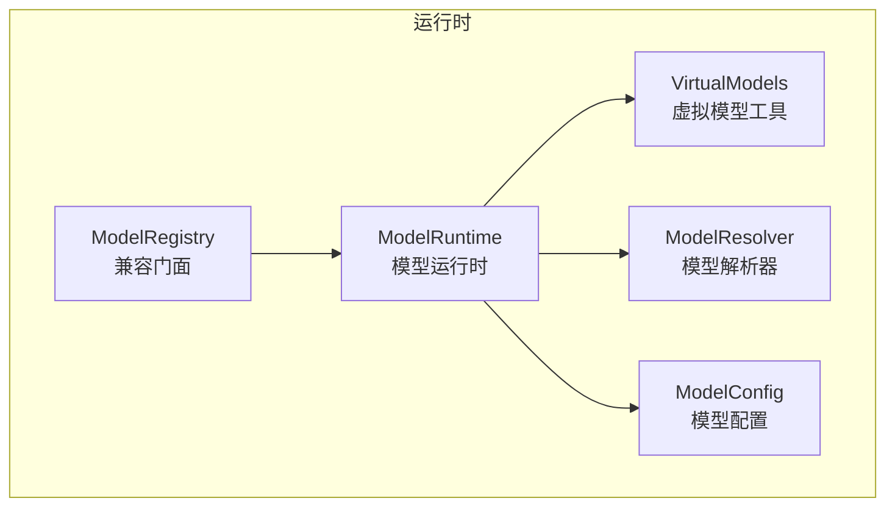
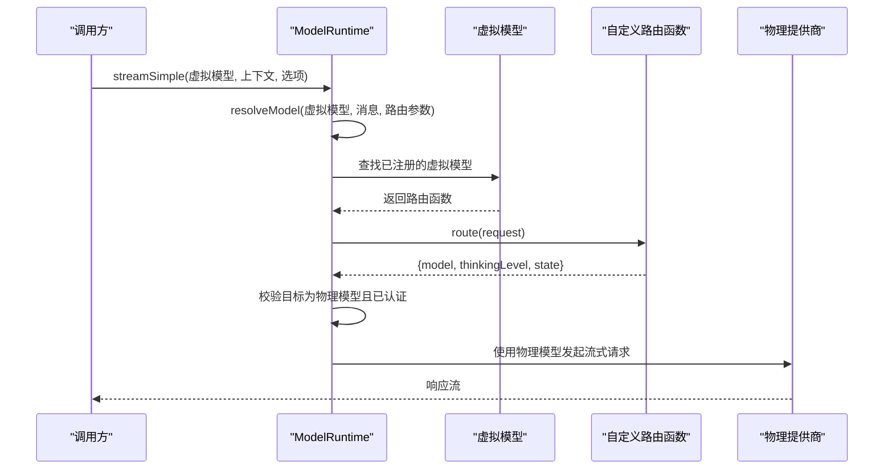
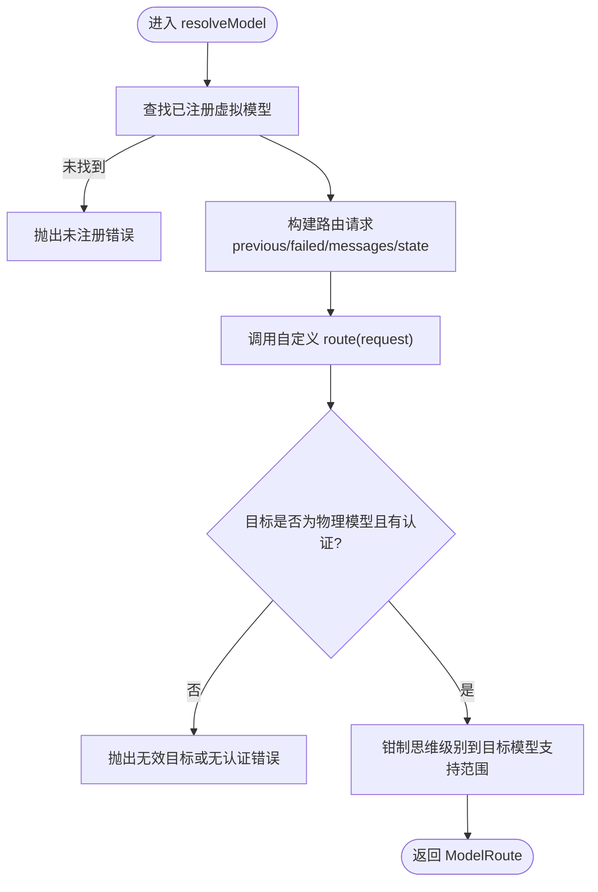
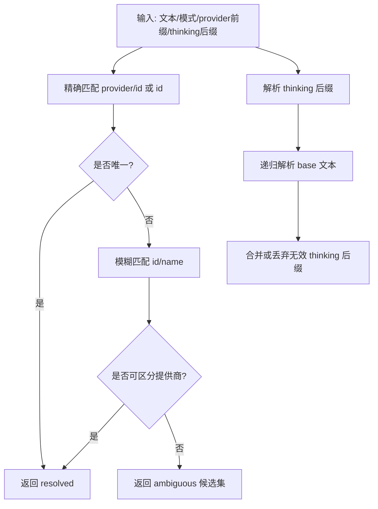
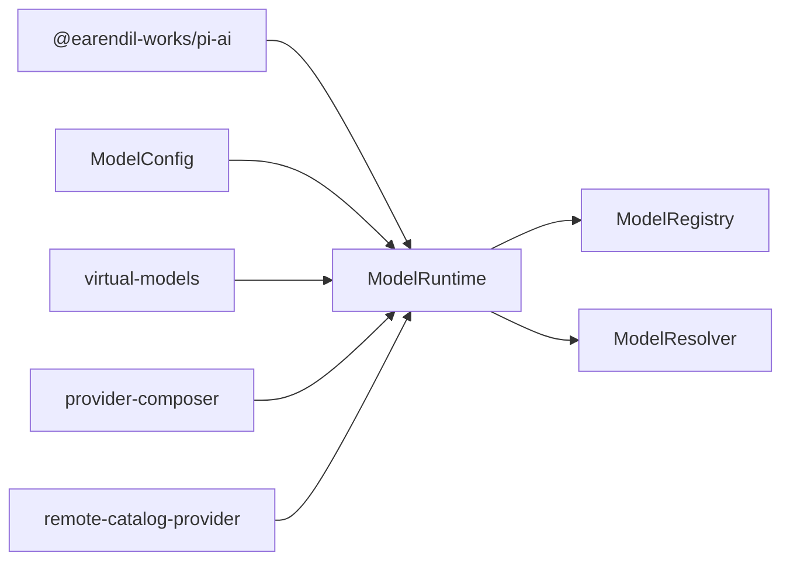
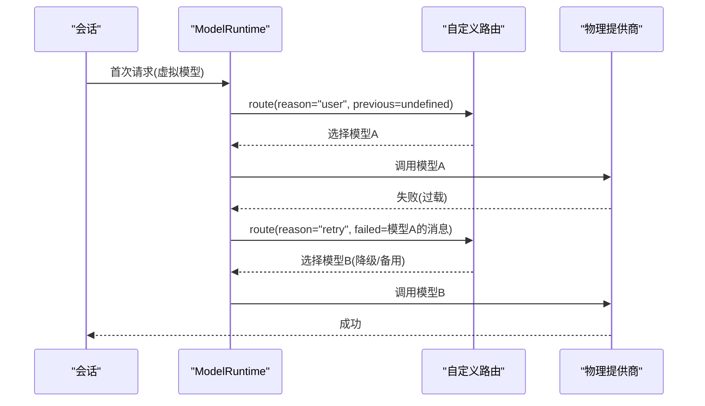

# 模型路由系统


**本文引用的文件**   
- [model-runtime.ts](https://github.com/FDE-GROUP/oh-my-fde/blob/main/packages/coding-agent/src/core/model-runtime.ts)
- [virtual-models.ts](https://github.com/FDE-GROUP/oh-my-fde/blob/main/packages/coding-agent/src/core/virtual-models.ts)
- [model-resolver.ts](https://github.com/FDE-GROUP/oh-my-fde/blob/main/packages/coding-agent/src/core/model-resolver.ts)
- [model-config.ts](https://github.com/FDE-GROUP/oh-my-fde/blob/main/packages/coding-agent/src/core/model-config.ts)
- [model-registry.ts](https://github.com/FDE-GROUP/oh-my-fde/blob/main/packages/coding-agent/src/core/model-registry.ts)
- [virtual-models.test.ts](https://github.com/FDE-GROUP/oh-my-fde/blob/main/packages/coding-agent/test/virtual-models.test.ts)


## 目录
1. [引言](#引言)
2. [项目结构](#项目结构)
3. [核心组件](#核心组件)
4. [架构总览](#架构总览)
5. [详细组件分析](#详细组件分析)
6. [依赖关系分析](#依赖关系分析)
7. [性能与成本优化](#性能与成本优化)
8. [故障转移与负载均衡](#故障转移与负载均衡)
9. [自定义路由开发指南](#自定义路由开发指南)
10. [疑难排查](#疑难排查)
11. [结论](#结论)

## 引言
本文件系统性梳理仓库中的“模型路由系统”，重点解释：
- 虚拟模型的创建、注册与目录挂载机制
- 模型选择算法与路由策略
- 思维级别控制、成本优化与性能调优
- 动态模型切换、负载均衡与故障转移的实现原理
- 面向开发者的自定义路由实现指南

该系统以“虚拟模型”为抽象，将用户或上层逻辑选择的“路由入口”与实际调用物理模型的过程解耦。所有请求在进入具体提供商之前，都会经过一次路由决策，从而支持按上下文、失败历史、成本、能力等维度进行智能调度。

## 项目结构
围绕模型路由的核心代码集中在 coding-agent 包的 core 层：
- model-runtime.ts：运行时入口，负责模型目录、认证、虚拟模型注册与路由执行
- virtual-models.ts：虚拟模型定义、状态、会话分支选择与目录包装
- model-resolver.ts：模型引用解析、范围匹配、初始模型选择
- model-config.ts：models.json 配置加载与校验
- model-registry.ts：对外同步兼容门面，暴露常用 API



图表来源
- [model-runtime.ts:174-216](https://github.com/FDE-GROUP/oh-my-fde/blob/main/packages/coding-agent/src/core/model-runtime.ts#L174-L216)
- [virtual-models.ts:1-26](https://github.com/FDE-GROUP/oh-my-fde/blob/main/packages/coding-agent/src/core/virtual-models.ts#L1-L26)
- [model-resolver.ts:1-18](https://github.com/FDE-GROUP/oh-my-fde/blob/main/packages/coding-agent/src/core/model-resolver.ts#L1-L18)
- [model-config.ts:159-207](https://github.com/FDE-GROUP/oh-my-fde/blob/main/packages/coding-agent/src/core/model-config.ts#L159-L207)
- [model-registry.ts:48-53](https://github.com/FDE-GROUP/oh-my-fde/blob/main/packages/coding-agent/src/core/model-registry.ts#L48-L53)

章节来源
- [model-runtime.ts:174-216](https://github.com/FDE-GROUP/oh-my-fde/blob/main/packages/coding-agent/src/core/model-runtime.ts#L174-L216)
- [virtual-models.ts:1-26](https://github.com/FDE-GROUP/oh-my-fde/blob/main/packages/coding-agent/src/core/virtual-models.ts#L1-L26)
- [model-resolver.ts:1-18](https://github.com/FDE-GROUP/oh-my-fde/blob/main/packages/coding-agent/src/core/model-resolver.ts#L1-L18)
- [model-config.ts:159-207](https://github.com/FDE-GROUP/oh-my-fde/blob/main/packages/coding-agent/src/core/model-config.ts#L159-L207)
- [model-registry.ts:48-53](https://github.com/FDE-GROUP/oh-my-fde/blob/main/packages/coding-agent/src/core/model-registry.ts#L48-L53)

## 核心组件
- ModelRuntime：统一封装模型目录、提供商组合、认证、可用性刷新、虚拟模型注册与路由执行，是系统的运行时中枢。
- VirtualModels：定义虚拟模型元数据、会话分支选择、状态持久化、以及将虚拟模型注入到提供商目录的包装器。
- ModelResolver：处理命令行/配置中的模型引用解析、模糊匹配、默认模型选择与思维级别解析。
- ModelConfig：加载并校验 models.json，提供不可变配置快照。
- ModelRegistry：对扩展暴露的同步兼容门面，内部委托给 ModelRuntime。

章节来源
- [model-runtime.ts:174-216](https://github.com/FDE-GROUP/oh-my-fde/blob/main/packages/coding-agent/src/core/model-runtime.ts#L174-L216)
- [virtual-models.ts:28-102](https://github.com/FDE-GROUP/oh-my-fde/blob/main/packages/coding-agent/src/core/virtual-models.ts#L28-L102)
- [model-resolver.ts:19-63](https://github.com/FDE-GROUP/oh-my-fde/blob/main/packages/coding-agent/src/core/model-resolver.ts#L19-L63)
- [model-config.ts:159-207](https://github.com/FDE-GROUP/oh-my-fde/blob/main/packages/coding-agent/src/core/model-config.ts#L159-L207)
- [model-registry.ts:48-53](https://github.com/FDE-GROUP/oh-my-fde/blob/main/packages/coding-agent/src/core/model-registry.ts#L48-L53)

## 架构总览
下图展示从“选择虚拟模型”到“路由到物理模型”的端到端流程。



图表来源
- [model-runtime.ts:744-781](https://github.com/FDE-GROUP/oh-my-fde/blob/main/packages/coding-agent/src/core/model-runtime.ts#L744-L781)
- [model-runtime.ts:1040-1071](https://github.com/FDE-GROUP/oh-my-fde/blob/main/packages/coding-agent/src/core/model-runtime.ts#L1040-L1071)
- [virtual-models.ts:169-187](https://github.com/FDE-GROUP/oh-my-fde/blob/main/packages/coding-agent/src/core/virtual-models.ts#L169-L187)

## 详细组件分析

### 虚拟模型与路由协议
- 虚拟模型不是真实提供商模型，而是目录中的一个“路由入口”。其 api 标识为专用值，确保不会直接发送到提供商。
- 虚拟模型通过 createVirtualModel 生成目录条目，包含支持的思维级别映射、输入类型、成本（通常为 0）、上下文窗口与最大输出等元信息。
- withVirtualModels 将虚拟模型追加到提供商目录中，同时屏蔽同名物理聊天模型，避免冲突。
- 会话分支会记录最后一次“模型变更”和最近一次成功的物理回复，用于恢复与路由上下文。

```mermaid
classDiagram
class VirtualModelDefinition {
+string provider
+string id
+string name
+ModelThinkingLevel[] thinkingLevels
+number contextWindow
+number maxTokens
+("text"|"image")[] input
+route(request) ModelRoute
}
class ModelRouteRequest {
+Model model
+ModelThinkingLevel thinkingLevel
+ModelRouteReason reason
+{model, thinkingLevel} previous
+{model, thinkingLevel, message} failed
+unknown state
+Message[] messages
+AbortSignal signal
}
class ModelRoute {
+Model model
+ModelThinkingLevel thinkingLevel
+unknown state
}
VirtualModelDefinition --> ModelRoute : "返回"
ModelRouteRequest --> ModelRoute : "输入"
```

图表来源
- [virtual-models.ts:84-102](https://github.com/FDE-GROUP/oh-my-fde/blob/main/packages/coding-agent/src/core/virtual-models.ts#L84-L102)
- [virtual-models.ts:52-82](https://github.com/FDE-GROUP/oh-my-fde/blob/main/packages/coding-agent/src/core/virtual-models.ts#L52-L82)

章节来源
- [virtual-models.ts:28-102](https://github.com/FDE-GROUP/oh-my-fde/blob/main/packages/coding-agent/src/core/virtual-models.ts#L28-L102)
- [virtual-models.ts:169-187](https://github.com/FDE-GROUP/oh-my-fde/blob/main/packages/coding-agent/src/core/virtual-models.ts#L169-L187)
- [virtual-models.ts:120-167](https://github.com/FDE-GROUP/oh-my-fde/blob/main/packages/coding-agent/src/core/virtual-models.ts#L120-L167)

### ModelRuntime：路由执行与生命周期
- 构造与初始化：加载 ModelConfig，构建提供商集合，按需启用远程目录刷新，重建提供商与模型快照。
- 提供商组合：根据配置与扩展注册，组合出最终 Provider；若组合失败则保留基础实现并记录错误。
- 虚拟模型注册：
  - registerVirtualModel：校验不与物理模型冲突，创建虚拟模型条目，维护 provider→id→RegisteredVirtualModel 映射，必要时标记仅含虚拟模型的提供商为“已配置”。
  - unregisterVirtualModel：移除后重建提供商与快照。
- 路由执行：resolveModel 接收虚拟模型、消息与路由参数，调用已注册路由函数，校验返回的目标必须是物理模型且具备认证，最后将思维级别钳制到目标模型支持的范围。
- 简单流式接口：streamSimple 在检测到虚拟模型时先走 resolveModel，再递归调用自身，确保外部传入的预算被限制到实际物理模型的能力范围内。



图表来源
- [model-runtime.ts:1040-1071](https://github.com/FDE-GROUP/oh-my-fde/blob/main/packages/coding-agent/src/core/model-runtime.ts#L1040-L1071)

章节来源
- [model-runtime.ts:218-269](https://github.com/FDE-GROUP/oh-my-fde/blob/main/packages/coding-agent/src/core/model-runtime.ts#L218-L269)
- [model-runtime.ts:327-341](https://github.com/FDE-GROUP/oh-my-fde/blob/main/packages/coding-agent/src/core/model-runtime.ts#L327-L341)
- [model-runtime.ts:1001-1029](https://github.com/FDE-GROUP/oh-my-fde/blob/main/packages/coding-agent/src/core/model-runtime.ts#L1001-L1029)
- [model-runtime.ts:1040-1071](https://github.com/FDE-GROUP/oh-my-fde/blob/main/packages/coding-agent/src/core/model-runtime.ts#L1040-L1071)
- [model-runtime.ts:744-781](https://github.com/FDE-GROUP/oh-my-fde/blob/main/packages/coding-agent/src/core/model-runtime.ts#L744-L781)

### 模型选择与参考解析
- resolveModelReference：支持 bare id、provider/id、thinking 后缀、模糊匹配与多提供商歧义报告。
- resolveModelScopeFromModels：将 --models 或 enabledModels 模式解析为带可选思维级别的 ScopedModel 列表，支持 glob 与警告诊断。
- findInitialModel：初始模型优先级：作用域模型 → 设置中的默认模型 → 首个可用模型；同时考虑 per-model 的思维级别。
- restoreModelFromSession：尝试恢复上次会话的模型，若不存在或无认证则回退到当前模型或首个可用模型。



图表来源
- [model-resolver.ts:150-177](https://github.com/FDE-GROUP/oh-my-fde/blob/main/packages/coding-agent/src/core/model-resolver.ts#L150-L177)
- [model-resolver.ts:192-227](https://github.com/FDE-GROUP/oh-my-fde/blob/main/packages/coding-agent/src/core/model-resolver.ts#L192-L227)
- [model-resolver.ts:236-296](https://github.com/FDE-GROUP/oh-my-fde/blob/main/packages/coding-agent/src/core/model-resolver.ts#L236-L296)

章节来源
- [model-resolver.ts:19-63](https://github.com/FDE-GROUP/oh-my-fde/blob/main/packages/coding-agent/src/core/model-resolver.ts#L19-L63)
- [model-resolver.ts:150-177](https://github.com/FDE-GROUP/oh-my-fde/blob/main/packages/coding-agent/src/core/model-resolver.ts#L150-L177)
- [model-resolver.ts:333-407](https://github.com/FDE-GROUP/oh-my-fde/blob/main/packages/coding-agent/src/core/model-resolver.ts#L333-L407)
- [model-resolver.ts:549-616](https://github.com/FDE-GROUP/oh-my-fde/blob/main/packages/coding-agent/src/core/model-resolver.ts#L549-L616)
- [model-resolver.ts:621-690](https://github.com/FDE-GROUP/oh-my-fde/blob/main/packages/coding-agent/src/core/model-resolver.ts#L621-L690)

### 配置与认证
- ModelConfig：读取 models.json，支持注释与 BOM，严格校验 schema，冻结对象保证不可变。
- ModelRuntime：
  - getAuth：合并运行时 apiKey、环境变量头与提供商配置头，支持 baseUrl 覆盖。
  - refresh：重载配置、重建提供商、刷新目录与可用性快照，支持按提供商增量刷新。
  - setRuntimeApiKey/removeRuntimeApiKey：队列化凭证操作，避免竞态，并在成功后同步目录与可用性。

章节来源
- [model-config.ts:159-207](https://github.com/FDE-GROUP/oh-my-fde/blob/main/packages/coding-agent/src/core/model-config.ts#L159-L207)
- [model-runtime.ts:556-578](https://github.com/FDE-GROUP/oh-my-fde/blob/main/packages/coding-agent/src/core/model-runtime.ts#L556-L578)
- [model-runtime.ts:885-926](https://github.com/FDE-GROUP/oh-my-fde/blob/main/packages/coding-agent/src/core/model-runtime.ts#L885-L926)
- [model-runtime.ts:622-641](https://github.com/FDE-GROUP/oh-my-fde/blob/main/packages/coding-agent/src/core/model-runtime.ts#L622-L641)

### 兼容性门面
- ModelRegistry：对扩展暴露同步方法，内部委托 ModelRuntime，包括流式调用、分类、图像生成、提供商注册与虚拟模型注册等。

章节来源
- [model-registry.ts:48-53](https://github.com/FDE-GROUP/oh-my-fde/blob/main/packages/coding-agent/src/core/model-registry.ts#L48-L53)
- [model-registry.ts:128-188](https://github.com/FDE-GROUP/oh-my-fde/blob/main/packages/coding-agent/src/core/model-registry.ts#L128-L188)
- [model-registry.ts:210-243](https://github.com/FDE-GROUP/oh-my-fde/blob/main/packages/coding-agent/src/core/model-registry.ts#L210-L243)

## 依赖关系分析
- ModelRuntime 依赖：
  - @earendil-works/pi-ai：模型、提供商、流式接口、工具函数
  - ModelConfig：不可变配置快照
  - virtual-models：虚拟模型工具与协议
  - provider-composer：提供商组合与头部合并
  - remote-catalog-provider：远程目录增强
- ModelResolver 依赖：
  - pi-ai：模型与比较工具
  - cli/args：思维级别校验
  - defaults：默认思维级别
- ModelRegistry 依赖：
  - ModelRuntime：所有能力的代理



图表来源
- [model-runtime.ts:1-95](https://github.com/FDE-GROUP/oh-my-fde/blob/main/packages/coding-agent/src/core/model-runtime.ts#L1-L95)
- [model-resolver.ts:1-18](https://github.com/FDE-GROUP/oh-my-fde/blob/main/packages/coding-agent/src/core/model-resolver.ts#L1-L18)
- [model-registry.ts:1-31](https://github.com/FDE-GROUP/oh-my-fde/blob/main/packages/coding-agent/src/core/model-registry.ts#L1-L31)

章节来源
- [model-runtime.ts:1-95](https://github.com/FDE-GROUP/oh-my-fde/blob/main/packages/coding-agent/src/core/model-runtime.ts#L1-L95)
- [model-resolver.ts:1-18](https://github.com/FDE-GROUP/oh-my-fde/blob/main/packages/coding-agent/src/core/model-resolver.ts#L1-L18)
- [model-registry.ts:1-31](https://github.com/FDE-GROUP/oh-my-fde/blob/main/packages/coding-agent/src/core/model-registry.ts#L1-L31)

## 性能与成本优化
- 思维级别控制
  - 虚拟模型声明支持的 thinkingLevels，并通过 thinkingLevelMap 映射到目标模型支持范围。
  - resolveModel 返回的 thinkingLevel 会被 clampThinkingLevel 钳制到目标模型支持的值，避免不支持的思维级别导致失败。
  - 非 agent 循环的直接调用（如 completeSimple）会将 reasoning 透传到路由结果，并根据物理模型的最大输出限制裁剪 caller 指定的 maxTokens。
- 成本优化
  - 虚拟模型的成本字段通常为零，实际成本由物理模型决定；可在路由中优先选择低成本模型，或在 thinkingLevel 上降级。
  - 通过 thinkingLevel 控制推理强度，平衡质量与成本。
- 性能调优
  - 使用 available 快照减少重复网络请求；仅在需要时触发 refresh。
  - 按提供商增量刷新 availability，降低全量刷新开销。
  - 避免在高频路径中进行昂贵的路由计算，可将稳定策略缓存于路由 state。

章节来源
- [virtual-models.ts:169-187](https://github.com/FDE-GROUP/oh-my-fde/blob/main/packages/coding-agent/src/core/virtual-models.ts#L169-L187)
- [model-runtime.ts:1040-1071](https://github.com/FDE-GROUP/oh-my-fde/blob/main/packages/coding-agent/src/core/model-runtime.ts#L1040-L1071)
- [model-runtime.ts:744-781](https://github.com/FDE-GROUP/oh-my-fde/blob/main/packages/coding-agent/src/core/model-runtime.ts#L744-L781)
- [model-runtime.ts:343-440](https://github.com/FDE-GROUP/oh-my-fde/blob/main/packages/coding-agent/src/core/model-runtime.ts#L343-L440)

## 故障转移与负载均衡
- 故障转移
  - 路由请求携带 failed 字段，包含失败的物理模型与消息，便于路由策略根据错误类型（如过载、限流）切换到备用模型。
  - 测试用例验证了重试场景下，路由能感知 failed 与 previous，保持会话一致性。
- 负载均衡
  - 路由函数可根据 messages 长度、工具调用次数、历史成功率、成本等指标，在不同物理模型间分配流量。
  - 结合 thinkingLevel，可在高负载时降级到较小模型，维持吞吐。
- 动态模型切换
  - 会话分支会记住“模型变更”与最近成功物理回复；当虚拟模型仍被选中时，后续请求继续路由，而不是锁定到上一次物理模型。
  - 若虚拟模型被注销，会话自动回退到上次回答的物理模型。



图表来源
- [virtual-models.test.ts:140-155](https://github.com/FDE-GROUP/oh-my-fde/blob/main/packages/coding-agent/test/virtual-models.test.ts#L140-L155)
- [model-runtime.ts:1040-1071](https://github.com/FDE-GROUP/oh-my-fde/blob/main/packages/coding-agent/src/core/model-runtime.ts#L1040-L1071)

章节来源
- [virtual-models.test.ts:140-155](https://github.com/FDE-GROUP/oh-my-fde/blob/main/packages/coding-agent/test/virtual-models.test.ts#L140-L155)
- [virtual-models.ts:120-167](https://github.com/FDE-GROUP/oh-my-fde/blob/main/packages/coding-agent/src/core/virtual-models.ts#L120-L167)
- [model-runtime.ts:1040-1071](https://github.com/FDE-GROUP/oh-my-fde/blob/main/packages/coding-agent/src/core/model-runtime.ts#L1040-L1071)

## 自定义路由开发指南
- 注册虚拟模型
  - 通过 runtime.registerVirtualModel 或 registry.registerVirtualModel 注册，指定 provider、id、name、thinkingLevels、input、contextWindow、maxTokens 与 route 函数。
  - 注意 id 不能与同一 provider 下的物理模型冲突。
- 路由函数签名
  - route(request): ModelRoute | Promise\<ModelRoute>
  - request.model：选中的虚拟模型
  - request.thinkingLevel：用户或上层期望的思维级别
  - request.reason：user/continuation/retry/direct
  - request.previous：最近一次成功的物理模型及其思维级别
  - request.failed：失败请求的模型与消息（仅 retry）
  - request.state：路由状态（可由调用方存储与恢复）
  - request.messages：对话上下文
- 返回值
  - model：必须为物理模型且具备认证
  - thinkingLevel：将被钳制到目标模型支持范围
  - state：可序列化状态，供下次路由复用
- 最佳实践
  - 基于 reason 区分首次用户请求与续传/重试，避免不必要的重选。
  - 利用 previous 与 failed 做稳定性与容错：失败时回退到上一成功模型或降级。
  - 根据 messages 长度与复杂度选择不同规格模型，兼顾延迟与成本。
  - 将昂贵计算结果缓存到 state，避免重复评估。
  - 明确 input 类型，避免向不支持图片的模型发送图像。
  - 谨慎设置 contextWindow 与 maxTokens，避免超出物理模型能力。

章节来源
- [model-runtime.ts:1001-1029](https://github.com/FDE-GROUP/oh-my-fde/blob/main/packages/coding-agent/src/core/model-runtime.ts#L1001-L1029)
- [virtual-models.ts:84-102](https://github.com/FDE-GROUP/oh-my-fde/blob/main/packages/coding-agent/src/core/virtual-models.ts#L84-L102)
- [virtual-models.ts:169-187](https://github.com/FDE-GROUP/oh-my-fde/blob/main/packages/coding-agent/src/core/virtual-models.ts#L169-L187)
- [virtual-models.test.ts:117-138](https://github.com/FDE-GROUP/oh-my-fde/blob/main/packages/coding-agent/test/virtual-models.test.ts#L117-L138)

## 疑难排查
- “虚拟模型必须先路由才能流式传输”
  - 原因：直接对虚拟模型调用底层流式接口而未先 resolveModel。
  - 解决：通过 runtime.streamSimple 或显式调用 resolveModel 后再转发。
- “虚拟模型未注册/路由到非物理模型/无认证”
  - 原因：registerVirtualModel 未调用、route 返回了虚拟模型或未知模型、目标提供商未配置认证。
  - 解决：检查注册顺序、route 返回值与提供商认证状态。
- “思维级别不生效或被忽略”
  - 原因：目标模型不支持该思维级别，已被钳制为 off 或其他支持值。
  - 解决：在虚拟模型声明中开启对应 thinkingLevels，或选择支持推理的模型。
- “直接调用 budget 超限”
  - 原因：caller 指定了较大的 maxTokens，但物理模型上限更小。
  - 解决：runtime 会自动取 min(options.maxTokens, physical.maxTokens)，请确认物理模型能力。

章节来源
- [virtual-models.ts:189-194](https://github.com/FDE-GROUP/oh-my-fde/blob/main/packages/coding-agent/src/core/virtual-models.ts#L189-L194)
- [model-runtime.ts:1040-1071](https://github.com/FDE-GROUP/oh-my-fde/blob/main/packages/coding-agent/src/core/model-runtime.ts#L1040-L1071)
- [virtual-models.test.ts:210-231](https://github.com/FDE-GROUP/oh-my-fde/blob/main/packages/coding-agent/test/virtual-models.test.ts#L210-L231)

## 结论
模型路由系统通过“虚拟模型”将高层选择与底层物理模型解耦，提供了灵活、可扩展的路由机制。开发者可以在路由函数中综合上下文、失败历史、成本与能力等因素，实现智能的动态模型切换、负载均衡与故障转移。配合思维级别控制与预算裁剪，系统能在质量、成本与性能之间取得良好平衡。对于扩展与集成，ModelRegistry 提供了简洁的同步门面，而 ModelRuntime 则承担全部复杂性与一致性保障。