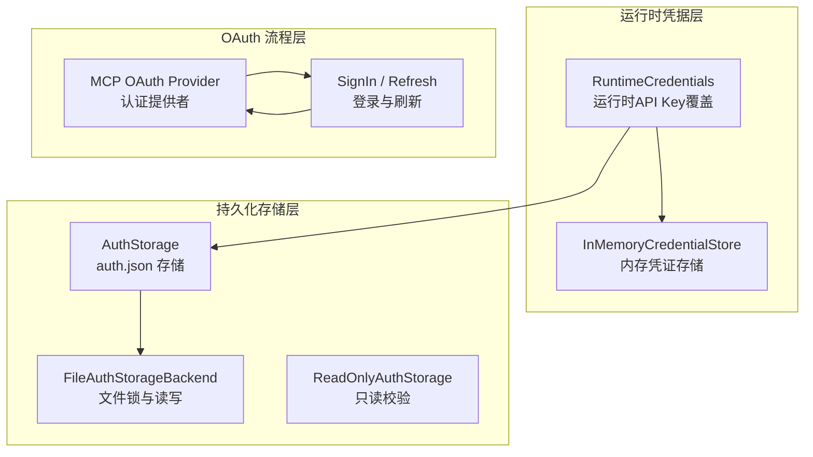
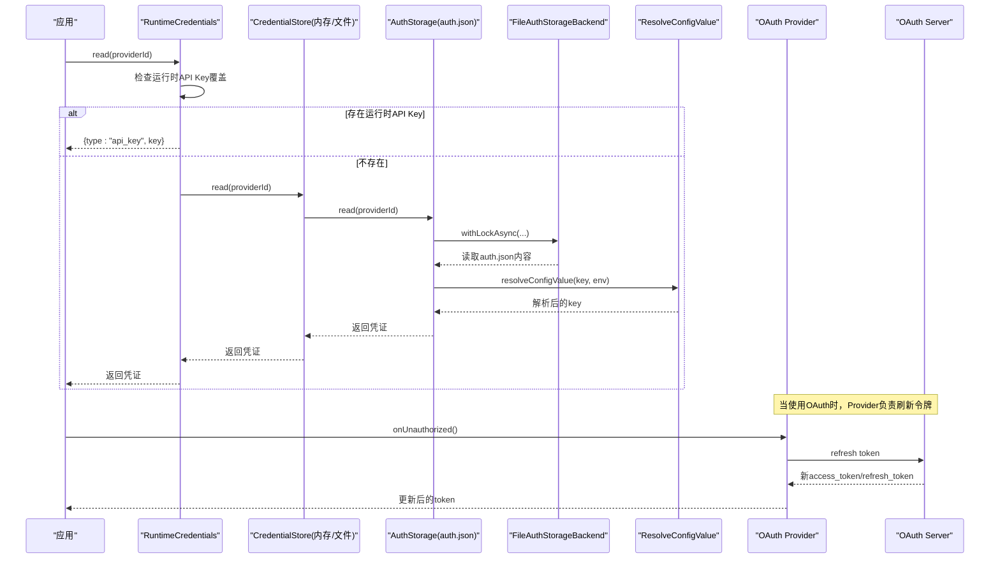
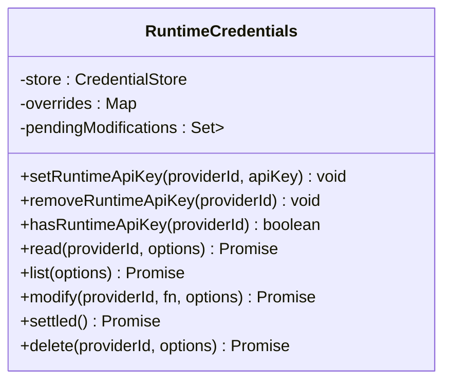
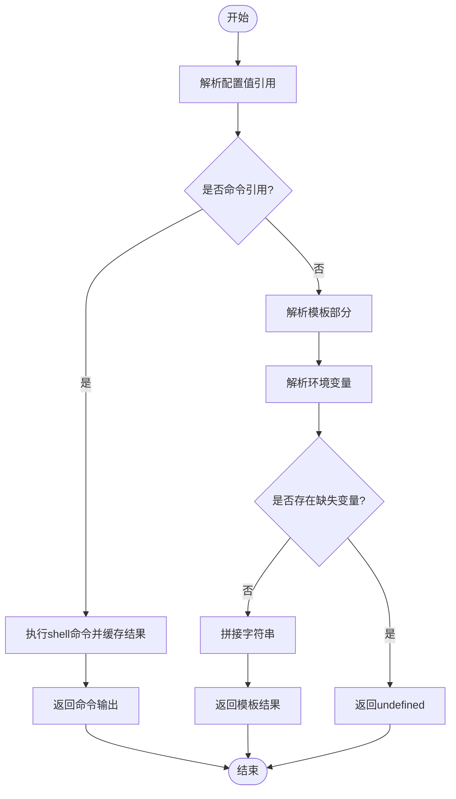
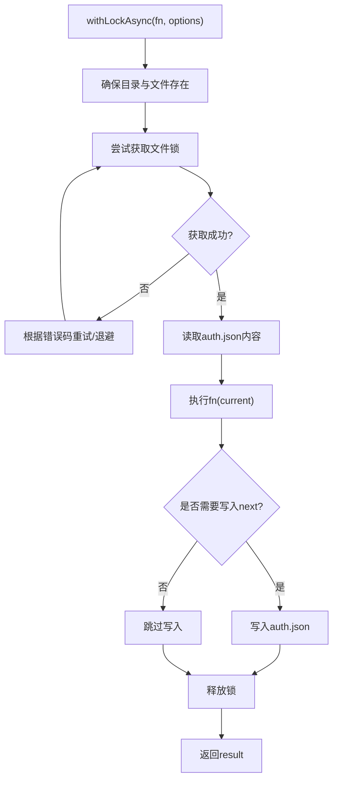
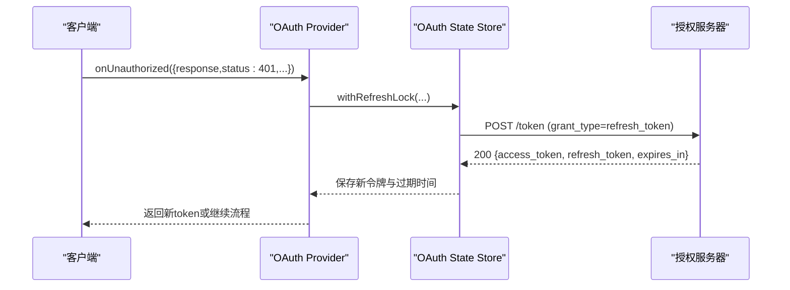
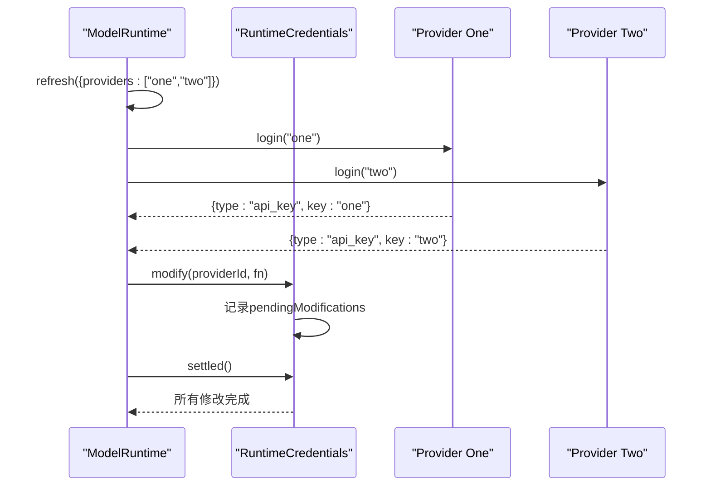
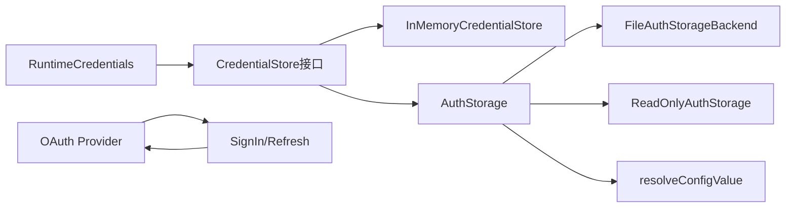

# 认证管理系统

**本文引用的文件**   
- [runtime-credentials.ts](https://github.com/FDE-GROUP/oh-my-fde/blob/main/packages/coding-agent/src/core/runtime-credentials.ts)
- [credential-store.ts](https://github.com/FDE-GROUP/oh-my-fde/blob/main/packages/ai/src/auth/credential-store.ts)
- [auth-storage.ts](https://github.com/FDE-GROUP/oh-my-fde/blob/main/packages/coding-agent/src/core/auth-storage.ts)
- [resolve-config-value.ts](https://github.com/FDE-GROUP/oh-my-fde/blob/main/packages/coding-agent/src/core/resolve-config-value.ts)
- [auth-provider.ts](https://github.com/FDE-GROUP/oh-my-fde/blob/main/packages/mcp/src/oauth/auth-provider.ts)
- [sign-in.ts](https://github.com/FDE-GROUP/oh-my-fde/blob/main/packages/mcp/src/oauth/sign-in.ts)
- [authorization-server.ts](https://github.com/FDE-GROUP/oh-my-fde/blob/main/packages/mcp/test/authorization-server.ts)
- [oauth.test.ts](https://github.com/FDE-GROUP/oh-my-fde/blob/main/packages/mcp/test/oauth.test.ts)
- [model-runtime-credential-sync.test.ts](https://github.com/FDE-GROUP/oh-my-fde/blob/main/packages/coding-agent/test/model-runtime-credential-sync.test.ts)
- [runtime-credentials.test.ts](https://github.com/FDE-GROUP/oh-my-fde/blob/main/packages/coding-agent/test/runtime-credentials.test.ts)

## 目录
1. [引言](#引言)
2. [项目结构](#项目结构)
3. [核心组件](#核心组件)
4. [架构总览](#架构总览)
5. [详细组件分析](#详细组件分析)
6. [依赖关系分析](#依赖关系分析)
7. [性能与并发特性](#性能与并发特性)
8. [故障排查指南](#故障排查指南)
9. [结论](#结论)
10. [附录：配置示例与安全最佳实践](#附录配置示例与安全最佳实践)

## 引言
本文件面向开发者与维护者，系统化说明认证管理系统的整体设计与实现细节。重点围绕 RuntimeCredentials 类的设计与职责，解释 API Key 管理、OAuth 流程处理、环境变量注入以及运行时凭据同步机制；同时覆盖认证状态检查、令牌刷新策略、安全存储方案、错误处理与调试技巧，并提供扩展认证的安全最佳实践与常见问题解决方案。

## 项目结构
认证相关代码分布在多个包中，形成“运行时凭据层 + 持久化存储层 + OAuth 流程层”的分层结构：
- 运行时凭据层：提供非持久化的运行时 API Key 覆盖与操作信号透传。
- 持久化存储层：基于 JSON 文件的 auth.json 存储，支持读写锁、并发读取优化与只读模式。
- OAuth 流程层：负责授权码流程、刷新令牌、客户端注册与重定向等。

图表来源
- [runtime-credentials.ts:4-70](https://github.com/FDE-GROUP/oh-my-fde/blob/main/packages/coding-agent/src/core/runtime-credentials.ts#L4-L70)
- [credential-store.ts:9-67](https://github.com/FDE-GROUP/oh-my-fde/blob/main/packages/ai/src/auth/credential-store.ts#L9-L67)
- [auth-storage.ts:61-203](https://github.com/FDE-GROUP/oh-my-fde/blob/main/packages/coding-agent/src/core/auth-storage.ts#L61-L203)
- [auth-storage.ts:205-292](https://github.com/FDE-GROUP/oh-my-fde/blob/main/packages/coding-agent/src/core/auth-storage.ts#L205-L292)
- [auth-storage.ts:329-492](https://github.com/FDE-GROUP/oh-my-fde/blob/main/packages/coding-agent/src/core/auth-storage.ts#L329-L492)
- [auth-provider.ts:101-130](https://github.com/FDE-GROUP/oh-my-fde/blob/main/packages/mcp/src/oauth/auth-provider.ts#L101-L130)
- [sign-in.ts:84-118](https://github.com/FDE-GROUP/oh-my-fde/blob/main/packages/mcp/src/oauth/sign-in.ts#L84-L118)

章节来源
- [runtime-credentials.ts:4-70](https://github.com/FDE-GROUP/oh-my-fde/blob/main/packages/coding-agent/src/core/runtime-credentials.ts#L4-L70)
- [credential-store.ts:9-67](https://github.com/FDE-GROUP/oh-my-fde/blob/main/packages/ai/src/auth/credential-store.ts#L9-L67)
- [auth-storage.ts:61-203](https://github.com/FDE-GROUP/oh-my-fde/blob/main/packages/coding-agent/src/core/auth-storage.ts#L61-L203)
- [auth-storage.ts:329-492](https://github.com/FDE-GROUP/oh-my-fde/blob/main/packages/coding-agent/src/core/auth-storage.ts#L329-L492)
- [auth-provider.ts:101-130](https://github.com/FDE-GROUP/oh-my-fde/blob/main/packages/mcp/src/oauth/auth-provider.ts#L101-L130)
- [sign-in.ts:84-118](https://github.com/FDE-GROUP/oh-my-fde/blob/main/packages/mcp/src/oauth/sign-in.ts#L84-L118)

## 核心组件
- RuntimeCredentials：运行时凭据覆盖层，提供 API Key 的临时注入、删除、查询，并将 AbortSignal 透传给底层存储，同时跟踪未完成的修改以便等待所有写操作完成。
- CredentialStore（接口）：统一凭证访问抽象，定义 read/list/modify/delete 方法，供不同存储实现。
- InMemoryCredentialStore：默认内存实现，按 providerId 串行化写入，避免并发写冲突。
- AuthStorage：基于 auth.json 的持久化存储，包含文件后端、只读后端、内存后端，提供并发安全的读取缓存与写入锁。
- FileAuthStorageBackend：文件级锁实现，支持同步与异步加锁、EPERM/ELOCKED 重试、损坏检测。
- ReadOnlyAuthStorage：只读模式，对 auth.json 进行严格校验并解析环境变量或命令引用。
- resolveConfigValue：配置值解析器，支持 shell 命令执行与环境变量模板插值，用于动态注入 API Key。
- MCP OAuth Provider 与 SignIn/Refresh：实现 OAuth 授权码流程、刷新令牌、客户端注册与重定向，保证刷新操作的原子性与安全性。

章节来源
- [runtime-credentials.ts:4-70](https://github.com/FDE-GROUP/oh-my-fde/blob/main/packages/coding-agent/src/core/runtime-credentials.ts#L4-L70)
- [credential-store.ts:9-67](https://github.com/FDE-GROUP/oh-my-fde/blob/main/packages/ai/src/auth/credential-store.ts#L9-L67)
- [auth-storage.ts:61-203](https://github.com/FDE-GROUP/oh-my-fde/blob/main/packages/coding-agent/src/core/auth-storage.ts#L61-L203)
- [auth-storage.ts:205-292](https://github.com/FDE-GROUP/oh-my-fde/blob/main/packages/coding-agent/src/core/auth-storage.ts#L205-L292)
- [auth-storage.ts:329-492](https://github.com/FDE-GROUP/oh-my-fde/blob/main/packages/coding-agent/src/core/auth-storage.ts#L329-L492)
- [resolve-config-value.ts:145-251](https://github.com/FDE-GROUP/oh-my-fde/blob/main/packages/coding-agent/src/core/resolve-config-value.ts#L145-L251)
- [auth-provider.ts:101-130](https://github.com/FDE-GROUP/oh-my-fde/blob/main/packages/mcp/src/oauth/auth-provider.ts#L101-L130)
- [sign-in.ts:84-118](https://github.com/FDE-GROUP/oh-my-fde/blob/main/packages/mcp/src/oauth/sign-in.ts#L84-L118)

## 架构总览
下图展示从应用调用到凭据获取与 OAuth 刷新的完整路径：

图表来源
- [runtime-credentials.ts:26-30](https://github.com/FDE-GROUP/oh-my-fde/blob/main/packages/coding-agent/src/core/runtime-credentials.ts#L26-L30)
- [auth-storage.ts:443-449](https://github.com/FDE-GROUP/oh-my-fde/blob/main/packages/coding-agent/src/core/auth-storage.ts#L443-L449)
- [auth-storage.ts:451-473](https://github.com/FDE-GROUP/oh-my-fde/blob/main/packages/coding-agent/src/core/auth-storage.ts#L451-L473)
- [auth-storage.ts:159-202](https://github.com/FDE-GROUP/oh-my-fde/blob/main/packages/coding-agent/src/core/auth-storage.ts#L159-L202)
- [resolve-config-value.ts:145-151](https://github.com/FDE-GROUP/oh-my-fde/blob/main/packages/coding-agent/src/core/resolve-config-value.ts#L145-L151)
- [auth-provider.ts:101-130](https://github.com/FDE-GROUP/oh-my-fde/blob/main/packages/mcp/src/oauth/auth-provider.ts#L101-L130)

## 详细组件分析

### RuntimeCredentials 设计架构
- 运行时 API Key 管理：通过 Map 维护 providerId -> apiKey 的覆盖表，支持 set/remove/has 操作。
- 读取优先级：read 优先返回运行时覆盖的 API Key，否则委托给底层 store.read。
- 列表合并：list 将底层存储的凭证信息与运行时覆盖项合并，确保 list 反映当前运行时状态。
- 修改追踪：modify 包装底层 modify，记录 pendingModifications，提供 settled 等待所有未完成写操作完成，防止因提前退出导致已消费的刷新令牌残留。
- 信号透传：所有操作均透传 AbortSignal，支持取消与超时控制。

图表来源
- [runtime-credentials.ts:4-70](https://github.com/FDE-GROUP/oh-my-fde/blob/main/packages/coding-agent/src/core/runtime-credentials.ts#L4-L70)

章节来源
- [runtime-credentials.ts:4-70](https://github.com/FDE-GROUP/oh-my-fde/blob/main/packages/coding-agent/src/core/runtime-credentials.ts#L4-L70)
- [runtime-credentials.test.ts:27-61](https://github.com/FDE-GROUP/oh-my-fde/blob/main/packages/coding-agent/test/runtime-credentials.test.ts#L27-L61)

### 环境变量注入与配置值解析
- 支持两种形式：
  - 命令引用：以 “!” 开头，执行 shell 命令并取 stdout 作为值（带进程级缓存）。
  - 模板插值：支持 $ENV_VAR 与 ${ENV_VAR}，缺失变量会返回 undefined。
- 在只读存储与持久化存储中，读取 API Key 时会调用 resolveConfigValue 进行解析。
- 提供辅助函数用于诊断缺失的环境变量名、强制抛错等。

图表来源
- [resolve-config-value.ts:80-86](https://github.com/FDE-GROUP/oh-my-fde/blob/main/packages/coding-agent/src/core/resolve-config-value.ts#L80-L86)
- [resolve-config-value.ts:101-113](https://github.com/FDE-GROUP/oh-my-fde/blob/main/packages/coding-agent/src/core/resolve-config-value.ts#L101-L113)
- [resolve-config-value.ts:145-151](https://github.com/FDE-GROUP/oh-my-fde/blob/main/packages/coding-agent/src/core/resolve-config-value.ts#L145-L151)
- [resolve-config-value.ts:198-216](https://github.com/FDE-GROUP/oh-my-fde/blob/main/packages/coding-agent/src/core/resolve-config-value.ts#L198-L216)
- [resolve-config-value.ts:229-251](https://github.com/FDE-GROUP/oh-my-fde/blob/main/packages/coding-agent/src/core/resolve-config-value.ts#L229-L251)

章节来源
- [resolve-config-value.ts:145-251](https://github.com/FDE-GROUP/oh-my-fde/blob/main/packages/coding-agent/src/core/resolve-config-value.ts#L145-L251)
- [auth-storage.ts:260-269](https://github.com/FDE-GROUP/oh-my-fde/blob/main/packages/coding-agent/src/core/auth-storage.ts#L260-L269)
- [auth-storage.ts:443-449](https://github.com/FDE-GROUP/oh-my-fde/blob/main/packages/coding-agent/src/core/auth-storage.ts#L443-L449)

### 持久化存储与安全方案
- 文件锁与并发：
  - 同步 withLock：适用于简单场景，内部确保父目录与文件存在，加锁后读取/写入。
  - 异步 withLockAsync：支持 AbortSignal、EPERM/ELOCKED 重试、stale 锁检测、损坏回调。
- 读取优化：
  - 共享读取状态与版本控制，避免重复 IO。
  - 并发读者共享 reload promise，完成后清理控制器。
- 只读模式：
  - 严格校验 auth.json 结构与字段类型，拒绝非法数据。
  - 对 API Key 支持命令引用与环境变量解析。
- 权限与模式：
  - 文件写入模式为 0o600，目录创建为 0o700，最小权限原则。

图表来源
- [auth-storage.ts:159-202](https://github.com/FDE-GROUP/oh-my-fde/blob/main/packages/coding-agent/src/core/auth-storage.ts#L159-L202)
- [auth-storage.ts:451-473](https://github.com/FDE-GROUP/oh-my-fde/blob/main/packages/coding-agent/src/core/auth-storage.ts#L451-L473)
- [auth-storage.ts:205-292](https://github.com/FDE-GROUP/oh-my-fde/blob/main/packages/coding-agent/src/core/auth-storage.ts#L205-L292)

章节来源
- [auth-storage.ts:61-203](https://github.com/FDE-GROUP/oh-my-fde/blob/main/packages/coding-agent/src/core/auth-storage.ts#L61-L203)
- [auth-storage.ts:205-292](https://github.com/FDE-GROUP/oh-my-fde/blob/main/packages/coding-agent/src/core/auth-storage.ts#L205-L292)
- [auth-storage.ts:329-492](https://github.com/FDE-GROUP/oh-my-fde/blob/main/packages/coding-agent/src/core/auth-storage.ts#L329-L492)

### OAuth 流程处理与令牌刷新策略
- 刷新入口：
  - refreshStoredTokens：在持有刷新锁的前提下刷新令牌，不注册用户，仅刷新。
  - refreshBeforeSignIn：在登录前尝试刷新，若失败则回退到用户重定向登录。
- 刷新策略：
  - 使用 stored refresh_token 向授权服务器请求新 access_token 与可能的旋转后的 refresh_token。
  - 多请求并发时，通过刷新锁避免重复刷新与令牌竞争。
- 错误处理：
  - 401 Unauthorized 触发刷新；若刷新失败或需要 step-up，抛出授权所需异常并保留待处理登录状态。
  - 测试用例验证了并发刷新不会重复刷新，且最终保存新 refresh_token 与过期时间。

图表来源
- [auth-provider.ts:101-130](https://github.com/FDE-GROUP/oh-my-fde/blob/main/packages/mcp/src/oauth/auth-provider.ts#L101-L130)
- [sign-in.ts:84-118](https://github.com/FDE-GROUP/oh-my-fde/blob/main/packages/mcp/src/oauth/sign-in.ts#L84-L118)
- [oauth.test.ts:309-349](https://github.com/FDE-GROUP/oh-my-fde/blob/main/packages/mcp/test/oauth.test.ts#L309-L349)
- [authorization-server.ts:66-88](https://github.com/FDE-GROUP/oh-my-fde/blob/main/packages/mcp/test/authorization-server.ts#L66-L88)

章节来源
- [auth-provider.ts:101-130](https://github.com/FDE-GROUP/oh-my-fde/blob/main/packages/mcp/src/oauth/auth-provider.ts#L101-L130)
- [sign-in.ts:84-118](https://github.com/FDE-GROUP/oh-my-fde/blob/main/packages/mcp/src/oauth/sign-in.ts#L84-L118)
- [oauth.test.ts:309-349](https://github.com/FDE-GROUP/oh-my-fde/blob/main/packages/mcp/test/oauth.test.ts#L309-L349)
- [authorization-server.ts:66-88](https://github.com/FDE-GROUP/oh-my-fde/blob/main/packages/mcp/test/authorization-server.ts#L66-L88)

### 认证状态检查与运行时凭据同步
- 认证状态检查：
  - ModelRuntime 暴露 hasConfiguredAuth(providerId) 等方法，结合 Provider 的 login 能力判断是否已配置认证。
  - 测试用例展示了即使无网络也能恢复遗留的 OAuth 凭据目录。
- 运行时凭据同步：
  - RuntimeCredentials.settled 确保所有 pending modifications 完成后再退出，避免 OAuth 刷新过程中单用刷新令牌被消费但未落盘。
  - 并发登录与刷新：不同 Provider 可并行运行认证流程，互不阻塞。

图表来源
- [model-runtime-credential-sync.test.ts:111-150](https://github.com/FDE-GROUP/oh-my-fde/blob/main/packages/coding-agent/test/model-runtime-credential-sync.test.ts#L111-L150)
- [runtime-credentials.ts:41-63](https://github.com/FDE-GROUP/oh-my-fde/blob/main/packages/coding-agent/src/core/runtime-credentials.ts#L41-L63)

章节来源
- [model-runtime-credential-sync.test.ts:111-150](https://github.com/FDE-GROUP/oh-my-fde/blob/main/packages/coding-agent/test/model-runtime-credential-sync.test.ts#L111-L150)
- [runtime-credentials.ts:41-63](https://github.com/FDE-GROUP/oh-my-fde/blob/main/packages/coding-agent/src/core/runtime-credentials.ts#L41-L63)

## 依赖关系分析
- RuntimeCredentials 依赖 CredentialStore 接口，具体实现可为内存或文件存储。
- AuthStorage 依赖 FileAuthStorageBackend 与 InMemoryAuthStorageBackend，提供统一的 CredentialStore 实现。
- OAuth Provider 依赖授权服务器与本地状态存储，刷新逻辑由 refreshStoredTokens 与 refreshBeforeSignIn 协调。
- 配置值解析器被持久化存储与只读存储复用，确保 API Key 的动态注入一致性。

图表来源
- [runtime-credentials.ts:4-70](https://github.com/FDE-GROUP/oh-my-fde/blob/main/packages/coding-agent/src/core/runtime-credentials.ts#L4-L70)
- [credential-store.ts:9-67](https://github.com/FDE-GROUP/oh-my-fde/blob/main/packages/ai/src/auth/credential-store.ts#L9-L67)
- [auth-storage.ts:329-492](https://github.com/FDE-GROUP/oh-my-fde/blob/main/packages/coding-agent/src/core/auth-storage.ts#L329-L492)
- [auth-provider.ts:101-130](https://github.com/FDE-GROUP/oh-my-fde/blob/main/packages/mcp/src/oauth/auth-provider.ts#L101-L130)
- [sign-in.ts:84-118](https://github.com/FDE-GROUP/oh-my-fde/blob/main/packages/mcp/src/oauth/sign-in.ts#L84-L118)

章节来源
- [runtime-credentials.ts:4-70](https://github.com/FDE-GROUP/oh-my-fde/blob/main/packages/coding-agent/src/core/runtime-credentials.ts#L4-L70)
- [credential-store.ts:9-67](https://github.com/FDE-GROUP/oh-my-fde/blob/main/packages/ai/src/auth/credential-store.ts#L9-L67)
- [auth-storage.ts:329-492](https://github.com/FDE-GROUP/oh-my-fde/blob/main/packages/coding-agent/src/core/auth-storage.ts#L329-L492)
- [auth-provider.ts:101-130](https://github.com/FDE-GROUP/oh-my-fde/blob/main/packages/mcp/src/oauth/auth-provider.ts#L101-L130)
- [sign-in.ts:84-118](https://github.com/FDE-GROUP/oh-my-fde/blob/main/packages/mcp/src/oauth/sign-in.ts#L84-L118)

## 性能与并发特性
- 内存凭证存储：按 providerId 串行化写入，避免并发写冲突；读操作 O(1)。
- 文件存储：
  - 并发读取共享 reload promise，减少重复 IO。
  - 异步加锁支持指数退避与 EPERM/ELOCKED 重试，提升跨平台稳定性。
- 配置值解析：
  - shell 命令结果进程级缓存，避免重复执行。
  - 模板解析线性扫描，复杂度 O(n)。
- OAuth 刷新：
  - 刷新锁保证同一时刻只有一个刷新任务，避免令牌竞争与重复刷新。
  - 并发 401 请求去重，确保刷新结果一致。

[本节为通用性能讨论，不直接分析具体文件]

## 故障排查指南
- 环境变量缺失：
  - 使用 getConfigValueEnvVarNames 与 getMissingConfigValueEnvVarNames 定位缺失变量。
  - 使用 resolveConfigValueOrThrow 获取更明确的错误信息。
- 命令执行失败：
  - 检查 shell 配置与命令返回值；Windows 下可能走默认 shell 回退。
  - 清除命令缓存 clearConfigValueCache 以重新执行。
- 文件锁问题：
  - 关注 EPERM/ELOCKED 错误；确认是否有其他进程占用或杀毒软件干扰。
  - 检查 auth.json 权限与目录权限是否符合最小权限要求。
- OAuth 刷新失败：
  - 检查 refresh_token 是否有效；授权服务器可能返回 invalid_grant。
  - 确认 redirectUrl 是否在客户端元数据文档中列出。
  - 查看测试中的授权服务器模拟行为，定位刷新流程问题。

章节来源
- [resolve-config-value.ts:115-128](https://github.com/FDE-GROUP/oh-my-fde/blob/main/packages/coding-agent/src/core/resolve-config-value.ts#L115-L128)
- [resolve-config-value.ts:229-251](https://github.com/FDE-GROUP/oh-my-fde/blob/main/packages/coding-agent/src/core/resolve-config-value.ts#L229-L251)
- [resolve-config-value.ts:284-287](https://github.com/FDE-GROUP/oh-my-fde/blob/main/packages/coding-agent/src/core/resolve-config-value.ts#L284-L287)
- [auth-storage.ts:159-202](https://github.com/FDE-GROUP/oh-my-fde/blob/main/packages/coding-agent/src/core/auth-storage.ts#L159-L202)
- [oauth.test.ts:309-349](https://github.com/FDE-GROUP/oh-my-fde/blob/main/packages/mcp/test/oauth.test.ts#L309-L349)
- [authorization-server.ts:66-88](https://github.com/FDE-GROUP/oh-my-fde/blob/main/packages/mcp/test/authorization-server.ts#L66-L88)

## 结论
认证管理系统通过分层设计实现了灵活的凭据管理与安全的 OAuth 流程：
- RuntimeCredentials 提供运行时 API Key 覆盖与操作信号透传，增强灵活性与可控性。
- AuthStorage 与 FileAuthStorageBackend 提供高可靠、并发安全的持久化存储，支持只读校验与最小权限。
- OAuth Provider 与 SignIn/Refresh 实现健壮的令牌刷新策略，保证并发安全与用户体验。
- 配置值解析器统一了环境变量与命令注入方式，便于动态配置与调试。

建议在生产环境中：
- 使用环境变量或命令注入敏感值，避免硬编码。
- 合理设置文件权限与目录权限，遵循最小权限原则。
- 监控 OAuth 刷新日志与错误，及时处理令牌失效与重定向问题。
- 利用测试用例与诊断工具快速定位配置与流程问题。

[本节为总结性内容，不直接分析具体文件]

## 附录：配置示例与安全最佳实践

### 配置示例
- 环境变量注入 API Key：
  - 在 auth.json 中配置 provider 的 key 为 "$MY_API_KEY" 或 "${MY_API_KEY}"。
  - 确保环境变量 MY_API_KEY 已设置。
- 命令注入 API Key：
  - 在 auth.json 中配置 provider 的 key 为 "!echo $MY_API_KEY"。
  - 确保命令可执行且返回期望值。
- OAuth 配置：
  - 在 MCP 配置中指定 serverUrl、clientId、redirectUrl 等参数。
  - 首次登录会引导用户授权，后续自动刷新令牌。

[本节为概念性示例，不直接分析具体文件]

### 安全最佳实践
- 使用环境变量或命令注入敏感值，避免明文存储。
- 限制 auth.json 与目录权限为最小权限（0o600/0o700）。
- 定期轮换 OAuth refresh_token 与 client secret。
- 使用只读存储进行审计与校验，避免意外修改。
- 在 CI/CD 中注入环境变量，避免在仓库中提交敏感信息。

[本节为通用指导，不直接分析具体文件]