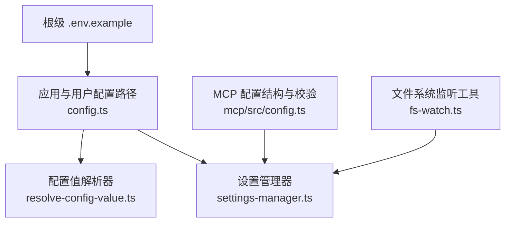
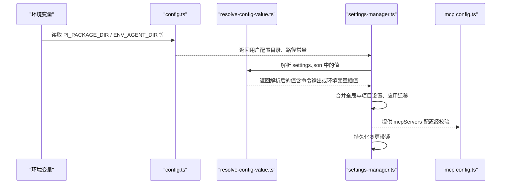
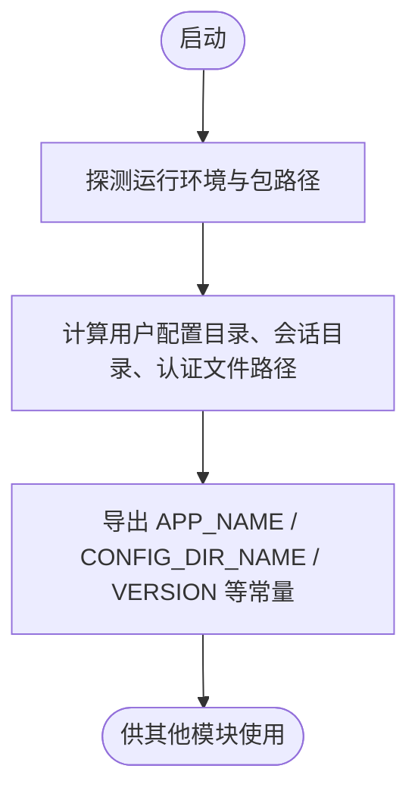
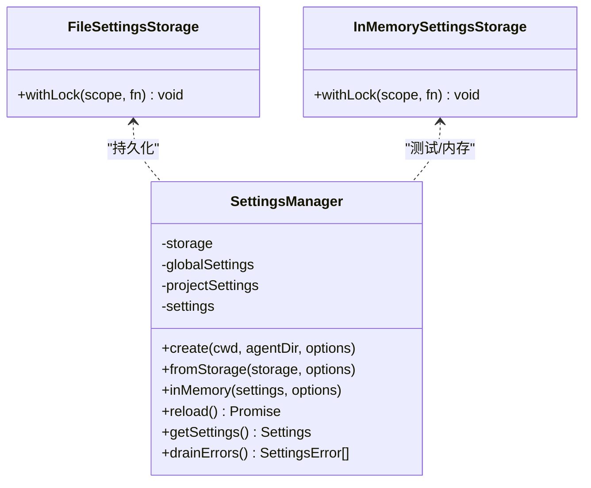
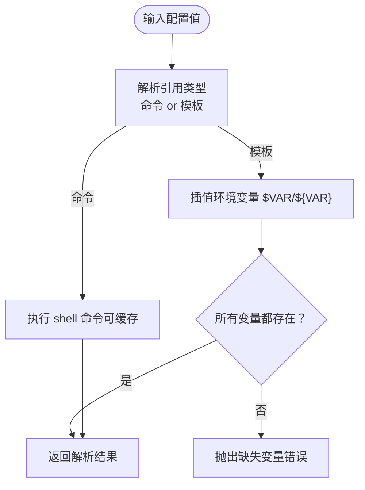
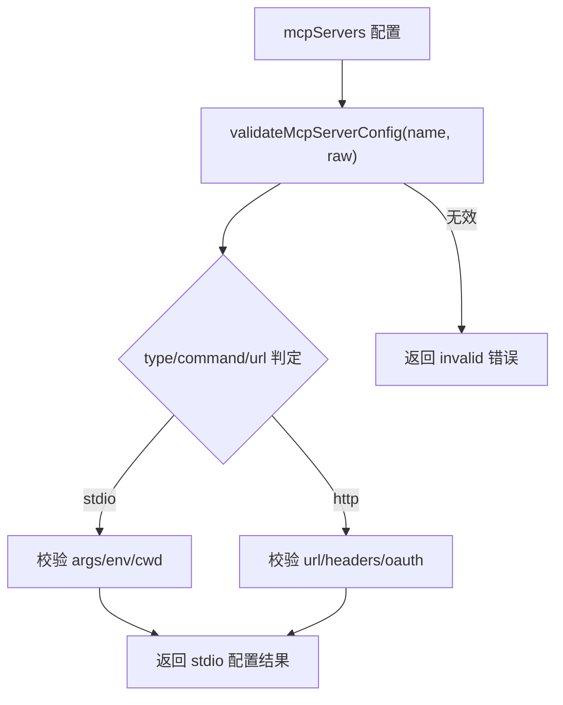
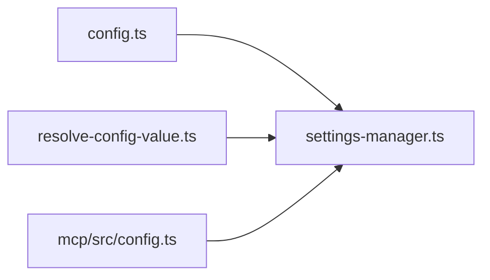

# 生产环境配置

**本文引用的文件**   
- [.env.example](https://github.com/FDE-GROUP/oh-my-fde/blob/main/.env.example)
- [packages/coding-agent/src/config.ts](https://github.com/FDE-GROUP/oh-my-fde/blob/main/packages/coding-agent/src/config.ts)
- [packages/coding-agent/src/core/resolve-config-value.ts](https://github.com/FDE-GROUP/oh-my-fde/blob/main/packages/coding-agent/src/core/resolve-config-value.ts)
- [packages/coding-agent/src/core/settings-manager.ts](https://github.com/FDE-GROUP/oh-my-fde/blob/main/packages/coding-agent/src/core/settings-manager.ts)
- [packages/mcp/src/config.ts](https://github.com/FDE-GROUP/oh-my-fde/blob/main/packages/mcp/src/config.ts)
- [packages/coding-agent/test/resolve-config-value.test.ts](https://github.com/FDE-GROUP/oh-my-fde/blob/main/packages/coding-agent/test/resolve-config-value.test.ts)
- [packages/coding-agent/test/config-value-migration.test.ts](https://github.com/FDE-GROUP/oh-my-fde/blob/main/packages/coding-agent/test/config-value-migration.test.ts)
- [packages/coding-agent/src/utils/fs-watch.ts](https://github.com/FDE-GROUP/oh-my-fde/blob/main/packages/coding-agent/src/utils/fs-watch.ts)

## 目录
1. [引言](#引言)
2. [项目结构](#项目结构)
3. [核心组件](#核心组件)
4. [架构总览](#架构总览)
5. [详细组件分析](#详细组件分析)
6. [依赖关系分析](#依赖关系分析)
7. [性能考虑](#性能考虑)
8. [故障排查指南](#故障排查指南)
9. [结论](#结论)
10. [附录：模板与迁移策略](#附录模板与迁移策略)

## 引言
本指南面向生产环境的配置管理，覆盖全局配置、项目配置与环境变量的最佳实践；说明配置验证、默认值管理、热重载与安全敏感信息处理；提供开发、测试、生产的配置模板建议与迁移策略；解释配置优先级、继承机制与调试方法。内容基于仓库中实际实现进行归纳，确保在生产部署时具备可操作性和可维护性。

## 项目结构
该仓库是一个多包（monorepo）工程，与“生产环境配置”直接相关的代码主要位于以下位置：
- 根级环境变量示例：`.env.example`
- 应用与用户配置路径解析：`packages/coding-agent/src/config.ts`
- 配置值解析（环境变量、命令注入、转义）：`packages/coding-agent/src/core/resolve-config-value.ts`
- 设置管理器（全局/项目设置合并、持久化、迁移、热重载）：`packages/coding-agent/src/core/settings-manager.ts`
- MCP 服务器配置结构与校验：`packages/mcp/src/config.ts`
- 文件系统监听工具（用于主题等热重载）：`packages/coding-agent/src/utils/fs-watch.ts`

**图表来源**
- [.env.example:1-4](https://github.com/FDE-GROUP/oh-my-fde/blob/main/.env.example#L1-L4)
- [packages/coding-agent/src/config.ts:577-682](https://github.com/FDE-GROUP/oh-my-fde/blob/main/packages/coding-agent/src/config.ts#L577-L682)
- [packages/coding-agent/src/core/settings-manager.ts:186-356](https://github.com/FDE-GROUP/oh-my-fde/blob/main/packages/coding-agent/src/core/settings-manager.ts#L186-L356)
- [packages/coding-agent/src/core/resolve-config-value.ts:1-151](https://github.com/FDE-GROUP/oh-my-fde/blob/main/packages/coding-agent/src/core/resolve-config-value.ts#L1-L151)
- [packages/mcp/src/config.ts:1-139](https://github.com/FDE-GROUP/oh-my-fde/blob/main/packages/mcp/src/config.ts#L1-L139)
- [packages/coding-agent/src/utils/fs-watch.ts:1-30](https://github.com/FDE-GROUP/oh-my-fde/blob/main/packages/coding-agent/src/utils/fs-watch.ts#L1-L30)

**章节来源**
- [.env.example:1-4](https://github.com/FDE-GROUP/oh-my-fde/blob/main/.env.example#L1-L4)
- [packages/coding-agent/src/config.ts:577-682](https://github.com/FDE-GROUP/oh-my-fde/blob/main/packages/coding-agent/src/config.ts#L577-L682)
- [packages/mcp/src/config.ts:1-139](https://github.com/FDE-GROUP/oh-my-fde/blob/main/packages/mcp/src/config.ts#L1-L139)

## 核心组件
- 配置路径与运行时常量
  - 通过 `config.ts` 暴露应用名、配置目录名、版本、以及用户配置目录（如 `~/.pi/agent`）、会话目录、认证文件路径、模型注册表路径、调试日志路径等。
  - 支持通过环境变量覆盖代理目录与会话目录，便于容器化或隔离部署。
- 设置管理器（SettingsManager）
  - 负责加载、合并、持久化全局与项目两套设置，支持字段级修改追踪、错误收集、迁移逻辑与热重载。
  - 提供锁机制保证并发安全，避免多进程同时写入导致损坏。
- 配置值解析器（resolve-config-value.ts）
  - 统一解析配置值中的环境变量引用、命令注入（以 `!` 开头）、字面量与转义规则。
  - 提供缓存与未缓存两种执行模式，并支持缺失变量检测与错误抛出。
- MCP 配置结构与校验
  - 定义 MCP 服务器的 stdio/http 配置结构，并对名称、URL、OAuth、超时等进行严格校验。
  - 支持“覆盖”语义，允许受信任的项目配置对全局配置进行局部覆盖。

**章节来源**
- [packages/coding-agent/src/config.ts:577-682](https://github.com/FDE-GROUP/oh-my-fde/blob/main/packages/coding-agent/src/config.ts#L577-L682)
- [packages/coding-agent/src/core/settings-manager.ts:186-356](https://github.com/FDE-GROUP/oh-my-fde/blob/main/packages/coding-agent/src/core/settings-manager.ts#L186-L356)
- [packages/coding-agent/src/core/resolve-config-value.ts:1-151](https://github.com/FDE-GROUP/oh-my-fde/blob/main/packages/coding-agent/src/core/resolve-config-value.ts#L1-L151)
- [packages/mcp/src/config.ts:1-139](https://github.com/FDE-GROUP/oh-my-fde/blob/main/packages/mcp/src/config.ts#L1-L139)

## 架构总览
下图展示了生产环境中配置从环境变量到最终生效设置的完整流程，包括路径解析、值解析、设置合并与持久化。

**图表来源**
- [packages/coding-agent/src/config.ts:577-682](https://github.com/FDE-GROUP/oh-my-fde/blob/main/packages/coding-agent/src/config.ts#L577-L682)
- [packages/coding-agent/src/core/resolve-config-value.ts:145-251](https://github.com/FDE-GROUP/oh-my-fde/blob/main/packages/coding-agent/src/core/resolve-config-value.ts#L145-L251)
- [packages/coding-agent/src/core/settings-manager.ts:309-356](https://github.com/FDE-GROUP/oh-my-fde/blob/main/packages/coding-agent/src/core/settings-manager.ts#L309-L356)
- [packages/mcp/src/config.ts:113-139](https://github.com/FDE-GROUP/oh-my-fde/blob/main/packages/mcp/src/config.ts#L113-L139)

## 详细组件分析

### 配置路径与运行时常量（config.ts）
- 关键职责
  - 探测运行环境（Bun/Node、打包方式），定位包目录与资源目录。
  - 暴露应用名、配置目录名、版本、用户配置目录、会话目录、认证文件路径、调试日志路径等。
  - 支持通过环境变量覆盖代理目录与会话目录，便于容器化部署。
- 生产要点
  - 使用 `PI_PACKAGE_DIR` 控制包根目录，避免在 Nix/Guix 等环境中路径解析问题。
  - 使用 `ENV_AGENT_DIR` 指定用户配置目录，将 `.pi/agent` 放在可备份、可挂载的位置。
  - 使用 `ENV_SESSION_DIR` 指定会话目录，便于日志采集与审计。

**图表来源**
- [packages/coding-agent/src/config.ts:418-430](https://github.com/FDE-GROUP/oh-my-fde/blob/main/packages/coding-agent/src/config.ts#L418-L430)
- [packages/coding-agent/src/config.ts:629-682](https://github.com/FDE-GROUP/oh-my-fde/blob/main/packages/coding-agent/src/config.ts#L629-L682)

**章节来源**
- [packages/coding-agent/src/config.ts:418-430](https://github.com/FDE-GROUP/oh-my-fde/blob/main/packages/coding-agent/src/config.ts#L418-L430)
- [packages/coding-agent/src/config.ts:629-682](https://github.com/FDE-GROUP/oh-my-fde/blob/main/packages/coding-agent/src/config.ts#L629-L682)

### 设置管理器（settings-manager.ts）
- 关键职责
  - 加载全局与项目设置，深合并为有效设置。
  - 支持字段级修改追踪、增量持久化、错误收集与报告。
  - 内置迁移逻辑（如旧字段到新字段映射）。
  - 提供 `reload()` 热重载能力，重新加载全局与项目设置。
- 并发与一致性
  - 使用锁机制防止并发写冲突，保障 JSON 文件完整性。
- 信任模型
  - 项目设置可通过 `projectTrusted` 控制是否启用，避免不受信任的项目配置影响运行。

**图表来源**
- [packages/coding-agent/src/core/settings-manager.ts:186-270](https://github.com/FDE-GROUP/oh-my-fde/blob/main/packages/coding-agent/src/core/settings-manager.ts#L186-L270)
- [packages/coding-agent/src/core/settings-manager.ts:272-356](https://github.com/FDE-GROUP/oh-my-fde/blob/main/packages/coding-agent/src/core/settings-manager.ts#L272-L356)

**章节来源**
- [packages/coding-agent/src/core/settings-manager.ts:186-356](https://github.com/FDE-GROUP/oh-my-fde/blob/main/packages/coding-agent/src/core/settings-manager.ts#L186-L356)
- [packages/coding-agent/src/core/settings-manager.ts:396-456](https://github.com/FDE-GROUP/oh-my-fde/blob/main/packages/coding-agent/src/core/settings-manager.ts#L396-L456)

### 配置值解析器（resolve-config-value.ts）
- 关键职责
  - 解析配置值中的环境变量引用 `$VAR` 与 `${VAR}`。
  - 支持命令注入：以 `!` 开头的值会执行 shell 命令并取 stdout。
  - 支持转义：`$$` 表示字面量 `$`，`$!` 表示字面量 `!`。
  - 提供缓存（进程内）与未缓存两种模式，并支持缺失变量检测与错误抛出。
- 生产要点
  - 对于敏感值（API Key、Token、Header），优先使用命令注入从密钥管理服务获取，避免明文存储。
  - 使用 `isCommandConfigValue` 与 `getConfigValueEnvVarNames` 做静态检查，提前发现缺失变量。
  - 使用 `resolveHeaders` / `resolveHeadersOrThrow` 批量解析请求头，确保鉴权头正确注入。

**图表来源**
- [packages/coding-agent/src/core/resolve-config-value.ts:28-86](https://github.com/FDE-GROUP/oh-my-fde/blob/main/packages/coding-agent/src/core/resolve-config-value.ts#L28-L86)
- [packages/coding-agent/src/core/resolve-config-value.ts:145-251](https://github.com/FDE-GROUP/oh-my-fde/blob/main/packages/coding-agent/src/core/resolve-config-value.ts#L145-L251)

**章节来源**
- [packages/coding-agent/src/core/resolve-config-value.ts:1-151](https://github.com/FDE-GROUP/oh-my-fde/blob/main/packages/coding-agent/src/core/resolve-config-value.ts#L1-L151)
- [packages/coding-agent/src/core/resolve-config-value.ts:229-282](https://github.com/FDE-GROUP/oh-my-fde/blob/main/packages/coding-agent/src/core/resolve-config-value.ts#L229-L282)

### MCP 配置结构与校验（mcp/src/config.ts）
- 关键职责
  - 定义 MCP 服务器的 stdio/http 配置结构，包含描述、启用开关、超时、环境变量、工作目录、OAuth 等。
  - 对 server name、URL、headers、oauth.callbackUrl、authServerMetadataUrl 等进行严格校验。
  - 支持“覆盖”语义：无 command/url/type 的条目视为覆盖项，允许项目配置覆盖全局配置的部分字段。
- 生产要点
  - 使用 `validateMcpServerConfig` 在服务启动前校验配置，避免运行时失败。
  - 对 OAuth 回调地址限制为 loopback 主机，提升安全性。
  - 通过 `enabled` 字段控制服务启停，便于按环境启用不同 MCP 服务。

**图表来源**
- [packages/mcp/src/config.ts:113-139](https://github.com/FDE-GROUP/oh-my-fde/blob/main/packages/mcp/src/config.ts#L113-L139)
- [packages/mcp/src/config.ts:145-227](https://github.com/FDE-GROUP/oh-my-fde/blob/main/packages/mcp/src/config.ts#L145-L227)

**章节来源**
- [packages/mcp/src/config.ts:1-139](https://github.com/FDE-GROUP/oh-my-fde/blob/main/packages/mcp/src/config.ts#L1-L139)
- [packages/mcp/src/config.ts:145-244](https://github.com/FDE-GROUP/oh-my-fde/blob/main/packages/mcp/src/config.ts#L145-L244)

## 依赖关系分析
- config.ts 为其他模块提供路径常量与运行时信息，是配置体系的基础。
- settings-manager.ts 依赖 config.ts 提供的路径常量，并组合 resolve-config-value.ts 的值解析能力。
- resolve-config-value.ts 被 auth-storage、model-registry 等模块复用，用于统一解析敏感值。
- mcp/src/config.ts 独立于设置管理器，但通常由上层消费方（如 CLI 或 SDK）在加载设置后校验并使用。

**图表来源**
- [packages/coding-agent/src/config.ts:577-682](https://github.com/FDE-GROUP/oh-my-fde/blob/main/packages/coding-agent/src/config.ts#L577-L682)
- [packages/coding-agent/src/core/settings-manager.ts:309-356](https://github.com/FDE-GROUP/oh-my-fde/blob/main/packages/coding-agent/src/core/settings-manager.ts#L309-L356)
- [packages/coding-agent/src/core/resolve-config-value.ts:1-151](https://github.com/FDE-GROUP/oh-my-fde/blob/main/packages/coding-agent/src/core/resolve-config-value.ts#L1-L151)
- [packages/mcp/src/config.ts:1-139](https://github.com/FDE-GROUP/oh-my-fde/blob/main/packages/mcp/src/config.ts#L1-L139)

**章节来源**
- [packages/coding-agent/src/config.ts:577-682](https://github.com/FDE-GROUP/oh-my-fde/blob/main/packages/coding-agent/src/config.ts#L577-L682)
- [packages/coding-agent/src/core/settings-manager.ts:309-356](https://github.com/FDE-GROUP/oh-my-fde/blob/main/packages/coding-agent/src/core/settings-manager.ts#L309-L356)
- [packages/coding-agent/src/core/resolve-config-value.ts:1-151](https://github.com/FDE-GROUP/oh-my-fde/blob/main/packages/coding-agent/src/core/resolve-config-value.ts#L1-L151)
- [packages/mcp/src/config.ts:1-139](https://github.com/FDE-GROUP/oh-my-fde/blob/main/packages/mcp/src/config.ts#L1-L139)

## 性能考虑
- 配置值解析缓存
  - 命令注入结果在进程内缓存，减少重复执行开销；环境变量插值不缓存，保证动态值实时生效。
- 设置持久化
  - 使用锁机制与队列串行化写入，避免并发写导致的竞争条件。
- 热重载
  - 设置管理器提供 `reload()` 方法，可在不重启进程的情况下重新加载全局与项目设置。
- 文件系统监听
  - 主题等动态资源可使用 fs.watch 监听变化并触发重载，注意错误处理与重试延迟。

**章节来源**
- [packages/coding-agent/src/core/resolve-config-value.ts:208-216](https://github.com/FDE-GROUP/oh-my-fde/blob/main/packages/coding-agent/src/core/resolve-config-value.ts#L208-L216)
- [packages/coding-agent/src/core/settings-manager.ts:500-526](https://github.com/FDE-GROUP/oh-my-fde/blob/main/packages/coding-agent/src/core/settings-manager.ts#L500-L526)
- [packages/coding-agent/src/utils/fs-watch.ts:1-30](https://github.com/FDE-GROUP/oh-my-fde/blob/main/packages/coding-agent/src/utils/fs-watch.ts#L1-L30)

## 故障排查指南
- 配置值解析失败
  - 若命令注入失败或缺失环境变量，调用 `resolveConfigValueOrThrow` 可获得明确错误信息。
  - 使用 `getMissingConfigValueEnvVarNames` 提前检测缺失变量，避免运行时异常。
- 设置文件读写错误
  - 通过 `drainErrors()` 获取设置加载或持久化过程中的错误，结合 scope 与 path 定位问题文件。
- 项目信任问题
  - 当项目不被信任时，项目设置会被忽略；确认 `projectTrusted` 状态与写入权限。
- MCP 配置校验失败
  - 检查 server name 是否符合规范、url 是否为 http/https、oauth.callbackUrl 是否为 loopback 地址。
- 环境变量与命令注入
  - 使用测试用例行为作为参考：环境变量插值不缓存，命令注入结果缓存；失败命令返回 undefined。

**章节来源**
- [packages/coding-agent/src/core/resolve-config-value.ts:229-282](https://github.com/FDE-GROUP/oh-my-fde/blob/main/packages/coding-agent/src/core/resolve-config-value.ts#L229-L282)
- [packages/coding-agent/src/core/settings-manager.ts:674-678](https://github.com/FDE-GROUP/oh-my-fde/blob/main/packages/coding-agent/src/core/settings-manager.ts#L674-L678)
- [packages/coding-agent/test/resolve-config-value.test.ts:27-40](https://github.com/FDE-GROUP/oh-my-fde/blob/main/packages/coding-agent/test/resolve-config-value.test.ts#L27-L40)
- [packages/coding-agent/test/resolve-config-value.test.ts:74-103](https://github.com/FDE-GROUP/oh-my-fde/blob/main/packages/coding-agent/test/resolve-config-value.test.ts#L74-L103)
- [packages/mcp/src/config.ts:113-139](https://github.com/FDE-GROUP/oh-my-fde/blob/main/packages/mcp/src/config.ts#L113-L139)

## 结论
生产环境配置应以“最小权限、可审计、可迁移”为原则：
- 使用环境变量与命令注入管理敏感信息，避免明文存储。
- 通过全局与项目两层设置实现继承与覆盖，配合严格校验与迁移逻辑。
- 利用热重载与文件系统监听提升运维效率，同时保持并发安全。
- 针对不同部署场景（开发、测试、生产）采用差异化模板与策略，确保一致性与稳定性。

## 附录：模板与迁移策略

### 环境变量与敏感信息管理
- 推荐做法
  - 将 API Key、Token、OAuth Secret 等敏感信息放入环境变量或外部密钥管理服务。
  - 在配置中使用命令注入（`!sh ...`）从密钥管理服务拉取值，避免落盘。
  - 使用 `resolveHeaders` / `resolveHeadersOrThrow` 批量注入请求头，确保鉴权头正确。
- 示例参考
  - 根级 `.env.example` 展示常见环境变量命名约定（如 PROVIDER、MODEL、API_KEY）。

**章节来源**
- [.env.example:1-4](https://github.com/FDE-GROUP/oh-my-fde/blob/main/.env.example#L1-L4)
- [packages/coding-agent/src/core/resolve-config-value.ts:256-282](https://github.com/FDE-GROUP/oh-my-fde/blob/main/packages/coding-agent/src/core/resolve-config-value.ts#L256-L282)

### 全局与项目配置优先级与继承
- 优先级
  - 项目设置 > 全局设置 > 默认值。
  - 嵌套对象深合并，数组与标量字段按覆盖规则处理。
- 继承机制
  - 工具选择支持 `+name` / `-name` 修饰符，追加或移除默认工具集。
- 热重载
  - 调用 `SettingsManager.reload()` 重新加载全局与项目设置，适用于配置更新场景。

**章节来源**
- [packages/coding-agent/src/core/settings-manager.ts:142-147](https://github.com/FDE-GROUP/oh-my-fde/blob/main/packages/coding-agent/src/core/settings-manager.ts#L142-L147)
- [packages/coding-agent/src/core/settings-manager.ts:500-526](https://github.com/FDE-GROUP/oh-my-fde/blob/main/packages/coding-agent/src/core/settings-manager.ts#L500-L526)

### 配置验证与默认值管理
- 验证
  - MCP 服务器配置通过 `validateMcpServerConfig` 进行严格校验，拒绝非法 URL、header、oauth 参数。
  - 设置管理器在加载时进行迁移与合并，并在写入时加锁保护。
- 默认值
  - 默认工具集、超时、传输模式等通过默认值与迁移逻辑统一管理。

**章节来源**
- [packages/mcp/src/config.ts:113-139](https://github.com/FDE-GROUP/oh-my-fde/blob/main/packages/mcp/src/config.ts#L113-L139)
- [packages/coding-agent/src/core/settings-manager.ts:396-456](https://github.com/FDE-GROUP/oh-my-fde/blob/main/packages/coding-agent/src/core/settings-manager.ts#L396-L456)

### 不同部署场景的配置模板建议
- 开发
  - 使用本地环境变量与简单命令注入，快速迭代。
  - 项目设置可开启信任，便于本地调试。
- 测试
  - 使用固定模型与 provider，关闭非必要功能，提高稳定性。
  - 通过环境变量注入测试凭证，避免落盘。
- 生产
  - 使用外部密钥管理服务（命令注入）注入敏感值。
  - 项目设置默认不信任，仅全局设置生效。
  - 启用 MCP 服务的超时与 OAuth 回调限制，确保安全。

[本节为概念性指导，不直接分析具体文件]

### 迁移策略
- 字段迁移
  - 旧字段自动迁移到新字段（如 queueMode -> steeringMode、websockets boolean -> transport enum）。
- 环境变量语法迁移
  - 测试用例覆盖环境变量语法迁移，确保兼容旧配置。

**章节来源**
- [packages/coding-agent/src/core/settings-manager.ts:396-456](https://github.com/FDE-GROUP/oh-my-fde/blob/main/packages/coding-agent/src/core/settings-manager.ts#L396-L456)
- [packages/coding-agent/test/config-value-migration.test.ts:1-39](https://github.com/FDE-GROUP/oh-my-fde/blob/main/packages/coding-agent/test/config-value-migration.test.ts#L1-L39)