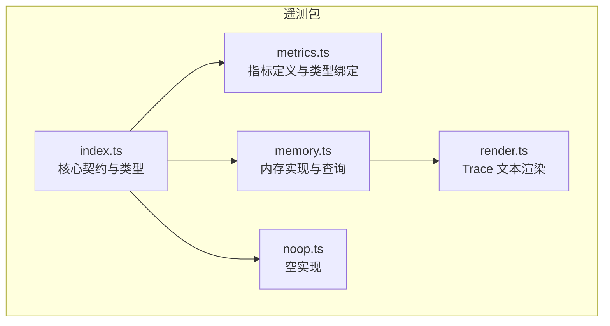
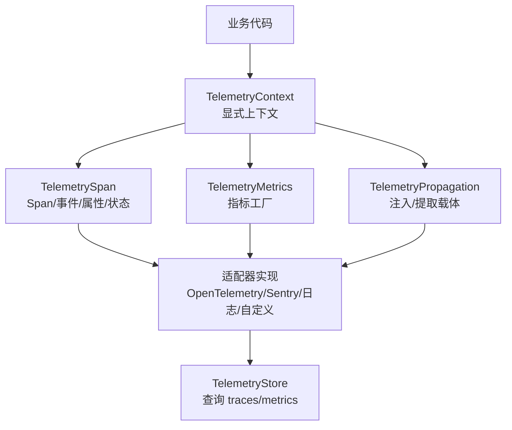
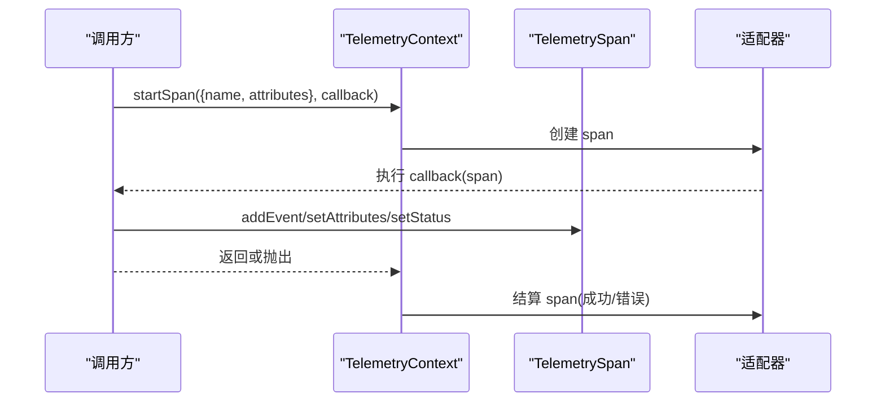
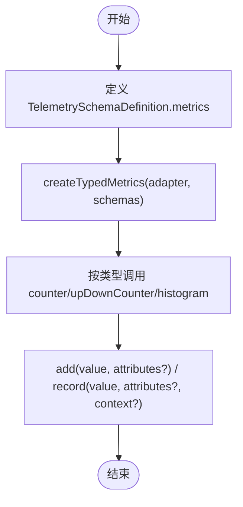
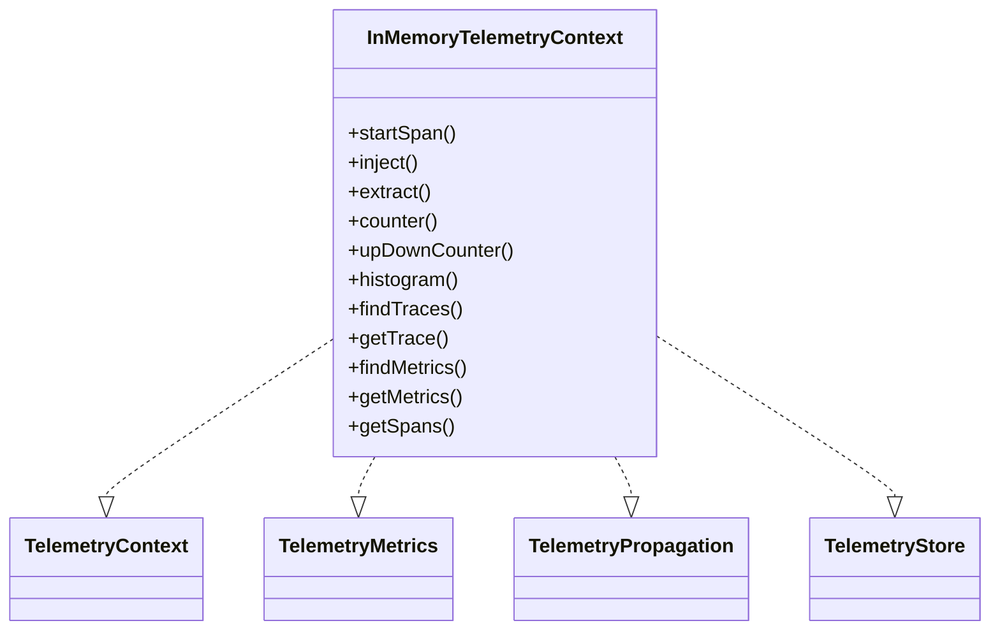
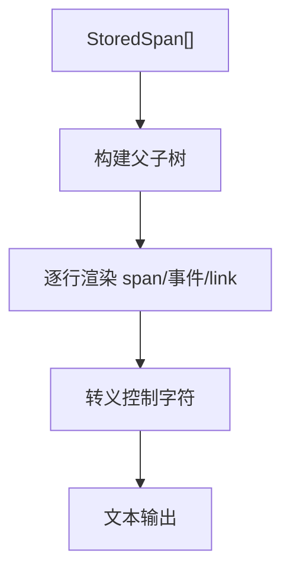
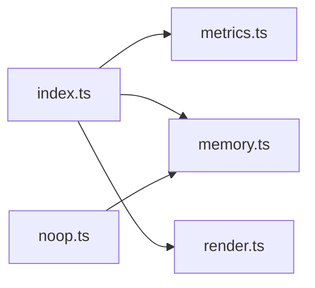

# 监控与日志

**本文引用的文件 **
- [packages/telemetry/src/index.ts](https://github.com/FDE-GROUP/oh-my-fde/blob/main/packages/telemetry/src/index.ts)
- [packages/telemetry/src/metrics.ts](https://github.com/FDE-GROUP/oh-my-fde/blob/main/packages/telemetry/src/metrics.ts)
- [packages/telemetry/src/memory.ts](https://github.com/FDE-GROUP/oh-my-fde/blob/main/packages/telemetry/src/memory.ts)
- [packages/telemetry/src/noop.ts](https://github.com/FDE-GROUP/oh-my-fde/blob/main/packages/telemetry/src/noop.ts)
- [packages/telemetry/src/render.ts](https://github.com/FDE-GROUP/oh-my-fde/blob/main/packages/telemetry/src/render.ts)
- [packages/telemetry/README.md](https://github.com/FDE-GROUP/oh-my-fde/blob/main/packages/telemetry/README.md)

## 目录
1. [简介](#简介)
2. [项目结构](#项目结构)
3. [核心组件](#核心组件)
4. [架构总览](#架构总览)
5. [详细组件分析](#详细组件分析)
6. [依赖关系分析](#依赖关系分析)
7. [性能与可扩展性](#性能与可扩展性)
8. [结构化日志、轮转与聚合方案](#结构化日志轮转与聚合方案)
9. [Prometheus、Grafana、ELK Stack 集成示例](#prometheusgrafanaelk-stack-集成示例)
10. [关键指标、告警规则与故障诊断](#关键指标告警规则与故障诊断)
11. [常见问题排查](#常见问题排查)
12. [结论](#结论)

## 简介
本仓库的监控与可观测性能力由 `@earendil-works/pi-telemetry` 提供。它是一套供应商中立的遥测契约和类型化 schema 工具，包含：
- 基于回调的 `TelemetryContext` / `TelemetrySpan` 接口；
- 跨进程传播与 span link；
- 计数器、上下计数器、直方图及类型化指标 schema；
- 内存参考实现 `InMemoryTelemetryContext`；
- 可序列化的 schema 定义与 TypeScript 类型推断；
- 不依赖全局上下文、导出器或具体后端。

该包本身不包含 Prometheus、Grafana、ELK Stack 等外部监控工具的集成代码，但提供了清晰的适配器契约，便于上层应用对接 OpenTelemetry、Sentry、日志系统或其他后端。

## 项目结构
监控相关代码集中在 `packages/telemetry` 下，核心文件职责如下：
- `src/index.ts`：定义遥测核心类型、span、事件、属性、schema、查询接口等。
- `src/metrics.ts`：定义指标工厂、度量类型与类型化指标绑定。
- `src/memory.ts`：内存中的参考实现，记录 spans、events、links、metrics，并提供查询 API。
- `src/noop.ts`：空实现，用于禁用遥测时的零开销路径。
- `src/render.ts`：将已存储的 spans 渲染为可读文本，便于调试。
- `README.md`：完整使用指南、概念说明、API 参考与最佳实践。

**图表来源**
- [packages/telemetry/src/index.ts:1-181](https://github.com/FDE-GROUP/oh-my-fde/blob/main/packages/telemetry/src/index.ts#L1-L181)
- [packages/telemetry/src/metrics.ts:1-146](https://github.com/FDE-GROUP/oh-my-fde/blob/main/packages/telemetry/src/metrics.ts#L1-L146)
- [packages/telemetry/src/memory.ts:1-495](https://github.com/FDE-GROUP/oh-my-fde/blob/main/packages/telemetry/src/memory.ts#L1-L495)
- [packages/telemetry/src/noop.ts:1-38](https://github.com/FDE-GROUP/oh-my-fde/blob/main/packages/telemetry/src/noop.ts#L1-L38)
- [packages/telemetry/src/render.ts:1-73](https://github.com/FDE-GROUP/oh-my-fde/blob/main/packages/telemetry/src/render.ts#L1-L73)

**章节来源**
- [packages/telemetry/src/index.ts:1-181](https://github.com/FDE-GROUP/oh-my-fde/blob/main/packages/telemetry/src/index.ts#L1-L181)
- [packages/telemetry/README.md:1-611](https://github.com/FDE-GROUP/oh-my-fde/blob/main/packages/telemetry/README.md#L1-L611)

## 核心组件
- 遥测上下文与 Span
  - `TelemetryContext`：启动带回调的 span，并可选暴露 `metrics` 与 `propagation`。
  - `TelemetrySpan`：记录属性、事件、状态，也可作为子 span 的父上下文。
  - `SpanOptions`、`SpanLink`、`SpanStatus`：描述 span 的创建参数、跨工作关联与结果状态。
- 传播与载体
  - `TelemetryPropagation`：注入/提取跨进程载体 `TelemetryCarrier`。
- 指标体系
  - `TelemetryMetrics`：`counter`、`upDownCounter`、`histogram` 工厂。
  - 类型化指标：通过 `defineTelemetrySchema` + `createTypedMetrics` 约束名称、种类、单位与低基数字段。
- 存储与查询
  - `TelemetryStore`：查询已结算 trace、trace 详情与指标行。
  - `StoredSpan`、`StoredTrace`、`StoredMetric`：后端无关的序列化快照。
- 参考实现
  - `InMemoryTelemetryContext`：进程内记录 spans、events、links、measurements，并提供 `findTraces`、`getTrace`、`findMetrics`、`getSpans`、`getMetrics`。
- 无操作实现
  - `NOOP_TELEMETRY_CONTEXT`、`NOOP_TELEMETRY_METRICS`、`NOOP_TELEMETRY_PROPAGATION`：零开销禁用遥测。

**章节来源**
- [packages/telemetry/src/index.ts:1-181](https://github.com/FDE-GROUP/oh-my-fde/blob/main/packages/telemetry/src/index.ts#L1-L181)
- [packages/telemetry/src/metrics.ts:1-146](https://github.com/FDE-GROUP/oh-my-fde/blob/main/packages/telemetry/src/metrics.ts#L1-L146)
- [packages/telemetry/src/memory.ts:313-495](https://github.com/FDE-GROUP/oh-my-fde/blob/main/packages/telemetry/src/memory.ts#L313-L495)
- [packages/telemetry/src/noop.ts:1-38](https://github.com/FDE-GROUP/oh-my-fde/blob/main/packages/telemetry/src/noop.ts#L1-L38)
- [packages/telemetry/README.md:44-184](https://github.com/FDE-GROUP/oh-my-fde/blob/main/packages/telemetry/README.md#L44-L184)

## 架构总览
下图展示应用如何以显式上下文方式接入遥测，并通过适配器桥接到具体后端。当前仓库未内置 Prometheus/Grafana/ELK 集成，但可通过适配器模式扩展。

**图表来源**
- [packages/telemetry/src/index.ts:101-114](https://github.com/FDE-GROUP/oh-my-fde/blob/main/packages/telemetry/src/index.ts#L101-L114)
- [packages/telemetry/src/metrics.ts:32-41](https://github.com/FDE-GROUP/oh-my-fde/blob/main/packages/telemetry/src/metrics.ts#L32-L41)
- [packages/telemetry/src/memory.ts:313-366](https://github.com/FDE-GROUP/oh-my-fde/blob/main/packages/telemetry/src/memory.ts#L313-L366)

## 详细组件分析

### 遥测上下文与 Span 生命周期
- 调用 `startSpan(options, callback)` 创建 span，回调期间可：
  - 添加子 span；
  - 添加事件 `addEvent`；
  - 合并属性 `setAttributes`；
  - 设置状态 `setStatus`（默认成功，异常时自动错误）。
- 回调返回或抛出后，span 结算，时间戳与结束序列写入内存实现。

**图表来源**
- [packages/telemetry/src/index.ts:101-114](https://github.com/FDE-GROUP/oh-my-fde/blob/main/packages/telemetry/src/index.ts#L101-L114)
- [packages/telemetry/src/memory.ts:213-277](https://github.com/FDE-GROUP/oh-my-fde/blob/main/packages/telemetry/src/memory.ts#L213-L277)

**章节来源**
- [packages/telemetry/src/index.ts:101-114](https://github.com/FDE-GROUP/oh-my-fde/blob/main/packages/telemetry/src/index.ts#L101-L114)
- [packages/telemetry/src/memory.ts:213-277](https://github.com/FDE-GROUP/oh-my-fde/blob/main/packages/telemetry/src/memory.ts#L213-L277)

### 指标采集与类型化 Schema
- 指标类型：
  - `counter`：单调递增计数；
  - `upDownCounter`：可正可负的计数器；
  - `histogram`：记录分布，支持边界提示与 exemplar context。
- 类型化指标通过 `defineTelemetrySchema` 声明指标名、kind、unit、attributes，并由 `createTypedMetrics` 绑定到具体适配器，编译期校验名称、kind、属性集合与必填字段。

**图表来源**
- [packages/telemetry/src/metrics.ts:10-41](https://github.com/FDE-GROUP/oh-my-fde/blob/main/packages/telemetry/src/metrics.ts#L10-L41)
- [packages/telemetry/src/metrics.ts:128-145](https://github.com/FDE-GROUP/oh-my-fde/blob/main/packages/telemetry/src/metrics.ts#L128-L145)
- [packages/telemetry/README.md:211-239](https://github.com/FDE-GROUP/oh-my-fde/blob/main/packages/telemetry/README.md#L211-L239)

**章节来源**
- [packages/telemetry/src/metrics.ts:1-146](https://github.com/FDE-GROUP/oh-my-fde/blob/main/packages/telemetry/src/metrics.ts#L1-L146)
- [packages/telemetry/README.md:185-239](https://github.com/FDE-GROUP/oh-my-fde/blob/main/packages/telemetry/README.md#L185-L239)

### 内存参考实现与查询
- `InMemoryTelemetryContext` 同时实现：
  - `TelemetryContext`：创建 span；
  - `TelemetryMetrics`：记录原始测量值；
  - `TelemetryPropagation`：进程内载体注入/提取；
  - `TelemetryStore`：查询 traces 与 metrics。
- 时间戳：
  - 使用 `telemetryNow()` 将单调时钟锚定到墙钟毫秒，保留微秒精度；
  - 指标按 10 秒区间记录，供 `findMetrics` 过滤。
- 查询能力：
  - `findTraces`：按最早 span 的名称、时间范围、是否含错误、属性匹配分页；
  - `getTrace`：按 traceId 获取；
  - `findMetrics`：按 name、interval 起止时间、属性精确匹配返回 count/sum/min/max。

**图表来源**
- [packages/telemetry/src/memory.ts:313-495](https://github.com/FDE-GROUP/oh-my-fde/blob/main/packages/telemetry/src/memory.ts#L313-L495)

**章节来源**
- [packages/telemetry/src/memory.ts:97-126](https://github.com/FDE-GROUP/oh-my-fde/blob/main/packages/telemetry/src/memory.ts#L97-L126)
- [packages/telemetry/src/memory.ts:313-495](https://github.com/FDE-GROUP/oh-my-fde/blob/main/packages/telemetry/src/memory.ts#L313-L495)

### Trace 渲染与调试输出
- `renderTrace(spans)` 将已存储 spans 渲染为有序森林文本，显示：
  - span 名称、属性、持续时间；
  - 事件及其相对时间偏移；
  - link 目标 trace/span 与属性；
  - 错误状态与错误信息。
- 控制字符会被转义，避免污染终端或查看器。

**图表来源**
- [packages/telemetry/src/render.ts:1-73](https://github.com/FDE-GROUP/oh-my-fde/blob/main/packages/telemetry/src/render.ts#L1-L73)

**章节来源**
- [packages/telemetry/src/render.ts:1-73](https://github.com/FDE-GROUP/oh-my-fde/blob/main/packages/telemetry/src/render.ts#L1-L73)

### No-op 路径
- `NOOP_TELEMETRY_CONTEXT`、`NOOP_TELEMETRY_METRICS`、`NOOP_TELEMETRY_PROPAGATION` 提供零开销路径：
  - 不检查、不保留任何遥测数据；
  - 保持回调语义与返回值/抛错一致性；
  - 适合在不需要遥测时直接注入。

**章节来源**
- [packages/telemetry/src/noop.ts:1-38](https://github.com/FDE-GROUP/oh-my-fde/blob/main/packages/telemetry/src/noop.ts#L1-L38)

## 依赖关系分析
- `index.ts` 导出核心契约与类型，并重新导出 `metrics.ts` 的类型与 `createTypedMetrics`。
- `memory.ts` 依赖 `index.ts` 的契约与 `noop.ts` 的空实现。
- `metrics.ts` 依赖 `index.ts` 的属性与 schema 类型。
- `render.ts` 仅依赖 `index.ts` 的 `StoredSpan` 类型。

**图表来源**
- [packages/telemetry/src/index.ts:1-130](https://github.com/FDE-GROUP/oh-my-fde/blob/main/packages/telemetry/src/index.ts#L1-L130)
- [packages/telemetry/src/memory.ts:1-26](https://github.com/FDE-GROUP/oh-my-fde/blob/main/packages/telemetry/src/memory.ts#L1-L26)
- [packages/telemetry/src/metrics.ts:1-8](https://github.com/FDE-GROUP/oh-my-fde/blob/main/packages/telemetry/src/metrics.ts#L1-L8)
- [packages/telemetry/src/render.ts:1-2](https://github.com/FDE-GROUP/oh-my-fde/blob/main/packages/telemetry/src/render.ts#L1-L2)

**章节来源**
- [packages/telemetry/src/index.ts:1-130](https://github.com/FDE-GROUP/oh-my-fde/blob/main/packages/telemetry/src/index.ts#L1-L130)
- [packages/telemetry/src/memory.ts:1-26](https://github.com/FDE-GROUP/oh-my-fde/blob/main/packages/telemetry/src/memory.ts#L1-L26)
- [packages/telemetry/src/metrics.ts:1-8](https://github.com/FDE-GROUP/oh-my-fde/blob/main/packages/telemetry/src/metrics.ts#L1-L8)
- [packages/telemetry/src/render.ts:1-2](https://github.com/FDE-GROUP/oh-my-fde/blob/main/packages/telemetry/src/render.ts#L1-L2)

## 性能与可扩展性
- 时间精度：`telemetryNow()` 使用单调时钟与墙钟锚定，保证进程内顺序与微秒级精度。
- 指标采样：内存实现按 10 秒区间记录原始测量值，`findMetrics` 返回聚合统计。
- 低基数属性：文档强调只使用低基数属性，避免高基数维度导致指标爆炸。
- 适配器解耦：所有后端细节（导出缓冲、采样、后端 ID、上下文对象）属于适配器，业务代码通过显式上下文传递，避免全局状态。

**章节来源**
- [packages/telemetry/src/memory.ts:97-126](https://github.com/FDE-GROUP/oh-my-fde/blob/main/packages/telemetry/src/memory.ts#L97-L126)
- [packages/telemetry/src/memory.ts:279-307](https://github.com/FDE-GROUP/oh-my-fde/blob/main/packages/telemetry/src/memory.ts#L279-L307)
- [packages/telemetry/README.md:207-239](https://github.com/FDE-GROUP/oh-my-fde/blob/main/packages/telemetry/README.md#L207-L239)

## 结构化日志、轮转与聚合方案
当前仓库未提供专用日志库或日志轮转逻辑。结合现有遥测能力，建议采用以下方案：
- 结构化日志格式
  - 使用 JSON 行格式，字段包括：时间戳、级别、traceId、spanId、服务名、模块、消息、属性键值对。
  - 将 `TelemetryContext.propagation.inject()` 的结果作为链路标识注入日志，便于跨服务追踪。
- 日志轮转
  - 使用操作系统或日志框架提供的轮转策略（按大小/时间），确保磁盘空间可控。
  - 对敏感属性进行脱敏后再落盘。
- 聚合与分析
  - 将结构化日志发送到集中式日志平台（如 ELK Stack、Loki），建立索引与可视化看板。
  - 将遥测指标（counter/upDownCounter/histogram）通过适配器导出到 Prometheus，再由 Grafana 展示。
  - 将 trace/span 数据通过适配器导出到分布式追踪系统（如 Jaeger、Tempo、OpenTelemetry Collector）。

[本节为通用方案建议，不直接分析具体源码文件]

## Prometheus、Grafana、ELK Stack 集成示例
仓库未内置这些工具的集成代码。推荐通过适配器模式实现：
- Prometheus
  - 适配器将 `TelemetryMetrics` 转换为 Prometheus 客户端 SDK 的指标类型；
  - 暴露 `/metrics` 端点供 Prometheus 抓取；
  - 使用 `HistogramOptions.boundaries` 作为桶提示。
- Grafana
  - 连接 Prometheus 数据源，基于指标名称、单位、属性维度创建仪表盘；
  - 使用 traceId/spanId 关联日志与指标。
- ELK Stack
  - 将结构化日志与 trace/span 元数据写入 Elasticsearch；
  - Kibana 中创建日志视图、搜索模板与告警规则；
  - 使用 `renderTrace` 输出辅助本地调试，生产环境由后端统一渲染或前端可视化。

[本节为通用集成思路，不直接分析具体源码文件]

## 关键指标、告警规则与故障诊断

### 关键指标采集
- 业务请求量：使用 `counter` 记录请求数，按方法、路径、状态等低基数属性区分。
- 并发度：使用 `upDownCounter` 记录活跃请求数。
- 延迟分布：使用 `histogram` 记录耗时，配置合理 boundaries，并结合 exemplar 关联 span。
- 错误率：通过 span 的 `status.error` 与事件标记计算错误比例。

**章节来源**
- [packages/telemetry/src/metrics.ts:20-41](https://github.com/FDE-GROUP/oh-my-fde/blob/main/packages/telemetry/src/metrics.ts#L20-L41)
- [packages/telemetry/src/memory.ts:279-307](https://github.com/FDE-GROUP/oh-my-fde/blob/main/packages/telemetry/src/memory.ts#L279-L307)
- [packages/telemetry/src/index.ts:30-52](https://github.com/FDE-GROUP/oh-my-fde/blob/main/packages/telemetry/src/index.ts#L30-L52)

### 告警规则建议
- 错误率超过阈值：基于 span status 或业务错误事件计算。
- 延迟 P95/P99 升高：基于 histogram 分位数或 bucket 计数变化。
- 并发异常：基于 upDownCounter 的活跃请求数突增或骤降。
- 资源耗尽：基于计数器增长趋势与系统指标联动。

[本节为通用告警建议，不直接分析具体源码文件]

### 故障诊断方法
- 使用 `findTraces` 与 `getTrace` 定位问题 trace，结合 `renderTrace` 快速查看 span 树、事件与错误。
- 使用 `findMetrics` 按名称、时间区间与属性过滤，观察指标聚合结果。
- 使用 `getSpans` 与 `getMetrics` 获取原始快照，便于单元测试与本地诊断。

**章节来源**
- [packages/telemetry/src/memory.ts:394-470](https://github.com/FDE-GROUP/oh-my-fde/blob/main/packages/telemetry/src/memory.ts#L394-L470)
- [packages/telemetry/src/render.ts:23-72](https://github.com/FDE-GROUP/oh-my-fde/blob/main/packages/telemetry/src/render.ts#L23-L72)

## 常见问题排查
- 为什么没有全局上下文？
  - 设计选择：显式 `TelemetryContext` 更清晰，避免运行时特定全局状态，适用于 Node/Bun/浏览器/Worker。
- 为什么属性要低基数？
  - 防止高基数维度导致指标爆炸与查询性能下降。
- 为什么内存实现不限制存储大小？
  - 它是参考实现，适合测试与本地诊断；生产环境应使用适配器持久化并按需清理。
- 如何验证适配器行为？
  - 使用适配器的 conformance suite，检查回调语义、状态、属性合并、事件顺序、链接与并发。

**章节来源**
- [packages/telemetry/README.md:513-520](https://github.com/FDE-GROUP/oh-my-fde/blob/main/packages/telemetry/README.md#L513-L520)
- [packages/telemetry/README.md:310-341](https://github.com/FDE-GROUP/oh-my-fde/blob/main/packages/telemetry/README.md#L310-L341)

## 结论
该仓库的监控与日志能力以 `pi-telemetry` 为核心，提供：
- 明确的遥测契约与类型化 schema；
- 内存参考实现与查询接口；
- 指标采集与低基数属性规范；
- 适配器解耦，便于对接 Prometheus、Grafana、ELK Stack 等生态。

在生产环境中，建议：
- 通过适配器将遥测数据导出到合适的后端；
- 使用结构化日志与 trace/span 关联；
- 配置合理的指标维度与告警规则；
- 使用 `renderTrace` 与 store 查询进行故障定位。

[本节为总结性内容，不直接分析具体源码文件]