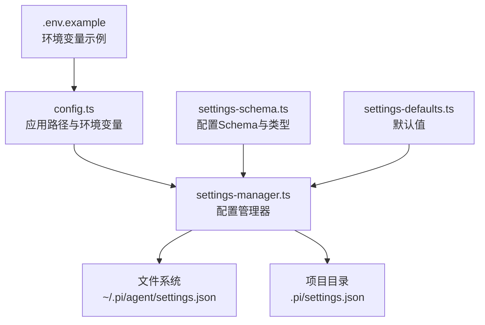
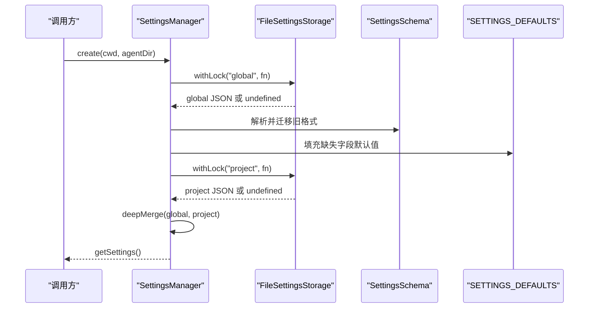
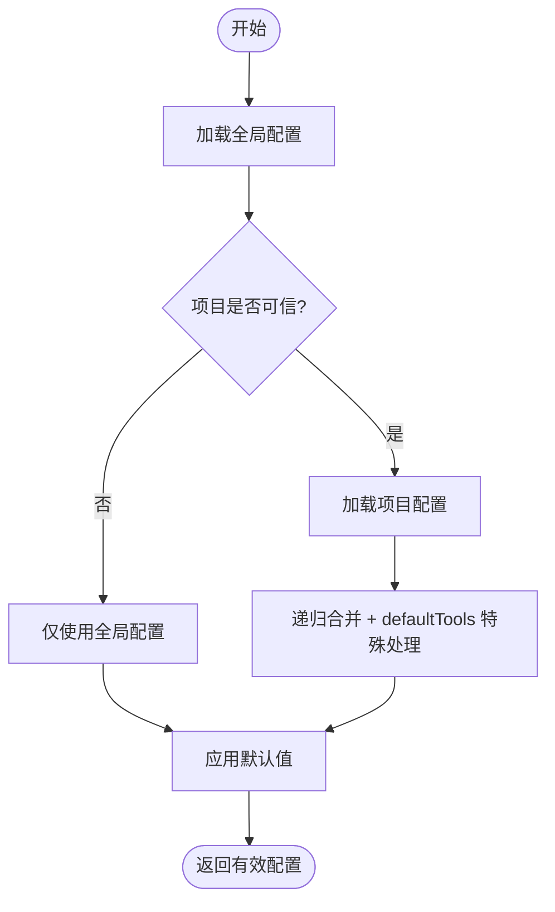
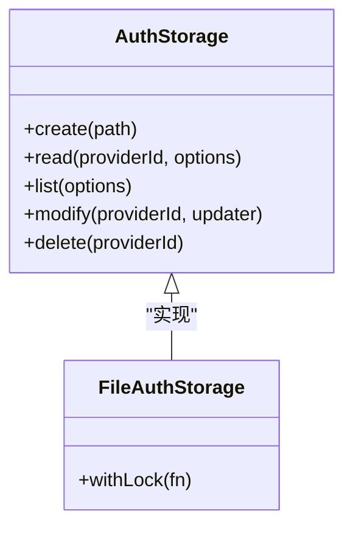
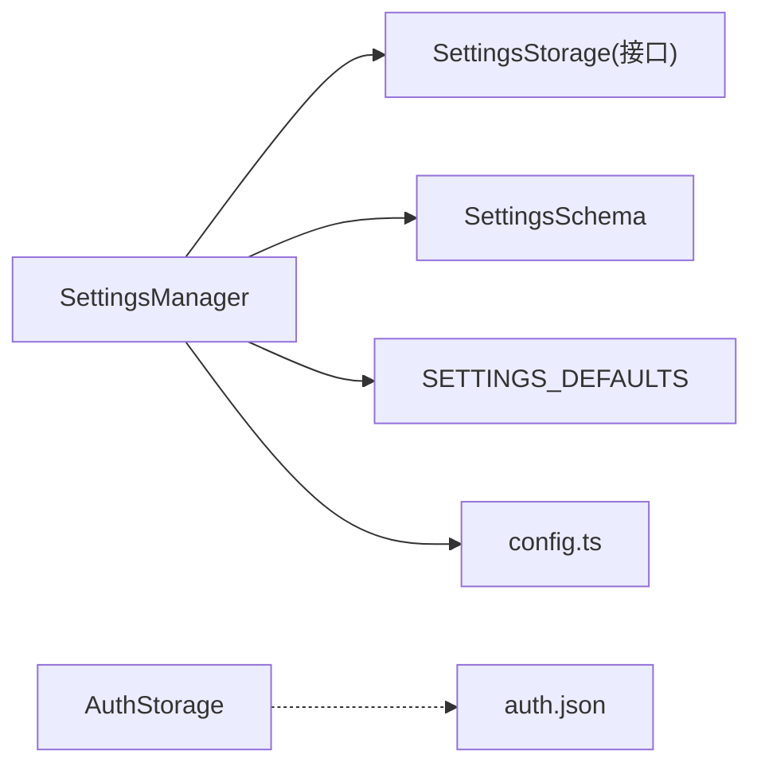

# 配置管理

**本文引用的文件**   
- [settings-manager.ts](https://github.com/FDE-GROUP/oh-my-fde/blob/main/packages/coding-agent/src/core/settings-manager.ts)
- [settings-schema.ts](https://github.com/FDE-GROUP/oh-my-fde/blob/main/packages/coding-agent/src/core/settings-schema.ts)
- [settings-defaults.ts](https://github.com/FDE-GROUP/oh-my-fde/blob/main/packages/coding-agent/src/core/settings-defaults.ts)
- [config.ts](https://github.com/FDE-GROUP/oh-my-fde/blob/main/packages/coding-agent/src/config.ts)
- [.env.example](https://github.com/FDE-GROUP/oh-my-fde/blob/main/.env.example)
- [resolve-config-value.test.ts](https://github.com/FDE-GROUP/oh-my-fde/blob/main/packages/coding-agent/test/resolve-config-value.test.ts)
- [settings-manager.test.ts](https://github.com/FDE-GROUP/oh-my-fde/blob/main/packages/coding-agent/test/settings-manager.test.ts)
- [7572-provider-retry-settings-merge.test.ts](https://github.com/FDE-GROUP/oh-my-fde/blob/main/packages/coding-agent/test/suite/regressions/7572-provider-retry-settings-merge.test.ts)
- [auth-storage.test.ts](https://github.com/FDE-GROUP/oh-my-fde/blob/main/packages/coding-agent/test/auth-storage.test.ts)
- [http-dispatcher.test.ts](https://github.com/FDE-GROUP/oh-my-fde/blob/main/packages/coding-agent/test/http-dispatcher.test.ts)

## 目录
1. [简介](#简介)
2. [项目结构](#项目结构)
3. [核心组件](#核心组件)
4. [架构总览](#架构总览)
5. [详细组件分析](#详细组件分析)
6. [依赖关系分析](#依赖关系分析)
7. [性能与调优](#性能与调优)
8. [故障排查指南](#故障排查指南)
9. [结论](#结论)
10. [附录](#附录)

## 简介
本文件系统化梳理项目的配置管理机制，覆盖全局配置、项目配置、环境变量、认证配置、代理设置、性能调优等高级主题。重点说明：
- 配置文件结构与字段含义
- 优先级与合并规则（全局 vs 项目）
- 迁移策略与兼容性处理
- 验证、调试与排错技巧

## 项目结构
配置相关代码集中在 coding-agent 包的核心模块中：
- settings-manager.ts：配置加载、合并、持久化、变更追踪、错误收集
- settings-schema.ts：配置的 JSON Schema 定义与类型导出
- settings-defaults.ts：运行时默认值
- config.ts：应用路径、环境变量、包资源路径、用户配置目录解析
- .env.example：示例环境变量

图表来源
- [config.ts:577-682](https://github.com/FDE-GROUP/oh-my-fde/blob/main/packages/coding-agent/src/config.ts#L577-L682)
- [settings-manager.ts:186-356](https://github.com/FDE-GROUP/oh-my-fde/blob/main/packages/coding-agent/src/core/settings-manager.ts#L186-L356)
- [settings-schema.ts:206-466](https://github.com/FDE-GROUP/oh-my-fde/blob/main/packages/coding-agent/src/core/settings-schema.ts#L206-L466)
- [settings-defaults.ts:1-68](https://github.com/FDE-GROUP/oh-my-fde/blob/main/packages/coding-agent/src/core/settings-defaults.ts#L1-L68)
- [.env.example:1-4](https://github.com/FDE-GROUP/oh-my-fde/blob/main/.env.example#L1-L4)

章节来源
- [config.ts:577-682](https://github.com/FDE-GROUP/oh-my-fde/blob/main/packages/coding-agent/src/config.ts#L577-L682)
- [settings-manager.ts:186-356](https://github.com/FDE-GROUP/oh-my-fde/blob/main/packages/coding-agent/src/core/settings-manager.ts#L186-L356)

## 核心组件
- SettingsManager：统一入口，负责读取、合并、校验、持久化配置，并提供访问器与修改器
- FileSettingsStorage / InMemorySettingsStorage：抽象存储后端，支持文件与内存两种实现
- SettingsSchema：以 TypeBox 定义的强类型配置结构，提供默认值与约束
- SETTINGS_DEFAULTS：集中维护所有默认值
- config.ts：解析应用根目录、用户配置目录、会话目录、调试日志路径等

章节来源
- [settings-manager.ts:272-356](https://github.com/FDE-GROUP/oh-my-fde/blob/main/packages/coding-agent/src/core/settings-manager.ts#L272-L356)
- [settings-manager.ts:186-270](https://github.com/FDE-GROUP/oh-my-fde/blob/main/packages/coding-agent/src/core/settings-manager.ts#L186-L270)
- [settings-schema.ts:206-466](https://github.com/FDE-GROUP/oh-my-fde/blob/main/packages/coding-agent/src/core/settings-schema.ts#L206-L466)
- [settings-defaults.ts:1-68](https://github.com/FDE-GROUP/oh-my-fde/blob/main/packages/coding-agent/src/core/settings-defaults.ts#L1-L68)
- [config.ts:577-682](https://github.com/FDE-GROUP/oh-my-fde/blob/main/packages/coding-agent/src/config.ts#L577-L682)

## 架构总览
配置系统采用“分层 + 合并”的架构：
- 全局配置：位于 ~/.pi/agent/settings.json（可通过环境变量覆盖目录）
- 项目配置：位于 \<cwd>/.pi/settings.json（受项目信任控制）
- 环境变量：用于覆盖安装目录、会话目录、代理、终端行为等
- 认证配置：独立于 settings.json，位于 ~/.pi/agent/auth.json

图表来源
- [settings-manager.ts:309-356](https://github.com/FDE-GROUP/oh-my-fde/blob/main/packages/coding-agent/src/core/settings-manager.ts#L309-L356)
- [settings-manager.ts:366-456](https://github.com/FDE-GROUP/oh-my-fde/blob/main/packages/coding-agent/src/core/settings-manager.ts#L366-L456)
- [settings-manager.ts:142-147](https://github.com/FDE-GROUP/oh-my-fde/blob/main/packages/coding-agent/src/core/settings-manager.ts#L142-L147)

## 详细组件分析

### 配置层次与优先级
- 全局配置：~/.pi/agent/settings.json，影响所有项目
- 项目配置：\<cwd>/.pi/settings.json，仅对当前项目生效
- 合并规则：
  - 对象字段递归合并
  - defaultTools 特殊合并：纯名称列表替换继承；+name/-name 追加到继承列表
  - 运行时通过 SettingsManager.getSettings() 获取最终合并结果
- 项目信任：
  - 未信任时跳过项目配置读取，且禁止写入项目配置
  - 可从全局 defaultProjectTrust 控制默认信任策略

图表来源
- [settings-manager.ts:142-147](https://github.com/FDE-GROUP/oh-my-fde/blob/main/packages/coding-agent/src/core/settings-manager.ts#L142-L147)
- [settings-manager.ts:366-394](https://github.com/FDE-GROUP/oh-my-fde/blob/main/packages/coding-agent/src/core/settings-manager.ts#L366-L394)
- [settings-manager.ts:471-498](https://github.com/FDE-GROUP/oh-my-fde/blob/main/packages/coding-agent/src/core/settings-manager.ts#L471-L498)

章节来源
- [settings-manager.ts:142-147](https://github.com/FDE-GROUP/oh-my-fde/blob/main/packages/coding-agent/src/core/settings-manager.ts#L142-L147)
- [settings-manager.ts:366-394](https://github.com/FDE-GROUP/oh-my-fde/blob/main/packages/coding-agent/src/core/settings-manager.ts#L366-L394)
- [settings-manager.ts:471-498](https://github.com/FDE-GROUP/oh-my-fde/blob/main/packages/coding-agent/src/core/settings-manager.ts#L471-L498)

### 配置文件结构与字段含义
- 顶层字段：defaultProvider、defaultModel、transport、sessionShareDestination、steeringMode、followUpMode、theme、compaction、branchSummary、retry、hideThinkingBlock、showCacheMissNotices、externalEditor、shellPath、quietStartup、defaultProjectTrust、shellCommandPrefix、npmCommand、selfUpdateCommand、collapseChangelog、enableInstallTelemetry、enableAnalytics、trackingId、packages、extensions、deviceId、skills、prompts、themes、enableSkillCommands、terminal、images、enabledModels、defaultTools、doubleEscapeAction、treeFilterMode、thinkingBudgets、editorPaddingX、outputPad、autocompleteMaxVisible、showHardwareCursor、markdown、warnings、codemode、sessionDir、httpProxy、httpIdleTimeoutMs、cacheWarming、websocketConnectTimeoutMs、tuiMode、fullscreenExitOutput、fullscreenScrollbar、fullscreenCopyOnSelect、fullscreenWheelScrollLines、queueMode（已废弃）、websockets（已废弃）
- 嵌套对象：
  - compaction：启用开关、保留 token、保留最近 token、按模型覆盖
  - branchSummary：保留 token、跳过提示
  - retry：启用、重试次数、基础延迟、最大代理延迟、provider 子配置
  - terminal：图片显示、宽度、收缩清理、进度条、hyperlinks/images/trueColor
  - images：自动缩放、阻断图片
  - markdown：代码块缩进、mermaid 渲染模式
  - warnings：供应商用量告警开关
  - codemode：工具暴露模式、内联预算
- 默认值：由 SETTINGS_DEFAULTS 提供，并在 Schema 中声明

章节来源
- [settings-schema.ts:206-466](https://github.com/FDE-GROUP/oh-my-fde/blob/main/packages/coding-agent/src/core/settings-schema.ts#L206-L466)
- [settings-defaults.ts:1-68](https://github.com/FDE-GROUP/oh-my-fde/blob/main/packages/coding-agent/src/core/settings-defaults.ts#L1-L68)

### 认证配置（auth.json）
- 位置：~/.pi/agent/auth.json
- 能力：
  - 按 provider 维度存储凭据（如 api_key）
  - 支持凭据作用域的环境变量注入（key/env）
  - 并发读写串行化，避免竞态
  - 支持列出、读取、修改、删除凭据
- 安全特性：
  - 只读存储不会创建 auth.json 或其父目录
  - 并发修改通过锁机制序列化

图表来源
- [auth-storage.test.ts:57-93](https://github.com/FDE-GROUP/oh-my-fde/blob/main/packages/coding-agent/test/auth-storage.test.ts#L57-L93)
- [auth-storage.test.ts:181-214](https://github.com/FDE-GROUP/oh-my-fde/blob/main/packages/coding-agent/test/auth-storage.test.ts#L181-L214)

章节来源
- [auth-storage.test.ts:57-93](https://github.com/FDE-GROUP/oh-my-fde/blob/main/packages/coding-agent/test/auth-storage.test.ts#L57-L93)
- [auth-storage.test.ts:181-214](https://github.com/FDE-GROUP/oh-my-fde/blob/main/packages/coding-agent/test/auth-storage.test.ts#L181-L214)

### 代理设置与 HTTP 超时
- httpProxy：在 settings.json 中设置，作为 Pi 管理的 HTTP 客户端的 HTTP_PROXY/HTTPS_PROXY
- httpIdleTimeoutMs：HTTP 请求头/体空闲超时，支持数字或 "disabled"
- websocketConnectTimeoutMs：WebSocket 连接/握手超时，支持数字或 "disabled"
- 测试覆盖：
  - 通过 HTTP_PROXY 环境变量与 dispatcher 配置进行代理连通性验证
  - HTTPS 连接尝试超时行为验证

章节来源
- [settings-schema.ts:406-425](https://github.com/FDE-GROUP/oh-my-fde/blob/main/packages/coding-agent/src/core/settings-schema.ts#L406-L425)
- [http-dispatcher.test.ts:127-158](https://github.com/FDE-GROUP/oh-my-fde/blob/main/packages/coding-agent/test/http-dispatcher.test.ts#L127-L158)

### 性能调优与缓存预热
- cacheWarming：缓存预热模式（off/streaming/idle），仅全局配置生效
- compaction：压缩策略，含 reserveTokens、keepRecentTokens、modelOverrides
- retry：重试策略，含 maxRetries、baseDelayMs、maxAgentDelayMs、provider.maxRetryDelayMs
- terminal.images、terminal.showTerminalProgress、markdown.mermaid 等影响渲染性能

章节来源
- [settings-manager.ts:941-951](https://github.com/FDE-GROUP/oh-my-fde/blob/main/packages/coding-agent/src/core/settings-manager.ts#L941-L951)
- [settings-manager.ts:833-893](https://github.com/FDE-GROUP/oh-my-fde/blob/main/packages/coding-agent/src/core/settings-manager.ts#L833-L893)
- [settings-manager.ts:906-926](https://github.com/FDE-GROUP/oh-my-fde/blob/main/packages/coding-agent/src/core/settings-manager.ts#L906-L926)
- [settings-manager.ts:1198-1206](https://github.com/FDE-GROUP/oh-my-fde/blob/main/packages/coding-agent/src/core/settings-manager.ts#L1198-L1206)
- [settings-manager.ts:1431-1445](https://github.com/FDE-GROUP/oh-my-fde/blob/main/packages/coding-agent/src/core/settings-manager.ts#L1431-L1445)

### 环境变量与路径解析
- PI_PACKAGE_DIR：覆盖包根目录
- PI_CODING_AGENT_DIR：覆盖用户配置目录（~/.pi/agent）
- PI_SESSION_DIR：覆盖会话目录
- PI_SHARE_VIEWER_URL：自定义分享查看器 URL
- PI_SELF_UPDATE_COMMAND：覆盖自更新命令
- PI_CLEAR_ON_SHRINK：终端收缩清理行为
- PI_HARDWARE_CURSOR：硬件光标显示

章节来源
- [config.ts:418-430](https://github.com/FDE-GROUP/oh-my-fde/blob/main/packages/coding-agent/src/config.ts#L418-L430)
- [config.ts:609-623](https://github.com/FDE-GROUP/oh-my-fde/blob/main/packages/coding-agent/src/config.ts#L609-L623)
- [config.ts:629-682](https://github.com/FDE-GROUP/oh-my-fde/blob/main/packages/coding-agent/src/config.ts#L629-L682)
- [settings-manager.ts:1238-1245](https://github.com/FDE-GROUP/oh-my-fde/blob/main/packages/coding-agent/src/core/settings-manager.ts#L1238-L1245)
- [settings-manager.ts:1391-1399](https://github.com/FDE-GROUP/oh-my-fde/blob/main/packages/coding-agent/src/core/settings-manager.ts#L1391-L1399)

### 配置迁移与兼容性
- queueMode -> steeringMode
- websockets(boolean) -> transport(enum)
- skills 对象 -> 数组
- retry.maxDelayMs -> retry.provider.maxRetryDelayMs
- 迁移逻辑在加载时执行，保证向后兼容

章节来源
- [settings-manager.ts:396-456](https://github.com/FDE-GROUP/oh-my-fde/blob/main/packages/coding-agent/src/core/settings-manager.ts#L396-L456)

### 配置值解析与动态值
- 支持从环境变量解析配置值（例如 $VAR）
- 环境变量不缓存，每次解析实时读取
- 支持命令输出解析（带 ! 前缀），可执行外部命令获取值

章节来源
- [resolve-config-value.test.ts:74-103](https://github.com/FDE-GROUP/oh-my-fde/blob/main/packages/coding-agent/test/resolve-config-value.test.ts#L74-L103)

### 项目信任与写入保护
- 未信任项目：
  - 跳过项目配置读取
  - 禁止写入项目配置
- 信任状态切换后重新加载项目配置
- 默认信任策略来自全局 defaultProjectTrust

章节来源
- [settings-manager.test.ts:256-353](https://github.com/FDE-GROUP/oh-my-fde/blob/main/packages/coding-agent/test/settings-manager.test.ts#L256-L353)
- [settings-manager.ts:471-498](https://github.com/FDE-GROUP/oh-my-fde/blob/main/packages/coding-agent/src/core/settings-manager.ts#L471-L498)

### 配置诊断与错误收集
- drainErrors：收集并清空加载错误（全局/项目）
- 记录错误来源与作用域，便于定位问题

章节来源
- [settings-manager.test.ts:237-253](https://github.com/FDE-GROUP/oh-my-fde/blob/main/packages/coding-agent/test/settings-manager.test.ts#L237-L253)
- [settings-manager.ts:674-678](https://github.com/FDE-GROUP/oh-my-fde/blob/main/packages/coding-agent/src/core/settings-manager.ts#L674-L678)

## 依赖关系分析
- SettingsManager 依赖：
  - FileSettingsStorage/InMemorySettingsStorage：I/O 抽象
  - SettingsSchema：类型与约束
  - SETTINGS_DEFAULTS：默认值
  - config.ts：路径与环境变量解析
- 认证系统独立于 settings.json，通过 AuthStorage 管理

图表来源
- [settings-manager.ts:272-356](https://github.com/FDE-GROUP/oh-my-fde/blob/main/packages/coding-agent/src/core/settings-manager.ts#L272-L356)
- [settings-manager.ts:186-270](https://github.com/FDE-GROUP/oh-my-fde/blob/main/packages/coding-agent/src/core/settings-manager.ts#L186-L270)
- [settings-schema.ts:206-466](https://github.com/FDE-GROUP/oh-my-fde/blob/main/packages/coding-agent/src/core/settings-schema.ts#L206-L466)
- [settings-defaults.ts:1-68](https://github.com/FDE-GROUP/oh-my-fde/blob/main/packages/coding-agent/src/core/settings-defaults.ts#L1-L68)
- [config.ts:577-682](https://github.com/FDE-GROUP/oh-my-fde/blob/main/packages/coding-agent/src/config.ts#L577-L682)

章节来源
- [settings-manager.ts:272-356](https://github.com/FDE-GROUP/oh-my-fde/blob/main/packages/coding-agent/src/core/settings-manager.ts#L272-L356)
- [settings-manager.ts:186-270](https://github.com/FDE-GROUP/oh-my-fde/blob/main/packages/coding-agent/src/core/settings-manager.ts#L186-L270)
- [settings-schema.ts:206-466](https://github.com/FDE-GROUP/oh-my-fde/blob/main/packages/coding-agent/src/core/settings-schema.ts#L206-L466)
- [settings-defaults.ts:1-68](https://github.com/FDE-GROUP/oh-my-fde/blob/main/packages/coding-agent/src/core/settings-defaults.ts#L1-L68)
- [config.ts:577-682](https://github.com/FDE-GROUP/oh-my-fde/blob/main/packages/coding-agent/src/config.ts#L577-L682)

## 性能与调优
- 缓存预热：
  - cacheWarming=streaming/idle 可在流式或空闲阶段预热缓存
  - 注意 idle 模式跨运行预热会产生费用
- 压缩策略：
  - 合理设置 reserveTokens/keepRecentTokens，避免上下文溢出
  - 针对特定模型使用 modelOverrides 精细调整
- 重试策略：
  - 调整 maxRetries/baseDelayMs/maxAgentDelayMs/provider.maxRetryDelayMs
  - 确保 provider 层最大延迟不超过服务限制
- 网络与代理：
  - 配置 httpProxy 以适配企业代理环境
  - 调整 httpIdleTimeoutMs/websocketConnectTimeoutMs 平衡稳定性与响应速度
- 终端与渲染：
  - terminal.showImages/imageWidthCells 影响渲染开销
  - markdown.mermaid 渲染模式影响输出体积与耗时

章节来源
- [settings-manager.ts:941-951](https://github.com/FDE-GROUP/oh-my-fde/blob/main/packages/coding-agent/src/core/settings-manager.ts#L941-L951)
- [settings-manager.ts:833-893](https://github.com/FDE-GROUP/oh-my-fde/blob/main/packages/coding-agent/src/core/settings-manager.ts#L833-L893)
- [settings-manager.ts:906-926](https://github.com/FDE-GROUP/oh-my-fde/blob/main/packages/coding-agent/src/core/settings-manager.ts#L906-L926)
- [settings-manager.ts:1198-1206](https://github.com/FDE-GROUP/oh-my-fde/blob/main/packages/coding-agent/src/core/settings-manager.ts#L1198-L1206)
- [settings-manager.ts:1431-1445](https://github.com/FDE-GROUP/oh-my-fde/blob/main/packages/coding-agent/src/core/settings-manager.ts#L1431-L1445)

## 故障排查指南
- 配置加载错误：
  - 使用 drainErrors 获取全局/项目配置解析错误与作用域
- 项目信任问题：
  - 检查 defaultProjectTrust 与 isProjectTrusted
  - 未信任时无法写入项目配置
- 认证凭据问题：
  - 确认 auth.json 存在且可读
  - 检查凭据作用域环境变量是否正确注入
- 代理与网络问题：
  - 验证 HTTP_PROXY/HTTPS_PROXY 与 httpProxy 设置
  - 检查 WebSocket 连接超时配置
- 性能问题：
  - 调整 cacheWarming、compaction、retry 参数
  - 观察终端图片与 mermaid 渲染对性能的影响

章节来源
- [settings-manager.test.ts:237-253](https://github.com/FDE-GROUP/oh-my-fde/blob/main/packages/coding-agent/test/settings-manager.test.ts#L237-L253)
- [settings-manager.ts:674-678](https://github.com/FDE-GROUP/oh-my-fde/blob/main/packages/coding-agent/src/core/settings-manager.ts#L674-L678)
- [settings-manager.test.ts:256-353](https://github.com/FDE-GROUP/oh-my-fde/blob/main/packages/coding-agent/test/settings-manager.test.ts#L256-L353)
- [auth-storage.test.ts:57-93](https://github.com/FDE-GROUP/oh-my-fde/blob/main/packages/coding-agent/test/auth-storage.test.ts#L57-L93)
- [http-dispatcher.test.ts:127-158](https://github.com/FDE-GROUP/oh-my-fde/blob/main/packages/coding-agent/test/http-dispatcher.test.ts#L127-L158)

## 结论
本项目配置体系以 SettingsManager 为核心，结合 Schema 与默认值，实现了清晰的分层配置、安全的合并策略、完善的迁移与诊断能力。配合独立的认证系统与灵活的环境变量覆盖，能够满足多场景下的配置需求。通过合理的性能调优与代理设置，可在复杂网络环境中稳定运行。

## 附录

### 常用环境变量速查
- PI_PACKAGE_DIR：包根目录
- PI_CODING_AGENT_DIR：用户配置目录
- PI_SESSION_DIR：会话目录
- PI_SHARE_VIEWER_URL：分享查看器 URL
- PI_SELF_UPDATE_COMMAND：自更新命令
- PI_CLEAR_ON_SHRINK：终端收缩清理
- PI_HARDWARE_CURSOR：硬件光标

章节来源
- [config.ts:418-430](https://github.com/FDE-GROUP/oh-my-fde/blob/main/packages/coding-agent/src/config.ts#L418-L430)
- [config.ts:609-623](https://github.com/FDE-GROUP/oh-my-fde/blob/main/packages/coding-agent/src/config.ts#L609-L623)
- [config.ts:629-682](https://github.com/FDE-GROUP/oh-my-fde/blob/main/packages/coding-agent/src/config.ts#L629-L682)
- [settings-manager.ts:1238-1245](https://github.com/FDE-GROUP/oh-my-fde/blob/main/packages/coding-agent/src/core/settings-manager.ts#L1238-L1245)
- [settings-manager.ts:1391-1399](https://github.com/FDE-GROUP/oh-my-fde/blob/main/packages/coding-agent/src/core/settings-manager.ts#L1391-L1399)

### 配置合并与默认值参考
- 默认值来源：SETTINGS_DEFAULTS
- 合并规则：deepMergeObjects + defaultTools 特殊处理
- 提供者重试合并：项目层 provider 配置与全局层非冲突字段合并

章节来源
- [settings-defaults.ts:1-68](https://github.com/FDE-GROUP/oh-my-fde/blob/main/packages/coding-agent/src/core/settings-defaults.ts#L1-L68)
- [settings-manager.ts:61-82](https://github.com/FDE-GROUP/oh-my-fde/blob/main/packages/coding-agent/src/core/settings-manager.ts#L61-L82)
- [settings-manager.ts:126-147](https://github.com/FDE-GROUP/oh-my-fde/blob/main/packages/coding-agent/src/core/settings-manager.ts#L126-L147)
- [7572-provider-retry-settings-merge.test.ts:1-35](https://github.com/FDE-GROUP/oh-my-fde/blob/main/packages/coding-agent/test/suite/regressions/7572-provider-retry-settings-merge.test.ts#L1-L35)