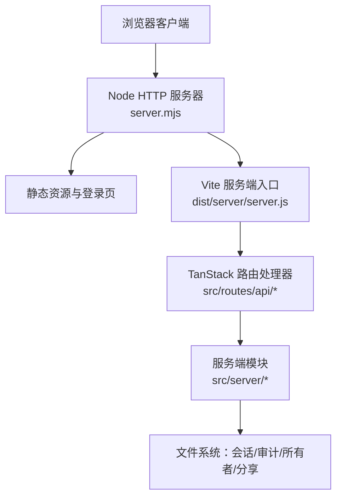
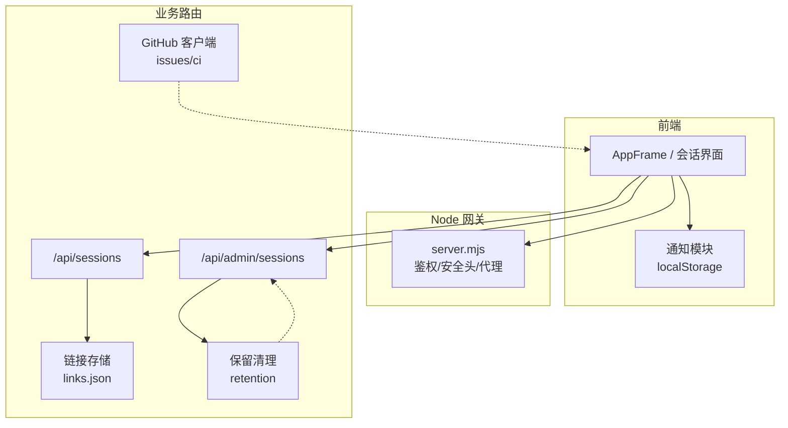
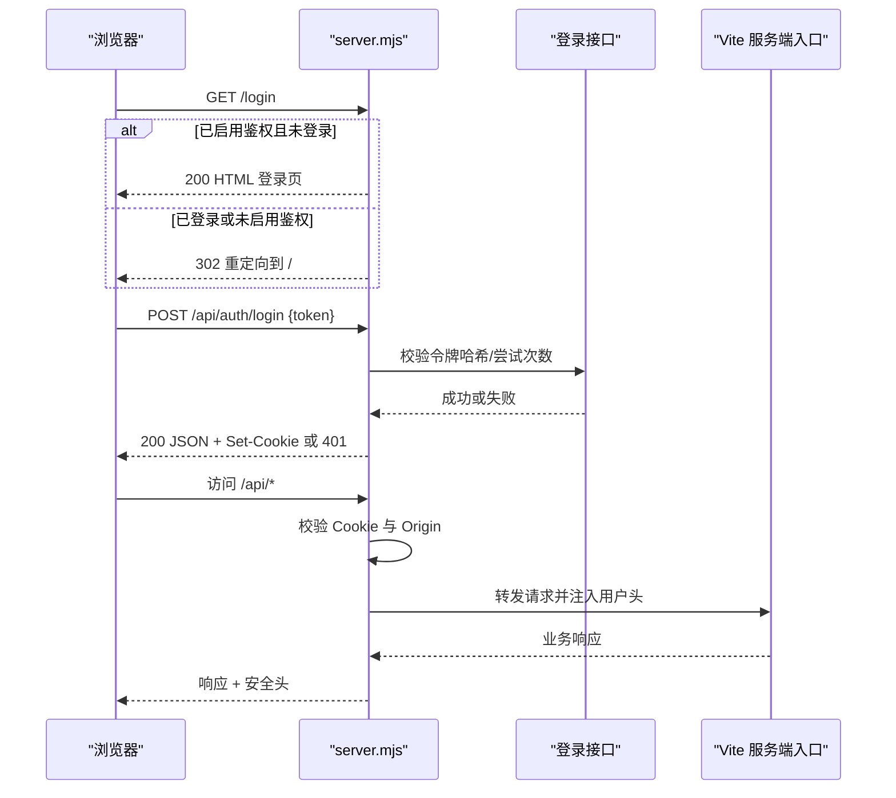
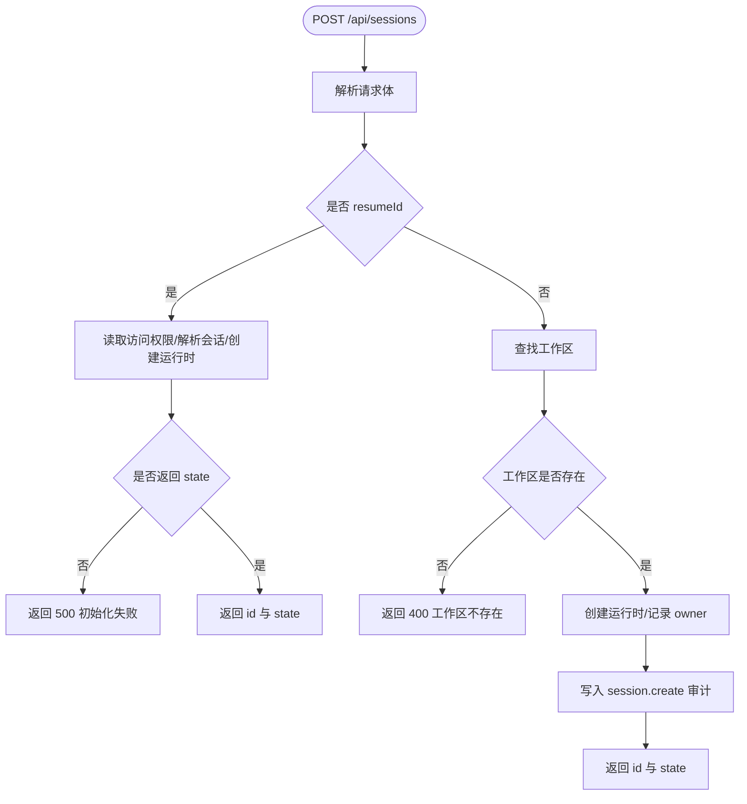
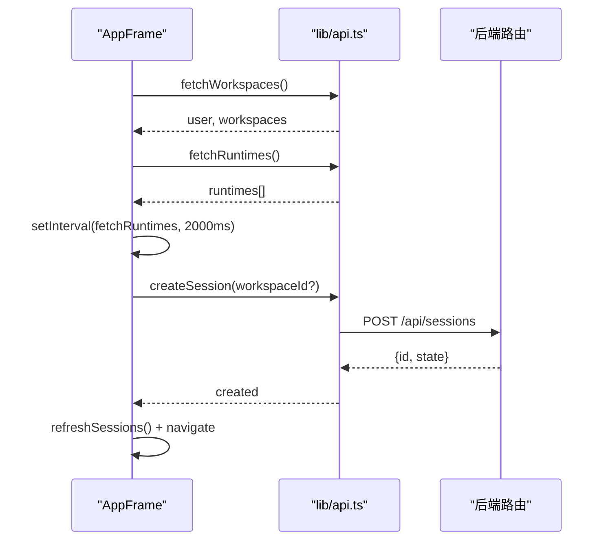
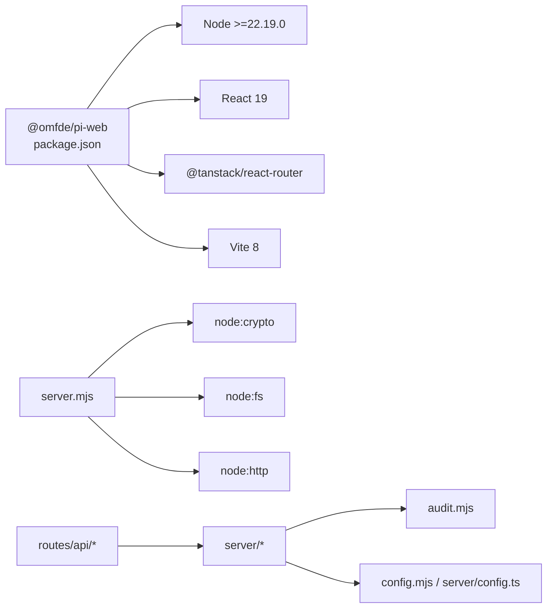

# Pi Web UI M5 技术验证

**本文引用的文件**   
- [apps/pi-web/package.json](https://github.com/FDE-GROUP/oh-my-fde/blob/main/apps/pi-web/package.json)
- [apps/pi-web/server.mjs](https://github.com/FDE-GROUP/oh-my-fde/blob/main/apps/pi-web/server.mjs)
- [apps/pi-web/src/router.tsx](https://github.com/FDE-GROUP/oh-my-fde/blob/main/apps/pi-web/src/router.tsx)
- [apps/pi-web/src/routes/api/sessions.ts](https://github.com/FDE-GROUP/oh-my-fde/blob/main/apps/pi-web/src/routes/api/sessions.ts)
- [apps/pi-web/src/routes/api/admin.sessions.ts](https://github.com/FDE-GROUP/oh-my-fde/blob/main/apps/pi-web/src/routes/api/admin.sessions.ts)
- [apps/pi-web/src/components/layout/AppFrame.tsx](https://github.com/FDE-GROUP/oh-my-fde/blob/main/apps/pi-web/src/components/layout/AppFrame.tsx)
- [apps/pi-web/src/server/config.ts](https://github.com/FDE-GROUP/oh-my-fde/blob/main/apps/pi-web/src/server/config.ts)
- [docs/plans/pi-web-m5.md](https://github.com/FDE-GROUP/oh-my-fde/blob/main/docs/plans/pi-web-m5.md)

## 目录
1. [引言](#引言)
2. [项目结构](#项目结构)
3. [核心组件](#核心组件)
4. [架构总览](#架构总览)
5. [详细组件分析](#详细组件分析)
6. [依赖关系分析](#依赖关系分析)
7. [性能与可靠性](#性能与可靠性)
8. [故障排查](#故障排查)
9. [结论](#结论)
10. [附录：M5 实现状态对照](#附录m5-实现状态对照)

## 引言
本技术验证聚焦 Pi Web UI 的 M5 能力，目标是在现有会话、工作区、运行时和审计基础上，接入 GitHub Issues、CI 状态展示、通知以及保留清理。M5 默认关闭或只读，未配置时行为与 M4 保持一致；不引入 PR 审查、自动评论、邮件/Slack/Webhook、多租户与细粒度权限等超范围能力。

M5 的关键新增点包括：
- GitHub Issues 查询与草稿预填。
- CI 最近运行状态展示与跳转。
- 浏览器通知与未读计数。
- 会话、分享、审计的保留策略预览与应用。
- 管理员视角的会话列表与清理入口。

## 项目结构
Pi Web 是一个基于 React + TanStack Router + Vite 的前后端一体化应用。Node 侧通过 `server.mjs` 启动 HTTP 服务，负责静态资源、登录鉴权与安全头，并将业务请求转发给由 Vite 构建的服务端入口。前端路由由 `router.tsx` 创建，API 路由以文件形式组织在 `src/routes/api` 下，服务端逻辑位于 `src/server`。

**图示来源**
- [apps/pi-web/server.mjs:163-353](https://github.com/FDE-GROUP/oh-my-fde/blob/main/apps/pi-web/server.mjs#L163-L353)
- [apps/pi-web/src/router.tsx:4-11](https://github.com/FDE-GROUP/oh-my-fde/blob/main/apps/pi-web/src/router.tsx#L4-L11)

**章节来源**
- [apps/pi-web/package.json:12-21](https://github.com/FDE-GROUP/oh-my-fde/blob/main/apps/pi-web/package.json#L12-L21)
- [apps/pi-web/server.mjs:1-20](https://github.com/FDE-GROUP/oh-my-fde/blob/main/apps/pi-web/server.mjs#L1-L20)
- [apps/pi-web/src/router.tsx:1-11](https://github.com/FDE-GROUP/oh-my-fde/blob/main/apps/pi-web/src/router.tsx#L1-L11)

## 核心组件
- Node 网关与鉴权：统一处理主机名、来源、CORS、Cookie 会话、登录尝试限制、安全响应头，并注入用户上下文。
- 前端路由：集中创建 TanStack Router，启用滚动恢复与意图预加载。
- 会话 API：提供会话列表与创建，支持 resumeId 恢复与新会话创建，记录审计。
- 管理员会话 API：仅管理员可获取全量会话，附带 owner 信息。
- 应用框架：管理侧栏、会话列表、工作区选择、运行时状态轮询、错误提示与审计面板开关。
- 应用配置缓存：避免每个请求重复解析配置文件。

**章节来源**
- [apps/pi-web/server.mjs:18-39](https://github.com/FDE-GROUP/oh-my-fde/blob/main/apps/pi-web/server.mjs#L18-L39)
- [apps/pi-web/server.mjs:68-137](https://github.com/FDE-GROUP/oh-my-fde/blob/main/apps/pi-web/server.mjs#L68-L137)
- [apps/pi-web/server.mjs:163-353](https://github.com/FDE-GROUP/oh-my-fde/blob/main/apps/pi-web/server.mjs#L163-L353)
- [apps/pi-web/src/router.tsx:4-11](https://github.com/FDE-GROUP/oh-my-fde/blob/main/apps/pi-web/src/router.tsx#L4-L11)
- [apps/pi-web/src/routes/api/sessions.ts:15-81](https://github.com/FDE-GROUP/oh-my-fde/blob/main/apps/pi-web/src/routes/api/sessions.ts#L15-L81)
- [apps/pi-web/src/routes/api/admin.sessions.ts:11-27](https://github.com/FDE-GROUP/oh-my-fde/blob/main/apps/pi-web/src/routes/api/admin.sessions.ts#L11-L27)
- [apps/pi-web/src/components/layout/AppFrame.tsx:28-116](https://github.com/FDE-GROUP/oh-my-fde/blob/main/apps/pi-web/src/components/layout/AppFrame.tsx#L28-L116)
- [apps/pi-web/src/server/config.ts:20-33](https://github.com/FDE-GROUP/oh-my-fde/blob/main/apps/pi-web/src/server/config.ts#L20-L33)

## 架构总览
M5 的架构仍以“会话为中心”，新增能力围绕以下集成点展开：
- GitHub 集成：Issues 查询、单条 Issue 详情、CI 最近运行状态。
- 链接存储：本地 `links.json` 将会话与 Issue 关联。
- 通知系统：基于 localStorage 的通知持久化与未读计数，页面隐藏时触发浏览器通知。
- 保留清理：按工作区、owner、分享、审计计算待删除项，支持 dry-run 与实际清理。
- 管理员界面：会话列表、清理预览与确认执行。

**图示来源**
- [apps/pi-web/server.mjs:163-353](https://github.com/FDE-GROUP/oh-my-fde/blob/main/apps/pi-web/server.mjs#L163-L353)
- [apps/pi-web/src/routes/api/sessions.ts:15-81](https://github.com/FDE-GROUP/oh-my-fde/blob/main/apps/pi-web/src/routes/api/sessions.ts#L15-L81)
- [apps/pi-web/src/routes/api/admin.sessions.ts:11-27](https://github.com/FDE-GROUP/oh-my-fde/blob/main/apps/pi-web/src/routes/api/admin.sessions.ts#L11-L27)
- [docs/plans/pi-web-m5.md:44-93](https://github.com/FDE-GROUP/oh-my-fde/blob/main/docs/plans/pi-web-m5.md#L44-L93)

## 详细组件分析

### Node 网关与鉴权
`server.mjs` 承担以下职责：
- 启动前校验：若监听非回环地址且未配置 `auth.users`，直接拒绝启动。
- 安全头：设置内容类型嗅探、X-Frame-Options、Referrer-Policy、Content-Security-Policy。
- Host/Origin 校验：允许 localhost、配置 host、publicOrigins 及对应 IP。
- 静态资源：对 `/assets/`、favicon、manifest、icons 提供带缓存头的静态文件服务。
- 登录流程：POST `/api/auth/login`，包含 IP 级尝试次数限制、令牌哈希比对、审计记录、签名 Cookie。
- 会话鉴权：根据 Cookie 验签，未登录时对 `/api/` 与 `/events` 返回 401，其他路径重定向到 `/login?next=...`。
- 用户上下文：为下游路由注入 `x-piweb-user`、`x-piweb-user-name`、`x-piweb-user-role`。
- 请求转发：将请求转发至 Vite 构建的服务端入口，透传响应头并补充默认缓存控制。

**图示来源**
- [apps/pi-web/server.mjs:24-27](https://github.com/FDE-GROUP/oh-my-fde/blob/main/apps/pi-web/server.mjs#L24-L27)
- [apps/pi-web/server.mjs:33-39](https://github.com/FDE-GROUP/oh-my-fde/blob/main/apps/pi-web/server.mjs#L33-L39)
- [apps/pi-web/server.mjs:125-137](https://github.com/FDE-GROUP/oh-my-fde/blob/main/apps/pi-web/server.mjs#L125-L137)
- [apps/pi-web/server.mjs:163-353](https://github.com/FDE-GROUP/oh-my-fde/blob/main/apps/pi-web/server.mjs#L163-L353)

**章节来源**
- [apps/pi-web/server.mjs:18-39](https://github.com/FDE-GROUP/oh-my-fde/blob/main/apps/pi-web/server.mjs#L18-L39)
- [apps/pi-web/server.mjs:68-137](https://github.com/FDE-GROUP/oh-my-fde/blob/main/apps/pi-web/server.mjs#L68-L137)
- [apps/pi-web/server.mjs:163-353](https://github.com/FDE-GROUP/oh-my-fde/blob/main/apps/pi-web/server.mjs#L163-L353)

### 会话 API 与工作区
`/api/sessions` 提供：
- GET：列出当前用户的会话。
- POST：支持两种模式：
  - resumeId：恢复已有会话，检查访问权限、运行时是否已存在、初始化状态。
  - 新建会话：根据 workspaceId 查找工作区，创建运行时，记录 owner 与审计。

错误处理：
- 会话不存在返回 404。
- 工作区不存在返回 400。
- 运行时容量不足返回 429。
- 其他异常返回 500。

**图示来源**
- [apps/pi-web/src/routes/api/sessions.ts:27-77](https://github.com/FDE-GROUP/oh-my-fde/blob/main/apps/pi-web/src/routes/api/sessions.ts#L27-L77)

**章节来源**
- [apps/pi-web/src/routes/api/sessions.ts:15-81](https://github.com/FDE-GROUP/oh-my-fde/blob/main/apps/pi-web/src/routes/api/sessions.ts#L15-L81)

### 管理员会话 API
`/api/admin/sessions` 仅管理员可访问，返回所有会话并附加 owner 信息。该接口用于后续 M5 保留清理的管理员界面数据源。

**章节来源**
- [apps/pi-web/src/routes/api/admin.sessions.ts:11-27](https://github.com/FDE-GROUP/oh-my-fde/blob/main/apps/pi-web/src/routes/api/admin.sessions.ts#L11-L27)

### 应用框架与运行时状态
`AppFrame.tsx` 负责：
- 拉取用户与工作区，并保存偏好。
- 轮询运行时状态，每 2 秒刷新一次。
- 创建新会话后刷新列表并导航。
- 支持管理员视图切换与审计面板打开。
- 移动端抽屉式侧栏与宽屏布局切换。

**图示来源**
- [apps/pi-web/src/components/layout/AppFrame.tsx:58-116](https://github.com/FDE-GROUP/oh-my-fde/blob/main/apps/pi-web/src/components/layout/AppFrame.tsx#L58-L116)
- [apps/pi-web/src/components/layout/AppFrame.tsx:130-159](https://github.com/FDE-GROUP/oh-my-fde/blob/main/apps/pi-web/src/components/layout/AppFrame.tsx#L130-L159)

**章节来源**
- [apps/pi-web/src/components/layout/AppFrame.tsx:28-116](https://github.com/FDE-GROUP/oh-my-fde/blob/main/apps/pi-web/src/components/layout/AppFrame.tsx#L28-L116)
- [apps/pi-web/src/components/layout/AppFrame.tsx:130-159](https://github.com/FDE-GROUP/oh-my-fde/blob/main/apps/pi-web/src/components/layout/AppFrame.tsx#L130-L159)

### M5 新增能力现状评估
依据计划文档，M5 新增能力包括 GitHub Issues、CI 状态、通知与保留清理。当前代码库中尚未发现对应的实现文件：
- GitHub 客户端：未在 `src/server` 中找到 `github.ts`。
- 链接存储：未在 `src/server` 中找到 `links.ts`。
- 通知模块：未在 `src/lib` 中找到 `notifications.ts`。
- 保留清理：未在 `src/server` 中找到 `retention.ts`。
- 管理员清理 API：未发现 `/api/admin/retention` 相关路由。

因此，M5 的上述功能在当前仓库中处于“规划阶段”，尚未落地到源码。

**章节来源**
- [docs/plans/pi-web-m5.md:44-93](https://github.com/FDE-GROUP/oh-my-fde/blob/main/docs/plans/pi-web-m5.md#L44-L93)

## 依赖关系分析
- 前端依赖 React、TanStack Router、TailwindCSS 与 Vite。
- Node 侧使用原生 `node:http`、`node:crypto`、`node:fs` 等模块。
- 业务路由依赖 `audit.mjs`、`server/access.ts`、`server/owners.ts`、`server/runtime-manager.ts`、`server/sessions.ts`、`server/user.ts`、`server/workspaces.ts`。
- 配置读取通过 `config.mjs` 与 `server/config.ts` 缓存。

**图示来源**
- [apps/pi-web/package.json:1-41](https://github.com/FDE-GROUP/oh-my-fde/blob/main/apps/pi-web/package.json#L1-L41)
- [apps/pi-web/server.mjs:1-10](https://github.com/FDE-GROUP/oh-my-fde/blob/main/apps/pi-web/server.mjs#L1-L10)
- [apps/pi-web/src/routes/api/sessions.ts:1-8](https://github.com/FDE-GROUP/oh-my-fde/blob/main/apps/pi-web/src/routes/api/sessions.ts#L1-L8)
- [apps/pi-web/src/server/config.ts:10-33](https://github.com/FDE-GROUP/oh-my-fde/blob/main/apps/pi-web/src/server/config.ts#L10-L33)

**章节来源**
- [apps/pi-web/package.json:1-41](https://github.com/FDE-GROUP/oh-my-fde/blob/main/apps/pi-web/package.json#L1-L41)
- [apps/pi-web/server.mjs:1-10](https://github.com/FDE-GROUP/oh-my-fde/blob/main/apps/pi-web/server.mjs#L1-L10)
- [apps/pi-web/src/routes/api/sessions.ts:1-8](https://github.com/FDE-GROUP/oh-my-fde/blob/main/apps/pi-web/src/routes/api/sessions.ts#L1-L8)
- [apps/pi-web/src/server/config.ts:10-33](https://github.com/FDE-GROUP/oh-my-fde/blob/main/apps/pi-web/src/server/config.ts#L10-L33)

## 性能与可靠性
- 静态资源缓存：`/assets/` 使用强缓存，其他静态资源无缓存。
- 运行时状态轮询：前端每 2 秒轮询一次，属于最佳-effort，不影响主流程。
- 登录尝试限制：同一 IP 每分钟最多 10 次尝试，防止暴力破解。
- 会话创建容量保护：运行时容量不足返回 429，避免过载。
- 配置缓存：应用配置全局缓存，避免频繁文件 IO。

建议：
- 对长轮询或 SSE 场景考虑增量更新与去抖。
- 对 GitHub 调用增加 ETag/缓存（按 M5 计划）。
- 对保留清理操作增加事务性保障与失败回滚报告。

[本节为通用指导，不直接分析具体文件]

## 故障排查
常见问题与定位要点：
- 无法在非回环地址启动：检查是否配置 `auth.users`。
- 403 forbidden host/origin/site：检查 `host`、`publicOrigins` 与跨站请求头。
- 登录失败：检查令牌哈希、IP 尝试次数、审计日志。
- 会话创建失败：检查工作区是否存在、运行时是否可用、resumeId 是否有效。
- 管理员接口 403：检查用户角色是否为 admin。
- 通知与保留清理：当前尚未实现，需等待 M5 落地。

**章节来源**
- [apps/pi-web/server.mjs:24-27](https://github.com/FDE-GROUP/oh-my-fde/blob/main/apps/pi-web/server.mjs#L24-L27)
- [apps/pi-web/server.mjs:163-179](https://github.com/FDE-GROUP/oh-my-fde/blob/main/apps/pi-web/server.mjs#L163-L179)
- [apps/pi-web/server.mjs:229-281](https://github.com/FDE-GROUP/oh-my-fde/blob/main/apps/pi-web/server.mjs#L229-L281)
- [apps/pi-web/src/routes/api/sessions.ts:27-77](https://github.com/FDE-GROUP/oh-my-fde/blob/main/apps/pi-web/src/routes/api/sessions.ts#L27-L77)
- [apps/pi-web/src/routes/api/admin.sessions.ts:14-24](https://github.com/FDE-GROUP/oh-my-fde/blob/main/apps/pi-web/src/routes/api/admin.sessions.ts#L14-L24)

## 结论
当前 Pi Web UI 已具备稳定的 Node 网关、鉴权、会话与工作区管理能力，以及管理员会话列表。M5 计划的 GitHub Issues、CI 状态、通知与保留清理尚未在源码中实现，仍处于规划阶段。建议在批准实施后，优先完成 S1（GitHub Issues 与关联）与 S4（保留清理），再逐步补齐 S2（CI 状态）与 S3（通知），并在 S5 进行加固与文档完善。

[本节为总结性内容，不直接分析具体文件]

## 附录：M5 实现状态对照
- GitHub Issues 与关联：
  - 计划：`server/github.ts`、`server/links.ts`、`/api/github/issues`、`/api/github/issue`、`/api/github/ci`。
  - 现状：未找到对应实现文件。
- CI 状态展示：
  - 计划：Actions runs 查询、缓存、状态栏、刷新、链接。
  - 现状：未找到对应实现文件。
- 通知：
  - 计划：`lib/notifications.ts`，localStorage 持久化，事件订阅，未读计数。
  - 现状：未找到对应实现文件。
- 保留清理：
  - 计划：`server/retention.ts`，预览与应用，活跃保护，管理员 API。
  - 现状：未找到对应实现文件。

**章节来源**
- [docs/plans/pi-web-m5.md:44-93](https://github.com/FDE-GROUP/oh-my-fde/blob/main/docs/plans/pi-web-m5.md#L44-L93)