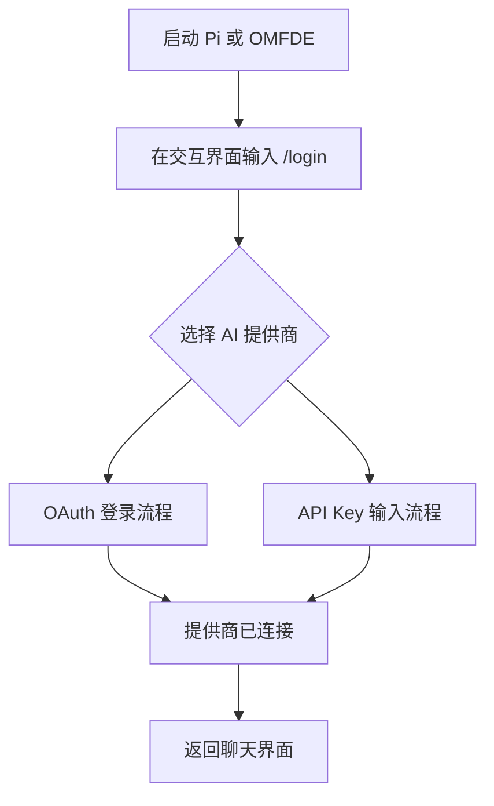
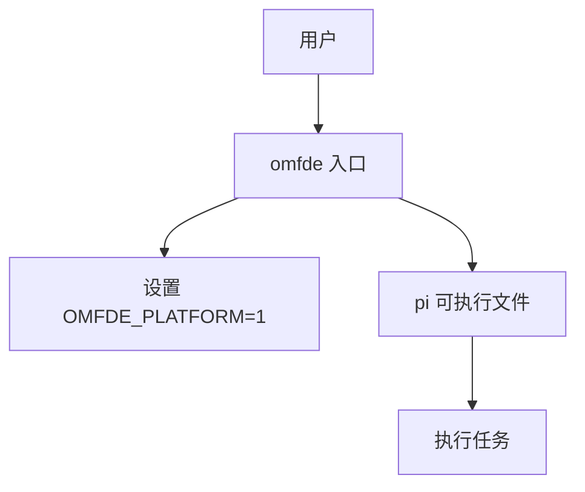

# 快速开始


**本文引用的文件**   
- [README.md](https://github.com/FDE-GROUP/oh-my-fde/blob/main/README.md)
- [README.zh-CN.md](https://github.com/FDE-GROUP/oh-my-fde/blob/main/README.zh-CN.md)
- [apps/omfde/README.md](https://github.com/FDE-GROUP/oh-my-fde/blob/main/apps/omfde/README.md)
- [apps/omfde/package.json](https://github.com/FDE-GROUP/oh-my-fde/blob/main/apps/omfde/package.json)
- [apps/omfde/bin/omfde.mjs](https://github.com/FDE-GROUP/oh-my-fde/blob/main/apps/omfde/bin/omfde.mjs)
- [package.json](https://github.com/FDE-GROUP/oh-my-fde/blob/main/package.json)
- [scripts/build-binaries.sh](https://github.com/FDE-GROUP/oh-my-fde/blob/main/scripts/build-binaries.sh)


## 目录
1. [简介](#简介)
2. [环境要求](#环境要求)
3. [安装方式](#安装方式)
4. [首次启动与基本配置](#首次启动与基本配置)
5. [连接 AI 提供商](#连接-ai-提供商)
6. [执行第一个任务](#执行第一个任务)
7. [OMFDE 平台入口说明](#omfde-平台入口说明)
8. [常见问题与故障排除](#常见问题与故障排除)
9. [下一步建议](#下一步建议)

## 简介
本指南面向第一次接触 OMFDE 的新用户，目标是让你在最短时间内完成安装、配置并成功运行一个真实任务。OMFDE 在本仓库中是一个基于 Pi 的平台入口：它负责启动底层 `pi` 可执行程序，并注入 `OMFDE_PLATFORM=1` 环境变量，以便后续扩展和平台能力可以识别当前运行上下文。

对于普通用户来说，你可以把 OMFDE 理解为“Pi 的包装器”；如果你只想体验核心功能，可以直接使用官方提供的 `pi` 命令，也可以通过仓库内的 `omfde` 入口启动。

## 环境要求
- **Node.js 版本**：需要 Node.js 22.19 或更高版本。
- **操作系统**：支持 macOS、Linux 和 Windows。
- **包管理器**：推荐使用 npm 或 pnpm；仓库开发流程默认使用 pnpm，但普通安装场景以 npm 为主。
- **网络**：首次安装可能需要访问 npm 注册表；如果使用官方安装器，还可能下载 Node.js 或相关依赖。

Node.js 版本约束来自仓库根配置以及多个包的声明，确保运行时行为一致。

**章节来源**
- [README.md:43-54](https://github.com/FDE-GROUP/oh-my-fde/blob/main/README.md#L43-L54)
- [README.zh-CN.md:61-70](https://github.com/FDE-GROUP/oh-my-fde/blob/main/README.zh-CN.md#L61-L70)
- [package.json:64-64](https://github.com/FDE-GROUP/oh-my-fde/blob/main/package.json#L64-L64)

## 安装方式
OMFDE 本身依赖 Pi 的可执行文件或 npm 包。你可以根据自身情况选择以下安装方式。

### 方式一：使用官方安装器（推荐）
官方安装器会处理依赖锁定和更新逻辑，适合大多数用户。

- **macOS / Linux**
  ```bash
  curl -fsSL https://pi.dev/install.sh | sh
  ```

- **Windows**
  ```powershell
  powershell -c "irm https://pi.dev/install.ps1 | iex"
  ```

安装完成后，通常可以在终端直接调用 `pi`。

**章节来源**
- [README.md:27-43](https://github.com/FDE-GROUP/oh-my-fde/blob/main/README.md#L27-L43)
- [README.zh-CN.md:45-61](https://github.com/FDE-GROUP/oh-my-fde/blob/main/README.zh-CN.md#L45-L61)

### 方式二：通过 npm 全局安装
如果你更熟悉 npm，也可以直接全局安装 Pi 包。这种方式不会像官方安装器那样锁定所有传递依赖，更适合已经熟悉 npm 生态的用户。

```bash
npm install -g --ignore-scripts @earendil-works/pi-coding-agent
```

安装后同样可以通过 `pi` 命令启动。

**章节来源**
- [README.md:37-43](https://github.com/FDE-GROUP/oh-my-fde/blob/main/README.md#L37-L43)
- [README.zh-CN.md:55-61](https://github.com/FDE-GROUP/oh-my-fde/blob/main/README.zh-CN.md#L55-L61)

### 方式三：从源码运行 OMFDE 入口
如果你想体验 OMFDE 平台入口，而不是直接使用上游 `pi`，可以在仓库内安装依赖后运行 `omfde`。

1. 进入仓库根目录。
2. 安装依赖（仓库开发流程使用 pnpm）：
   ```bash
   pnpm install --ignore-scripts
   ```
3. 运行 OMFDE 入口：
   ```bash
   pnpm run omfde
   ```

该入口会解析工作区中的 `pi` 可执行文件，设置 `OMFDE_PLATFORM=1`，并把参数原样传给 Pi。

**章节来源**
- [apps/omfde/README.md:1-14](https://github.com/FDE-GROUP/oh-my-fde/blob/main/apps/omfde/README.md#L1-L14)
- [apps/omfde/package.json:1-16](https://github.com/FDE-GROUP/oh-my-fde/blob/main/apps/omfde/package.json#L1-L16)
- [apps/omfde/bin/omfde.mjs:1-42](https://github.com/FDE-GROUP/oh-my-fde/blob/main/apps/omfde/bin/omfde.mjs#L1-L42)

### 方式四：构建独立二进制（高级）
如果你需要从发布源码构建独立二进制，可以使用仓库提供的脚本。该脚本支持指定平台，输出 tar.gz 或 zip 归档，适合打包、分发或离线环境。

```bash
./scripts/build-binaries.sh --offline-model-data --platform linux-x64 --out "$PWD/out"
```

支持的常见平台包括 darwin-arm64、darwin-x64、linux-x64、linux-arm64、windows-x64、windows-arm64。

**章节来源**
- [scripts/build-binaries.sh:1-20](https://github.com/FDE-GROUP/oh-my-fde/blob/main/scripts/build-binaries.sh#L1-L20)
- [scripts/build-binaries.sh:64-75](https://github.com/FDE-GROUP/oh-my-fde/blob/main/scripts/build-binaries.sh#L64-L75)
- [scripts/build-binaries.sh:162-200](https://github.com/FDE-GROUP/oh-my-fde/blob/main/scripts/build-binaries.sh#L162-L200)

## 首次启动与基本配置
安装完成后，进入你想让 Pi 工作的项目目录，然后启动交互界面。

```bash
cd /path/to/project
pi
```

或者在 OMFDE 仓库中：

```bash
pnpm run omfde
```

启动后，你会进入交互式终端界面。此时如果还没有配置 AI 提供商，系统会提示你进行登录或认证。

**章节来源**
- [README.md:45-54](https://github.com/FDE-GROUP/oh-my-fde/blob/main/README.md#L45-L54)
- [README.zh-CN.md:63-70](https://github.com/FDE-GROUP/oh-my-fde/blob/main/README.zh-CN.md#L63-L70)
- [apps/omfde/README.md:7-11](https://github.com/FDE-GROUP/oh-my-fde/blob/main/apps/omfde/README.md#L7-L11)

## 连接 AI 提供商
要使用内置的 AI 提供商，需要在 Pi 内部运行 `/login`，然后按照提示连接订阅或 API key。

典型流程如下：



**图示来源**
- [README.md:52-54](https://github.com/FDE-GROUP/oh-my-fde/blob/main/README.md#L52-L54)
- [README.zh-CN.md:70-70](https://github.com/FDE-GROUP/oh-my-fde/blob/main/README.zh-CN.md#L70-L70)

注意事项：
- 不同提供商可能支持不同的认证方式，例如 OAuth、API Key、AWS Profile 等。
- 如果某个提供商没有 API Key 登录方式，系统会提示省略 `--api-key` 并使用其他登录方式。
- 如果提供商已在 Pi 之外配置，系统会提示外部配置状态。

**章节来源**
- [README.md:52-54](https://github.com/FDE-GROUP/oh-my-fde/blob/main/README.md#L52-L54)
- [README.zh-CN.md:70-70](https://github.com/FDE-GROUP/oh-my-fde/blob/main/README.zh-CN.md#L70-L70)

## 执行第一个任务
完成提供商连接后，你就可以给 Pi 一个任务了。例如：

- 让代码生成一段函数。
- 解释现有代码。
- 修改某个文件。
- 回答关于项目结构的问题。

在交互界面中直接输入自然语言描述即可。Pi 会根据你的任务调用模型、工具或扩展来完成任务。

如果你希望用命令行模式执行简单任务，也可以在启动时传入参数，例如：

```bash
pnpm run omfde -- -p "只回复 OK"
```

这会把 `-p "只回复 OK"` 作为参数传递给底层 Pi。

**章节来源**
- [README.md:52-54](https://github.com/FDE-GROUP/oh-my-fde/blob/main/README.md#L52-L54)
- [apps/omfde/README.md:7-11](https://github.com/FDE-GROUP/oh-my-fde/blob/main/apps/omfde/README.md#L7-L11)

## OMFDE 平台入口说明
`apps/omfde` 是 OMFDE 平台的第一个入口。它目前是一个薄启动器，主要职责包括：

1. 解析工作区中的 `pi` 可执行文件。
2. 设置 `OMFDE_PLATFORM=1` 环境变量。
3. 将命令行参数原样转发给 Pi。
4. 保留子进程的退出码或信号，使 `omfde` 的行为接近直接调用 `pi`。

这意味着：
- 如果你只需要基础功能，可以直接使用 `pi`。
- 如果你未来要接入 OMFDE 平台扩展、权限控制、审计或平台化能力，应优先通过 `omfde` 启动。



**图示来源**
- [apps/omfde/bin/omfde.mjs:1-42](https://github.com/FDE-GROUP/oh-my-fde/blob/main/apps/omfde/bin/omfde.mjs#L1-L42)
- [apps/omfde/README.md:1-14](https://github.com/FDE-GROUP/oh-my-fde/blob/main/apps/omfde/README.md#L1-L14)

**章节来源**
- [apps/omfde/bin/omfde.mjs:1-42](https://github.com/FDE-GROUP/oh-my-fde/blob/main/apps/omfde/bin/omfde.mjs#L1-L42)
- [apps/omfde/README.md:1-14](https://github.com/FDE-GROUP/oh-my-fde/blob/main/apps/omfde/README.md#L1-L14)

## 常见问题与故障排除

### 问题一：提示 Node.js 版本过低
**现象**：安装或运行时报错，提示 Node.js 版本不满足要求。  
**原因**：仓库要求 Node.js 22.19 或更高版本。  
**解决**：升级 Node.js 到 22.19+，或使用官方安装器自动安装所需版本。

**章节来源**
- [README.md:43-43](https://github.com/FDE-GROUP/oh-my-fde/blob/main/README.md#L43-L43)
- [README.zh-CN.md:61-61](https://github.com/FDE-GROUP/oh-my-fde/blob/main/README.zh-CN.md#L61-L61)
- [package.json:64-64](https://github.com/FDE-GROUP/oh-my-fde/blob/main/package.json#L64-L64)

### 问题二：macOS 上无法执行二进制
**现象**：双击或终端执行时报权限或沙箱错误。  
**原因**：macOS 对未签名或未信任的二进制有安全限制。  
**解决**：
- 如果是从压缩包解压出来的二进制，尝试在终端执行前解除隔离属性。
- 如果是从源码构建，请确认依赖安装和构建步骤完整。
- 生产环境中建议使用官方安装器或受信任的安装路径。

### 问题三：Windows 上命令找不到
**现象**：输入 `pi` 或 `omfde` 提示不是内部或外部命令。  
**原因**：可执行文件所在目录未加入 PATH，或安装方式不完整。  
**解决**：
- 如果使用 npm 全局安装，确认 npm 的全局 bin 目录已在 PATH 中。
- 如果使用 OMFDE 入口，确认在仓库根目录运行 `pnpm run omfde`。
- 如果使用独立二进制，确认解压后的可执行文件存在且可执行。

**章节来源**
- [apps/omfde/package.json:6-8](https://github.com/FDE-GROUP/oh-my-fde/blob/main/apps/omfde/package.json#L6-L8)
- [apps/omfde/bin/omfde.mjs:15-17](https://github.com/FDE-GROUP/oh-my-fde/blob/main/apps/omfde/bin/omfde.mjs#L15-L17)

### 问题四：登录后仍无法调用模型
**现象**：`/login` 显示成功，但提问时报认证或模型不可用。  
**可能原因**：
- 提供商密钥无效或过期。
- 网络无法访问提供商 API。
- 所选模型在当前提供商下不可用。
- 提供商在 Pi 之外配置，但未正确同步。

**排查建议**：
1. 重新运行 `/login` 并确认登录状态。
2. 检查网络是否能访问提供商 API。
3. 查看提供商文档，确认模型名称和配额。
4. 如果提供商由外部配置，根据提示重新配置或切换到 Pi 内管理。

**章节来源**
- [README.md:52-54](https://github.com/FDE-GROUP/oh-my-fde/blob/main/README.md#L52-L54)
- [README.zh-CN.md:70-70](https://github.com/FDE-GROUP/oh-my-fde/blob/main/README.zh-CN.md#L70-L70)

### 问题五：想离线构建或避免刷新模型数据
**现象**：构建过程需要网络，或希望复用已有模型数据。  
**解决**：使用带 `--offline-model-data` 参数的构建脚本，避免刷新 provider 目录。

```bash
./scripts/build-binaries.sh --offline-model-data --platform linux-x64 --out "$PWD/out"
```

**章节来源**
- [scripts/build-binaries.sh:1-20](https://github.com/FDE-GROUP/oh-my-fde/blob/main/scripts/build-binaries.sh#L1-L20)
- [scripts/build-binaries.sh:162-200](https://github.com/FDE-GROUP/oh-my-fde/blob/main/scripts/build-binaries.sh#L162-L200)

## 下一步建议
- 如果你只是个人使用，建议先掌握 `pi` 的基本交互、`/login` 配置和常用任务。
- 如果你要接入 OMFDE 平台能力，优先通过 `omfde` 启动，并为后续扩展预留配置空间。
- 如果需要更强的权限边界，可以参考仓库中关于容器化和沙箱化的说明。
- 如果想参与开发，可以按照 README 中的开发命令安装依赖、构建和运行测试。