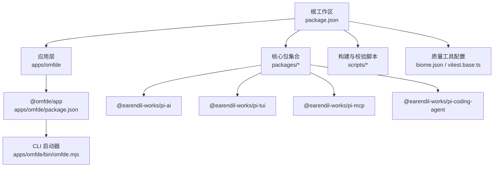
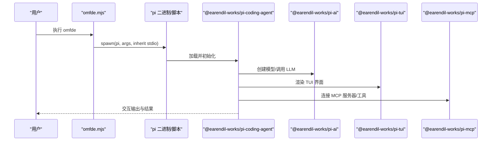
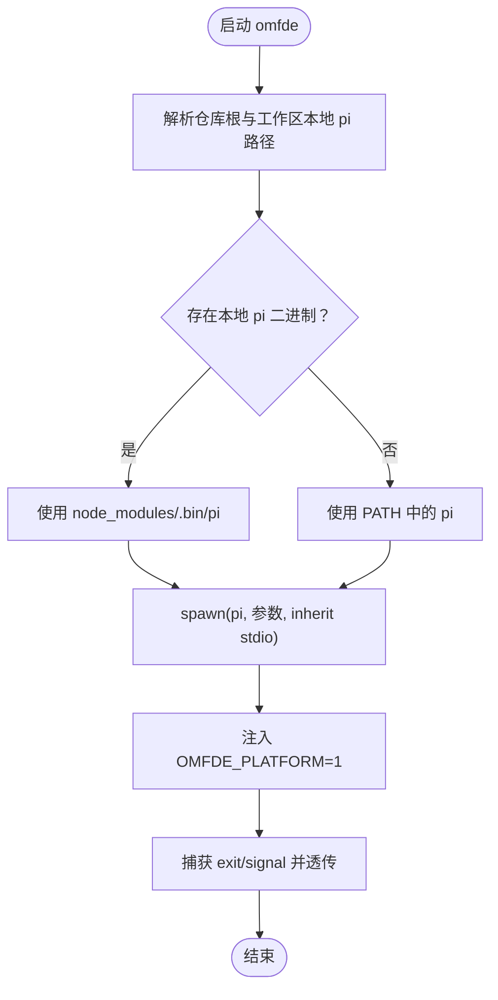
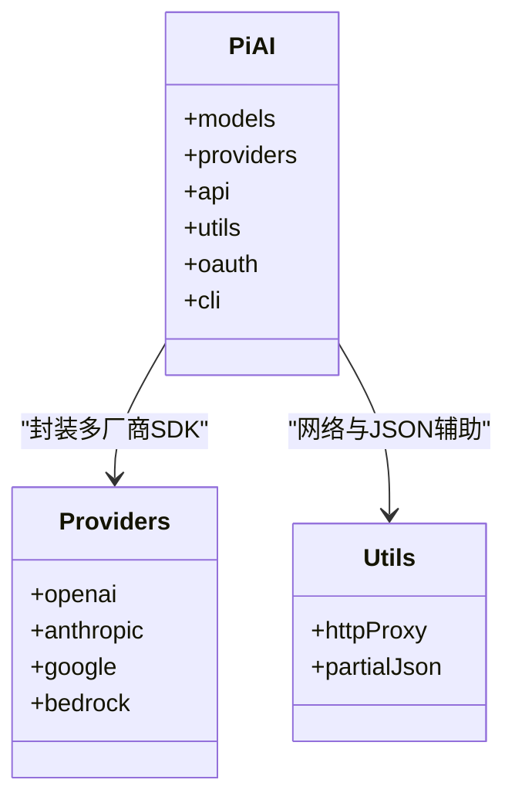
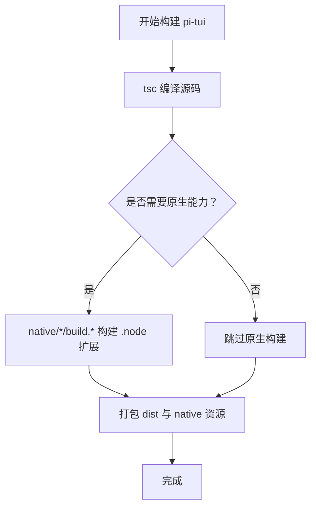
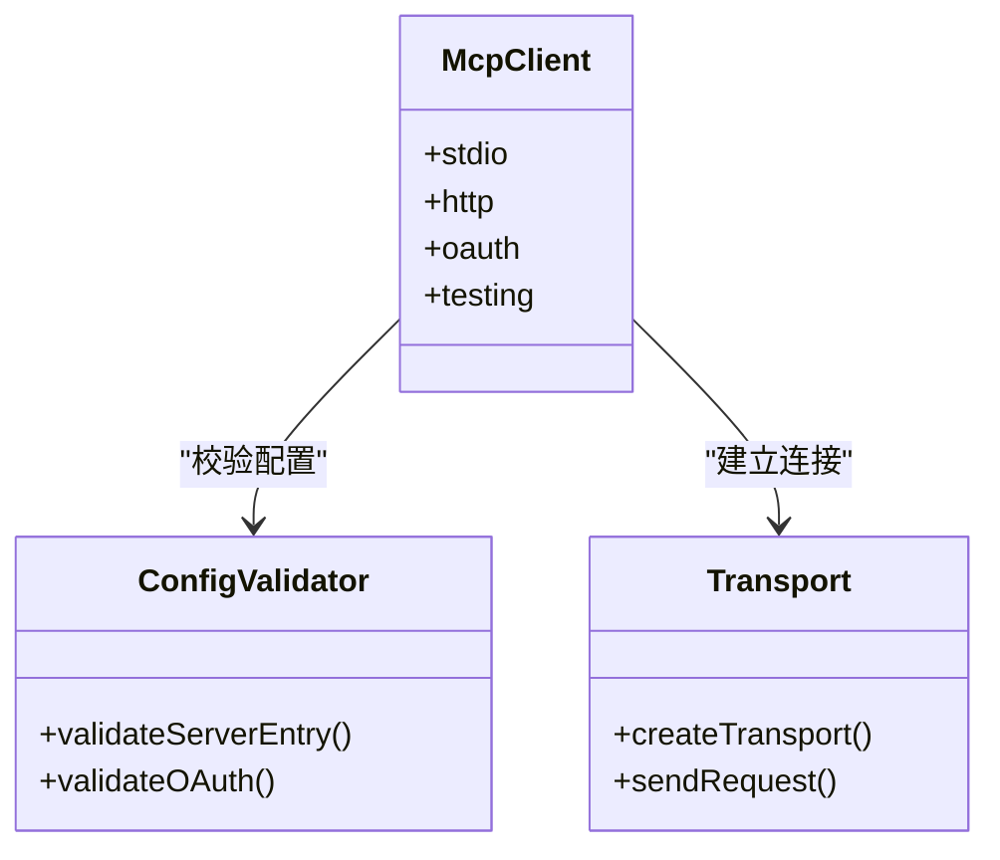
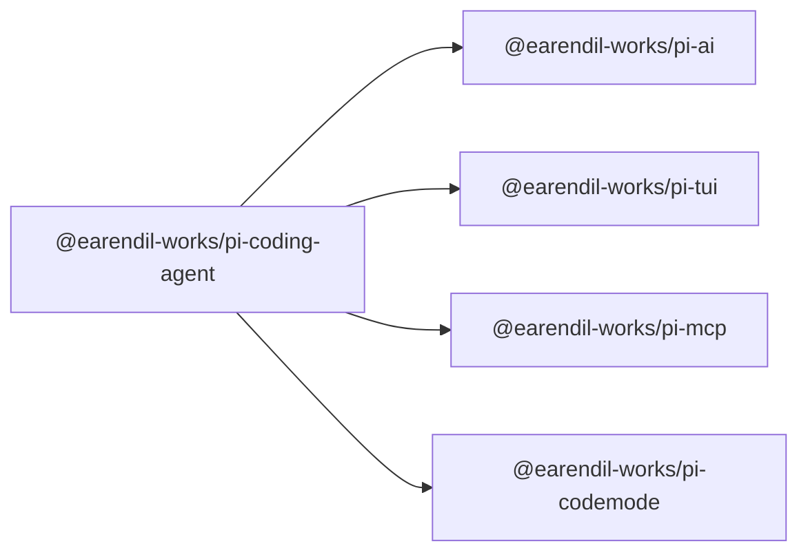
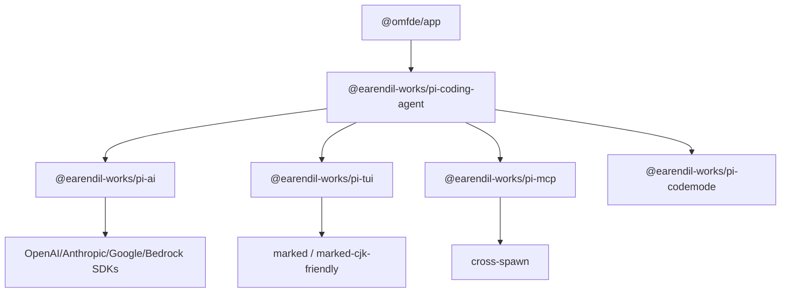

# 技术栈

**本文引用的文件**   
- [package.json](https://github.com/FDE-GROUP/oh-my-fde/blob/main/package.json)
- [apps/omfde/package.json](https://github.com/FDE-GROUP/oh-my-fde/blob/main/apps/omfde/package.json)
- [apps/omfde/bin/omfde.mjs](https://github.com/FDE-GROUP/oh-my-fde/blob/main/apps/omfde/bin/omfde.mjs)
- [biome.json](https://github.com/FDE-GROUP/oh-my-fde/blob/main/biome.json)
- [vitest.base.ts](https://github.com/FDE-GROUP/oh-my-fde/blob/main/vitest.base.ts)
- [packages/ai/package.json](https://github.com/FDE-GROUP/oh-my-fde/blob/main/packages/ai/package.json)
- [packages/tui/package.json](https://github.com/FDE-GROUP/oh-my-fde/blob/main/packages/tui/package.json)
- [packages/mcp/package.json](https://github.com/FDE-GROUP/oh-my-fde/blob/main/packages/mcp/package.json)
- [packages/coding-agent/package.json](https://github.com/FDE-GROUP/oh-my-fde/blob/main/packages/coding-agent/package.json)

## 目录
1. [引言](#引言)
2. [项目结构](#项目结构)
3. [核心组件](#核心组件)
4. [架构总览](#架构总览)
5. [详细组件分析](#详细组件分析)
6. [依赖关系分析](#依赖关系分析)
7. [性能与构建特性](#性能与构建特性)
8. [故障排查指南](#故障排查指南)
9. [结论](#结论)

## 引言
本技术栈说明面向 OMFDE 项目的开发者与维护者，聚焦以下目标：
- 明确以 TypeScript 作为主要开发语言、Node.js 为运行时、pnpm 为包管理器的工程基线。
- 解释关键依赖库的职责与选型理由：@earendil-works/pi-ai（LLM 抽象层）、@earendil-works/pi-tui（终端界面）、@earendil-works/pi-mcp（MCP 协议支持）。
- 梳理开发工具链与配置：Biome 代码检查与格式化、Vitest 测试框架、Husky Git 钩子。
- 说明构建系统与部署工具链，包括 monorepo 脚本、打包产物、二进制分发与平台扩展。
- 给出技术选型的背景与权衡，帮助新成员快速上手并做出一致的技术决策。

## 项目结构
OMFDE 基于 pnpm workspace 的 monorepo 组织方式，顶层 package.json 定义统一脚本、Node 引擎版本与开发依赖；应用入口位于 apps/omfde，核心能力以 packages/* 形式拆分为多个可复用包。

**图表来源**
- [package.json:1-68](https://github.com/FDE-GROUP/oh-my-fde/blob/main/package.json#L1-L68)
- [apps/omfde/package.json:1-16](https://github.com/FDE-GROUP/oh-my-fde/blob/main/apps/omfde/package.json#L1-L16)
- [apps/omfde/bin/omfde.mjs:1-42](https://github.com/FDE-GROUP/oh-my-fde/blob/main/apps/omfde/bin/omfde.mjs#L1-L42)

**章节来源**
- [package.json:1-68](https://github.com/FDE-GROUP/oh-my-fde/blob/main/package.json#L1-L68)
- [apps/omfde/package.json:1-16](https://github.com/FDE-GROUP/oh-my-fde/blob/main/apps/omfde/package.json#L1-L16)

## 核心组件
本节从“运行环境、包管理、语言”三个维度说明 OMFDE 的基础技术栈。

- Node.js 运行时
  - 根 package.json 通过 engines.node 指定最低 Node 版本，确保所有包在一致的运行时上执行。
  - 应用入口 omfde.mjs 使用 Node 内置模块（child_process、fs、path、url）启动底层 pi 命令，透传参数并保留退出码与信号。

- TypeScript 语言
  - 根 devDependencies 引入 typescript，配合 tsconfig 进行类型检查与编译。
  - 各包均声明 type: module，采用 ESM 风格导出与导入。

- pnpm 包管理
  - 根 package.json 声明 packageManager 字段锁定 pnpm 版本，保证团队与 CI 的一致性。
  - 通过 scripts 中的 pnpm --filter 命令对 monorepo 内各包进行顺序构建、发布与测试。

**章节来源**
- [package.json:53-65](https://github.com/FDE-GROUP/oh-my-fde/blob/main/package.json#L53-L65)
- [apps/omfde/bin/omfde.mjs:1-42](https://github.com/FDE-GROUP/oh-my-fde/blob/main/apps/omfde/bin/omfde.mjs#L1-L42)

## 架构总览
OMFDE 的应用层通过一个轻量启动器转发到 @earendil-works/pi-coding-agent，后者组合 LLM 抽象、终端 UI 与 MCP 协议客户端，形成完整的交互式编码代理体验。

**图表来源**
- [apps/omfde/bin/omfde.mjs:1-42](https://github.com/FDE-GROUP/oh-my-fde/blob/main/apps/omfde/bin/omfde.mjs#L1-L42)
- [packages/coding-agent/package.json:1-98](https://github.com/FDE-GROUP/oh-my-fde/blob/main/packages/coding-agent/package.json#L1-L98)
- [packages/ai/package.json:1-116](https://github.com/FDE-GROUP/oh-my-fde/blob/main/packages/ai/package.json#L1-L116)
- [packages/tui/package.json:1-64](https://github.com/FDE-GROUP/oh-my-fde/blob/main/packages/tui/package.json#L1-L64)
- [packages/mcp/package.json:1-61](https://github.com/FDE-GROUP/oh-my-fde/blob/main/packages/mcp/package.json#L1-L61)

## 详细组件分析

### 运行时与入口：Node.js 与 omfde 启动器
- omfde.mjs 负责：
  - 解析仓库根路径与工作区本地 pi 二进制位置。
  - 将命令行参数透传给 pi，并设置 OMFDE_PLATFORM 环境变量以便平台扩展识别。
  - 继承子进程标准 I/O，并在退出时保留信号或退出码。
- 该设计使 omfde 成为“透明外壳”，不改变 pi 的行为语义，同时提供平台级集成点。

**图表来源**
- [apps/omfde/bin/omfde.mjs:1-42](https://github.com/FDE-GROUP/oh-my-fde/blob/main/apps/omfde/bin/omfde.mjs#L1-L42)

**章节来源**
- [apps/omfde/bin/omfde.mjs:1-42](https://github.com/FDE-GROUP/oh-my-fde/blob/main/apps/omfde/bin/omfde.mjs#L1-L42)

### LLM 抽象层：@earendil-works/pi-ai
- 职责
  - 提供统一的 LLM API，屏蔽不同厂商 SDK 的差异。
  - 暴露 models、providers、api、utils、oauth 等子路径导出，便于按需引入。
  - 支持模型目录生成、离线构建与数据校验脚本。
- 关键依赖
  - 集成 OpenAI、Anthropic、Google GenAI、AWS Bedrock 等官方 SDK。
  - 使用 http-proxy-agent/https-proxy-agent 支持代理网络访问。
  - 使用 partial-json 处理流式或部分 JSON 响应。
- 构建与产物
  - 通过 tsc 编译至 dist，并提供 bin 入口用于 CLI。
  - 支持 generate-models、hydrate-model-data、generate-model-catalog 等脚本。

**图表来源**
- [packages/ai/package.json:1-116](https://github.com/FDE-GROUP/oh-my-fde/blob/main/packages/ai/package.json#L1-L116)

**章节来源**
- [packages/ai/package.json:1-116](https://github.com/FDE-GROUP/oh-my-fde/blob/main/packages/ai/package.json#L1-L116)

### 终端界面：@earendil-works/pi-tui
- 职责
  - 提供终端用户界面库，支持差分渲染以提升文本应用性能。
  - 包含原生扩展构建脚本（darwin/linux/win32），用于剪贴板等系统能力。
- 关键依赖
  - marked 与 marked-cjk-friendly 用于 Markdown 渲染与中日韩字符宽度计算。
  - get-east-asian-width 用于精确列宽对齐。
- 构建与产物
  - 通过 tsc 编译，并提供 native 构建脚本与预编译二进制。
  - 支持跨平台原生构建命令。

**图表来源**
- [packages/tui/package.json:1-64](https://github.com/FDE-GROUP/oh-my-fde/blob/main/packages/tui/package.json#L1-L64)

**章节来源**
- [packages/tui/package.json:1-64](https://github.com/FDE-GROUP/oh-my-fde/blob/main/packages/tui/package.json#L1-L64)

### MCP 协议支持：@earendil-works/pi-mcp
- 职责
  - 提供独立的 Model Context Protocol 客户端，供 pi 及其他应用复用。
  - 支持 stdio 与 Streamable HTTP 两种传输方式，以及 OAuth 认证流程。
- 关键能力
  - 配置校验：对 mcpServers 条目进行严格校验，区分有效/无效配置。
  - OAuth：支持回调 URL、端口、作用域、客户端注册策略等安全字段校验。
- 构建与产物
  - 通过 tsc 编译，提供 source/types/import 三态导出。
  - 提供 testing 子路径用于单元测试与合规性测试。

**图表来源**
- [packages/mcp/package.json:1-61](https://github.com/FDE-GROUP/oh-my-fde/blob/main/packages/mcp/package.json#L1-L61)

**章节来源**
- [packages/mcp/package.json:1-61](https://github.com/FDE-GROUP/oh-my-fde/blob/main/packages/mcp/package.json#L1-L61)

### 编码代理：@earendil-works/pi-coding-agent
- 职责
  - 提供编码代理 CLI，整合读文件、Bash、编辑、写入等工具与会话管理。
  - 组合 pi-ai、pi-tui、pi-mcp、pi-codemode 等能力，形成完整交互闭环。
- 构建与产物
  - 支持 unbundled 与 bundle 两种构建模式，并可通过 bun 编译为独立二进制。
  - 复制主题、资源与模板文件到 dist，便于运行时加载。

**图表来源**
- [packages/coding-agent/package.json:1-98](https://github.com/FDE-GROUP/oh-my-fde/blob/main/packages/coding-agent/package.json#L1-L98)

**章节来源**
- [packages/coding-agent/package.json:1-98](https://github.com/FDE-GROUP/oh-my-fde/blob/main/packages/coding-agent/package.json#L1-L98)

## 依赖关系分析
- 应用层依赖
  - @omfde/app 仅依赖 @earendil-works/pi-coding-agent，保持应用壳极简。
- 核心包依赖
  - pi-coding-agent 依赖 pi-ai、pi-tui、pi-mcp、pi-codemode 等包，形成横向能力组合。
  - pi-ai 依赖多家厂商 SDK 与通用网络/JSON 工具。
  - pi-tui 依赖 Markdown 渲染与东亚字符宽度库，并提供原生扩展。
  - pi-mcp 依赖 cross-spawn 用于进程管理，提供 OAuth 与配置校验。

**图表来源**
- [apps/omfde/package.json:1-16](https://github.com/FDE-GROUP/oh-my-fde/blob/main/apps/omfde/package.json#L1-L16)
- [packages/coding-agent/package.json:1-98](https://github.com/FDE-GROUP/oh-my-fde/blob/main/packages/coding-agent/package.json#L1-L98)
- [packages/ai/package.json:1-116](https://github.com/FDE-GROUP/oh-my-fde/blob/main/packages/ai/package.json#L1-L116)
- [packages/tui/package.json:1-64](https://github.com/FDE-GROUP/oh-my-fde/blob/main/packages/tui/package.json#L1-L64)
- [packages/mcp/package.json:1-61](https://github.com/FDE-GROUP/oh-my-fde/blob/main/packages/mcp/package.json#L1-L61)

**章节来源**
- [apps/omfde/package.json:1-16](https://github.com/FDE-GROUP/oh-my-fde/blob/main/apps/omfde/package.json#L1-L16)
- [packages/coding-agent/package.json:1-98](https://github.com/FDE-GROUP/oh-my-fde/blob/main/packages/coding-agent/package.json#L1-L98)
- [packages/ai/package.json:1-116](https://github.com/FDE-GROUP/oh-my-fde/blob/main/packages/ai/package.json#L1-L116)
- [packages/tui/package.json:1-64](https://github.com/FDE-GROUP/oh-my-fde/blob/main/packages/tui/package.json#L1-L64)
- [packages/mcp/package.json:1-61](https://github.com/FDE-GROUP/oh-my-fde/blob/main/packages/mcp/package.json#L1-L61)

## 性能与构建特性
- 差分渲染
  - pi-tui 通过差分渲染减少终端重绘开销，适合长时间运行的交互式应用。
- 原生扩展
  - pi-tui 提供 darwin/linux/win32 原生构建脚本，提升剪贴板等系统能力性能。
- 模型目录与离线构建
  - pi-ai 支持 generate-model-catalog 与 build:offline，便于离线环境与 CI 稳定性。
- 二进制分发
  - coding-agent 支持 bun 编译为独立二进制，便于跨平台分发与快速启动。

[本节为通用性能讨论，不直接分析具体文件]

## 故障排查指南
- 启动失败
  - 若 omfde 无法找到本地 pi 二进制，会回退到 PATH 查找；确认 node_modules/.bin 是否存在或全局安装是否生效。
  - 检查 OMFDE_PLATFORM 环境变量是否正确注入，用于平台扩展识别。
- 构建失败
  - 根脚本通过 pnpm --filter 顺序构建各包；若某包构建失败，优先查看对应包的 build 脚本与依赖版本。
  - pi-ai 的 build:offline 依赖模型数据校验，确保模型目录与数据一致性。
- 测试失败
  - 根 test 脚本先运行脚本测试，再在工作区内并行执行各包的测试；根据错误定位具体包。
  - vitest.base.ts 中定义了别名映射，确保测试能解析工作区内的包路径。

**章节来源**
- [apps/omfde/bin/omfde.mjs:1-42](https://github.com/FDE-GROUP/oh-my-fde/blob/main/apps/omfde/bin/omfde.mjs#L1-L42)
- [package.json:6-51](https://github.com/FDE-GROUP/oh-my-fde/blob/main/package.json#L6-L51)
- [vitest.base.ts:1-97](https://github.com/FDE-GROUP/oh-my-fde/blob/main/vitest.base.ts#L1-L97)

## 结论
OMFDE 的技术栈以 TypeScript + Node.js + pnpm 为核心，围绕 monorepo 组织多个高内聚、低耦合的包。@earendil-works/pi-ai 统一了多厂商 LLM 接口，@earendil-works/pi-tui 提供了高性能终端界面，@earendil-works/pi-mcp 实现了标准化的 MCP 协议客户端。配合 Biome 的代码质量、Vitest 的测试框架与 Husky 的 Git 钩子，项目在开发体验、可维护性与可移植性之间取得良好平衡。对于新增能力，建议遵循现有包边界与构建脚本约定，优先复用已有抽象，避免重复造轮子。