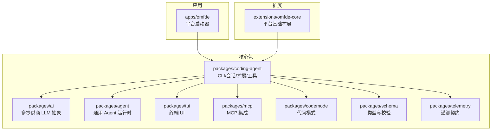
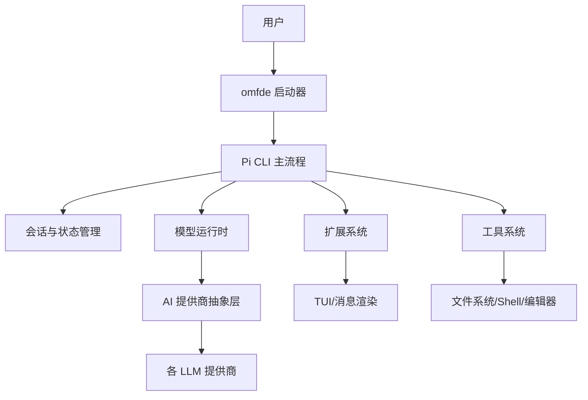
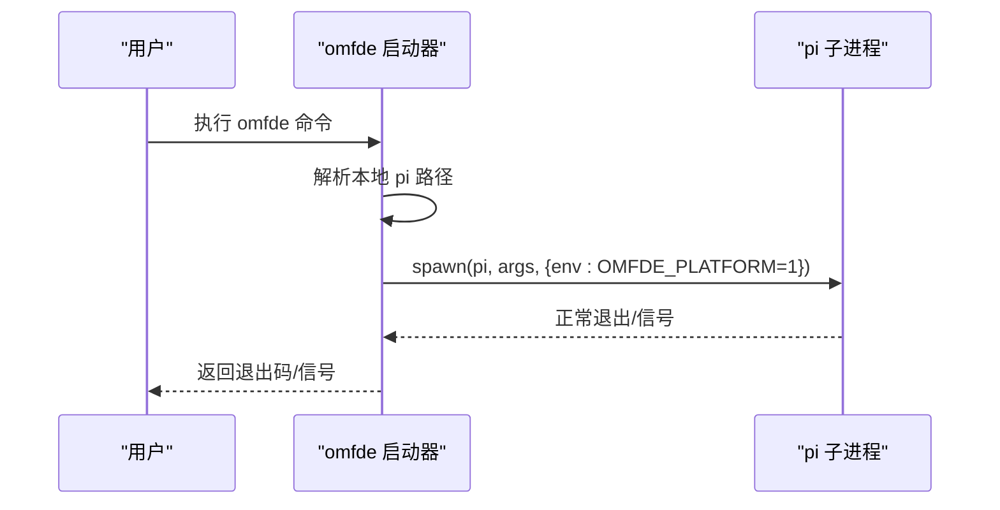
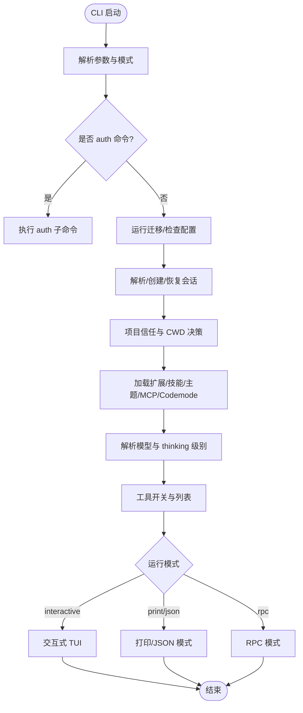
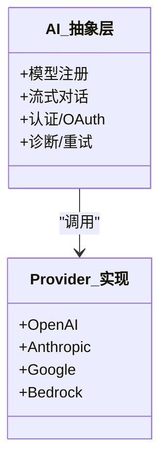
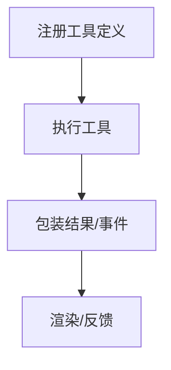
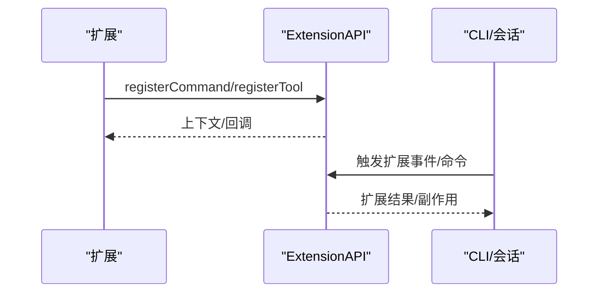
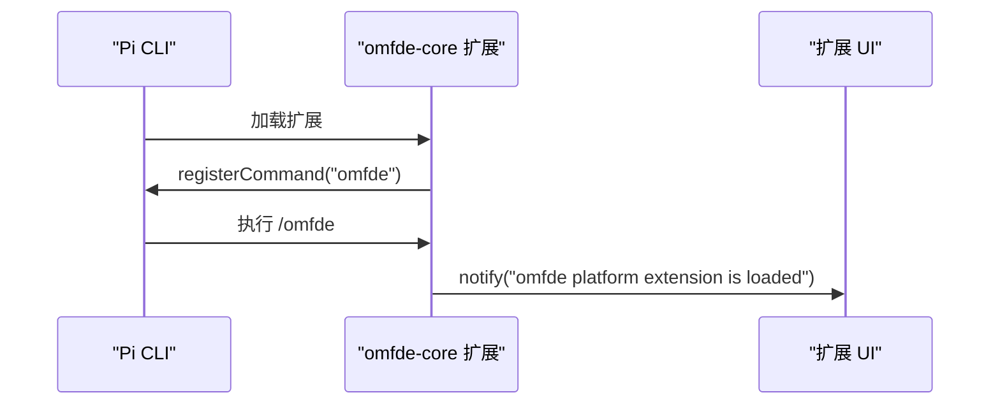
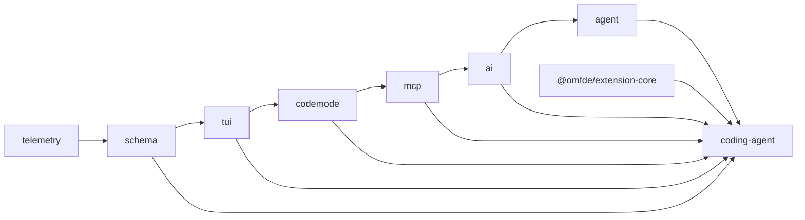

# 架构概览

**本文引用的文件**   
- [README.md](https://github.com/FDE-GROUP/oh-my-fde/blob/main/README.md)
- [package.json](https://github.com/FDE-GROUP/oh-my-fde/blob/main/package.json)
- [apps/omfde/bin/omfde.mjs](https://github.com/FDE-GROUP/oh-my-fde/blob/main/apps/omfde/bin/omfde.mjs)
- [apps/omfde/README.md](https://github.com/FDE-GROUP/oh-my-fde/blob/main/apps/omfde/README.md)
- [extensions/omfde-core/package.json](https://github.com/FDE-GROUP/oh-my-fde/blob/main/extensions/omfde-core/package.json)
- [extensions/omfde-core/src/index.ts](https://github.com/FDE-GROUP/oh-my-fde/blob/main/extensions/omfde-core/src/index.ts)
- [packages/coding-agent/src/cli.ts](https://github.com/FDE-GROUP/oh-my-fde/blob/main/packages/coding-agent/src/cli.ts)
- [packages/coding-agent/src/main.ts](https://github.com/FDE-GROUP/oh-my-fde/blob/main/packages/coding-agent/src/main.ts)
- [packages/coding-agent/src/index.ts](https://github.com/FDE-GROUP/oh-my-fde/blob/main/packages/coding-agent/src/index.ts)
- [packages/ai/src/index.ts](https://github.com/FDE-GROUP/oh-my-fde/blob/main/packages/ai/src/index.ts)
- [packages/agent/package.json](https://github.com/FDE-GROUP/oh-my-fde/blob/main/packages/agent/package.json)

## 目录
1. [简介](#简介)
2. [项目结构](#项目结构)
3. [核心组件](#核心组件)
4. [架构总览](#架构总览)
5. [详细组件分析](#详细组件分析)
6. [依赖关系分析](#依赖关系分析)
7. [性能与可扩展性](#性能与可扩展性)
8. [故障排查指南](#故障排查指南)
9. [结论](#结论)

## 简介
本文件为 OMFDE 的高层次架构概览，面向开发者快速理解整体系统设计、monorepo 组织方式、核心包职责与数据流向。OMFDE 以 Pi 编码代理为核心运行时，通过一个薄启动器注入平台上下文，并以扩展机制在不修改内核的前提下接入平台能力。系统采用模块化设计、事件驱动与插件体系，将 CLI 入口、代理运行时、AI 提供商抽象层、工具系统与扩展机制解耦，便于演进和替换。

## 项目结构
仓库采用 pnpm monorepo 组织：
- apps：应用入口（当前为 omfde 平台启动器）
- packages：核心库与运行时（coding-agent、ai、agent、tui、schema、telemetry、mcp、codemode、evals 等）
- extensions：平台扩展（当前提供 omfde-core 基础扩展）
- docs/specs/explains：规范、设计与实现说明
- scripts：构建、发布、校验与工具脚本

图表来源
- [package.json:6-32](https://github.com/FDE-GROUP/oh-my-fde/blob/main/package.json#L6-L32)
- [apps/omfde/bin/omfde.mjs:1-42](https://github.com/FDE-GROUP/oh-my-fde/blob/main/apps/omfde/bin/omfde.mjs#L1-L42)
- [packages/coding-agent/src/index.ts:1-503](https://github.com/FDE-GROUP/oh-my-fde/blob/main/packages/coding-agent/src/index.ts#L1-L503)
- [packages/ai/src/index.ts:1-48](https://github.com/FDE-GROUP/oh-my-fde/blob/main/packages/ai/src/index.ts#L1-L48)
- [packages/agent/package.json:1-51](https://github.com/FDE-GROUP/oh-my-fde/blob/main/packages/agent/package.json#L1-L51)

章节来源
- [README.md:56-69](https://github.com/FDE-GROUP/oh-my-fde/blob/main/README.md#L56-L69)
- [package.json:1-68](https://github.com/FDE-GROUP/oh-my-fde/blob/main/package.json#L1-L68)

## 核心组件
- 平台启动器（OMFDE Launcher）
  - 作用：解析工作区 pi 可执行文件，设置平台环境变量，透传参数并保留退出码/信号。
  - 关键行为：优先使用本地 node_modules/.bin/pi，否则回退到 PATH；剥离 pnpm 的 -- 分隔符；继承 stdio；转发子进程错误与退出。
- CLI 入口点（Pi Coding Agent）
  - 作用：统一解析命令行、选择运行模式（交互/打印/RPC/JSON）、初始化会话、加载扩展与工具、调度模型运行时。
  - 关键流程：auth 命令分流 → 迁移与配置 → 会话解析 → 信任管理 → 扩展/技能/主题加载 → 模式路由。
- AI 提供商抽象层
  - 作用：统一多厂商 LLM API（OpenAI、Anthropic、Google、Bedrock 等），暴露模型注册、流式调用、认证与诊断能力。
- 工具系统
  - 作用：定义与注册工具（读/写/搜索/执行 shell 等），提供工具定义工厂、渲染与结果包装，支持扩展动态注入。
- 扩展机制
  - 作用：通过 ExtensionAPI 注册命令、工具、事件钩子、UI 组件等，不侵入内核即可增强能力。
- 通用 Agent 运行时
  - 作用：提供传输抽象、状态管理与附件支持，作为更高层 Agent 能力的基座。

章节来源
- [apps/omfde/bin/omfde.mjs:1-42](https://github.com/FDE-GROUP/oh-my-fde/blob/main/apps/omfde/bin/omfde.mjs#L1-L42)
- [packages/coding-agent/src/cli.ts:1-7](https://github.com/FDE-GROUP/oh-my-fde/blob/main/packages/coding-agent/src/cli.ts#L1-L7)
- [packages/coding-agent/src/main.ts:1-800](https://github.com/FDE-GROUP/oh-my-fde/blob/main/packages/coding-agent/src/main.ts#L1-L800)
- [packages/coding-agent/src/index.ts:1-503](https://github.com/FDE-GROUP/oh-my-fde/blob/main/packages/coding-agent/src/index.ts#L1-L503)
- [packages/ai/src/index.ts:1-48](https://github.com/FDE-GROUP/oh-my-fde/blob/main/packages/ai/src/index.ts#L1-L48)
- [packages/agent/package.json:1-51](https://github.com/FDE-GROUP/oh-my-fde/blob/main/packages/agent/package.json#L1-L51)

## 架构总览
OMFDE 的整体边界如下：
- 外部用户通过 omfde 命令进入平台启动器
- 启动器调用 Pi CLI，传入 OMFDE_PLATFORM=1 环境标志
- Pi CLI 解析参数、初始化会话、加载扩展与内置能力
- 扩展可在不修改内核的情况下注册命令、工具与 UI
- 代理运行时通过 AI 抽象层与具体 LLM 提供商通信
- 工具系统负责文件系统、Shell 与编辑等操作，受信任策略约束

图表来源
- [apps/omfde/bin/omfde.mjs:1-42](https://github.com/FDE-GROUP/oh-my-fde/blob/main/apps/omfde/bin/omfde.mjs#L1-L42)
- [packages/coding-agent/src/main.ts:1-800](https://github.com/FDE-GROUP/oh-my-fde/blob/main/packages/coding-agent/src/main.ts#L1-L800)
- [packages/coding-agent/src/index.ts:1-503](https://github.com/FDE-GROUP/oh-my-fde/blob/main/packages/coding-agent/src/index.ts#L1-L503)
- [packages/ai/src/index.ts:1-48](https://github.com/FDE-GROUP/oh-my-fde/blob/main/packages/ai/src/index.ts#L1-L48)

## 详细组件分析

### 平台启动器（OMFDE Launcher）
- 职责
  - 定位工作区内的 pi 可执行文件
  - 设置 OMFDE_PLATFORM=1 以区分平台化启动
  - 透传所有参数给子进程
  - 保持父进程与子进程的退出码/信号一致
- 关键路径
  - 本地二进制优先：node_modules/.bin/pi（或 .cmd）
  - 失败时输出错误并退出
  - 捕获子进程 error/exit 事件，转发信号或退出码

图表来源
- [apps/omfde/bin/omfde.mjs:1-42](https://github.com/FDE-GROUP/oh-my-fde/blob/main/apps/omfde/bin/omfde.mjs#L1-L42)

章节来源
- [apps/omfde/bin/omfde.mjs:1-42](https://github.com/FDE-GROUP/oh-my-fde/blob/main/apps/omfde/bin/omfde.mjs#L1-L42)
- [apps/omfde/README.md:1-14](https://github.com/FDE-GROUP/oh-my-fde/blob/main/apps/omfde/README.md#L1-L14)

### CLI 入口点与主流程（Pi Coding Agent）
- 职责
  - 解析命令行参数与模式（interactive/print/json/rpc）
  - 处理 auth/login/logout 等专用命令
  - 初始化 SettingsManager、SessionManager、ProjectTrustStore
  - 加载扩展、技能、主题与 MCP/Codemode
  - 根据模式路由到对应运行器
- 关键流程要点
  - 离线模式与环境变量处理
  - 会话解析（fork/continue/resume/sessionId）
  - 模型解析与 thinking level 优先级
  - 工具开关与白/黑名单
  - 首次引导与主题选择
  - 标准输出接管与非交互模式保护

图表来源
- [packages/coding-agent/src/main.ts:1-800](https://github.com/FDE-GROUP/oh-my-fde/blob/main/packages/coding-agent/src/main.ts#L1-L800)
- [packages/coding-agent/src/cli.ts:1-7](https://github.com/FDE-GROUP/oh-my-fde/blob/main/packages/coding-agent/src/cli.ts#L1-L7)

章节来源
- [packages/coding-agent/src/cli.ts:1-7](https://github.com/FDE-GROUP/oh-my-fde/blob/main/packages/coding-agent/src/cli.ts#L1-L7)
- [packages/coding-agent/src/main.ts:1-800](https://github.com/FDE-GROUP/oh-my-fde/blob/main/packages/coding-agent/src/main.ts#L1-L800)

### AI 提供商抽象层
- 职责
  - 暴露统一的模型与流式对话接口
  - 管理模型目录、认证、OAuth、重试与诊断
  - 为上层提供 provider 工厂与兼容层
- 设计要点
  - 核心入口仅导出无副作用的类型与工具
  - Provider 实现位于 providers/*，API 适配位于 api/*
  - 兼容层在 compat/* 中维护旧全局 API

图表来源
- [packages/ai/src/index.ts:1-48](https://github.com/FDE-GROUP/oh-my-fde/blob/main/packages/ai/src/index.ts#L1-L48)

章节来源
- [packages/ai/src/index.ts:1-48](https://github.com/FDE-GROUP/oh-my-fde/blob/main/packages/ai/src/index.ts#L1-L48)

### 工具系统
- 职责
  - 定义与注册工具（read/write/find/grep/ls/bash/powershell/edit 等）
  - 提供工具定义工厂、渲染与结果包装
  - 支持扩展动态注入与工具生命周期事件
- 设计要点
  - 工具定义与执行分离，便于测试与复用
  - 通过 ExtensionAPI 暴露工具注册与上下文
  - 与信任策略结合，限制敏感操作

图表来源
- [packages/coding-agent/src/index.ts:340-398](https://github.com/FDE-GROUP/oh-my-fde/blob/main/packages/coding-agent/src/index.ts#L340-L398)

章节来源
- [packages/coding-agent/src/index.ts:340-398](https://github.com/FDE-GROUP/oh-my-fde/blob/main/packages/coding-agent/src/index.ts#L340-L398)

### 扩展机制
- 职责
  - 提供 ExtensionAPI 供扩展注册命令、工具、UI 组件与事件钩子
  - 支持内联扩展与外部扩展发现与加载
  - 与 CLI/SDK 共同协作，扩展能力贯穿交互与程序化使用
- 设计要点
  - 扩展与内核解耦，避免直接修改核心逻辑
  - 通过事件总线与上下文对象传递状态与回调

图表来源
- [packages/coding-agent/src/index.ts:53-221](https://github.com/FDE-GROUP/oh-my-fde/blob/main/packages/coding-agent/src/index.ts#L53-L221)

章节来源
- [packages/coding-agent/src/index.ts:53-221](https://github.com/FDE-GROUP/oh-my-fde/blob/main/packages/coding-agent/src/index.ts#L53-L221)

### 通用 Agent 运行时
- 职责
  - 提供传输抽象、状态管理与附件支持
  - 作为更高层 Agent 能力的基座
- 依赖
  - 依赖 @earendil-works/pi-ai 与 @earendil-works/pi-schema

章节来源
- [packages/agent/package.json:1-51](https://github.com/FDE-GROUP/oh-my-fde/blob/main/packages/agent/package.json#L1-L51)

### 平台扩展（omfde-core）
- 职责
  - 注册 /omfde 命令作为加载探针
  - 通过 ctx.ui.notify 展示平台扩展已加载
- 设计原则
  - 不修改 Pi 内核，优先通过扩展、配置与公开 API 组合
  - 后续平台能力在此扩展中逐步接入

图表来源
- [extensions/omfde-core/src/index.ts:1-20](https://github.com/FDE-GROUP/oh-my-fde/blob/main/extensions/omfde-core/src/index.ts#L1-L20)

章节来源
- [extensions/omfde-core/src/index.ts:1-20](https://github.com/FDE-GROUP/oh-my-fde/blob/main/extensions/omfde-core/src/index.ts#L1-L20)
- [extensions/omfde-core/package.json:1-16](https://github.com/FDE-GROUP/oh-my-fde/blob/main/extensions/omfde-core/package.json#L1-L16)

## 依赖关系分析
- 顶层脚本与包顺序
  - build 脚本按依赖顺序依次构建 telemetry → schema → tui → codemode → mcp → ai → agent → coding-agent
- 包间依赖
  - coding-agent 依赖 ai、tui、schema、telemetry、mcp、codemode 与 agent
  - agent 依赖 ai 与 schema
  - ai 提供跨提供商的统一抽象，被多个上层包复用
- 扩展依赖
  - omfde-core 声明 peer/dev 依赖 @earendil-works/pi-coding-agent，表明扩展基于 SDK 扩展点

图表来源
- [package.json:6-12](https://github.com/FDE-GROUP/oh-my-fde/blob/main/package.json#L6-L12)
- [packages/agent/package.json:25-28](https://github.com/FDE-GROUP/oh-my-fde/blob/main/packages/agent/package.json#L25-L28)
- [extensions/omfde-core/package.json:9-14](https://github.com/FDE-GROUP/oh-my-fde/blob/main/extensions/omfde-core/package.json#L9-L14)

章节来源
- [package.json:1-68](https://github.com/FDE-GROUP/oh-my-fde/blob/main/package.json#L1-L68)
- [packages/agent/package.json:1-51](https://github.com/FDE-GROUP/oh-my-fde/blob/main/packages/agent/package.json#L1-L51)
- [extensions/omfde-core/package.json:1-16](https://github.com/FDE-GROUP/oh-my-fde/blob/main/extensions/omfde-core/package.json#L1-L16)

## 性能与可扩展性
- 模块化与按需加载
  - 通过扩展与懒加载减少冷启动成本
  - 非交互模式接管 stdout 以避免干扰输出
- 事件驱动
  - 扩展通过事件钩子参与会话生命周期，降低耦合度
- 模型与工具的可插拔
  - AI 抽象层允许替换提供商实现
  - 工具系统允许动态增删与渲染定制
- 安全与隔离
  - 项目信任与资源访问控制
  - 文档建议容器化或沙箱化部署以获得更强边界

[本节为通用指导，不直接分析具体文件]

## 故障排查指南
- 启动失败
  - 检查本地 pi 二进制是否存在，若不存在则确保 PATH 正确
  - 查看子进程 error 事件输出，确认 Node 版本与依赖安装
- 会话问题
  - 使用 --session/--continue/--resume/--session-id 验证会话解析
  - 注意 fork 与其他选项的互斥关系
- 模型与认证
  - 使用 auth 相关命令检查凭据与提供商状态
  - 离线模式下禁用网络访问，确认模型数据已就绪
- 扩展加载
  - 如扩展导致异常，尝试不带扩展启动以定位问题
  - 检查扩展对 ExtensionAPI 的使用是否符合约定

章节来源
- [apps/omfde/bin/omfde.mjs:29-41](https://github.com/FDE-GROUP/oh-my-fde/blob/main/apps/omfde/bin/omfde.mjs#L29-L41)
- [packages/coding-agent/src/main.ts:136-256](https://github.com/FDE-GROUP/oh-my-fde/blob/main/packages/coding-agent/src/main.ts#L136-L256)
- [packages/coding-agent/src/main.ts:346-496](https://github.com/FDE-GROUP/oh-my-fde/blob/main/packages/coding-agent/src/main.ts#L346-L496)

## 结论
OMFDE 以 Pi 编码代理为核心运行时，通过薄启动器注入平台上下文，并以扩展机制在不侵入内核的前提下扩展能力。系统采用模块化、事件驱动与插件体系，将 CLI、会话、工具、模型与扩展解耦，形成清晰的系统边界与数据流向。该设计使 OMFDE 具备良好的可扩展性与可维护性，适合在不同业务场景中快速组合与演进。